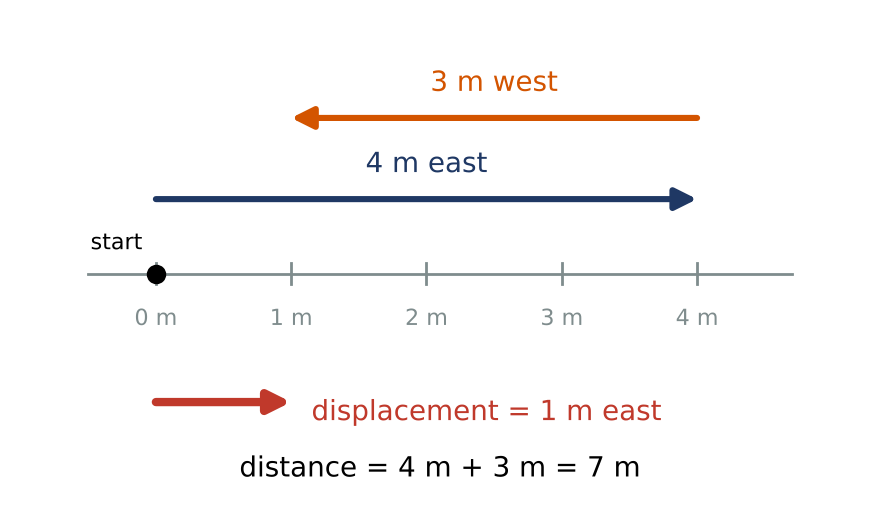
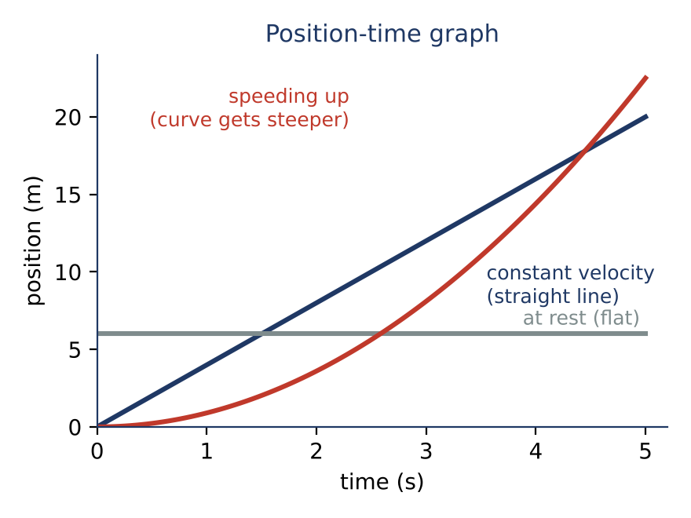
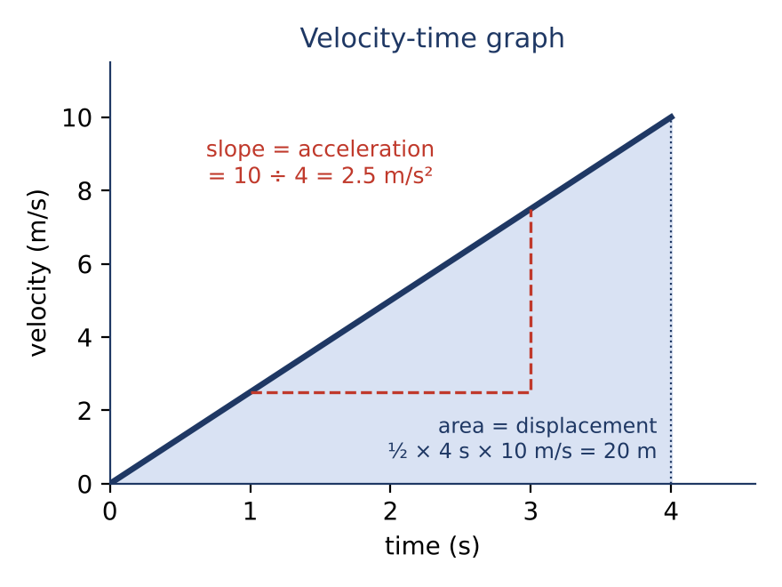
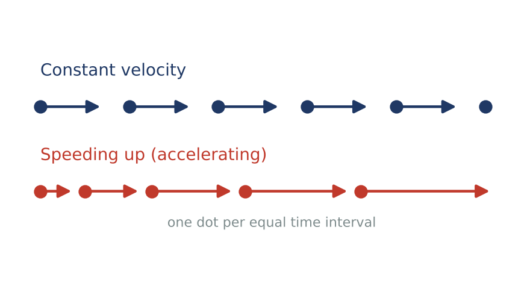
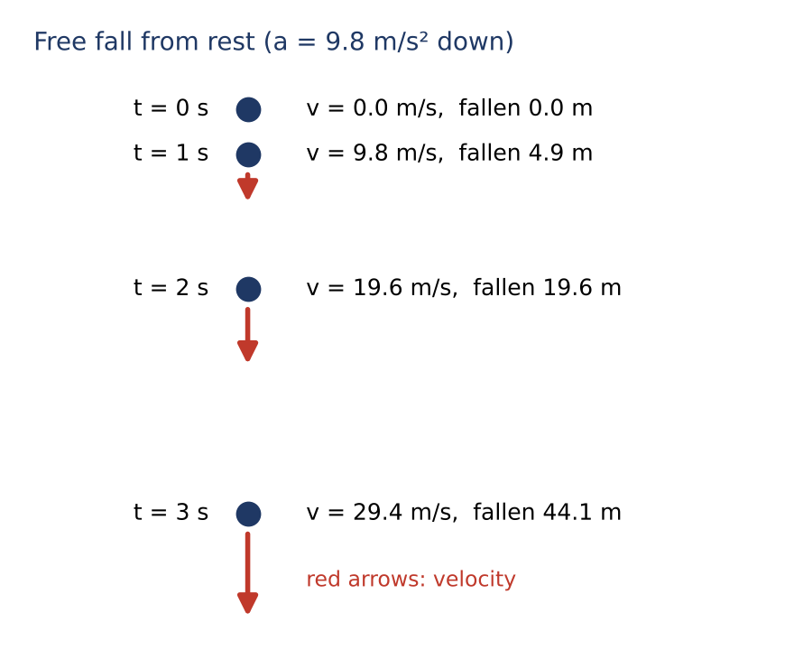

# Unit 1: Kinematics

**Pacing:** 4 weeks | **Essential question:** How can we describe and predict where an object will be and how fast it will be moving at any moment?

## Materials in this folder

- [ ] **Cornell notes** (Word, print-ready): [Cornell-Notes-Kinematics.docx](Cornell-Notes-Kinematics.docx)
- [ ] **Most-missed questions quiz** (interactive): [quizzes/index.html](../quizzes/index.html#kinematics), choose "Kinematics"
- [ ] **This outline**: key concepts, objectives, resources, practice problems, applications, assessment

## NGSS alignment (California, Physics in the Universe)

| Standard | How this unit addresses it |
|---|---|
| HS-PS2-1 (foundation) | Analyze data to support the claim that Newton's second law describes the relationship among net force, mass, and acceleration. Kinematics supplies the acceleration half of that claim. |
| SEP: Analyzing and interpreting data; Using mathematics and computational thinking | Build and read position-time and velocity-time graphs from lab data. |
| CCC: Patterns; Scale, proportion, and quantity | Linear vs. squared relationships (d grows with t²). |

## Key concepts to master

| Concept | What students need to know |
|---|---|
| **Scalars vs. vectors** | A scalar has size only (distance, speed, time). A vector has size and direction (displacement, velocity, acceleration). |
| **Distance vs. displacement** | Distance is the total path length. Displacement is the straight-line change in position, with direction. |
| **Speed vs. velocity** | Average speed = distance ÷ time. Average velocity = displacement ÷ time. |
| **Acceleration** | The rate at which velocity changes: a = Δv ÷ t. Speeding up, slowing down, and turning are all acceleration. |
| **Motion graphs** | Slope of position-time = velocity. Slope of velocity-time = acceleration. Area under velocity-time = displacement. |
| **Kinematic equations** | Four equations that link d, vi, vf, a, and t when acceleration is constant. |
| **Free fall** | Motion under gravity alone: a = 9.8 m/s² downward for every object, whatever its mass. |

## Learning objectives

Rate each objective 1 to 4 using the proficiency scale under Assessment. The target is 3 or higher on every objective.

| ID | Objective ("I can...") | Self-rating | Teacher rating |
|---|---|---|---|
| K1 | I can tell scalars from vectors and calculate distance, displacement, average speed, and average velocity. | | |
| K2 | I can calculate acceleration and say whether an object is speeding up or slowing down from the signs of v and a. | | |
| K3 | I can read and sketch position-time and velocity-time graphs, using slope and area. | | |
| K4 | I can choose and solve the right kinematic equation for a constant-acceleration problem. | | |
| K5 | I can solve free-fall problems and explain why all objects fall with the same acceleration without air resistance. | | |
| K6 | I can collect motion data in a lab, graph it, and state the relationship the graph shows. | | |

## Cornell notes outline

Each section of the notes lists cue questions to answer aloud from memory, worked examples, and matching IXL skills.

**1. Describing Motion**

- What is the difference between a scalar and a vector?
- How is distance different from displacement?
- How do you calculate average speed and average velocity?
- What is instantaneous velocity?

**2. Acceleration**

- What is acceleration and what are its units?
- What three things count as accelerating?
- How do the signs of v and a tell you whether an object speeds up or slows down?
- Can an object have zero velocity and still be accelerating?

**3. Motion Graphs**

- What does the slope of a position-time graph tell you?
- What does the slope of a velocity-time graph tell you?
- What does the area under a velocity-time graph tell you?
- How do you tell a position-time graph from a velocity-time graph before answering?

**4. Kinematic Equations**

- What are the four kinematic equations, and when do they apply?
- How do you choose which equation to use?
- How far does a car travel while accelerating from rest at 4.0 m/s² for 6.0 s?
- A car moving at 20 m/s brakes at −5.0 m/s². How far does it travel before stopping?

**5. Free Fall**

- What is free fall, and what is the acceleration of a free-falling object?
- How fast is a dropped object moving after 3.0 s, and how far has it fallen?
- A ball is thrown straight up at 19.6 m/s. How long does it take to reach the top, and how high does it go?
- Why do a heavy ball and a light ball dropped together land at the same time?

**6. Labs and Measurement**

- In the constant-velocity lab, what are the variables and what does the graph show?
- In the cart-on-a-ramp lab, how do you find the acceleration?
- How do you measure g in the free-fall lab?

## Visual memory aids

A walk 4 m east then 3 m west: the path is 7 m long, but the position changes by only 1 m east. **Rule:** distance = path length; displacement = final − initial position

Position-time graphs: a straight line is constant velocity, a flat line is at rest, a curve is accelerating. **Rule:** slope of position-time = velocity

Velocity-time graph: the slope is the acceleration and the shaded area is the displacement. **Rule:** slope = a; area = d (here ½ × 4 s × 10 m/s = 20 m)

Motion maps: evenly spaced dots mean constant velocity; dots spreading apart mean speeding up. **Rule:** equal time between dots; wider spacing = faster

Free fall from rest: velocity grows by 9.8 m/s each second and the distance fallen grows with t². **Rule:** v = g·t; d = ½·g·t²

## Most-missed questions

The [interactive quiz](../quizzes/index.html#kinematics) has one question for each of these common mistakes. Each explanation says why the tempting answer is wrong.

1. Mixing up speed and velocity
2. Thinking zero velocity means zero acceleration
3. Believing negative acceleration always means slowing down
4. Reading a position-time graph as a velocity-time graph
5. Reading a flat line as "at rest" on every graph
6. Thinking heavier objects fall faster
7. Thinking acceleration only means a change in speed
8. Using the final velocity instead of the average (or area)
9. Assuming stopping distance grows in step with speed
10. Assuming distance fallen grows in step with time

## Learning resources

| Resource | Use it for |
|---|---|
| [The Physics Classroom: 1-D Kinematics tutorial](https://www.physicsclassroom.com/class/1DKin) | Readable lessons that use the same vocabulary as these notes. |
| [The Physics Classroom: Concept Builders](https://www.physicsclassroom.com/Concept-Builders/Kinematics) | Short self-checking question sets on graphs and free fall. |
| [Khan Academy: High School Physics](https://www.khanacademy.org/science/highschool-physics) | Free videos and mastery practice. Open the unit on this topic. |
| [OpenStax Physics (high school), Chapters 2–3](https://openstax.org/details/books/physics) | Free textbook: Motion in One Dimension; Acceleration. |
| [PhET: The Moving Man](https://phet.colorado.edu/en/simulations/moving-man) | Drive a character and watch the position, velocity, and acceleration graphs draw live. |
| [IXL Physics, sections C and D](https://www.ixl.com/science/physics) | Skill practice; target SmartScore 80+. |

## Practice problems

Use g = 9.8 m/s² and ignore air resistance. Show the knowns, the equation, the substitution, and units.

1. A student walks 6.0 m north, then 8.0 m south, in 10 s. Find the distance, displacement, average speed, and average velocity.
2. A cyclist speeds up from 4.0 m/s to 12 m/s in 5.0 s. Find the acceleration and the distance covered.
3. A train moving at 30 m/s brakes at −1.5 m/s². How long does it take to stop, and how far does it travel?
4. A stone is dropped from a bridge and hits the water 2.5 s later. How high is the bridge, and how fast is the stone moving at impact?
5. A ball is thrown straight up at 14.7 m/s. Find the time to the top, the maximum height, and the total time in the air.
6. A velocity-time graph shows 6.0 m/s held constant for 3.0 s, then a steady decrease to 0 over the next 2.0 s. Find the total displacement and the acceleration during the last 2.0 s.

Answer key

1. Distance 14 m; displacement 2.0 m south; average speed 1.4 m/s; average velocity 0.20 m/s south.
2. a = 1.6 m/s²; d = ½(4.0 + 12)(5.0) = 40 m.
3. t = 20 s; d = 300 m.
4. h = ½(9.8)(2.5)² = 30.6 m (about 31 m); v = 24.5 m/s downward.
5. 1.5 s; 11.0 m; 3.0 s.
6. Area = 18 m + 6.0 m = 24 m; a = −3.0 m/s².

## Labs and investigations

- **In the constant-velocity lab, what are the variables and what does the graph show?** Lab: time a battery buggy (or a walking student) at marked positions along a track. Independent variable: time. Dependent variable: position. The position-time graph is a straight line. Its slope is the velocity: v = Δx ÷ Δt.
- **In the cart-on-a-ramp lab, how do you find the acceleration?** Lab: release a cart from rest and time it over several distances (or use a motion sensor). Formula: d = ½·a·t², so a = 2d ÷ t². A graph of d against t² is a straight line with slope ½·a. Controlled variables: ramp angle, the cart, the starting point.
- **How do you measure g in the free-fall lab?** Drop an object from a measured height h and time the fall (photogate, video frames, or picket fence). g = 2h ÷ t². Compare with 9.8 m/s² using percent error = |measured − accepted| ÷ accepted × 100. Run at least three trials and average them, because reaction time is the largest source of error with a hand stopwatch.

## Real-world applications

- Stopping distance and speed limits: braking distance grows with the square of speed, which is why school zones are 25 mph.
- Sports timing: sprint splits, pitch speed from radar, and hang time in basketball are all kinematics.
- Crash reconstruction: investigators use skid-mark length and vf² = vi² + 2ad to work out the speed before braking.
- Phone and car sensors: accelerometers measure acceleration and integrate it to track velocity and position.
- Amusement park drop towers: riders are in free fall for a known height, so engineers can predict the speed at the brakes.

## Assessment criteria

| Level | Meaning | Evidence |
|---|---|---|
| 4 Extends | Applies the idea to a new situation and explains the reasoning | Solves an unfamiliar problem or explains a classmate's error |
| 3 Meets | Meets the objective independently | Correct method and answer with units on quiz, test, or lab |
| 2 Approaching | Meets the objective with notes or hints | Sets up correctly but makes errors, or needs the worked example |
| 1 Beginning | Not yet able to start without help | Cannot yet choose a method |

**Unit completion checklist**

- [ ] Cornell notes complete; every cue question answered aloud from memory
- [ ] Each Visual Memory Aid redrawn from memory
- [ ] Most-missed questions quiz: 8 of 10 or better
- [ ] IXL Practice Plan (last page of the notes): SmartScore 80+ on every skill
- [ ] Practice problems: at least 5 of 6 correct with work shown
- [ ] Lab report submitted and scored 3 or higher on the lab rubric
- [ ] Unit test: 3 or higher on every objective

Rubrics for lab reports and design projects are in [ASSESSMENT.md](../ASSESSMENT.md).

**Not included in this unit:** Projectile motion (Physics E) and forces (Physics F) are left for Units 2 and 3.
