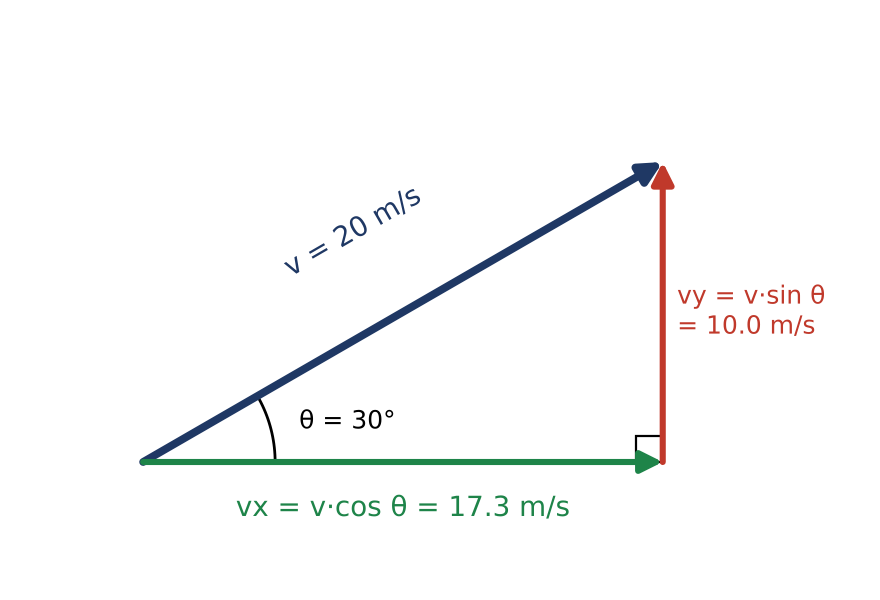
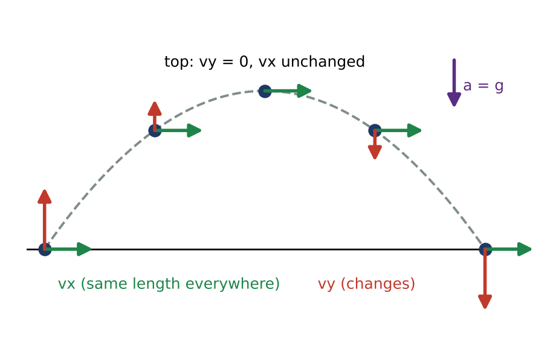
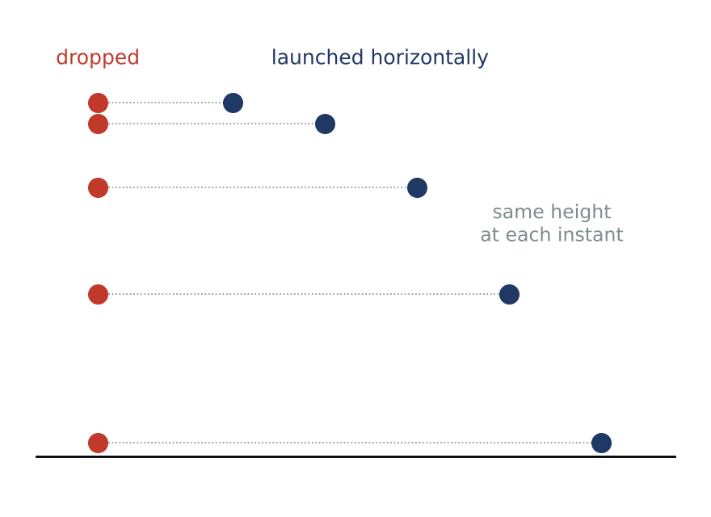
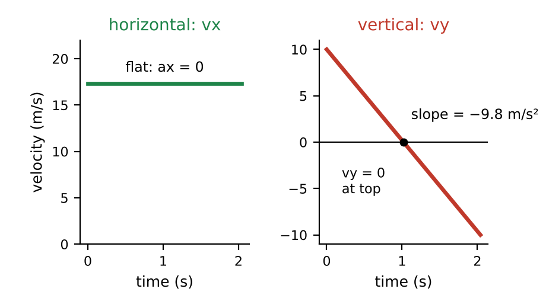
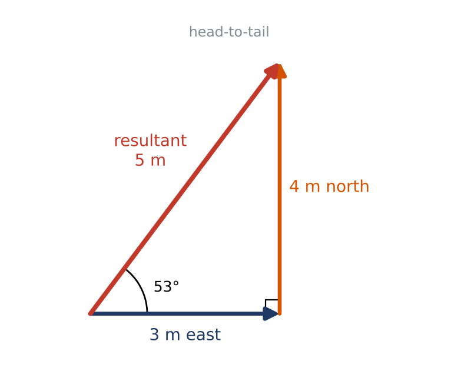

# Unit 2: Projectile Motion

**Pacing:** 3 weeks | **Essential question:** Why does a thrown object follow a curved path, and how can we predict where it will land?

## Materials in this folder

- [ ] **Cornell notes** (Word, print-ready): [Cornell-Notes-Projectile-Motion.docx](Cornell-Notes-Projectile-Motion.docx)
- [ ] **Most-missed questions quiz** (interactive): [quizzes/index.html](../quizzes/index.html#projectile-motion), choose "Projectile Motion"
- [ ] **This outline**: key concepts, objectives, resources, practice problems, applications, assessment

## NGSS alignment (California, Physics in the Universe)

| Standard | How this unit addresses it |
|---|---|
| HS-PS2-1 (foundation) | Projectile motion applies constant acceleration in two dimensions; it prepares students to connect net force (gravity) with acceleration. |
| HS-PS2-4 (connection) | Gravity as the single force acting on a projectile links to the later study of gravitational force. |
| SEP: Developing and using models; Using mathematics and computational thinking | Model 2-D motion as two independent 1-D motions and predict a landing point. |
| CCC: Cause and effect; Systems and system models | Gravity changes only the vertical motion. |

## Key concepts to master

| Concept | What students need to know |
|---|---|
| **Vector components** | Any vector can be split into a horizontal part and a vertical part: vx = v·cos θ, vy = v·sin θ. |
| **Resultant vectors** | Perpendicular vectors add with the Pythagorean theorem; the angle comes from inverse tangent. |
| **Projectile** | An object moving through the air with gravity as the only force acting on it. |
| **Independence of motion** | Horizontal and vertical motions do not affect each other. They share only the time. |
| **Horizontal motion** | Constant velocity: ax = 0, so x = vx·t. |
| **Vertical motion** | Free fall: ay = 9.8 m/s² downward, so the 1-D kinematic equations apply. |
| **Range and launch angle** | 45° gives the greatest range on level ground; complementary angles (such as 30° and 60°) give the same range. |

## Learning objectives

Rate each objective 1 to 4 using the proficiency scale under Assessment. The target is 3 or higher on every objective.

| ID | Objective ("I can...") | Self-rating | Teacher rating |
|---|---|---|---|
| P1 | I can resolve a vector into horizontal and vertical components and combine components into a resultant. | | |
| P2 | I can explain why horizontal and vertical motions are independent and name the only force on a projectile. | | |
| P3 | I can solve horizontally launched projectile problems for time, range, and impact velocity. | | |
| P4 | I can solve angle-launched projectile problems for time of flight, maximum height, and range. | | |
| P5 | I can predict a landing point from measurements and test the prediction in a lab. | | |

## Cornell notes outline

Each section of the notes lists cue questions to answer aloud from memory, worked examples, and matching IXL skills.

**1. Vectors and Components**

- How do you add two vectors that are at right angles?
- How do you find the horizontal and vertical components of a velocity?
- Which trig function goes with which component?

**2. What Makes a Projectile**

- What is the only force acting on a projectile?
- How do the horizontal and vertical motions of a projectile compare?
- A ball is dropped and another is launched horizontally from the same height at the same instant. Which lands first?
- What are the velocity and acceleration at the top of an angled launch?

**3. Horizontally Launched Projectiles**

- What are the starting conditions for a horizontal launch?
- A ball leaves a 19.6 m high cliff horizontally at 15 m/s. How long is it in the air and how far from the base does it land?
- How fast is that ball moving when it lands?
- If the ball is launched faster from the same height, what changes?

**4. Projectiles Launched at an Angle**

- What is the first step in any angled-launch problem?
- A ball is kicked at 20 m/s at 30° above level ground. How long is it in the air?
- How high does that ball rise and how far does it travel?
- Which launch angle gives the greatest range, and which angles tie?

**5. Labs and Measurement**

- In the marble-off-the-table lab, how do you predict the landing spot?
- What are the variables in the launch-angle lab?
- Why might the measured range be shorter than predicted?

## Visual memory aids

A launch velocity splits into a horizontal part and a vertical part that form a right triangle. **Rule:** vx = v·cos θ; vy = v·sin θ

Along the arc the horizontal velocity arrow never changes while the vertical arrow shrinks, reaches zero at the top, then grows downward. **Rule:** vx constant; vy changes by 9.8 m/s each second

Motion maps for a dropped ball and a horizontally launched ball: at every instant they are at the same height. **Rule:** same fall time: t = √(2h ÷ g)

Velocity-time graphs for a projectile: horizontal velocity is a flat line; vertical velocity is a straight line with slope −9.8 m/s². **Rule:** ax = 0; ay = −9.8 m/s²

Head-to-tail addition of 3 m east and 4 m north gives a 5 m resultant at 53° north of east. **Rule:** R = √(a² + b²); θ = tan⁻¹(opp ÷ adj)

## Most-missed questions

The [interactive quiz](../quizzes/index.html#projectile-motion) has one question for each of these common mistakes. Each explanation says why the tempting answer is wrong.

1. Thinking horizontal speed affects fall time
2. Thinking velocity is zero at the top of an arc
3. Thinking projectiles slow down horizontally on their own
4. Believing a "force of the throw" travels with the ball
5. Thinking a released object falls straight down
6. Assuming steeper (or flatter) is always farther
7. Missing that complementary angles give equal range
8. Thinking a faster launch means a longer (or shorter) fall
9. Using the horizontal speed in the vertical equation
10. Swapping sine and cosine

## Learning resources

| Resource | Use it for |
|---|---|
| [The Physics Classroom: Vectors - Motion and Forces in Two Dimensions](https://www.physicsclassroom.com/class/vectors) | Lessons 1 and 2 cover vectors and projectiles. |
| [PhET: Projectile Motion](https://phet.colorado.edu/en/simulations/projectile-motion) | Change angle, speed, and height; show velocity components along the path. |
| [Khan Academy: High School Physics](https://www.khanacademy.org/science/highschool-physics) | Free videos and mastery practice. Open the unit on this topic. |
| [OpenStax Physics (high school), Chapter 5](https://openstax.org/details/books/physics) | Motion in Two Dimensions: vector addition and projectile motion. |
| [IXL Physics, sections C and E; Precalculus section Y](https://www.ixl.com/science/physics) | Skill practice; target SmartScore 80+. |

## Practice problems

Use g = 9.8 m/s² and ignore air resistance. Show the knowns, the equation, the substitution, and units.

1. A hiker walks 6.0 km east and then 8.0 km north. Find the magnitude and direction of the displacement.
2. A soccer ball is kicked at 25 m/s at 37° above the horizontal. Find vx and viy. (Use cos 37° = 0.80, sin 37° = 0.60.)
3. A marble rolls off a 1.2 m high table at 3.0 m/s. How long is it in the air and how far from the table does it land?
4. A stone is thrown horizontally at 12 m/s from a 44.1 m cliff. Find the time of flight, the range, and the vertical velocity at impact.
5. A projectile is launched from level ground with vx = 20 m/s and viy = 15 m/s. Find the time of flight, maximum height, and range.
6. Two identical balls are launched at the same speed, one at 25° and one at 65°. Compare their ranges, heights, and times in the air.

Answer key

1. 10 km at 53° north of east.
2. vx = 20 m/s; viy = 15 m/s.
3. t = √(2 × 1.2 ÷ 9.8) = 0.49 s; x = 1.5 m.
4. t = 3.0 s; x = 36 m; vy = 29.4 m/s downward.
5. t = 2 × 15 ÷ 9.8 = 3.06 s; h = 15² ÷ 19.6 = 11.5 m; x = 61 m.
6. Same range (complementary angles). The 65° ball goes higher and stays in the air longer.

## Labs and investigations

- **In the marble-off-the-table lab, how do you predict the landing spot?** Measure the launch speed on the table: vx = distance ÷ time between two marks (or photogates). Measure the table height h and find the fall time: t = √(2h ÷ g). Predicted range: x = vx·t. Place a target there, then test.
- **What are the variables in the launch-angle lab?** Independent variable: launch angle. Dependent variable: range. Controlled: launch speed, launch height, the projectile. Expected result: range rises to a maximum near 45° and then falls; 30° and 60° land close together.
- **Why might the measured range be shorter than predicted?** Air resistance and friction on the ramp or launcher reduce the speed, and the marble may not leave exactly horizontally. Report percent error and name the likely source, not just "human error".

## Real-world applications

- Sports: a basketball shot, a football punt, a long jump, and a soccer free kick are all projectile problems; athletes trade hang time against range.
- Emergency and aid drops: aircraft must release supplies before they are over the target because the package keeps the plane's horizontal velocity.
- Firefighting: hose angle is adjusted to reach an upper floor or to reach farther across the ground.
- Space launch and orbits: a satellite is a projectile moving sideways fast enough that the ground curves away beneath it.
- Video-game and animation physics: engines update horizontal and vertical velocity separately each frame, exactly as in the two-column method.

## Assessment criteria

| Level | Meaning | Evidence |
|---|---|---|
| 4 Extends | Applies the idea to a new situation and explains the reasoning | Solves an unfamiliar problem or explains a classmate's error |
| 3 Meets | Meets the objective independently | Correct method and answer with units on quiz, test, or lab |
| 2 Approaching | Meets the objective with notes or hints | Sets up correctly but makes errors, or needs the worked example |
| 1 Beginning | Not yet able to start without help | Cannot yet choose a method |

**Unit completion checklist**

- [ ] Cornell notes complete; every cue question answered aloud from memory
- [ ] Each Visual Memory Aid redrawn from memory
- [ ] Most-missed questions quiz: 8 of 10 or better
- [ ] IXL Practice Plan (last page of the notes): SmartScore 80+ on every skill
- [ ] Practice problems: at least 5 of 6 correct with work shown
- [ ] Lab report submitted and scored 3 or higher on the lab rubric
- [ ] Unit test: 3 or higher on every objective

Rubrics for lab reports and design projects are in [ASSESSMENT.md](../ASSESSMENT.md).

**Not included in this unit:** Precalculus Y.6, Y.8, and Y.10–14 (parallelogram method, subtraction, scalar multiples, unit vectors) are not needed for projectile problems. Circular motion (Physics I) is outside this semester's list.
