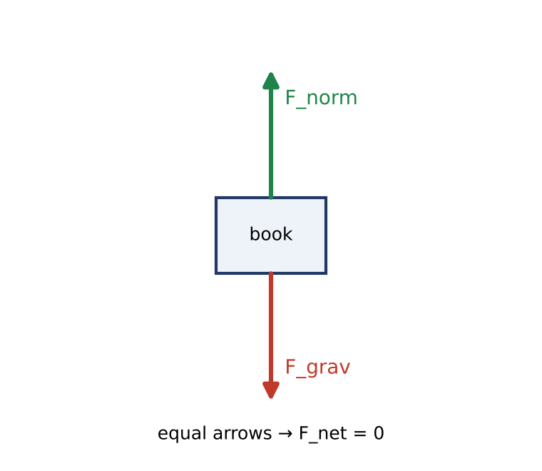
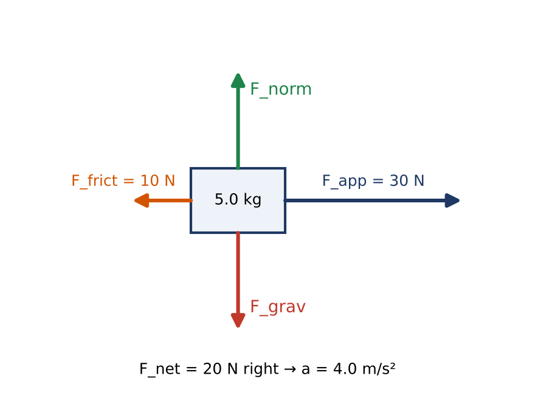
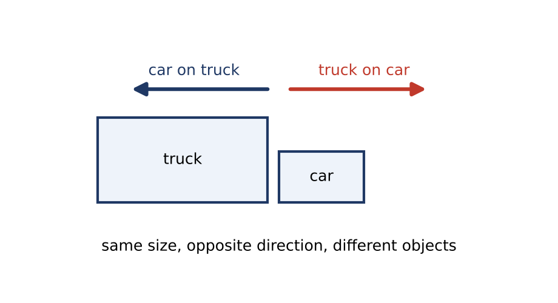
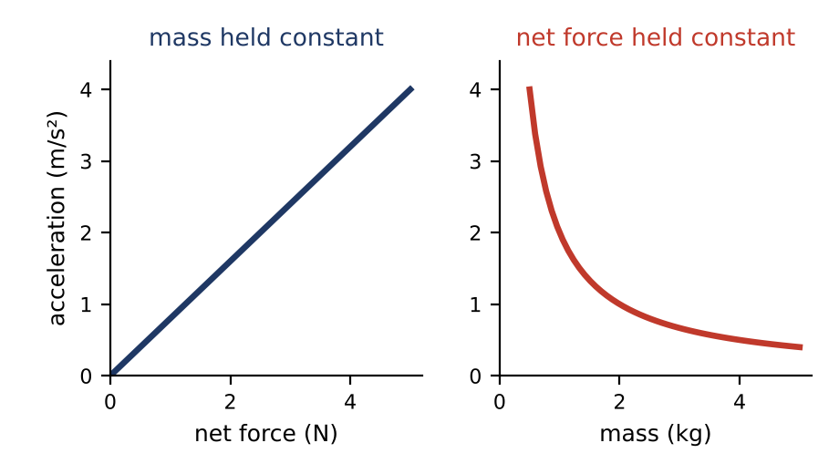
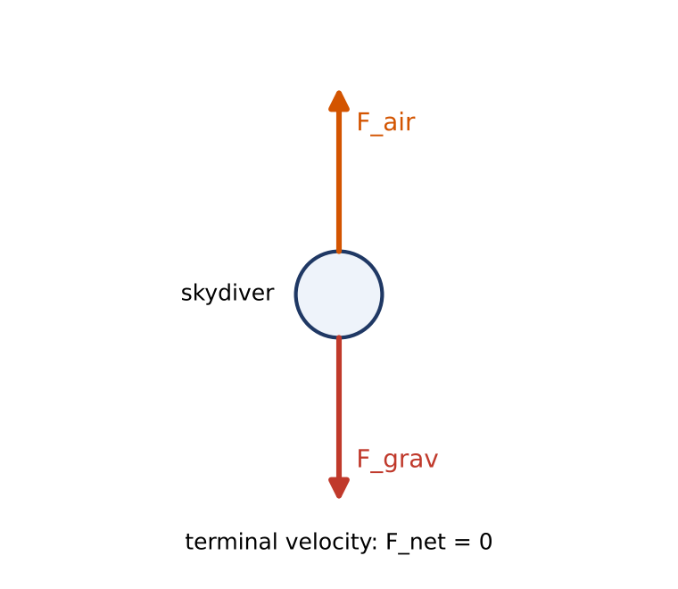

# Unit 3: Newton's Laws

**Pacing:** 4 weeks | **Essential question:** What makes an object change its motion, and how can we predict how much it will change?

## Materials in this folder

- [ ] **Cornell notes** (Word, print-ready): [Cornell-Notes-Newtons-Laws.docx](Cornell-Notes-Newtons-Laws.docx)
- [ ] **Most-missed questions quiz** (interactive): [quizzes/index.html](../quizzes/index.html#newtons-laws), choose "Newton's Laws"
- [ ] **This outline**: key concepts, objectives, resources, practice problems, applications, assessment

## NGSS alignment (California, Physics in the Universe)

| Standard | How this unit addresses it |
|---|---|
| HS-PS2-1 | Analyze data to support the claim that Newton's second law of motion describes the mathematical relationship among the net force on a macroscopic object, its mass, and its acceleration. |
| HS-PS2-4 (connection) | Weight as the gravitational force on an object (F_grav = m·g) introduces Newton's law of gravitation. |
| SEP: Analyzing and interpreting data; Planning and carrying out investigations | Cart-and-hanging-mass investigation of a vs. F_net and a vs. m. |
| CCC: Cause and effect | Net force causes acceleration; balanced forces cause no change in motion. |

## Key concepts to master

| Concept | What students need to know |
|---|---|
| **Force** | A push or pull, measured in newtons (N). A vector. |
| **Free-body diagram** | A sketch of one object showing every force on it as a labeled arrow. |
| **Net force** | The vector sum of all forces on an object. Net force, not any single force, decides the acceleration. |
| **Inertia (first law)** | Objects keep their velocity unless a net force acts. More mass means more inertia. |
| **Second law** | a = F_net ÷ m. Acceleration is proportional to net force and inversely proportional to mass. |
| **Mass vs. weight** | Mass is the amount of matter (kg). Weight is the force of gravity on it: F_grav = m·g (N). |
| **Friction** | A contact force opposing sliding: F_frict = μ·F_norm. |
| **Third law** | Forces come in pairs: equal in size, opposite in direction, acting on two different objects. |

## Learning objectives

Rate each objective 1 to 4 using the proficiency scale under Assessment. The target is 3 or higher on every objective.

| ID | Objective ("I can...") | Self-rating | Teacher rating |
|---|---|---|---|
| N1 | I can identify the forces on an object and draw a correct free-body diagram. | | |
| N2 | I can use Newton's first law to explain the motion of objects with balanced forces. | | |
| N3 | I can find the net force and use F_net = m·a to solve for force, mass, or acceleration. | | |
| N4 | I can tell mass from weight and calculate weight, normal force, and friction. | | |
| N5 | I can identify action-reaction pairs and explain why they do not cancel. | | |
| N6 | I can analyze lab data to support the claim that a = F_net ÷ m (HS-PS2-1). | | |

## Cornell notes outline

Each section of the notes lists cue questions to answer aloud from memory, worked examples, and matching IXL skills.

**1. Forces and Free-Body Diagrams**

- What forces should you look for on an object?
- How do you draw a free-body diagram?
- What is the difference between mass and weight?
- Which object exerts the normal force, and is it always equal to the weight?

**2. Newton's First Law (Inertia)**

- What does Newton's first law say?
- What is inertia and what does it depend on?
- Does an object need a force to keep moving?
- If an object moves at constant velocity, what must be true about the forces on it?

**3. Newton's Second Law (F_net = m·a)**

- What does Newton's second law say?
- How do you find the net force?
- A 5.0 kg box is pushed with 30 N against 10 N of friction. What is its acceleration?
- A 60 kg person stands on a scale in an elevator accelerating upward at 2.0 m/s². What does the scale read?

**4. Friction**

- How do you calculate the friction force?
- What is the difference between static and kinetic friction?
- A 10 kg crate is pushed with 50 N across a floor where μ = 0.30. What is its acceleration?

**5. Newton's Third Law (Action-Reaction)**

- What does Newton's third law say?
- How do you name the partner of a force?
- Why do action-reaction forces not cancel?
- In a collision between a truck and a small car, which exerts the larger force?

**6. Labs and Measurement**

- In the second-law cart lab, how is acceleration tested against force?
- How is acceleration tested against mass?
- How do you measure the coefficient of friction?

## Visual memory aids

A book at rest on a table: the normal force and gravity are equal and opposite, so the net force is zero. **Rule:** F_net = 0 → constant velocity (or at rest)

A box pushed with 30 N against 10 N of friction: the leftover 20 N forward causes the acceleration. **Rule:** a = F_net ÷ m = 20 N ÷ 5.0 kg = 4.0 m/s²

A truck and a car collide: the force on the car and the force on the truck are the same size, on different objects. **Rule:** F(A on B) = −F(B on A)

Lab graphs: acceleration rises in a straight line with net force, and falls as a curve when mass increases. **Rule:** a ∝ F_net; a ∝ 1 ÷ m

A skydiver at terminal velocity: air resistance has grown to equal gravity, so the velocity stops changing. **Rule:** F_air = F_grav → F_net = 0

## Most-missed questions

The [interactive quiz](../quizzes/index.html#newtons-laws) has one question for each of these common mistakes. Each explanation says why the tempting answer is wrong.

1. Thinking the bigger or faster object pushes harder
2. Thinking a moving object needs a net forward force
3. Believing motion needs a force to keep going
4. Thinking "at rest" means "no forces"
5. Treating mass and weight as the same thing
6. Thinking third-law pairs cancel
7. Linking force to the direction of motion instead of acceleration
8. Applying only half of a = F ÷ m
9. Thinking zero velocity means zero net force
10. Thinking falling always means a net downward force

## Learning resources

| Resource | Use it for |
|---|---|
| [The Physics Classroom: Newton's Laws tutorial](https://www.physicsclassroom.com/class/newtlaws) | Four lessons matching the sections of these notes. |
| [PhET: Forces and Motion: Basics](https://phet.colorado.edu/en/simulations/forces-and-motion-basics) | Net force, friction, and acceleration with live free-body arrows. |
| [Khan Academy: High School Physics](https://www.khanacademy.org/science/highschool-physics) | Free videos and mastery practice. Open the unit on this topic. |
| [OpenStax Physics (high school), Chapter 4](https://openstax.org/details/books/physics) | Forces and Newton's Laws of Motion. |
| [IXL Physics, section F; Grade 8, section I](https://www.ixl.com/science/physics) | Skill practice; target SmartScore 80+. |

## Practice problems

Use g = 9.8 m/s² and ignore air resistance. Show the knowns, the equation, the substitution, and units.

1. A 1200 kg car accelerates at 2.5 m/s². What net force acts on it?
2. A 4.0 kg block is pulled right with 26 N while friction of 6.0 N acts left. Find the net force and the acceleration.
3. What is the weight of a 75 kg astronaut on Earth and on Mars (g = 3.7 m/s²)?
4. A 20 kg sled is pulled at constant velocity across snow with a horizontal force of 39.2 N. Find the friction force and the coefficient of kinetic friction.
5. A 50 kg student stands on a scale in an elevator accelerating downward at 1.5 m/s². What does the scale read?
6. A 70 kg skater pushes a 35 kg skater with a force of 105 N. Find the force on each skater and each skater's acceleration during the push.

Answer key

1. 3000 N.
2. F_net = 20 N right; a = 5.0 m/s² right.
3. 735 N on Earth; about 278 N on Mars. Mass is 75 kg in both places.
4. F_frict = 39.2 N (balanced forces); F_norm = 196 N; μ = 0.20.
5. F_norm = m(g − a) = 50 × 8.3 = 415 N.
6. 105 N on each, in opposite directions. 70 kg skater: 1.5 m/s². 35 kg skater: 3.0 m/s².

## Labs and investigations

- **In the second-law cart lab, how is acceleration tested against force?** Setup: a cart on a level track is pulled by a string over a pulley to a hanging mass. Independent variable: net force (the weight of the hanging mass, m_hang·g). Dependent variable: acceleration. Controlled: total mass of the system (move masses from the cart to the hanger). Result: a graph of a against F_net is a straight line through the origin. Slope = 1 ÷ mass.
- **How is acceleration tested against mass?** Keep the hanging mass fixed and add mass to the cart. Independent variable: total mass. Dependent variable: acceleration. Result: a against m is a falling curve; a against 1 ÷ m is a straight line. Acceleration is inversely proportional to mass.
- **How do you measure the coefficient of friction?** Pull a block at constant velocity with a spring scale. At constant velocity, the scale reading equals F_frict. μ = F_frict ÷ F_norm, with F_norm = m·g on a level surface.

## Real-world applications

- Seat belts and headrests: the first law in action. Your body keeps moving when the car stops, and stays put when the car is hit from behind.
- Rocket launches: exhaust gas is pushed down and the rocket is pushed up (third law); acceleration grows as fuel mass burns away (second law).
- Anti-lock brakes and tire tread: both are designed around the difference between static and kinetic friction.
- Elevators and scales: apparent weight changes with acceleration, the same effect astronauts feel at launch.
- Skydiving and parachutes: terminal velocity is reached when air resistance balances weight.

## Assessment criteria

| Level | Meaning | Evidence |
|---|---|---|
| 4 Extends | Applies the idea to a new situation and explains the reasoning | Solves an unfamiliar problem or explains a classmate's error |
| 3 Meets | Meets the objective independently | Correct method and answer with units on quiz, test, or lab |
| 2 Approaching | Meets the objective with notes or hints | Sets up correctly but makes errors, or needs the worked example |
| 1 Beginning | Not yet able to start without help | Cannot yet choose a method |

**Unit completion checklist**

- [ ] Cornell notes complete; every cue question answered aloud from memory
- [ ] Each Visual Memory Aid redrawn from memory
- [ ] Most-missed questions quiz: 8 of 10 or better
- [ ] IXL Practice Plan (last page of the notes): SmartScore 80+ on every skill
- [ ] Practice problems: at least 5 of 6 correct with work shown
- [ ] Lab report submitted and scored 3 or higher on the lab rubric
- [ ] Unit test: 3 or higher on every objective

Rubrics for lab reports and design projects are in [ASSESSMENT.md](../ASSESSMENT.md).

**Not included in this unit:** Circular motion and universal gravitation (Physics I) and Hooke's law (Physics K) are not part of this unit. Grade 8 I.7 (collisions and car safety) is placed in Unit 4.
