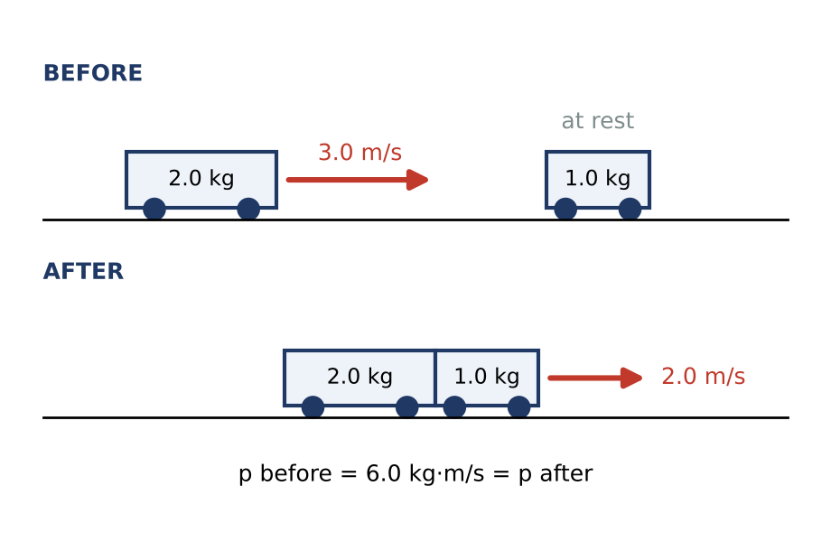
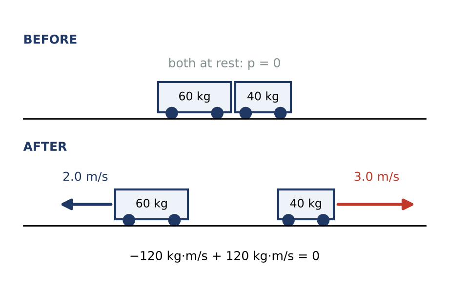
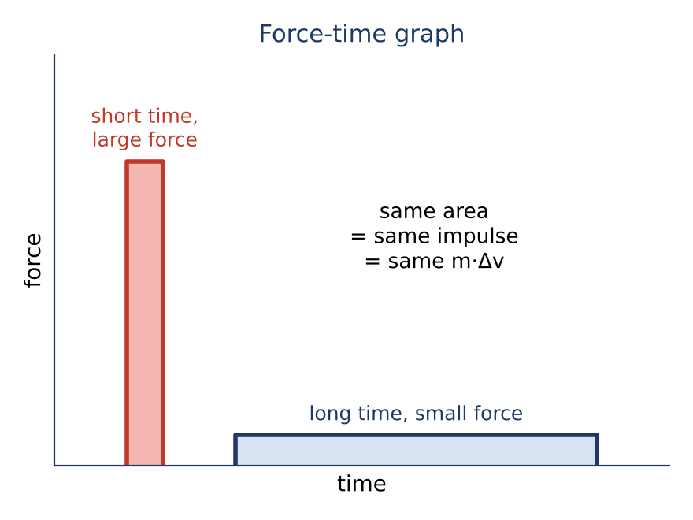
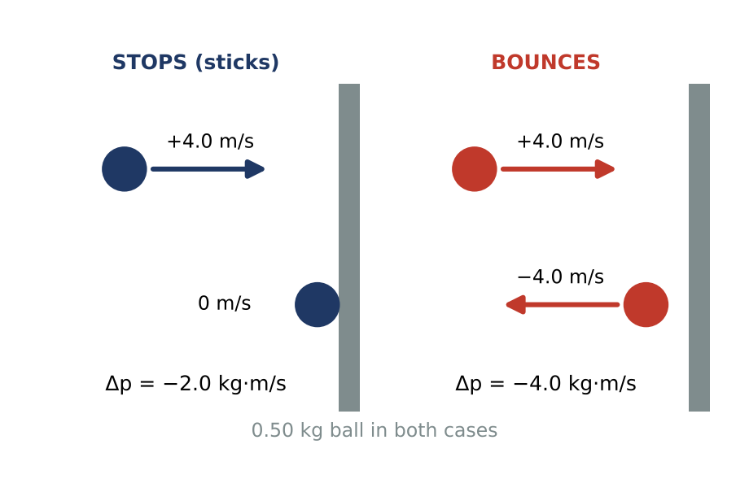

# Unit 4: Momentum

**Pacing:** 3 weeks | **Essential question:** Why are some collisions more damaging than others, and what stays the same when objects collide?

## Materials in this folder

- [ ] **Cornell notes** (Word, print-ready): [Cornell-Notes-Momentum.docx](Cornell-Notes-Momentum.docx)
- [ ] **Most-missed questions quiz** (interactive): [quizzes/index.html](../quizzes/index.html#momentum), choose "Momentum"
- [ ] **This outline**: key concepts, objectives, resources, practice problems, applications, assessment

## NGSS alignment (California, Physics in the Universe)

| Standard | How this unit addresses it |
|---|---|
| HS-PS2-2 | Use mathematical representations to support the claim that the total momentum of a system of objects is conserved when there is no net force on the system. |
| HS-PS2-3 | Apply scientific and engineering ideas to design, evaluate, and refine a device that minimizes the force on a macroscopic object during a collision. |
| HS-ETS1-2 / HS-ETS1-3 | Break a design problem into smaller parts and evaluate solutions against criteria and trade-offs (egg-drop or crash-cushion design). |
| CCC: Systems and system models | Define the system so that outside forces are negligible, then track momentum before and after. |

## Key concepts to master

| Concept | What students need to know |
|---|---|
| **Momentum** | p = m·v. A vector in the direction of the velocity, measured in kg·m/s. |
| **Impulse** | Force multiplied by the time it acts: J = F·t, in N·s. |
| **Impulse-momentum theorem** | Impulse equals the change in momentum: F·t = m·Δv. |
| **Force-time trade-off** | For the same change in momentum, a longer stopping time means a smaller force. |
| **Conservation of momentum** | In an isolated system the total momentum before an interaction equals the total momentum after. |
| **Collision types** | Elastic: objects bounce and kinetic energy is conserved. Inelastic: kinetic energy is not conserved. Perfectly inelastic: objects stick together. |
| **Recoil and explosions** | Objects that start at rest and push apart leave with equal and opposite momenta. |

## Learning objectives

Rate each objective 1 to 4 using the proficiency scale under Assessment. The target is 3 or higher on every objective.

| ID | Objective ("I can...") | Self-rating | Teacher rating |
|---|---|---|---|
| M1 | I can calculate momentum and compare the momenta of different objects, including direction. | | |
| M2 | I can use F·t = m·Δv to find force, time, or change in velocity. | | |
| M3 | I can explain how increasing collision time reduces force, and apply this to safety design (HS-PS2-3). | | |
| M4 | I can use conservation of momentum to solve collision and recoil problems (HS-PS2-2). | | |
| M5 | I can classify collisions as elastic or inelastic and say what happens to kinetic energy. | | |
| M6 | I can design, test, and refine a device that reduces collision force, and justify it with impulse. | | |

## Cornell notes outline

Each section of the notes lists cue questions to answer aloud from memory, worked examples, and matching IXL skills.

**1. Momentum**

- What is momentum and how do you calculate it?
- Which has more momentum: a 1000 kg truck at 1 m/s or a 0.010 kg bullet at 500 m/s?
- How is momentum different from inertia and from kinetic energy?

**2. Impulse and Changing Momentum**

- What is impulse and how is it related to momentum?
- How do airbags, crumple zones, and padding reduce injury?
- Which involves the larger impulse: a ball that bounces off a wall or one that sticks to it?

**3. Conservation of Momentum**

- What does the law of conservation of momentum say?
- Why is momentum conserved in a collision?
- A 2.0 kg cart moving at 3.0 m/s hits a 1.0 kg cart at rest and they stick. What is their velocity afterward?
- Two identical carts move toward each other at the same speed and stick together. What happens?

**4. Collisions and Recoil**

- What is the difference between elastic and inelastic collisions?
- In the sticking-carts example, how much kinetic energy is lost?
- A 60 kg skater and a 40 kg skater at rest push apart. The 40 kg skater moves at 3.0 m/s. How fast does the 60 kg skater move?

**5. Labs and Measurement**

- In the cart-collision lab, what do you measure and what should you find?
- What are the variables in the collision lab?
- In the egg-drop (collision-cushion) design challenge, what physics guides the design?

## Visual memory aids

Before and after a sticking collision: a 2.0 kg cart at 3.0 m/s joins a 1.0 kg cart at rest, and both move off at 2.0 m/s. **Rule:** m₁·v₁ + m₂·v₂ = (m₁ + m₂)·v′

Two skaters at rest push apart: their momenta are equal and opposite, so the total stays zero. **Rule:** 0 = m₁·v₁′ + m₂·v₂′

Force-time graphs for the same stop: a short hard hit and a long gentle one have the same area. **Rule:** impulse = area = F·t = m·Δv

A ball that rebounds has its velocity reversed, so its change in momentum is larger than for a ball that stops. **Rule:** Δp = m·(vf − vi), with signs

## Most-missed questions

The [interactive quiz](../quizzes/index.html#momentum) has one question for each of these common mistakes. Each explanation says why the tempting answer is wrong.

1. Thinking a dead stop is the biggest possible change
2. Thinking safety devices reduce impulse or momentum change
3. Thinking the bigger object has the bigger momentum change
4. Thinking momentum is lost in inelastic collisions
5. Forgetting that the combined mass moves afterward
6. Treating momentum as a scalar
7. Ignoring direction when subtracting velocities
8. Judging momentum by speed alone
9. Thinking the heavier object gets less momentum
10. Confusing momentum (m·v) with kinetic energy (½·m·v²)

## Learning resources

| Resource | Use it for |
|---|---|
| [The Physics Classroom: Momentum and Its Conservation](https://www.physicsclassroom.com/class/momentum) | Lesson 1 covers impulse; Lesson 2 covers conservation and collisions. |
| [PhET: Collision Lab](https://phet.colorado.edu/en/simulations/collision-lab) | Set masses, velocities, and elasticity; momentum and kinetic energy are tallied live. |
| [Khan Academy: High School Physics](https://www.khanacademy.org/science/highschool-physics) | Free videos and mastery practice. Open the unit on this topic. |
| [OpenStax Physics (high school), Chapter 8](https://openstax.org/details/books/physics) | Momentum: impulse, conservation, elastic and inelastic collisions. |
| [IXL Physics, section G; Grade 8 I.7](https://www.ixl.com/science/physics) | Skill practice; target SmartScore 80+. |

## Practice problems

Use g = 9.8 m/s² and ignore air resistance. Show the knowns, the equation, the substitution, and units.

1. Find the momentum of a 0.145 kg baseball thrown at 40 m/s.
2. A 1500 kg car slows from 30 m/s to 10 m/s in 5.0 s. Find the change in momentum and the average braking force.
3. A 0.060 kg tennis ball arrives at 30 m/s and leaves the racket at 40 m/s in the opposite direction. Contact lasts 0.0050 s. Find the average force.
4. A 3.0 kg cart moving at 4.0 m/s collides with and sticks to a 1.0 kg cart at rest. Find the final velocity and the kinetic energy lost.
5. A 0.050 kg bullet is fired at 300 m/s from a 3.0 kg rifle at rest. Find the recoil velocity of the rifle.
6. A 1000 kg car moving east at 20 m/s collides head-on with a 2000 kg truck moving west at 10 m/s. They lock together. What is their velocity after the collision?

Answer key

1. 5.8 kg·m/s in the direction of the throw.
2. Δp = −30,000 kg·m/s; F = −6000 N (6000 N opposite the motion).
3. Δv = 70 m/s; Δp = 4.2 kg·m/s; F = 840 N.
4. v = 3.0 m/s; KE before 24 J, after 18 J; 6.0 J lost.
5. −5.0 m/s (5.0 m/s opposite the bullet).
6. Total momentum = 20,000 − 20,000 = 0, so they are at rest.

## Labs and investigations

- **In the cart-collision lab, what do you measure and what should you find?** Measure each cart's mass and its velocity before and after the collision (photogates, motion sensor, or video). Calculate p = m·v for each cart, with signs for direction, and add them. Expected result: total momentum before ≈ total momentum after. Report the percent difference; track friction is the main error source.
- **What are the variables in the collision lab?** Independent variable: the masses or starting velocities you choose. Dependent variable: the velocities after the collision. Controlled: a level track and the same carts and bumpers.
- **In the egg-drop (collision-cushion) design challenge, what physics guides the design?** The egg's change in momentum is set by the drop height. The device must increase the stopping time and spread the force. Criteria: the egg survives. Constraints: mass, size, materials, cost. Test, record what failed, change one feature, and retest. Explain each change using F·t = m·Δv.

## Real-world applications

- Vehicle safety: airbags, crumple zones, seat belts that stretch, and highway crash barrels all lengthen stopping time.
- Sports: follow-through in batting or golf lengthens contact time to increase impulse; catching with "soft hands" lowers the force.
- Helmets and packaging: foam crushes to spread the stop over more time and area.
- Rockets and jets: exhaust momentum backward equals vehicle momentum forward.
- Crash investigation: conservation of momentum lets investigators work backward from where vehicles ended up to how fast they were going.

## Assessment criteria

| Level | Meaning | Evidence |
|---|---|---|
| 4 Extends | Applies the idea to a new situation and explains the reasoning | Solves an unfamiliar problem or explains a classmate's error |
| 3 Meets | Meets the objective independently | Correct method and answer with units on quiz, test, or lab |
| 2 Approaching | Meets the objective with notes or hints | Sets up correctly but makes errors, or needs the worked example |
| 1 Beginning | Not yet able to start without help | Cannot yet choose a method |

**Unit completion checklist**

- [ ] Cornell notes complete; every cue question answered aloud from memory
- [ ] Each Visual Memory Aid redrawn from memory
- [ ] Most-missed questions quiz: 8 of 10 or better
- [ ] IXL Practice Plan (last page of the notes): SmartScore 80+ on every skill
- [ ] Practice problems: at least 5 of 6 correct with work shown
- [ ] Lab report submitted and scored 3 or higher on the lab rubric
- [ ] Unit test: 3 or higher on every objective

Rubrics for lab reports and design projects are in [ASSESSMENT.md](../ASSESSMENT.md).

**Not included in this unit:** Two-dimensional collisions are left out; this course treats collisions along a line. IXL Physics "Calculate linear momentum and impulse" is marked New on the live page and has no number yet.
