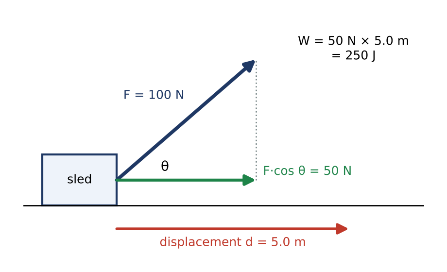
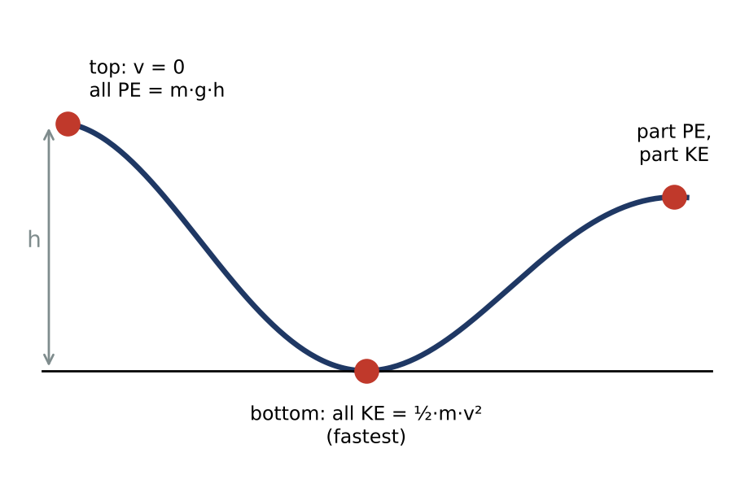
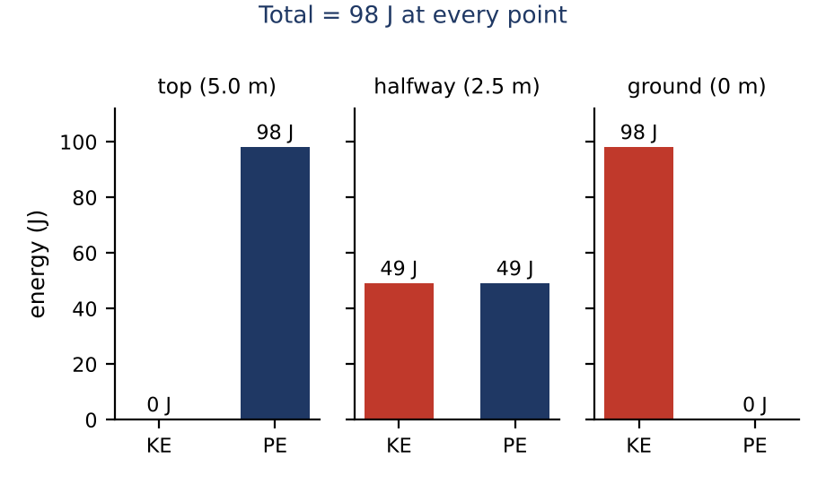
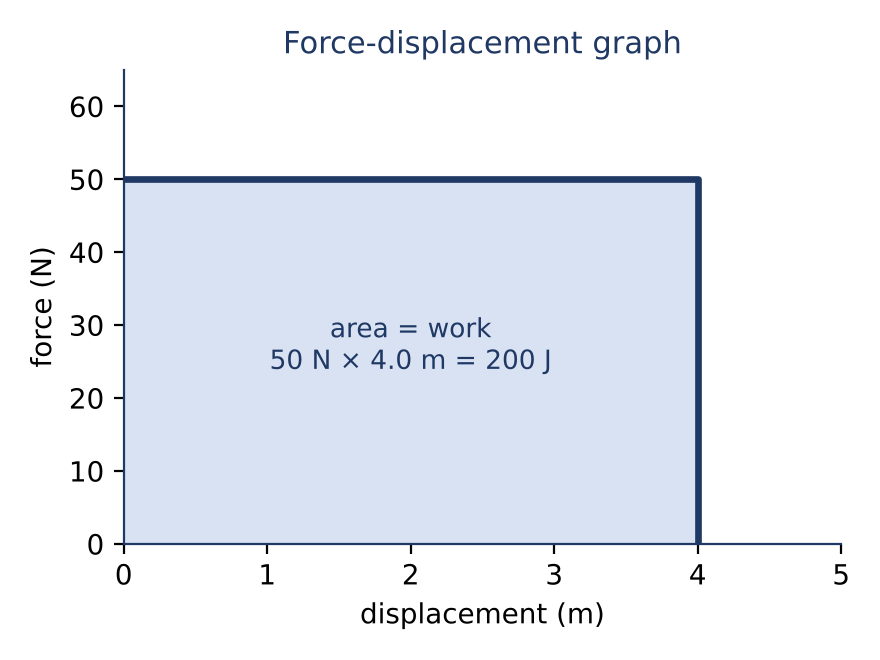
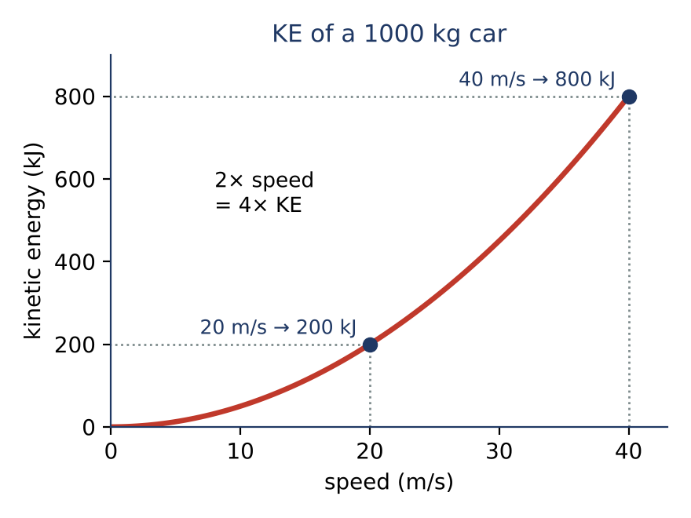

# Unit 5: Work and Energy

**Pacing:** 4 weeks | **Essential question:** Where does energy go when things speed up, slow down, rise, or fall, and how can tracking it let us predict motion?

## Materials in this folder

- [ ] **Cornell notes** (Word, print-ready): [Cornell-Notes-Work-and-Energy.docx](Cornell-Notes-Work-and-Energy.docx)
- [ ] **Most-missed questions quiz** (interactive): [quizzes/index.html](../quizzes/index.html#work-and-energy), choose "Work and Energy"
- [ ] **This outline**: key concepts, objectives, resources, practice problems, applications, assessment

## NGSS alignment (California, Physics in the Universe)

| Standard | How this unit addresses it |
|---|---|
| HS-PS3-1 | Create a computational model to calculate the change in the energy of one component in a system when the change in energy of the other component(s) and energy flows in and out of the system are known. |
| HS-PS3-2 | Develop and use models to illustrate that energy at the macroscopic scale can be accounted for as a combination of energy associated with the motions of particles (objects) and energy associated with the relative positions of particles (objects). |
| HS-PS3-3 | Design, build, and refine a device that works within given constraints to convert one form of energy into another form of energy. |
| CCC: Energy and matter; Systems and system models | Energy is never created or destroyed; it moves between objects and changes form. |

## Key concepts to master

| Concept | What students need to know |
|---|---|
| **Work** | Energy transferred by a force acting through a displacement: W = F·d·cos θ, in joules (J). |
| **Kinetic energy** | Energy of motion: KE = ½·m·v². |
| **Work-energy theorem** | The net work done on an object equals its change in kinetic energy. |
| **Gravitational potential energy** | Stored energy of height: PE = m·g·h. |
| **Elastic potential energy** | Stored energy of a stretched or compressed spring: PE = ½·k·x². |
| **Conservation of energy** | Total energy stays constant. Without friction, KE + PE at the start equals KE + PE at the end. |
| **Power** | The rate of doing work: P = W ÷ t, in watts (W). |

## Learning objectives

Rate each objective 1 to 4 using the proficiency scale under Assessment. The target is 3 or higher on every objective.

| ID | Objective ("I can...") | Self-rating | Teacher rating |
|---|---|---|---|
| E1 | I can decide whether a force does work and calculate the work, including at an angle. | | |
| E2 | I can calculate kinetic energy and use the work-energy theorem. | | |
| E3 | I can calculate gravitational and elastic potential energy. | | |
| E4 | I can use conservation of energy and energy bar charts to predict speeds and heights (HS-PS3-1, HS-PS3-2). | | |
| E5 | I can account for energy transformed to thermal energy by friction. | | |
| E6 | I can calculate power and compare the power of different processes. | | |
| E7 | I can design, build, and refine a device that converts energy from one form to another (HS-PS3-3). | | |

## Cornell notes outline

Each section of the notes lists cue questions to answer aloud from memory, worked examples, and matching IXL skills.

**1. Work**

- What is work in physics and how do you calculate it?
- When does a force do zero work?
- A sled is pulled 5.0 m with a 100 N rope angled 60° above the ground. How much work is done?
- What is negative work?

**2. Kinetic Energy and the Work-Energy Theorem**

- What is kinetic energy and how do you calculate it?
- What happens to kinetic energy when speed doubles?
- What does the work-energy theorem say?

**3. Potential Energy**

- What is gravitational potential energy and how do you calculate it?
- Does the path taken to a height change the potential energy?
- What is elastic potential energy?

**4. Conservation of Energy**

- What does the law of conservation of energy say?
- A roller coaster starts from rest at the top of a 20 m hill. How fast is it moving at the bottom (no friction)?
- A 2.0 kg ball is dropped from 5.0 m. How is its energy divided halfway down, and how fast is it moving at the ground?
- Where does the energy go when friction acts?

**5. Power**

- What is power and how do you calculate it?
- Two students climb the same stairs. One takes half the time. How do their work and power compare?
- A 60 kg student climbs 3.0 m of stairs in 4.0 s. What is the student's power?

**6. Labs and Measurement**

- In the ramp (or pendulum) energy lab, what do you compare?
- How do you measure your own power in the stair-climb lab?
- In the energy-conversion design project, what must the report show?

## Visual memory aids

A force at an angle: only the component along the displacement does work. **Rule:** W = F·d·cos θ

A frictionless roller coaster: energy shifts from potential at the top to kinetic at the bottom, and the total is constant. **Rule:** m·g·h = ½·m·v² → v = √(2·g·h)

Energy bar charts for a 2.0 kg ball dropped from 5.0 m: the bars change, the total stays at 98 J. **Rule:** KE + PE = constant (no friction)

Force-displacement graph: the area under the line is the work done. **Rule:** W = area = F × d

Kinetic energy against speed is a curve: doubling the speed gives four times the kinetic energy. **Rule:** KE = ½·m·v²

## Most-missed questions

The [interactive quiz](../quizzes/index.html#work-and-energy) has one question for each of these common mistakes. Each explanation says why the tempting answer is wrong.

1. Equating effort or tiredness with work
2. Multiplying any force by any distance
3. Thinking kinetic energy grows in step with speed
4. Thinking a steeper path gives a faster final speed
5. Thinking more mass means more speed at the bottom
6. Thinking energy is used up or disappears
7. Mixing up where KE and PE are largest
8. Confusing work with power
9. Assuming speed and energy change in the same proportion
10. Thinking work is always positive

## Learning resources

| Resource | Use it for |
|---|---|
| [The Physics Classroom: Work, Energy, and Power](https://www.physicsclassroom.com/class/energy) | Lesson 1 covers work, energy forms, and power; Lesson 2 covers the work-energy relationship and bar charts. |
| [PhET: Energy Skate Park](https://phet.colorado.edu/en/simulations/energy-skate-park) | Live energy bar charts for a skater on a track, with adjustable friction. |
| [Khan Academy: High School Physics](https://www.khanacademy.org/science/highschool-physics) | Free videos and mastery practice. Open the unit on this topic. |
| [OpenStax Physics (high school), Chapter 9](https://openstax.org/details/books/physics) | Work, Energy, and Simple Machines. |
| [IXL Physics, section H; Grade 8, section J](https://www.ixl.com/science/physics) | Skill practice; target SmartScore 80+. |

## Practice problems

Use g = 9.8 m/s² and ignore air resistance. Show the knowns, the equation, the substitution, and units.

1. A 40 N force pulls a wagon 12 m along the ground. How much work is done if the force is (a) horizontal, (b) at 60° above the horizontal?
2. Find the kinetic energy of a 70 kg sprinter running at 10 m/s.
3. How much gravitational potential energy does a 55 kg diver have on a 10 m platform, relative to the water?
4. A 0.50 kg ball is dropped from 8.0 m. Ignoring air resistance, how fast is it moving just before it hits the ground?
5. A 20 kg child starts from rest at the top of a 3.0 m high slide and reaches the bottom at 6.0 m/s. How much energy was transformed to thermal energy?
6. A motor lifts a 500 N crate 6.0 m in 10 s. Find the work done and the power.

Answer key

1. (a) 480 J; (b) 240 J.
2. 3500 J.
3. 5390 J (about 5400 J).
4. v = √(2 × 9.8 × 8.0) = 12.5 m/s. The mass is not needed.
5. PE = 588 J; KE = 360 J; 228 J became thermal energy.
6. W = 3000 J; P = 300 W.

## Labs and investigations

- **In the ramp (or pendulum) energy lab, what do you compare?** Release a cart from a measured height h and measure its speed v at the bottom (photogate or motion sensor). Compare PE at the top (m·g·h) with KE at the bottom (½·m·v²). Independent variable: release height. Dependent variable: speed at the bottom. The difference between PE and KE is the energy transformed by friction.
- **How do you measure your own power in the stair-climb lab?** Measure your mass (or weight in newtons), the vertical height of the staircase, and your climbing time. P = m·g·h ÷ t. Use the vertical height, not the length of the staircase.
- **In the energy-conversion design project, what must the report show?** The device (for example a rubber-band car, mousetrap car, or marble roller coaster) and the energy conversions it uses, shown with an energy bar chart. The criteria and constraints, the test data, and at least one refinement with the reason for it. Estimate efficiency = useful energy out ÷ energy in.

## Real-world applications

- Roller coasters: the first hill is the tallest because the train never gets more total energy than it has at the top.
- Hydroelectric dams: water's gravitational potential energy becomes kinetic energy, then electrical energy in a turbine generator.
- Regenerative braking in electric and hybrid cars: kinetic energy is stored in the battery instead of being turned into heat in the brake pads.
- Speed and crash severity: kinetic energy grows with the square of speed, so a crash at 60 mph involves four times the energy of one at 30 mph.
- Sports and the body: pole vaulters convert running kinetic energy to elastic and then gravitational potential energy; food Calories are a unit of energy (1 Cal = 4184 J).

## Assessment criteria

| Level | Meaning | Evidence |
|---|---|---|
| 4 Extends | Applies the idea to a new situation and explains the reasoning | Solves an unfamiliar problem or explains a classmate's error |
| 3 Meets | Meets the objective independently | Correct method and answer with units on quiz, test, or lab |
| 2 Approaching | Meets the objective with notes or hints | Sets up correctly but makes errors, or needs the worked example |
| 1 Beginning | Not yet able to start without help | Cannot yet choose a method |

**Unit completion checklist**

- [ ] Cornell notes complete; every cue question answered aloud from memory
- [ ] Each Visual Memory Aid redrawn from memory
- [ ] Most-missed questions quiz: 8 of 10 or better
- [ ] IXL Practice Plan (last page of the notes): SmartScore 80+ on every skill
- [ ] Practice problems: at least 5 of 6 correct with work shown
- [ ] Lab report submitted and scored 3 or higher on the lab rubric
- [ ] Unit test: 3 or higher on every objective

Rubrics for lab reports and design projects are in [ASSESSMENT.md](../ASSESSMENT.md).

**Not included in this unit:** Thermodynamics (Physics J) and spring oscillations (Physics K.2 onward) are outside this unit. IXL Physics "Calculate work from force-displacement graphs" is marked New on the live page and has no number yet.
