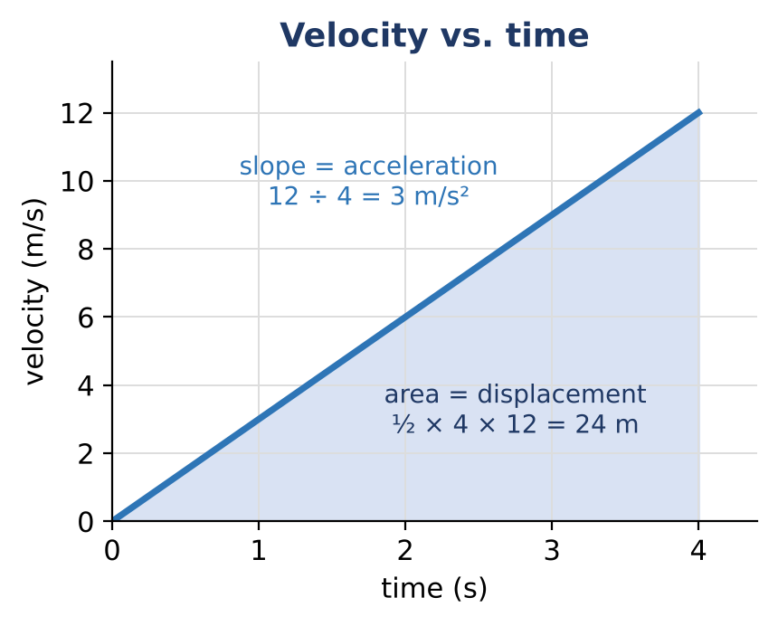

# Unit 1: Kinematics

**Suggested pacing:** Weeks 1–4 of semester 1  
**Essential question:** How can we describe and predict where an object will be and how fast it will be moving?

## Materials in this folder

| File | What it is |
|---|---|
| [cornell-notes.md](cornell-notes.md) | Cornell notes, readable here on GitHub |
| [cornell-notes-kinematics.docx](cornell-notes-kinematics.docx) | The same notes as a printable Word document with a cover page, visual memory aids, and an IXL practice plan |
| [Quiz](../../quizzes/index.html) | Interactive quiz on the most often missed questions (open `quizzes/index.html` in a browser and choose Kinematics) |

## Standards (NGSS for California, high school)

- **HS-PS2-1** Analyze data to support the claim that Newton's second law describes the relationship among net force, mass, and acceleration. Kinematics builds the acceleration half of this standard.
- **SEP 4 / SEP 5** Analyzing and interpreting data; using mathematics and computational thinking (motion graphs, kinematic equations).

## Learning objectives

Check each box when you can do it without notes.

- [ ] I can tell distance from displacement and speed from velocity, and say which are vectors.
- [ ] I can calculate average speed, average velocity, and acceleration with correct units.
- [ ] I can read position-time and velocity-time graphs, using slope and area.
- [ ] I can choose and solve the right kinematic equation for constant acceleration.
- [ ] I can explain and calculate free-fall motion using g = 9.8 m/s² downward.

## Key concepts to master

| Concept | What you need to know |
|---|---|
| **Position and reference point** | Where an object is, measured from a chosen zero. |
| **Distance vs. displacement** | Distance is the total path length (scalar). Displacement is the change in position, with direction (vector). |
| **Speed vs. velocity** | Speed is distance ÷ time. Velocity is displacement ÷ time and includes direction. |
| **Acceleration** | The rate at which velocity changes: a = Δv ÷ Δt, in m/s². Changing speed or changing direction both count. |
| **Motion graphs** | Slope of position-time = velocity. Slope of velocity-time = acceleration. Area under velocity-time = displacement. |
| **Kinematic equations** | Four equations that link d, v_i, v_f, a and t when acceleration is constant. |
| **Free fall** | Motion under gravity alone. Every object accelerates at 9.8 m/s² downward, whatever its mass. |

## Visual memory aids

Position-time graphs: a straight line is constant velocity; a curve getting steeper is speeding up. **Rule:** slope = velocity

Velocity-time graph for constant acceleration from rest. **Rule:** slope = acceleration; area = displacement

Motion maps: evenly spaced dots mean constant velocity; dots spreading apart mean speeding up. **Rule:** equal time between dots

Ball tossed straight up: velocity shrinks to zero at the top, but acceleration stays 9.8 m/s² down. **Rule:** a = g = 9.8 m/s² down, always

## Learning resources

| Resource | Use it for |
|---|---|
| [The Physics Classroom: 1-D Kinematics](https://www.physicsclassroom.com/class/1DKin) | Tutorial lessons that match these notes, plus Concept Builders for self-checking. |
| [PhET: The Moving Man](https://phet.colorado.edu/en/simulations/moving-man) | Simulation that draws position, velocity, and acceleration graphs as you move a character. |
| [Khan Academy: High school physics](https://www.khanacademy.org/science/highschool-physics) | Videos and practice sets on one-dimensional motion. |
| [OpenStax Physics (high school)](https://openstax.org/details/books/physics) | Free textbook; see the chapters on motion in one dimension and acceleration. |

### IXL practice plan

Goal: SmartScore 80+ on each skill before the unit test. Codes were checked against the live IXL skill lists on November 27, 2026; IXL renumbers skills from time to time, so search by skill name if a code has moved.

| Done | Skill | Skill name | Notes section |
|---|---|---|---|
| ☐ | Physics A.2 | Identify independent and dependent variables | 6 |
| ☐ | Physics B.1 | Identify significant figures in measurements | 6 |
| ☐ | Physics B.3 | Multiply and divide with significant figures | 6 |
| ☐ | Grade 8 KK.4 | Abbreviate time, length, speed, and acceleration units | 6 |
| ☐ | Physics C.1 | Classify vectors and scalars | 1 |
| ☐ | Physics D.1 | Distance and displacement in one dimension | 1 |
| ☐ | Physics D.2 | Speed and velocity in one dimension | 2 |
| ☐ | Grade 8 H.1 | Calculate velocity from time and distance | 2 |
| ☐ | Grade 8 H.2 | Calculate distance from velocity and time | 2 |
| ☐ | Grade 8 H.3 | Calculate time from velocity and distance | 2 |
| ☐ | Grade 8 H.4 | Calculate velocity, distance, and time I | 2 |
| ☐ | Grade 8 H.5 | Calculate velocity, distance, and time II | 2 |
| ☐ | Grade 8 H.6 | Create a distance-time graph | 2 |
| ☐ | Grade 8 H.7 | Interpret distance-time graphs | 2 |
| ☐ | Physics D.3 | Acceleration in one dimension | 3 |
| ☐ | Grade 8 I.1 | Identify whether objects are accelerating | 3 |
| ☐ | Physics D.4 | Solve problems using kinematic equations | 4 |

No exact IXL match:

- **Free Fall:** IXL has no free-fall-only skill. Also use the free-fall Concept Builders in the 1-D Kinematics section of physicsclassroom.com.

## Practice problems

Use g = 9.8 m/s². Show givens, equation, substitution, and units. Answers are hidden under each problem.

1. **Foundation.** A cyclist travels 150 m in 12 s. What is the average speed?

   

Answer
v = 150 ÷ 12 = 12.5 m/s

2. **Foundation.** You walk 8 m north, then 3 m south. Find the distance and the displacement.

   

Answer
Distance = 11 m. Displacement = 5 m north.

3. **Proficient.** A car speeds up from 10 m/s to 30 m/s in 8 s. Find the acceleration and the distance covered.

   

Answer
a = (30 − 10) ÷ 8 = 2.5 m/s². d = ½(10 + 30)(8) = 160 m.

4. **Proficient.** A stone dropped from a bridge hits the water 2.0 s later. How high is the bridge, and how fast is the stone moving at impact?

   

Answer
d = ½(9.8)(2.0)² = 19.6 m. v = 9.8 × 2.0 = 19.6 m/s.

5. **Challenge.** A car moving at 25 m/s brakes at −5 m/s². Find the stopping time and stopping distance.

   

Answer
t = 25 ÷ 5 = 5 s. d = 25² ÷ (2 × 5) = 62.5 m.

6. **Challenge.** A ball is thrown straight up at 14.7 m/s. Find the time to the top, the maximum height, and the total time in the air.

   

Answer
t_up = 14.7 ÷ 9.8 = 1.5 s. Height = 14.7² ÷ (2 × 9.8) = 11.0 m. Total time = 3.0 s.

## Real-world applications

- Stopping distance and following distance: why doubling your speed needs four times the braking distance.
- Speed limits and yellow-light timing, which engineers set using reaction time and braking acceleration.
- Sports timing: sprint splits show the acceleration phase and the top-speed phase of a 100 m race.
- Phone and fitness trackers, which use accelerometers and GPS position-time data to report speed.

## Assessment criteria

Scored on a 4-point scale. A 3 (Proficient) meets the standard. See [ASSESSMENT.md](../../ASSESSMENT.md) for how scores are collected.

| Skill | 1 Beginning | 2 Developing | 3 Proficient | 4 Advanced |
|---|---|---|---|---|
| **Describe motion with vectors** | Mixes up distance and displacement or speed and velocity | Defines each term but makes sign or direction errors | Uses distance, displacement, speed, and velocity correctly with direction and units | Applies the ideas to an unfamiliar multi-part trip and explains the reasoning |
| **Interpret motion graphs** | Reads the graph as a picture of the path | Reads values but confuses slope and height | Finds velocity, acceleration, and displacement from slope and area | Sketches one graph from another and matches graphs to a described motion |
| **Solve kinematics problems** | Cannot identify the givens | Lists givens but picks a wrong equation or drops units | Chooses the right equation and solves with units and a sense check | Solves two-stage problems and free-fall problems with both directions |

## Unit checklist

- [ ] Read the Cornell notes and answer every cue aloud with the notes column covered
- [ ] Redraw each visual memory aid from memory
- [ ] Complete the practice problems (all Foundation and Proficient; at least one Challenge)
- [ ] Score 80% or higher on the unit quiz
- [ ] Reach SmartScore 80+ on the IXL skills above
- [ ] Complete the lab and its write-up
- [ ] Check off every learning objective above

[Back to the project outline](../../README.md)
