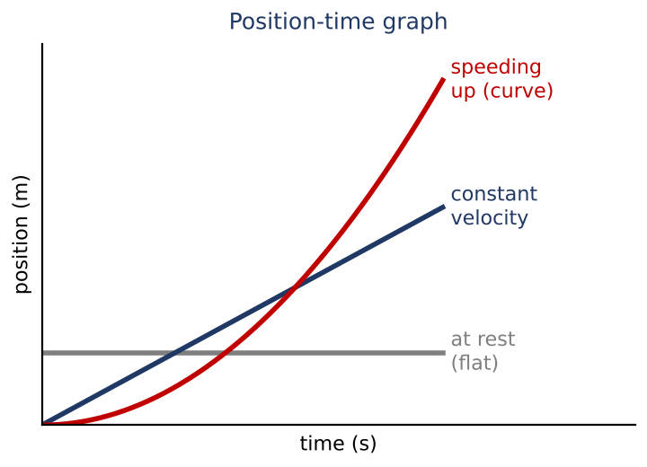
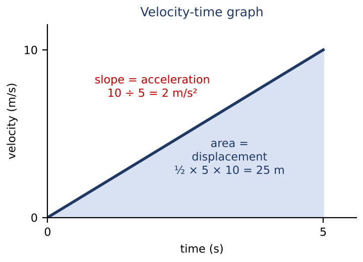
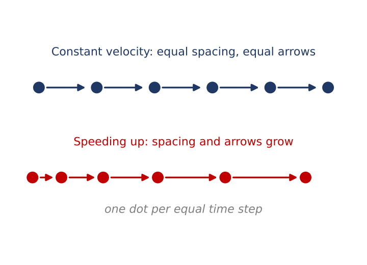
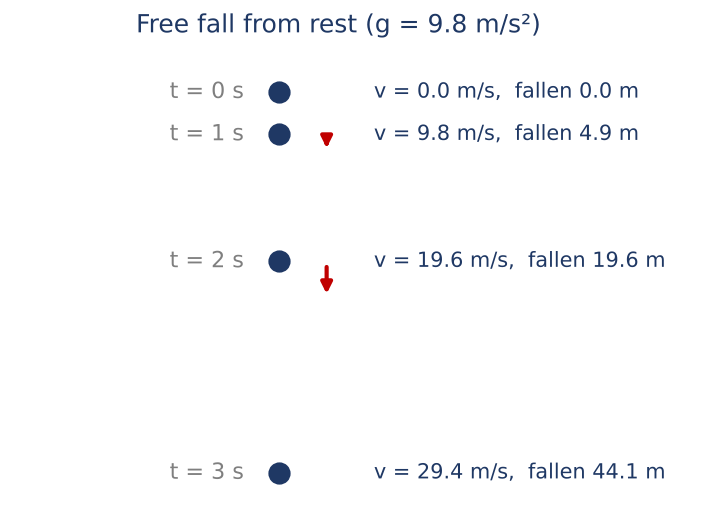

# Unit 1: Kinematics

[Project home](../../README.md) · **1. Kinematics** · [2. Projectile Motion](../02-projectile-motion/README.md) · [3. Newton's Laws](../03-newtons-laws/README.md) · [4. Momentum](../04-momentum/README.md) · [5. Work & Energy](../05-work-and-energy/README.md)

**Pacing:** Weeks 1–4 · **Essential question:** How can we describe and predict the motion of an object using words, graphs and equations?

Kinematics describes how things move without asking why. Students learn to describe motion in words, numbers, graphs and equations, and to move between those four descriptions.

## Materials in this folder

| File | What it is |
|---|---|
| [cornell-notes-01-kinematics.docx](cornell-notes-01-kinematics.docx) | Printable Cornell notes: cue questions, notes with worked examples, visual memory aids, study method, IXL practice plan |
| [quiz.html](quiz.html) | Interactive quiz on the 10 most commonly missed ideas, with an explanation after every answer |

## Standards (CA NGSS)

- **HS-PS2-1** – Analyze data (tables and graphs of position or velocity versus time) to support the claim that Newton's second law describes the relationship among net force, mass and acceleration. Kinematics supplies the graphing and acceleration skills this standard depends on.
- **SEP: Analyzing and Interpreting Data** – Build and read position-time and velocity-time graphs from lab data.
- **SEP: Using Mathematics and Computational Thinking** – Choose and solve the constant-acceleration equations with correct units.

## Key concepts to master

- **Position, distance, displacement** – where an object is, how far it travelled, and how far it ended up from its start (with direction).
- **Scalars and vectors** – size only versus size plus direction.
- **Speed and velocity** – rate of covering distance versus rate of changing position; average versus instantaneous.
- **Acceleration** – rate of change of velocity; sign conventions; speeding up versus slowing down.
- **Motion graphs** – slope of position-time is velocity; slope of velocity-time is acceleration; area under velocity-time is displacement.
- **Kinematic equations** – the four constant-acceleration equations and how to choose among them.
- **Free fall** – g = 9.8 m/s² downward, the same for all masses when air resistance is ignored.

## Learning objectives and how each is assessed

| # | Students can… | Evidence |
|---|---|---|
| 1.1 | Distinguish distance/displacement and speed/velocity in a described motion. | Quiz Q4, Q7; cue self-test sections 1–2 |
| 1.2 | Calculate average speed, velocity and acceleration with units and sign. | Practice 1–2; IXL Physics D.2, D.3 |
| 1.3 | Interpret and construct position-time and velocity-time graphs. | Quiz Q4, Q5, Q10; graph-matching lab |
| 1.4 | Solve constant-acceleration problems with the kinematic equations. | Practice 2–6; IXL Physics D.4 |
| 1.5 | Explain and calculate free-fall motion, including the top of a toss. | Quiz Q1, Q6, Q8; Practice 3, 5 |
| 1.6 | Collect motion data and find acceleration from a graph (lab). | Cart-on-ramp lab report |

Score each objective on the 4-point scale in [Assessment and progress tracking](../../docs/assessment-and-tracking.md). The unit is mastered when every objective is at 3 or above.

## Cue questions (self-test)

Cover the answers in the Cornell notes and answer these aloud.

**1. Describing Motion: Position, Distance, Displacement**

- How is distance different from displacement?
- What makes a quantity a vector instead of a scalar?

**2. Speed and Velocity**

- What is the difference between speed and velocity?
- How do you find the average speed for a whole trip?
- Can speed stay constant while velocity changes?

**3. Acceleration**

- What does acceleration measure?
- How can you tell whether an object is speeding up or slowing down?

**4. Motion Graphs**

- What does the slope of a position-time graph tell you?
- What do the slope and the area of a velocity-time graph tell you?

**5. The Kinematic Equations**

- Which four equations describe constant acceleration?
- How do you choose the right equation?
- How far does a car travel while speeding up or braking?

**6. Free Fall**

- What is the acceleration of every object in free fall?
- What are the velocity and acceleration at the top of a toss?
- How fast and how far does a dropped object fall?

**7. Labs and Measurement**

- What are the variables in a cart-on-a-ramp lab?
- How do you get acceleration from lab data?

## Visual memory aids

| | |
|---|---|
|  On a position-time graph the steepness of the line is the velocity. **slope = Δx/Δt = v** |  On a velocity-time graph the slope is the acceleration and the shaded area is the displacement. **slope = a;  area = Δx** |
|  A motion map shows position at equal time steps: even spacing is constant velocity, growing spacing is speeding up. **equal gaps: a = 0;  growing gaps: a > 0** |  A dropped ball gains 9.8 m/s each second, so it falls farther in each second. **v = gt;  d = ½gt²** |

## Most commonly missed ideas

Each of these is a question in the [interactive quiz](quiz.html).

1. Confusing zero velocity with zero acceleration.
2. Believing "negative acceleration" always means slowing down.
3. Averaging the two speeds instead of using total distance ÷ total time.
4. Reading the height of a position-time graph as speed.
5. Treating a flat line as "at rest" on every graph. That is only true on a position-time graph.
6. Believing heavier objects fall faster.
7. Using distance when the question asks for velocity.
8. Assuming distance fallen grows in direct proportion to time.
9. Mixing up "fast" (velocity) with "accelerating" (changing velocity).
10. Reading a downward-sloping velocity-time line as moving backward.

## Learning resources

- [The Physics Classroom: 1-D Kinematics tutorial](https://www.physicsclassroom.com/class/1DKin) – Reading, animations and check-your-understanding questions for every section.
- [The Physics Classroom: Concept Builders](https://www.physicsclassroom.com/Concept-Builders) – Interactive practice; open the Kinematics set.
- [PhET simulation: The Moving Man](https://phet.colorado.edu/en/simulations/moving-man) – Move a figure and watch position, velocity and acceleration graphs draw live.
- [OpenStax Physics (high school), Chapters 2–3](https://openstax.org/details/books/physics) – Free textbook: Motion in One Dimension; Acceleration.
- [Khan Academy Physics](https://www.khanacademy.org/science/physics) – Videos and practice; browse or search the library for one-dimensional motion. Unit names on the site change from time to time.
- [IXL Physics, sections C and D](https://www.ixl.com/science/physics) – Skill practice; goal SmartScore 80+.

## IXL practice plan (goal: SmartScore 80+)

| Done | Skill | Skill name |
|---|---|---|
| ☐ | Physics A.2 | Identify independent and dependent variables |
| ☐ | Grade 8 KK.4 | Abbreviate time, length, speed, and acceleration units |
| ☐ | Physics B.1 | Identify significant figures in measurements |
| ☐ | Physics B.2 | Add and subtract with significant figures |
| ☐ | Physics B.3 | Multiply and divide with significant figures |
| ☐ | Physics B.4 | Calculations with significant figures |
| ☐ | Physics C.1 | Classify vectors and scalars |
| ☐ | Physics D.1 | Distance and displacement in one dimension |
| ☐ | Grade 8 H.1 | Calculate velocity from time and distance |
| ☐ | Grade 8 H.2 | Calculate distance from velocity and time |
| ☐ | Grade 8 H.3 | Calculate time from velocity and distance |
| ☐ | Grade 8 H.4 | Calculate velocity, distance, and time I |
| ☐ | Grade 8 H.5 | Calculate velocity, distance, and time II |
| ☐ | Physics D.2 | Speed and velocity in one dimension |
| ☐ | Grade 8 I.1 | Identify whether objects are accelerating |
| ☐ | Physics D.3 | Acceleration in one dimension |
| ☐ | Grade 8 H.6 | Create a distance-time graph |
| ☐ | Grade 8 H.7 | Interpret distance-time graphs |
| ☐ | Physics D.4 | Solve problems using kinematic equations |

*No IXL match:* Velocity-time graphs (slope and area) and motion maps have no matching IXL skill. Use the physicsclassroom.com Concept Builders for Kinematics (Graph That Motion, Motion Diagrams).

## Practice problems

Use g = 9.8 m/s². Try each one before opening the answer.

1. A cyclist covers 150 m in 12 s at a steady pace. What is the cyclist's speed?
   

Answer
v = 150 ÷ 12 = <strong>12.5 m/s</strong>

2. A car speeds up from 10 m/s to 26 m/s in 4.0 s. Find the acceleration and the distance covered.
   

Answer
a = (26 − 10)/4.0 = <strong>4.0 m/s²</strong>. Δx = ½(10 + 26)(4.0) = <strong>72 m</strong>

3. A stone dropped from a bridge hits the water 2.5 s later. How high is the bridge and how fast is the stone moving at impact?
   

Answer
h = ½(9.8)(2.5)² = <strong>30.6 m</strong>. v = 9.8 × 2.5 = <strong>24.5 m/s</strong>

4. A car moving at 30 m/s brakes at 6.0 m/s². How long does it take to stop, and how far does it travel?
   

Answer
t = 30 ÷ 6.0 = <strong>5.0 s</strong>. Δx = 30² ÷ (2 × 6.0) = <strong>75 m</strong>

5. A ball is thrown straight up at 14.7 m/s. How long does it take to reach the top, and how high does it go?
   

Answer
t = 14.7 ÷ 9.8 = <strong>1.5 s</strong>. h = 14.7² ÷ (2 × 9.8) = <strong>11.0 m</strong>

6. A sprinter starts from rest and accelerates at 2.0 m/s² over 25 m. Find the final speed and the time.
   

Answer
v = √(2 × 2.0 × 25) = <strong>10 m/s</strong>. t = 10 ÷ 2.0 = <strong>5.0 s</strong>

7. A velocity-time graph rises from 0 to 12 m/s in 3 s, stays at 12 m/s for 5 s, then falls to 0 in 2 s. Find the total displacement.
   

Answer
Area = ½(3)(12) + (5)(12) + ½(2)(12) = 18 + 60 + 12 = <strong>90 m</strong>

8. Explain why doubling a car's speed makes its braking distance four times as long.
   

Answer
With the same braking acceleration, Δx = v₀²/(2a). Distance depends on the <strong>square</strong> of the speed, so 2² = 4 times the distance.

## Labs and investigations

- **Graph matching**: walk in front of a motion sensor (or use The Moving Man) to reproduce a given position-time graph.
- **Cart on a ramp**: time a cart over several distances, plot velocity versus time, and find acceleration from the slope.
- **Reaction time**: catch a dropped ruler and use d = ½gt² to calculate your reaction time.

## Real-world applications

- **Road safety**: stopping distance, following distance and why speed limits drop near schools.
- **Sports**: sprint split times, pitch speed from radar, hang time of a jump.
- **Phones and cars**: accelerometers detect motion, count steps and trigger airbags.
- **GPS**: position measured over time gives speed and estimated arrival time.
- **Amusement rides**: drop towers are free fall with a braking section at the bottom.

## Unit checklist

**Student**

- [ ] Cornell notes read; every cue question answered aloud from memory
- [ ] All visual memory aids redrawn from memory
- [ ] Practice problems completed and checked
- [ ] IXL practice plan at SmartScore 80+
- [ ] Interactive quiz at 80% or higher
- [ ] Lab report submitted
- [ ] Unit test taken; missed objectives retested

**Instructor**

- [ ] Learning targets and essential question posted
- [ ] Quiz given as a pre-assessment to find misconceptions
- [ ] Lab(s) run and scored with the lab rubric
- [ ] Quiz repeated as a post-assessment; results recorded in the tracker
- [ ] Reteach plan made for any objective below 3
