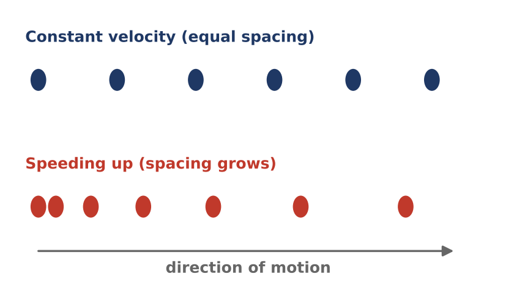
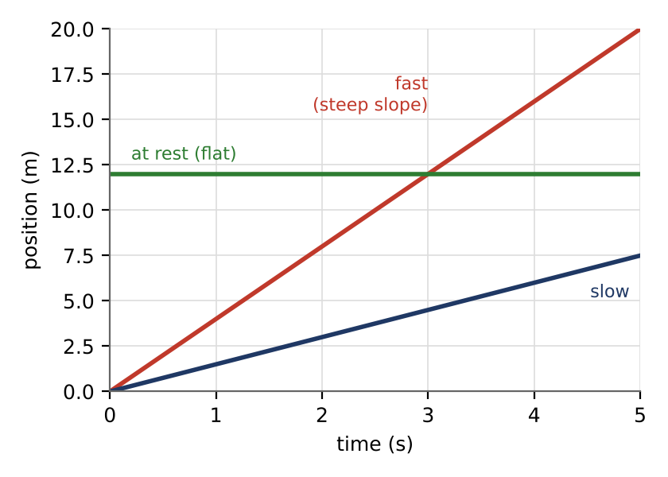
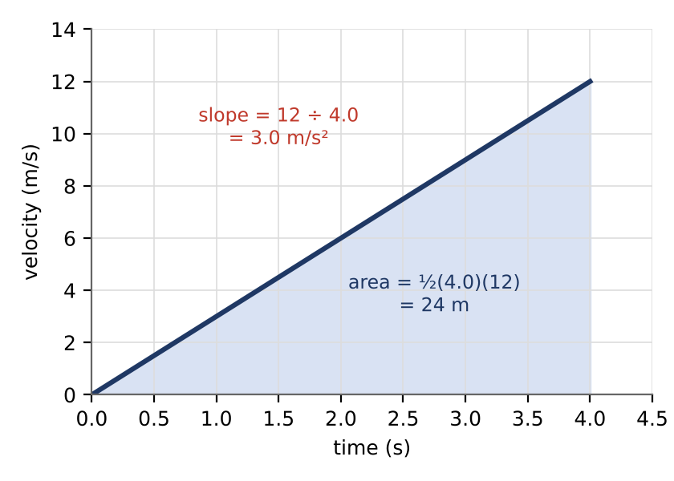
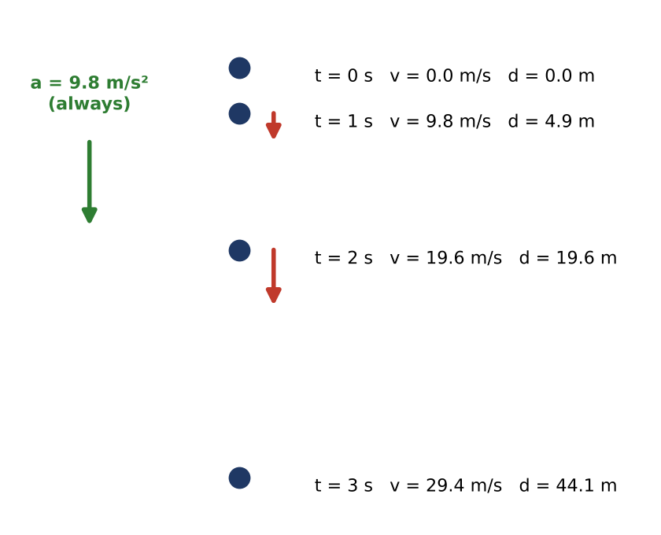

# Cornell Notes: Kinematics

*Physics | Semester 1, Unit 1 | Distance and displacement, velocity, acceleration, motion graphs, free fall*

Printable version: [cornell-notes.docx](cornell-notes.docx)

**Essential question:** How can we describe and predict where an object will be and how fast it will be moving?

**Learning targets**

- I can tell distance from displacement and speed from velocity, and sort quantities into scalars and vectors.
- I can calculate average speed, average velocity and acceleration with correct units.
- I can read position-time and velocity-time graphs using slope and area.
- I can solve constant-acceleration problems, including free fall, with the kinematic equations.

## 1. Describing Position: Scalars and Vectors

| Cues / Questions | Notes |
|---|---|
| **What is the difference between distance and displacement?** | **Distance** is the total length of the path traveled. It is a **scalar** (size only). **Displacement** is the change in position, measured straight from start to finish, with a direction. It is a **vector**: Δx = xf − xi. Worked example: walk 4 m east, then 3 m west. Distance = 4 + 3 = **7 m**. Displacement = 4 − 3 = **1 m east**. |
| **Which motion quantities are scalars and which are vectors?** | **Scalars** (size only): distance, speed, time, mass. **Vectors** (size and direction): displacement, velocity, acceleration, force. In one dimension, direction is shown with a + or − sign. |
| **Can displacement be zero when distance is not?** | Yes. One full lap of a 400 m track: distance = **400 m**, displacement = **0 m**, because the runner ends where they started. |

**IXL practice (goal: SmartScore 80+):** Physics C.1 Classify vectors and scalars; Physics D.1 Distance and displacement in one dimension.

## 2. Speed and Velocity

| Cues / Questions | Notes |
|---|---|
| **How do I calculate average speed and average velocity?** | **Average speed** = distance ÷ time. **Average velocity** = displacement ÷ time. Worked example: a runner finishes one 400 m lap in 80 s. Average speed = 400 ÷ 80 = **5.0 m/s**. Average velocity = 0 ÷ 80 = **0 m/s**. |
| **What does "instantaneous" speed mean?** | The speed at one moment, like a speedometer reading. Average speed covers the whole trip. |
| **How do I convert km/h to m/s?** | Divide by 3.6 (because 1 km = 1000 m and 1 h = 3600 s). Worked example: a car covers 150 km in 2.5 h. Speed = 150 ÷ 2.5 = **60 km/h** = 60 ÷ 3.6 = **16.7 m/s**. |

**IXL practice (goal: SmartScore 80+):** Physics D.2 Speed and velocity in one dimension; Grade 8 H.1 Calculate velocity from time and distance; Grade 8 H.2 Calculate distance from velocity and time; Grade 8 H.3 Calculate time from velocity and distance; Grade 8 H.4 Calculate velocity, distance, and time I; Grade 8 H.5 Calculate velocity, distance, and time II; Grade 8 KK.4 Abbreviate time, length, speed, and acceleration units.

## 3. Acceleration

| Cues / Questions | Notes |
|---|---|
| **What is acceleration and how is it calculated?** | **Acceleration** is how fast velocity changes: a = (vf − vi) ÷ t. Unit: **m/s²**. An object accelerates when it speeds up, slows down, or changes direction. Worked example: a car goes from 0 to 27 m/s in 9.0 s. a = (27 − 0) ÷ 9.0 = **3.0 m/s²**. |
| **Does negative acceleration always mean slowing down?** | No. The sign only gives direction. Velocity and acceleration in the **same** direction: speeding up. In **opposite** directions: slowing down. Worked example: braking from 20 m/s to 0 in 4.0 s. a = (0 − 20) ÷ 4.0 = **−5.0 m/s²** (opposite to the motion, so slowing). |

**IXL practice (goal: SmartScore 80+):** Physics D.3 Acceleration in one dimension; Grade 8 I.1 Identify whether objects are accelerating.

## 4. Motion Graphs

| Cues / Questions | Notes |
|---|---|
| **What does the slope of a position-time graph tell me?** | Slope = **velocity**. Straight sloped line: constant velocity. Flat line: at rest. Curve getting steeper: speeding up. |
| **What do the slope and area of a velocity-time graph tell me?** | Slope = **acceleration**. Area between the line and the time axis = **displacement**. A flat line above zero means constant velocity, not "at rest". Worked example: velocity rises steadily from 0 to 12 m/s in 4.0 s. Slope = 12 ÷ 4.0 = **3.0 m/s²**. Area = ½ × 4.0 × 12 = **24 m**. |

**IXL practice (goal: SmartScore 80+):** Grade 8 H.6 Create a distance-time graph; Grade 8 H.7 Interpret distance-time graphs.

## 5. Kinematic Equations and Free Fall

| Cues / Questions | Notes |
|---|---|
| **What are the four kinematic equations and when do they work?** | They work only when acceleration is **constant**. vf = vi + at d = vit + ½at² vf² = vi² + 2ad d = ½(vi + vf)t |
| **How do I choose the right equation?** | List the five variables (vi, vf, a, t, d). Mark the three you know and the one you want. Pick the equation that leaves out the fifth. Worked example: a car starts from rest and accelerates at 3.0 m/s² for 6.0 s. d = 0 + ½(3.0)(6.0)² = **54 m**. vf = 0 + (3.0)(6.0) = **18 m/s**. Sense check: average velocity 9 m/s × 6 s = 54 m. |
| **What is the acceleration of an object in free fall?** | **9.8 m/s² downward** for every object, heavy or light, when air resistance is ignored. At the top of a throw the velocity is 0 for an instant, but the acceleration is still 9.8 m/s² downward. Worked example (dropped): a rock falls from rest for 2.0 s. vf = 9.8 × 2.0 = **19.6 m/s**. d = ½(9.8)(2.0)² = **19.6 m**. Worked example (thrown up at 14.7 m/s): time to the top = 14.7 ÷ 9.8 = **1.5 s**. Maximum height = 14.7² ÷ (2 × 9.8) = **11.0 m**. |

**IXL practice (goal: SmartScore 80+):** Physics D.4 Solve problems using kinematic equations.

## 6. Labs and Measurement

| Cues / Questions | Notes |
|---|---|
| **In a constant-speed buggy lab, what are the variables and what does the graph show?** | Independent variable: **time**. Dependent variable: **position**. The position-time graph is a straight line and its slope is the buggy's speed. |
| **How do I find acceleration for a cart released from rest on a ramp?** | Measure the distance d and the time t. Since vi = 0, d = ½at², so **a = 2d ÷ t²**. Worked example: the cart travels 1.2 m in 2.0 s. a = 2(1.2) ÷ (2.0)² = **0.60 m/s²**. |

**IXL practice (goal: SmartScore 80+):** Physics A.2 Identify independent and dependent variables; Physics B.1 Identify significant figures in measurements; Physics B.4 Calculations with significant figures.

## Memory tricks

- **Slope of position-time = velocity. Slope of velocity-time = acceleration. Area under velocity-time = displacement.** Use it: Any graph question: decide first whether it asks for a slope or an area.
- **GUESS: Givens, Unknown, Equation, Substitute, Solve.** Use it: Every word problem. Write the givens with units before touching the calculator.
- **Vectors have direction; scalars do not.** Use it: When a question says "displacement" or "velocity", include a direction or sign.
- **km/h ÷ 3.6 = m/s.** Use it: Whenever speeds are given in km/h and the answer needs SI units.
- **Same direction speeds up, opposite direction slows down.** Use it: Deciding whether an object is speeding up from the signs of v and a.

## Summary

Kinematics describes motion without asking what causes it. Position, velocity and acceleration are linked: velocity is how fast position changes and acceleration is how fast velocity changes. The same links show up on graphs as slope and area, and in the four kinematic equations when acceleration is constant. Free fall is the most common case of constant acceleration, 9.8 m/s² downward for every object.

## Visual memory aids

Motion maps (dot diagrams): evenly spaced dots mean constant velocity; dots spreading apart mean speeding up.  
**Rule:** Equal spacing: a = 0. Growing spacing: a in the direction of motion.

Position-time graph: the steeper the line, the faster the object. A flat line is an object at rest.  
**Rule:** slope = velocity

Velocity-time graph: the slope is the acceleration and the shaded area is the displacement.  
**Rule:** slope = a = 3.0 m/s²; area = ½(4.0)(12) = 24 m

Free fall from rest: the speed grows by 9.8 m/s every second and the distance fallen grows as t².  
**Rule:** v = gt, d = ½gt², g = 9.8 m/s²

## Study method

1. Cover the Notes column and answer each cue question aloud.
2. Uncover, check, and mark every cue you missed.
3. Redraw each Visual Memory Aid from memory.
4. Repeat the next day and again a few days later.
5. Finish the IXL plan to SmartScore 80+ and take the unit quiz before the test.
