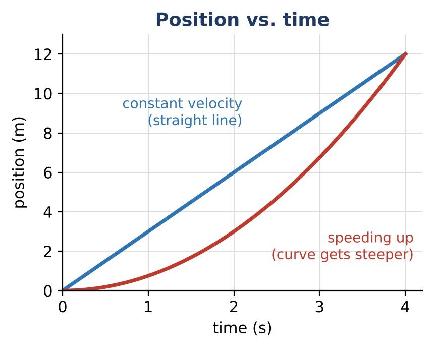
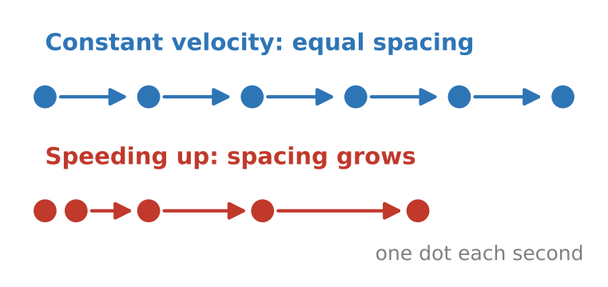
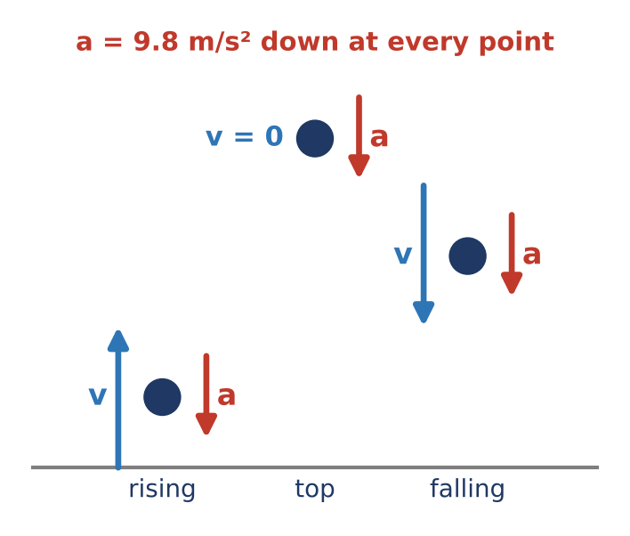

# Cornell Notes: Kinematics

*Physics | Motion in One Dimension | position, velocity, acceleration, motion graphs, free fall*

Name: ________________  Period: ______  Date: __________

**Learning targets**

- I can tell distance from displacement and speed from velocity, and say which are vectors.
- I can calculate average speed, average velocity, and acceleration with correct units.
- I can read position-time and velocity-time graphs, using slope and area.
- I can choose and solve the right kinematic equation for constant acceleration.
- I can explain and calculate free-fall motion using g = 9.8 m/s² downward.

**Essential question:** How can we describe and predict where an object will be and how fast it will be moving?

**How to use these notes:** cover the Notes column, answer each cue question aloud, then uncover and check. Mark the ones you miss and try them again tomorrow.

## 1. Position, Distance, and Displacement

| Cues / Questions | Notes |
|---|---|
| **What is the difference between distance and displacement?** | • **Distance** = total length of the path traveled. It is a **scalar** (size only) and is never negative. • **Displacement** = change in position, Δx = x_final − x_initial. It is a **vector** (size and direction). • Worked example: walk 4 m east, then 3 m west. Distance = 4 + 3 = **7 m**. Displacement = 4 − 3 = **1 m east**. |
| **What makes a quantity a vector instead of a scalar?** | • A **vector** has magnitude and direction: displacement, velocity, acceleration, force. • A **scalar** has magnitude only: distance, speed, time, mass. • In one dimension the sign is the direction. Pick a positive direction (usually right or up) and keep it for the whole problem. |

> **IXL practice (goal: SmartScore 80+):** **Physics C.1** Classify vectors and scalars · **Physics D.1** Distance and displacement in one dimension

## 2. Speed and Velocity

| Cues / Questions | Notes |
|---|---|
| **How do you calculate average speed and average velocity?** | • **Average speed** = total distance ÷ total time. • **Average velocity** = displacement ÷ time, v = Δx ÷ Δt. Units: m/s. • Worked example: a runner finishes one 400 m lap in 80 s. Average speed = 400 ÷ 80 = **5 m/s**. Displacement is 0 (back at the start), so average velocity = **0 m/s**. |
| **What does the slope of a position-time graph tell you?** | • Slope of a position-time graph = **velocity**. • Straight line = constant velocity. Steeper line = faster. Flat line = at rest. • Line sloping **down** = moving in the negative direction (not slowing down). • Curved line = velocity is changing, so the object is accelerating. |
| **How is instantaneous velocity different from average velocity?** | • **Instantaneous velocity** is the velocity at one moment (what a speedometer shows, plus direction). • **Average velocity** covers a whole time interval. They are equal only when velocity is constant. |

> **IXL practice (goal: SmartScore 80+):** **Physics D.2** Speed and velocity in one dimension · **Grade 8 H.1** Calculate velocity from time and distance · **Grade 8 H.2** Calculate distance from velocity and time · **Grade 8 H.3** Calculate time from velocity and distance · **Grade 8 H.4** Calculate velocity, distance, and time I · **Grade 8 H.5** Calculate velocity, distance, and time II · **Grade 8 H.6** Create a distance-time graph · **Grade 8 H.7** Interpret distance-time graphs

## 3. Acceleration and Velocity-Time Graphs

| Cues / Questions | Notes |
|---|---|
| **What is acceleration and how do you calculate it?** | • **Acceleration** = change in velocity ÷ time: a = (v_f − v_i) ÷ t. Units: **m/s²**. • Speeding up, slowing down, and changing direction are all accelerations. • Worked example: a car goes from 0 to 20 m/s in 5 s. a = (20 − 0) ÷ 5 = **4 m/s²**. Sense check: it gains 4 m/s every second. |
| **How can you tell whether an object is speeding up or slowing down?** | • Velocity and acceleration in the **same** direction (same sign) → speeding up. • Velocity and acceleration in **opposite** directions (opposite signs) → slowing down. • So negative acceleration does not always mean slowing down. An object moving in the negative direction with negative acceleration is speeding up. |
| **What do the slope and the area of a velocity-time graph tell you?** | • **Slope** of a velocity-time graph = **acceleration**. • **Area** between the line and the time axis = **displacement**. • A flat line above the axis means constant velocity, not at rest. At rest is a line on the axis (v = 0). • Worked example: v rises steadily from 0 to 12 m/s in 4 s. Slope = 12 ÷ 4 = **3 m/s²**. Area = ½ × 4 × 12 = **24 m**. |

> **IXL practice (goal: SmartScore 80+):** **Physics D.3** Acceleration in one dimension · **Grade 8 I.1** Identify whether objects are accelerating

## 4. The Kinematic Equations

| Cues / Questions | Notes |
|---|---|
| **What are the four kinematic equations, and when do they work?** | • They work only when **acceleration is constant**. • v_f = v_i + a·t • d = v_i·t + ½·a·t² • v_f² = v_i² + 2·a·d • d = ½·(v_i + v_f)·t |
| **How do you choose which kinematic equation to use?** | • List the five quantities: d, v_i, v_f, a, t. Mark the three you know and the one you want. • Pick the equation that does **not** contain the fifth quantity (the one you neither know nor want). • "Starts from rest" means v_i = 0. "Comes to a stop" means v_f = 0. |
| **How far does a car travel while speeding up from rest at 3 m/s² for 6 s?** | • Known: v_i = 0, a = 3 m/s², t = 6 s. Want: d. Missing: v_f. • d = v_i·t + ½·a·t² = 0 + ½ × 3 × 6² = **54 m**. • Final speed: v_f = 0 + 3 × 6 = **18 m/s**. Sense check: average speed 9 m/s × 6 s = 54 m. |
| **How far does a car need to stop from 30 m/s if it brakes at −6 m/s²?** | • Known: v_i = 30 m/s, v_f = 0, a = −6 m/s². Want: d. Missing: t. • v_f² = v_i² + 2·a·d → 0 = 900 + 2(−6)d → d = 900 ÷ 12 = **75 m**. • Doubling the speed makes the stopping distance four times as long, because d depends on v². |

> **IXL practice (goal: SmartScore 80+):** **Physics D.4** Solve problems using kinematic equations

## 5. Free Fall

| Cues / Questions | Notes |
|---|---|
| **What is the acceleration of any object in free fall?** | • **Free fall** = gravity is the only force acting (no air resistance). • Every object in free fall accelerates at **g = 9.8 m/s² downward**, whatever its mass. • A heavy ball and a light ball dropped together land together when air resistance is negligible. |
| **What are the velocity and acceleration at the top of a toss straight up?** | • At the top, **velocity = 0** for an instant. • Acceleration is still **9.8 m/s² downward**. It never switches off; that is why the ball comes back down. • The trip is symmetric: time up = time down, and it returns to the launch height at the launch speed. |
| **How fast is a dropped object moving after 3 s, and how far has it fallen?** | • Known: v_i = 0, a = 9.8 m/s² (taking down as positive), t = 3 s. • v_f = v_i + a·t = 9.8 × 3 = **29.4 m/s**. • d = ½·a·t² = ½ × 9.8 × 3² = **44.1 m**. |

> **IXL practice (goal: SmartScore 80+):** **Physics D.4** Solve problems using kinematic equations
> IXL has no free-fall-only skill. Also use the free-fall Concept Builders in the 1-D Kinematics section of physicsclassroom.com.

## 6. Labs and Measurement

| Cues / Questions | Notes |
|---|---|
| **In a constant-velocity lab, which variable is independent and which is dependent?** | • Typical lab: time a battery-powered buggy (or a walking student) at marked positions. • **Independent variable**: time (x-axis). **Dependent variable**: position (y-axis). • The slope of the best-fit line on the position-time graph is the **velocity**. |
| **How do you find acceleration from cart-on-a-ramp data?** | • Measure the distance d the cart rolls from rest and the time t it takes. • From d = ½·a·t², the acceleration is **a = 2d ÷ t²**. • Repeat each trial at least three times and average the times to reduce random error. |
| **How many significant figures should a calculated answer have?** | • Multiplying or dividing: match the measurement with the **fewest significant figures**. • Always write the unit. A number without a unit is not a measurement. |

> **IXL practice (goal: SmartScore 80+):** **Physics A.2** Identify independent and dependent variables · **Physics B.1** Identify significant figures in measurements · **Physics B.3** Multiply and divide with significant figures · **Grade 8 KK.4** Abbreviate time, length, speed, and acceleration units

## Memory tricks

- **Slope and area rules.** Slope of position-time is velocity. Slope of velocity-time is acceleration. Area under velocity-time is displacement. *Use it for:* Any graph question.
- **GUESS.** Givens, Unknown, Equation, Substitute, Solve. *Use it for:* Every word problem, so you never skip listing what you know.
- **Same signs speed up, opposite signs slow down.** Compare the signs of velocity and acceleration. *Use it for:* Deciding whether an object is speeding up or slowing down.
- **Find the missing variable.** Choose the kinematic equation that leaves out the quantity you neither know nor want. *Use it for:* Picking an equation quickly.
- **Rest means zero.** "From rest" → v_i = 0. "Stops" → v_f = 0. "Dropped" → v_i = 0. *Use it for:* Finding hidden givens in the wording.

## Summary

Kinematics describes motion without asking what causes it. Position, displacement, velocity, and acceleration are vectors, so direction (the sign) matters. Velocity is how fast position changes and acceleration is how fast velocity changes; those two ideas appear as the slopes of the position-time and velocity-time graphs, and the area under a velocity-time graph gives displacement. When acceleration is constant, the four kinematic equations connect d, v_i, v_f, a, and t. Free fall is the most common case: every object accelerates downward at 9.8 m/s², even at the top of its path where its velocity is zero.

## Visual memory aids

Position-time graphs: a straight line is constant velocity; a curve getting steeper is speeding up. **Rule:** slope = velocity

Velocity-time graph for constant acceleration from rest. **Rule:** slope = acceleration; area = displacement

Motion maps: evenly spaced dots mean constant velocity; dots spreading apart mean speeding up. **Rule:** equal time between dots

Ball tossed straight up: velocity shrinks to zero at the top, but acceleration stays 9.8 m/s² down. **Rule:** a = g = 9.8 m/s² down, always

## Study method

1. Cover the Notes column and answer each cue aloud.
2. Check, and mark the ones you missed.
3. Redraw each visual memory aid from memory.
4. Repeat the next day and again a few days later. Recall spread over days builds memory that rereading does not.
5. Finish the IXL plan to SmartScore 80+ before the test.

Printable version: [cornell-notes-kinematics.docx](cornell-notes-kinematics.docx) · [Unit guide](README.md)
