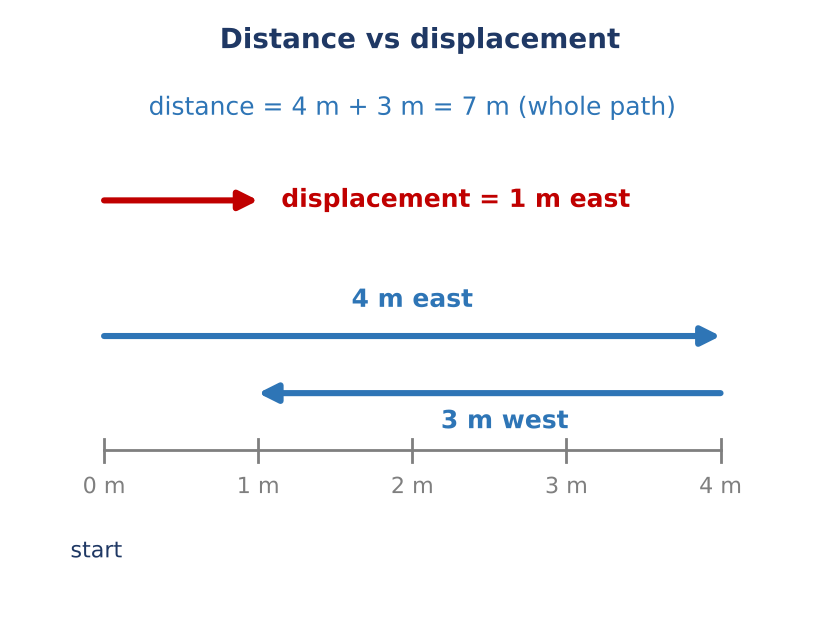
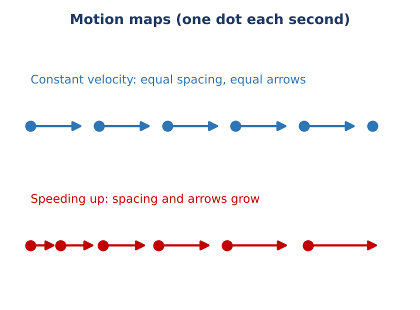
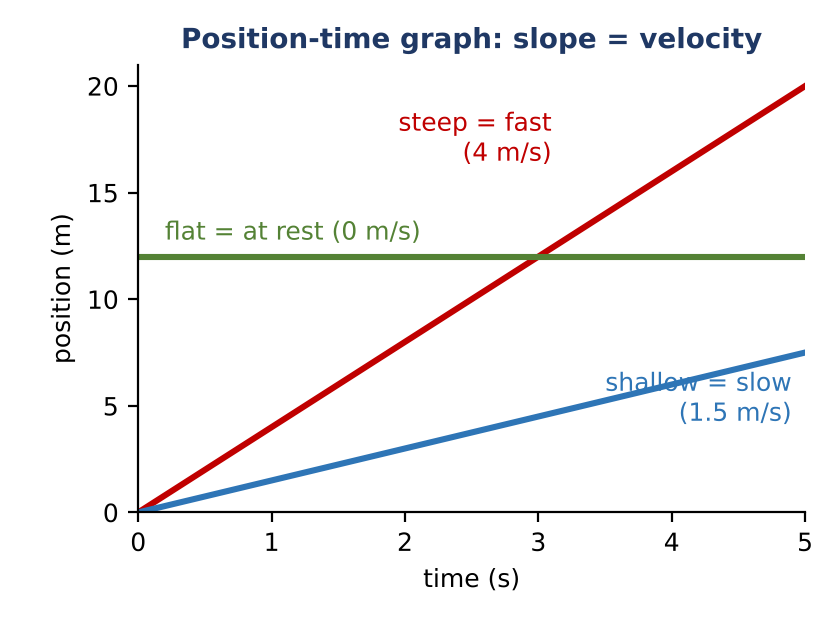
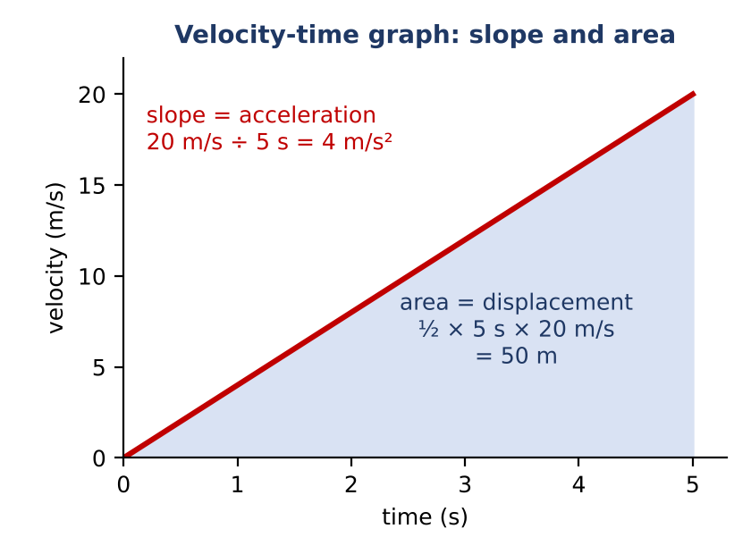

# Cornell Notes: Kinematics

*Physics | Unit 1 | Position, velocity, acceleration, motion graphs, free fall*

> Printable version with the Visual Memory Aids laid out for class: [Cornell-Notes-Kinematics.docx](Cornell-Notes-Kinematics.docx)

**Essential question:** How can we describe and predict the motion of an object using words, graphs, and equations?

**Learning targets**

- I can tell distance from displacement and speed from velocity, and say which are vectors.
- I can calculate average speed, average velocity, and acceleration with correct units.
- I can read position-time and velocity-time graphs (slope and area) and sketch one from a description.
- I can choose and solve the right kinematic equation for constant acceleration.
- I can solve free-fall problems using a = 9.8 m/s² downward.

**How to use:** cover the Notes column, answer each cue aloud, then check.

## 1. Describing Motion: Distance and Displacement

| Cues / Questions | Notes |
|---|---|
| **What is the difference between distance and displacement?** | • **Distance** is the total length of the path traveled. It is a **scalar** (size only) and is never negative. • **Displacement** is the change in position: Δx = x_final − x_initial. It is a **vector** (size and direction). • Displacement only cares about where you start and where you end, not the route. |
| **Which motion quantities are scalars and which are vectors?** | • **Scalars:** distance, speed, time, mass. • **Vectors:** displacement, velocity, acceleration, force. • In one dimension, direction is shown with a sign: pick one direction as **+** and the opposite is **−**. |
| **You walk 4 m east, then 3 m west. What are your distance and displacement?** | • Distance: add the whole path. 4 m + 3 m = **7 m**. • Displacement: call east +. (+4 m) + (−3 m) = **+1 m, or 1 m east**. • Sense check: displacement can never be larger than distance. |

**IXL practice (goal: SmartScore 80+):** **Physics C.1** Classify vectors and scalars; **Physics D.1** Distance and displacement in one dimension

## 2. Speed and Velocity

| Cues / Questions | Notes |
|---|---|
| **How is average speed different from average velocity?** | • **Average speed** = total distance ÷ total time. • **Average velocity** = displacement ÷ total time, and it has a direction. • Both are measured in **m/s**. |
| **A runner finishes one 400 m lap in 80 s. What are the average speed and average velocity?** | • Average speed = 400 m ÷ 80 s = **5 m/s**. • The runner ends where they started, so displacement = 0 and average velocity = **0 m/s**. |
| **What does the slope of a position-time graph tell you?** | • Slope = rise ÷ run = Δx ÷ Δt = **velocity**. • Steeper line = faster. Flat line = at rest. Line sloping down = moving in the negative direction. • A **curved** line means the velocity is changing, so the object is accelerating. |
| **A car drives the first half of a trip's distance at 60 km/h and the second half at 30 km/h. Why is the average speed not 45 km/h?** | • The car spends **more time** at the slower speed, so the slow part counts more. • Take each half as 60 km: 60 km ÷ 60 km/h = 1 h, then 60 km ÷ 30 km/h = 2 h. • Average speed = 120 km ÷ 3 h = **40 km/h**. Always use total distance ÷ total time. |

**IXL practice (goal: SmartScore 80+):** **Physics D.2** Speed and velocity in one dimension; **Grade 8 H.1** Calculate velocity from time and distance; **Grade 8 H.2** Calculate distance from velocity and time; **Grade 8 H.3** Calculate time from velocity and distance; **Grade 8 H.4** Calculate velocity, distance, and time I; **Grade 8 H.5** Calculate velocity, distance, and time II; **Grade 8 H.6** Create a distance-time graph; **Grade 8 H.7** Interpret distance-time graphs

## 3. Acceleration and Velocity-Time Graphs

| Cues / Questions | Notes |
|---|---|
| **What is acceleration, and what are its units?** | • **Acceleration** is how quickly velocity changes: **a = Δv ÷ Δt = (v_f − vᵢ) ÷ t**. • Units: **m/s²** (meters per second, each second). • Any change in velocity counts: speeding up, slowing down, or changing direction. |
| **How can you tell whether an object is speeding up or slowing down?** | • Compare the **signs** of velocity and acceleration. • **Same sign** (both + or both −): speeding up. **Opposite signs:** slowing down. • So negative acceleration does not always mean slowing down. A car moving in the − direction with a = −2 m/s² is speeding up. |
| **What do the slope and the area of a velocity-time graph tell you?** | • **Slope = acceleration.** A flat line means constant velocity (a = 0), not “at rest.” • **Area between the line and the time axis = displacement.** • Where the line crosses the time axis, v = 0 and the object **changes direction**. |
| **A car goes from rest to 20 m/s in 5 s. What are its acceleration and displacement?** | • a = (20 m/s − 0) ÷ 5 s = **4 m/s²**. • Displacement = area of the triangle under the v-t line = ½ × 5 s × 20 m/s = **50 m**. • Check with an equation: d = ½at² = ½ × 4 × 5² = 50 m. |

**IXL practice (goal: SmartScore 80+):** **Physics D.3** Acceleration in one dimension; **Grade 8 I.1** Identify whether objects are accelerating; **Grade 8 KK.4** Abbreviate time, length, speed, and acceleration units

## 4. Kinematic Equations

| Cues / Questions | Notes |
|---|---|
| **What are the four kinematic equations, and when do they work?** | • They work only when **acceleration is constant**. • **v_f = vᵢ + at** (no d) • **d = vᵢt + ½at²** (no v_f) • **v_f² = vᵢ² + 2ad** (no t) • **d = ½(vᵢ + v_f)t** (no a) |
| **How do you choose which equation to use?** | • There are five variables: **d, vᵢ, v_f, a, t**. Write down the three you know and the one you want. • Pick the equation that **leaves out** the fifth variable you neither know nor need. • Watch for hidden values: “from rest” means vᵢ = 0; “comes to a stop” means v_f = 0. |
| **A car moving at 30 m/s brakes at −6 m/s². How far does it travel before stopping?** | • Known: vᵢ = 30 m/s, v_f = 0, a = −6 m/s². Want d. Time is not needed. • v_f² = vᵢ² + 2ad → 0 = 30² + 2(−6)d → d = 900 ÷ 12 = **75 m**. • Sense check: the answer is positive and a reasonable stopping distance for highway speed. |

**IXL practice (goal: SmartScore 80+):** **Physics D.4** Solve problems using kinematic equations

## 5. Free Fall

| Cues / Questions | Notes |
|---|---|
| **What is free fall, and what is the acceleration of an object in free fall?** | • **Free fall** is motion with **gravity as the only force** (air resistance ignored). • Every object in free fall accelerates at **g = 9.8 m/s² downward**, on the way up, at the top, and on the way down. • With up as +, a = **−9.8 m/s²**. |
| **Does a heavier object fall faster than a lighter one?** | • **No.** Without air resistance, all objects fall with the same acceleration and land together. • A feather falls slowly in air only because air resistance is large compared with its weight. |
| **A ball is thrown straight up. What are its velocity and acceleration at the very top?** | • Velocity at the top = **0 m/s** for an instant. • Acceleration at the top is **still 9.8 m/s² downward**. If it were zero, the ball would stay there. |
| **A rock is dropped from rest and falls for 2.0 s. How fast is it going and how far has it fallen?** | • v_f = vᵢ + at = 0 + (9.8)(2.0) = **19.6 m/s downward**. • d = ½at² = ½ × 9.8 × 2.0² = **19.6 m**. • Pattern: fall time doubles, distance goes up **four** times (d depends on t²). |

**IXL practice (goal: SmartScore 80+):** **Physics D.4** Solve problems using kinematic equations

## 6. Labs and Measurement

| Cues / Questions | Notes |
|---|---|
| **In a cart-on-a-ramp lab, what are the independent and dependent variables?** | • **Independent variable** (what you change): time, or the ramp height. • **Dependent variable** (what you measure): the cart's position or velocity. • **Controlled:** same cart, same ramp surface, same release point. |
| **How do you find acceleration from lab data?** | • Plot **velocity vs time** and draw a best-fit line. The **slope is the acceleration**. • Or, for a cart released from rest, measure distance and time and use **a = 2d ÷ t²**. • Run several trials and average them. Report answers with sensible significant figures and units. |

**IXL practice (goal: SmartScore 80+):** **Physics A.2** Identify independent and dependent variables; **Physics B.1** Identify significant figures in measurements; **Physics B.3** Multiply and divide with significant figures; **Physics B.4** Calculations with significant figures

## Memory tricks

- **GUESS: Givens, Unknown, Equation, Substitute, Solve.** Use on every word problem so no step is skipped.
- **Slope of position-time is velocity; slope of velocity-time is acceleration.** Use whenever a graph question asks “how fast” or “what acceleration.”
- **Area under velocity-time is displacement.** Use when a graph question asks “how far.”
- **Same signs speed up, opposite signs slow down.** Use to decide if an object is speeding up from the signs of v and a.
- **“From rest” means vᵢ = 0; “stops” means v_f = 0.** Use when listing givens; these values are hidden in the wording.
- **g = 9.8 m/s² down, always.** Use in every free-fall problem, including at the top of the path.

## Summary

Kinematics describes motion without asking what causes it. Position, displacement, velocity, and acceleration are linked: velocity is how fast position changes, and acceleration is how fast velocity changes. The same motion can be shown as a motion map, a position-time graph, a velocity-time graph, or an equation, and the slope and area of the graphs carry the key numbers. When acceleration is constant, four kinematic equations connect d, vᵢ, v_f, a, and t. Free fall is the most important case: every object accelerates at 9.8 m/s² downward regardless of mass.

## Visual memory aids

| | |
|---|---|
|  The whole path gives distance; the straight arrow from start to finish gives displacement. **Rule:** distance = path length; Δx = x_final − x_initial |  Dots show position each second. Even spacing means constant velocity; growing spacing means speeding up. **Rule:** bigger gaps = faster |
|  On a position-time graph, a steeper line means a faster object and a flat line means it is at rest. **Rule:** slope = Δx ÷ Δt = velocity |  On a velocity-time graph, the slope gives acceleration and the shaded area gives displacement. **Rule:** slope = a; area = displacement |
