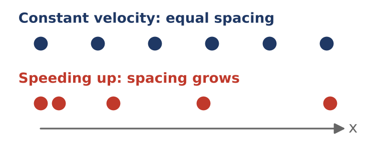
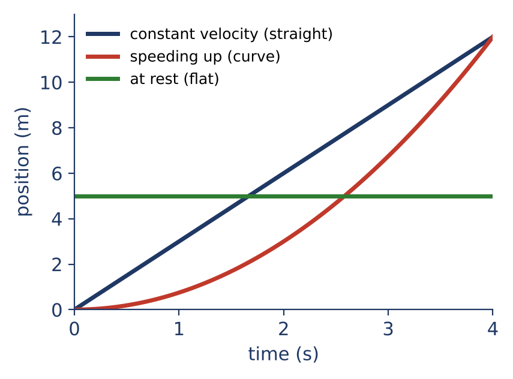
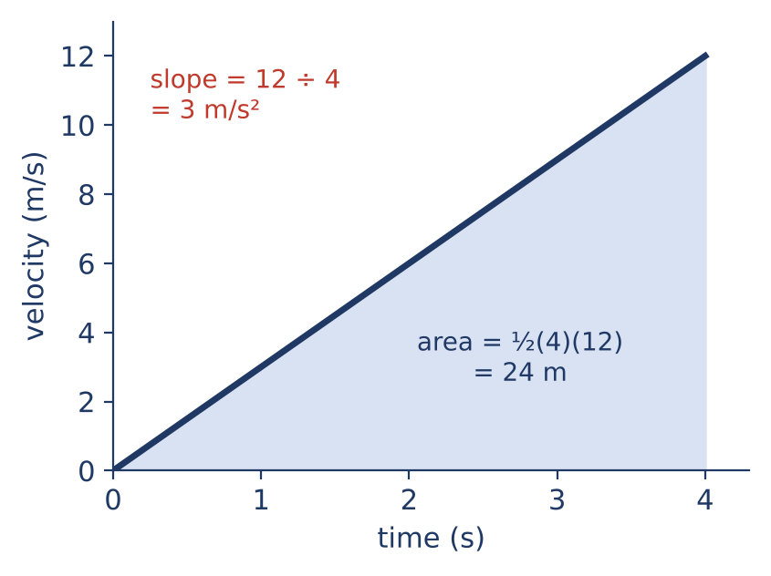
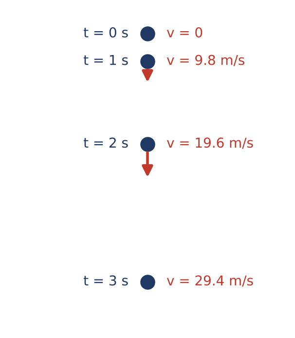

# Cornell Notes: Kinematics

*Physics | Semester 1, Unit 1 | Position, velocity, acceleration, motion graphs, free fall*

Name: ____________________  Period: ______  Date: __________

**Learning targets**

- I can tell distance from displacement and speed from velocity, and say which are vectors.
- I can calculate average velocity and acceleration from data.
- I can read position-time and velocity-time graphs using slope and area.
- I can choose a kinematic equation and solve a constant-acceleration problem.
- I can solve free-fall problems using a = 9.8 m/s² downward.

**Essential question:** How can we describe and predict where an object will be and how fast it will be moving?

How to use these notes: cover the Notes column, answer each cue question aloud, then check.

## 1. Position, Distance, and Displacement

| Cues / Questions | Notes |
|---|---|
| **What is the difference between distance and displacement?** | • **Distance** is the total length of the path traveled. It is a **scalar** (size only). • **Displacement** is the change in position: Δx = xf − xi. It is a **vector** (size and direction). • Example: walk 4 m east, then 3 m west. Distance = **7 m**. Displacement = **1 m east**. |
| **What makes a quantity a vector instead of a scalar?** | • A **vector** has magnitude and direction: displacement, velocity, acceleration, force. • A **scalar** has magnitude only: distance, speed, time, mass. • In one dimension, show direction with a **+ or − sign** (for example, right and up are +). |
| **Why does every motion problem need a reference point?** | • **Position** is measured from an origin (x = 0) that you choose. • Motion is described relative to a **frame of reference**. A passenger is at rest relative to the bus but moving relative to the road. |

**IXL practice (goal: SmartScore 80+):** **Physics C.1** Classify vectors and scalars; **Physics D.1** Distance and displacement in one dimension

## 2. Speed and Velocity

| Cues / Questions | Notes |
|---|---|
| **How do you calculate average speed and average velocity?** | • **Average speed** = total distance ÷ total time. • **Average velocity** = displacement ÷ time: vavg = Δx / Δt. Units: m/s. • Worked example: a runner goes once around a 400 m track in 80 s. Average speed = 400 ÷ 80 = **5 m/s**. Displacement is 0 (back at the start), so average velocity = **0 m/s**. |
| **What does the slope of a position-time graph tell you?** | • **Slope = velocity.** Rise is Δx, run is Δt. • Straight line = constant velocity. Steeper line = faster. Flat line = at rest. • Line sloping down = moving in the negative direction. **Curved line = velocity is changing** (accelerating). |
| **How is instantaneous velocity different from average velocity?** | • **Instantaneous velocity** is the velocity at one moment (what a speedometer shows, plus direction). • **Average velocity** covers a whole time interval. They are equal only when velocity is constant. |

**IXL practice (goal: SmartScore 80+):** **Physics D.2** Speed and velocity in one dimension; **Grade 8 H.1** Calculate velocity from time and distance; **Grade 8 H.2** Calculate distance from velocity and time; **Grade 8 H.3** Calculate time from velocity and distance; **Grade 8 H.4** Calculate velocity, distance, and time I; **Grade 8 H.5** Calculate velocity, distance, and time II; **Grade 8 H.6** Create a distance-time graph; **Grade 8 H.7** Interpret distance-time graphs

## 3. Acceleration

| Cues / Questions | Notes |
|---|---|
| **What is acceleration, and what are its units?** | • **Acceleration** is how fast velocity changes: a = Δv / Δt = (vf − vi) / t. Units: **m/s²**. • Worked example: a car goes from 0 to 20 m/s in 5 s. a = (20 − 0) ÷ 5 = **4 m/s²**. Each second it gains 4 m/s. • Speeding up, slowing down, and changing direction are all acceleration. |
| **Does a negative acceleration always mean slowing down?** | • **No.** The sign of a gives its direction, not whether the object slows. • Velocity and acceleration with the **same sign: speeding up**. **Opposite signs: slowing down**. • Example: v = −10 m/s and a = −2 m/s². The object is speeding up in the negative direction. |
| **What do the slope and the area of a velocity-time graph tell you?** | • **Slope = acceleration. Area under the line = displacement.** • Worked example: velocity rises steadily from 0 to 12 m/s in 4 s. Slope = 12 ÷ 4 = **3 m/s²**. Area = ½ × 4 × 12 = **24 m**. • A flat line above the axis means constant velocity, not at rest. |
| **Can an object have zero velocity and still be accelerating?** | • **Yes.** A ball thrown straight up has v = 0 at the top, but a is still 9.8 m/s² downward. • If a were zero at the top, the ball would stay there. |

**IXL practice (goal: SmartScore 80+):** **Physics D.3** Acceleration in one dimension; **Grade 8 I.1** Identify whether objects are accelerating

## 4. Kinematic Equations and Free Fall

| Cues / Questions | Notes |
|---|---|
| **Which four equations describe motion with constant acceleration?** | • vf = vi + at • Δx = vi t + ½at² • vf² = vi² + 2aΔx • Δx = ½(vi + vf)t • They work **only when acceleration is constant**. |
| **How do you choose which kinematic equation to use?** | • List what you know and what you want (vi, vf, a, t, Δx). You need **three knowns**. • Pick the equation that has your unknown and does **not** contain the variable you were not given. • Worked example: a car starts from rest and accelerates at 3 m/s² for 6 s. How far does it go? Knowns: vi = 0, a = 3, t = 6. Δx = 0 + ½(3)(6²) = **54 m**. Sense check: final speed is 18 m/s, average 9 m/s, and 9 × 6 = 54 m. • Worked example: a car at 20 m/s brakes at −5 m/s². Stopping distance? 0² = 20² + 2(−5)Δx, so Δx = 400 ÷ 10 = **40 m**. |
| **What is free fall, and what is the acceleration of a falling object?** | • **Free fall** is motion with gravity as the only force (air resistance ignored). • Every object in free fall accelerates at **g = 9.8 m/s² downward**, whatever its mass. • Worked example: a rock is dropped from rest and falls for 3 s. Speed: v = 9.8 × 3 = **29.4 m/s**. Distance: d = ½(9.8)(3²) = **44.1 m**. • On the way up, a tossed ball loses 9.8 m/s each second. On the way down it gains 9.8 m/s each second. |

**IXL practice (goal: SmartScore 80+):** **Physics D.4** Solve problems using kinematic equations

## 5. Labs and Measurement

| Cues / Questions | Notes |
|---|---|
| **How do you measure a constant velocity in the lab?** | • **Constant-velocity lab** (battery buggy or walking student): mark position every second with a meter stick and stopwatch. • Graph position vs. time. The **slope of the best-fit line is the speed**. • **Independent variable:** time. **Dependent variable:** position. |
| **How do you measure acceleration in the lab?** | • **Cart on a ramp** (or a dropped object): release from rest, measure distance and time. • From rest, Δx = ½at², so **a = 2Δx / t²**. • **Independent variable:** ramp height (or distance). **Dependent variable:** time. Keep the cart and start line the same. |
| **Why do you run several trials and watch significant figures?** | • Hand timing has a reaction-time error of about 0.2 s. **Averaging three or more trials** reduces random error. • Report answers to the precision of the least precise measurement. |

**IXL practice (goal: SmartScore 80+):** **Physics A.2** Identify independent and dependent variables; **Physics B.1** Identify significant figures in measurements; **Physics B.2** Add and subtract with significant figures; **Physics B.3** Multiply and divide with significant figures; **Physics B.4** Calculations with significant figures; **Grade 8 KK.4** Abbreviate time, length, speed, and acceleration units

## Memory tricks

- **List knowns, pick the equation missing the variable you don't have.** Every constant-acceleration problem. Three knowns give you the fourth.
- **Slope of position-time = velocity. Slope of velocity-time = acceleration. Area under velocity-time = displacement.** Any motion graph question.
- **Same signs speed up, opposite signs slow down.** Deciding whether an object is speeding up from the signs of v and a.
- **g = 9.8 m/s² down, the whole flight.** Free fall: going up, at the top, and coming down.
- **Vectors have direction, scalars do not.** Distance vs. displacement and speed vs. velocity questions.

## Summary

Kinematics describes motion without asking what causes it. Position tells where an object is, velocity tells how fast its position changes and in which direction, and acceleration tells how fast its velocity changes. Graphs carry the same information: the slope of a position-time graph is velocity, the slope of a velocity-time graph is acceleration, and the area under a velocity-time graph is displacement. When acceleration is constant, four equations connect vi, vf, a, t, and Δx. Free fall is the most common case, with a = 9.8 m/s² downward for every object.

## Visual memory aids

A motion map shows position at equal time intervals. Even spacing means constant velocity. Growing spacing means speeding up. **v = Δx / Δt**

On a position-time graph, the slope is the velocity. A curve means the velocity is changing. **slope = Δx / Δt = v**

On a velocity-time graph, the slope is the acceleration and the shaded area is the displacement. **slope = a,  area = Δx**

A dropped object gains 9.8 m/s every second, so the gaps between dots grow. **v = gt,  d = ½gt²**

## Study method

1. Cover the Notes column and answer each cue aloud.
2. Check your answer and mark the ones you missed.
3. Redraw each visual memory aid from memory.
4. Repeat the next day and again a few days later. Recall spread over several days builds memory that rereading does not.
5. Finish the IXL plan to SmartScore 80+ before the test.
