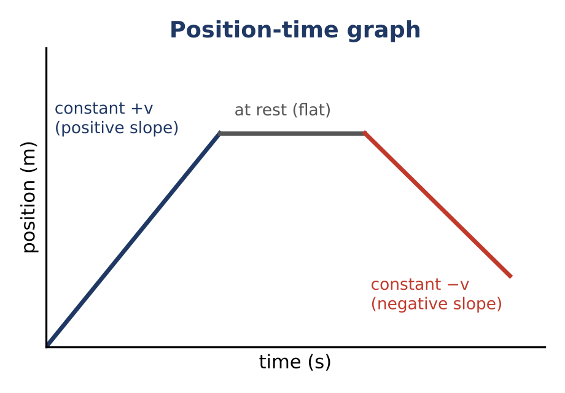
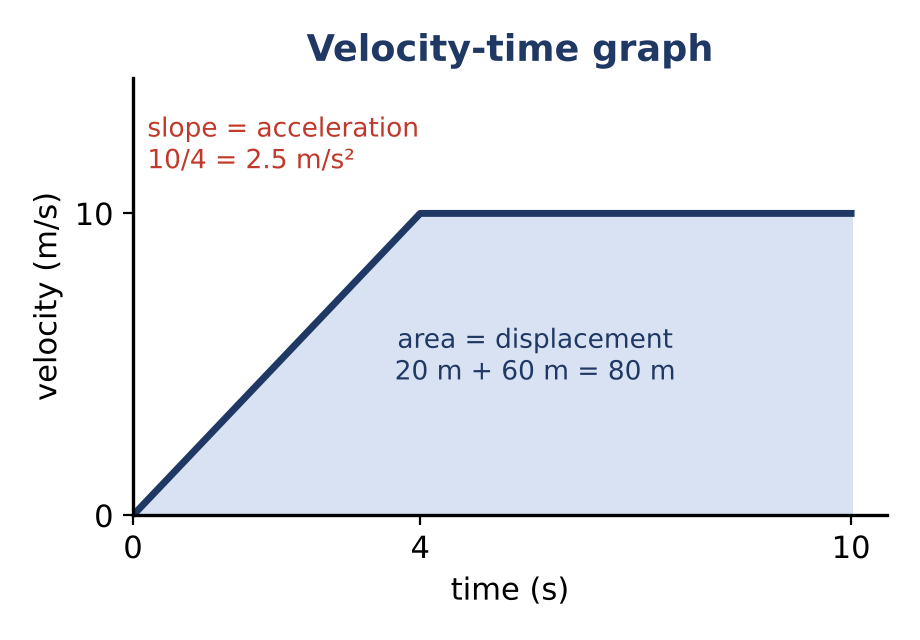
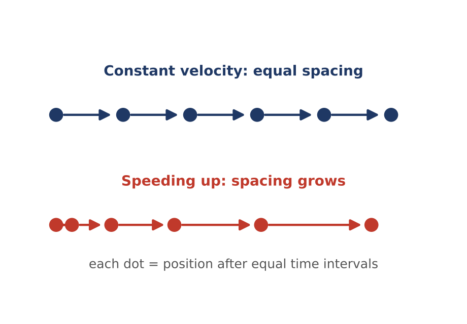
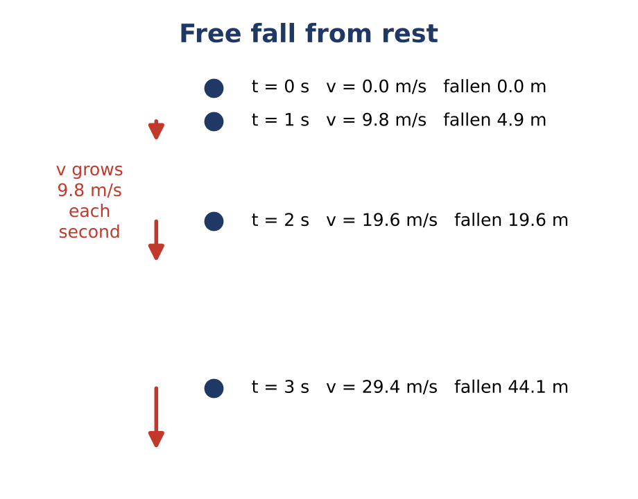

# Cornell Notes: Kinematics

*Physics (Grade 11) | Semester 1, Unit 1 | Position, velocity, acceleration, motion graphs, free fall*

Name: ________________  Period: ______  Date: __________

A print-ready Word version with the same content is in [cornell-notes.docx](cornell-notes.docx).

**Learning targets**

- [ ] I can tell distance from displacement and speed from velocity, and calculate each one.
- [ ] I can calculate acceleration and say what its sign means.
- [ ] I can read position-time and velocity-time graphs (slope and area).
- [ ] I can pick and solve the right kinematic equation for constant acceleration.
- [ ] I can solve free-fall problems using g = 9.8 m/s² downward.

**Essential question:** How can we describe and predict the motion of an object using words, graphs, and equations?

> **How to use these notes:** the left column is your self-test. Cover the right column, answer each cue question aloud, then check.

## 1. Describing Motion: Position, Distance, Displacement

| Cues / Questions | Notes |
|---|---|
| **What is the difference between a scalar and a vector?** | • A **scalar** has size (magnitude) only: distance, speed, time, mass. • A **vector** has size and direction: displacement, velocity, acceleration, force. • In one dimension, direction is shown with a sign (+ right/up, − left/down). |
| **How is distance different from displacement?** | • **Distance** = total path length traveled. Never negative. • **Displacement** Δx = x_final − x_initial. Only start and end points matter. • Worked example: walk 40 m east, then 30 m west. Distance = 40 + 30 = **70 m**. Displacement = 40 − 30 = **10 m east**. • A full lap around a track: distance = one lap, displacement = **0**. |
| **Why do we need a reference point?** | • Position only has meaning measured from an **origin** (reference point). Motion is always described relative to a **frame of reference**. |

**IXL practice (goal: SmartScore 80+):** **Physics C.1** Classify vectors and scalars · **Physics D.1** Distance and displacement in one dimension

## 2. Speed and Velocity

| Cues / Questions | Notes |
|---|---|
| **How do you calculate average speed and average velocity?** | • **Average speed** = total distance ÷ total time. • **Average velocity** = displacement ÷ time, v = Δx/Δt. Units: m/s. It has a direction. • Worked example: a runner goes 300 m east in 60 s, then 100 m west in 40 s. • Distance = 400 m, time = 100 s, so average speed = 400/100 = **4.0 m/s**. • Displacement = 300 − 100 = 200 m east, so average velocity = 200/100 = **2.0 m/s east**. • Sense check: velocity is smaller than speed because the runner doubled back. |
| **What is instantaneous velocity?** | • The velocity at one moment (what a speedometer plus a compass would show). On a position-time graph it is the slope at that point. |
| **Can speed be constant while velocity changes?** | • **Yes.** A car rounding a curve at a steady 20 m/s keeps the same speed, but its direction changes, so its velocity changes. |

**IXL practice (goal: SmartScore 80+):** **Physics D.2** Speed and velocity in one dimension · **Grade 8 H.1** Calculate velocity from time and distance · **Grade 8 H.2** Calculate distance from velocity and time · **Grade 8 H.3** Calculate time from velocity and distance · **Grade 8 H.4** Calculate velocity, distance, and time I · **Grade 8 H.5** Calculate velocity, distance, and time II

## 3. Acceleration

| Cues / Questions | Notes |
|---|---|
| **What is acceleration and how is it calculated?** | • **Acceleration** = change in velocity ÷ time: a = Δv/Δt = (v − v₀)/t. Units: **m/s²**. • Worked example: a car goes from rest to 24 m/s in 6.0 s. a = (24 − 0)/6.0 = **4.0 m/s²**. • Meaning: the velocity grows by 4.0 m/s every second. |
| **What are the three ways an object can accelerate?** | • **Speed up, slow down, or change direction.** Any change in velocity is an acceleration. |
| **Does negative acceleration always mean slowing down?** | • **No.** The sign gives the direction of the acceleration, not whether the object slows. • Same sign for v and a: **speeding up**. Opposite signs: **slowing down**. • Worked example: a car moving east at 25 m/s slows to 15 m/s in 5.0 s. a = (15 − 25)/5.0 = −2.0 m/s², which is **2.0 m/s² west**. |

**IXL practice (goal: SmartScore 80+):** **Physics D.3** Acceleration in one dimension · **Grade 8 I.1** Identify whether objects are accelerating

## 4. Motion Graphs

| Cues / Questions | Notes |
|---|---|
| **What does the slope of a position-time graph tell you?** | • Slope = **velocity**. Straight line = constant velocity. Steeper = faster. Flat = at rest. Downward slope = moving in the negative direction. • A **curve** means the velocity is changing (acceleration). |
| **What do the slope and the area of a velocity-time graph tell you?** | • Slope = **acceleration**. Area between the line and the time axis = **displacement**. • A flat line above zero means constant velocity (moving, not at rest). • Worked example: velocity rises steadily from 0 to 10 m/s in 4.0 s, then stays at 10 m/s for 6.0 s. • Triangle: ½(4.0)(10) = 20 m. Rectangle: (6.0)(10) = 60 m. Displacement = **80 m**. |
| **How do you tell "at rest" on each graph?** | • Position-time: a **horizontal** line. Velocity-time: a line **on the time axis** (v = 0). |

**IXL practice (goal: SmartScore 80+):** **Grade 8 H.6** Create a distance-time graph · **Grade 8 H.7** Interpret distance-time graphs · IXL has no velocity-time graph skill. Use the matching Concept Builders at physicsclassroom.com.

## 5. Kinematic Equations (Constant Acceleration)

| Cues / Questions | Notes |
|---|---|
| **What are the four kinematic equations?** | • **v = v₀ + at** (no Δx) • **Δx = v₀t + ½at²** (no v) • **v² = v₀² + 2aΔx** (no t) • **Δx = ½(v₀ + v)t** (no a) • They work only when acceleration is **constant**. |
| **How do you choose which equation to use?** | • List the five variables (Δx, v₀, v, a, t). Mark the three you know and the one you want. Pick the equation that **leaves out the variable you do not have and do not need**. |
| **How far does a car going 20 m/s travel while braking at −5.0 m/s²?** | • Given: v₀ = 20 m/s, v = 0, a = −5.0 m/s². Unknown: Δx. No time, so use v² = v₀² + 2aΔx. • 0 = (20)² + 2(−5.0)Δx, so Δx = 400/10 = **40 m**. • Time to stop: v = v₀ + at, so t = (0 − 20)/(−5.0) = **4.0 s**. • Sense check: average velocity 10 m/s × 4.0 s = 40 m. Matches. |
| **What happens to stopping distance when speed doubles?** | • Stopping distance depends on v₀², so doubling the speed makes it **four times** as long (40 m becomes 160 m). |

**IXL practice (goal: SmartScore 80+):** **Physics D.4** Solve problems using kinematic equations

## 6. Free Fall

| Cues / Questions | Notes |
|---|---|
| **What is free fall, and what is the acceleration?** | • **Free fall** = motion with gravity as the only force (no air resistance). • Acceleration is **g = 9.8 m/s² downward** for every object, heavy or light, whether it is moving up, moving down, or at the top. |
| **How fast and how far does an object dropped from rest fall in 3.0 s?** | • Given: v₀ = 0, a = 9.8 m/s² (taking down as positive), t = 3.0 s. • v = v₀ + at = (9.8)(3.0) = **29.4 m/s**. • Δy = ½at² = ½(9.8)(3.0)² = **44.1 m**. |
| **What are the velocity and acceleration at the top of an upward throw?** | • Velocity is **zero** for an instant. Acceleration is still **9.8 m/s² downward**. If it were zero, the ball would hang there. • Worked example: a ball is thrown up at 19.6 m/s. Time to top: t = 19.6/9.8 = **2.0 s**. Maximum height: Δy = v₀²/(2g) = (19.6)²/19.6 = **19.6 m**. • Symmetry: it takes 2.0 s to come back down and returns at 19.6 m/s. |

**IXL practice (goal: SmartScore 80+):** **Physics D.4** Solve problems using kinematic equations · For free-fall concept practice, use the kinematics Concept Builders at physicsclassroom.com.

## 7. Labs and Measurement

| Cues / Questions | Notes |
|---|---|
| **How do you find velocity in the constant-velocity (buggy) lab?** | • Mark the buggy's position every 1.0 s, then plot position vs time. The **slope of the best-fit line** is the velocity. • **Independent variable:** time. **Dependent variable:** position. |
| **How do you measure acceleration with a cart on a ramp?** | • Record velocity vs time (motion sensor or video). The **slope of the velocity-time graph** is the acceleration. • Independent variable: ramp angle (or time). Dependent variable: acceleration (or velocity). Keep the cart and surface the same. |
| **How can you measure g in the lab?** | • Drop an object from a measured height h and time the fall: **g = 2h/t²**. Repeat trials and average, because timing by hand is the largest source of error. |

**IXL practice (goal: SmartScore 80+):** **Physics A.2** Identify independent and dependent variables · **Physics B.1** Identify significant figures in measurements · **Physics B.2** Add and subtract with significant figures · **Physics B.3** Multiply and divide with significant figures · **Physics B.4** Calculations with significant figures

## Memory Tricks

- **GUESS.** Given, Unknown, Equation, Substitute, Solve. Use on every calculation problem.
- **Slope and area.** Position-time slope is velocity. Velocity-time slope is acceleration. Velocity-time area is displacement.
- **Same signs speed up, opposite signs slow down.** Compare the signs of velocity and acceleration to decide whether an object is speeding up.
- **Pick the equation missing what you are missing.** Each kinematic equation leaves out one variable. Choose the one that leaves out the variable you neither know nor want.
- **King Henry Died By Drinking Chocolate Milk.** Metric prefixes: kilo, hecto, deka, base, deci, centi, milli. Use when converting units.

## Summary

Kinematics describes motion without asking what causes it. Position, displacement, velocity, and acceleration are vectors, so direction (the sign) matters. Velocity is how fast position changes and acceleration is how fast velocity changes, which is why the slope of a position-time graph is velocity and the slope of a velocity-time graph is acceleration. When acceleration is constant, four kinematic equations connect displacement, initial velocity, final velocity, acceleration, and time. Free fall is the most important case: every object accelerates at 9.8 m/s² downward, even at the top of its path.

## Visual Memory Aids

Position-time graph: the slope is the velocity. Steeper is faster, flat is at rest. **v = Δx/Δt = slope**

Velocity-time graph: the slope is the acceleration and the shaded area is the displacement. **a = Δv/Δt = slope; Δx = area**

Motion maps (dot diagrams): even spacing is constant velocity; growing spacing is speeding up. **Dots are equal time intervals apart**

Free fall from rest: speed grows by 9.8 m/s each second and distance grows with t². **v = gt; Δy = ½gt²**

## Study Method

1. Cover the Notes column and answer each cue question aloud.
2. Uncover, check, and mark every cue you missed.
3. Redraw each Visual Memory Aid from memory, with labels and its equation.
4. Repeat the next day and again a few days later. Recall spread over days builds memory that rereading does not.
5. Finish the IXL Practice Plan to SmartScore 80+ before the test.

## IXL Practice Plan

Reach SmartScore 80+ on each skill before the test.

| Done | # | Skill | Skill name | Notes section |
|---|---|---|---|---|
| ☐ | 1 | Physics A.2 | Identify independent and dependent variables | 7 |
| ☐ | 2 | Physics B.1 | Identify significant figures in measurements | 7 |
| ☐ | 3 | Physics B.2 | Add and subtract with significant figures | 7 |
| ☐ | 4 | Physics B.3 | Multiply and divide with significant figures | 7 |
| ☐ | 5 | Physics B.4 | Calculations with significant figures | 7 |
| ☐ | 6 | Physics C.1 | Classify vectors and scalars | 1 |
| ☐ | 7 | Grade 8 H.1 | Calculate velocity from time and distance | 2 |
| ☐ | 8 | Grade 8 H.2 | Calculate distance from velocity and time | 2 |
| ☐ | 9 | Grade 8 H.3 | Calculate time from velocity and distance | 2 |
| ☐ | 10 | Grade 8 H.4 | Calculate velocity, distance, and time I | 2 |
| ☐ | 11 | Grade 8 H.5 | Calculate velocity, distance, and time II | 2 |
| ☐ | 12 | Grade 8 H.6 | Create a distance-time graph | 4 |
| ☐ | 13 | Grade 8 H.7 | Interpret distance-time graphs | 4 |
| ☐ | 14 | Grade 8 I.1 | Identify whether objects are accelerating | 3 |
| ☐ | 15 | Physics D.1 | Distance and displacement in one dimension | 1 |
| ☐ | 16 | Physics D.2 | Speed and velocity in one dimension | 2 |
| ☐ | 17 | Physics D.3 | Acceleration in one dimension | 3 |
| ☐ | 18 | Physics D.4 | Solve problems using kinematic equations | 5, 6 |

No full IXL match (use physicsclassroom.com Concept Builders): Motion Graphs; Free Fall.

*Self-test tip: cover the Notes column, answer each cue aloud, then redo every worked example on blank paper without looking.*
