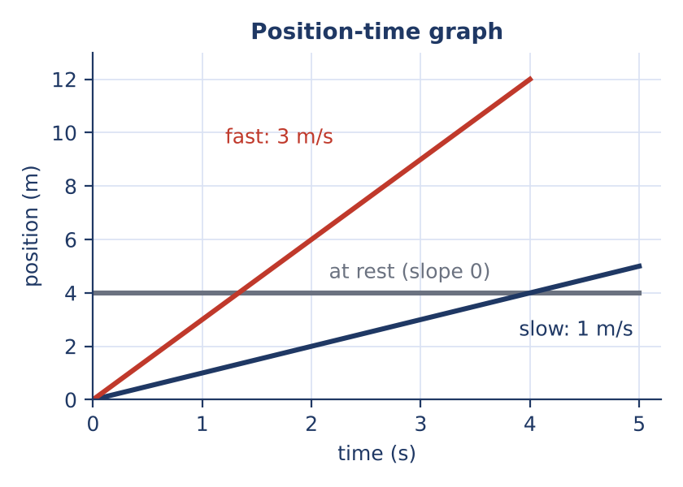
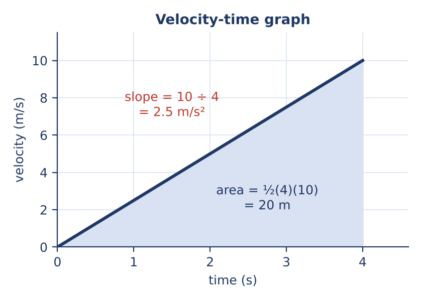
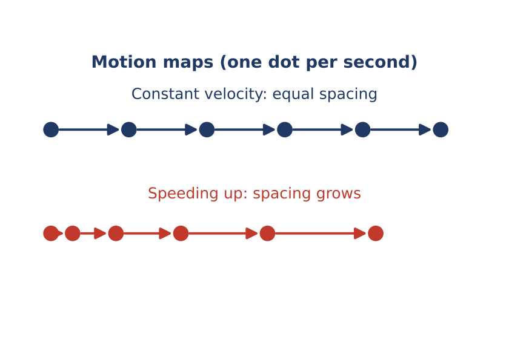
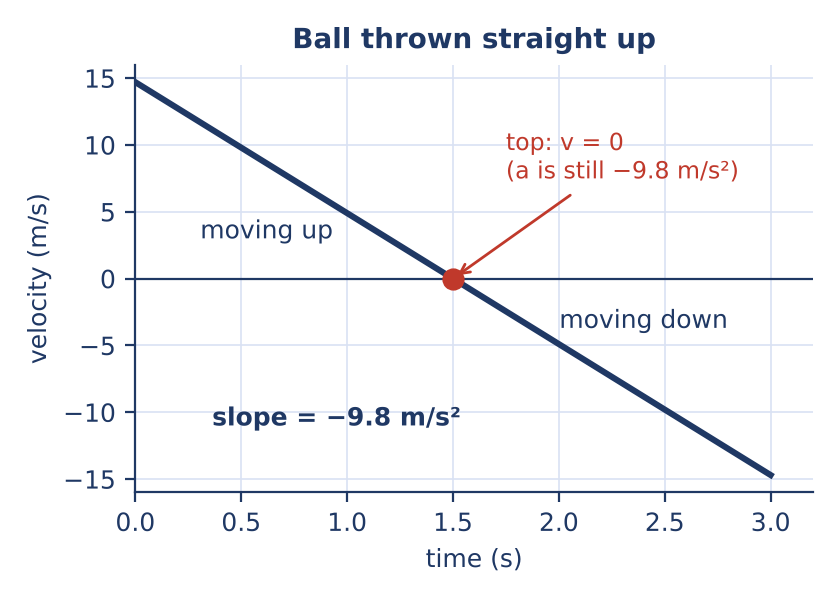

# Cornell Notes: Kinematics

*Physics | Unit 1 | Motion in one dimension*

Name: ________________  Period: ______  Date: __________

> A print-ready Word version with the same content is in this folder. Cover the right-hand column and answer each cue aloud to self-test.

**Learning targets**

- I can tell distance from displacement and speed from velocity, and calculate each.
- I can read position-time and velocity-time graphs using slope and area.
- I can define acceleration and decide from signs whether an object speeds up or slows down.
- I can choose and solve the right kinematic equation for constant acceleration.
- I can solve free-fall problems and explain why all objects fall with the same acceleration.
- I can collect motion data in a lab and find velocity from the slope of a graph.

**Essential question:** How can we describe and predict the motion of an object using words, graphs, and equations?

## 1. Position, Distance, and Displacement

| Cues / Questions | Notes |
|---|---|
| **What is the difference between distance and displacement?** | • **Distance** is the total path length traveled. It is a scalar (size only). • **Displacement** is the change in position: **Δx = x_f − x_i**. It is a vector (size and direction). • Worked example: you walk 8 m east, then 3 m west. Distance = 8 + 3 = **11 m**. Displacement = 8 − 3 = **5 m east**. • Sense check: displacement can never be larger than distance. |
| **What makes a quantity a vector instead of a scalar?** | • A **vector** needs a direction to be complete: displacement, velocity, acceleration, force. • A **scalar** is fully described by a number and unit: distance, speed, time, mass. • In one dimension, direction is shown with a **+ or − sign**. Pick the positive direction first and keep it. |

**IXL practice (goal: SmartScore 80+):** **Physics C.1** Classify vectors and scalars; **Physics D.1** Distance and displacement in one dimension

## 2. Speed and Velocity

| Cues / Questions | Notes |
|---|---|
| **How is average speed different from average velocity?** | • **Average speed = distance ÷ time.** **Average velocity = displacement ÷ time.** • Worked example: a runner completes one 400 m lap in 80 s. Speed = 400 ÷ 80 = **5 m/s**. Displacement is 0 (back at the start), so average velocity = **0 m/s**. • Units: m/s. Velocity also needs a direction. |
| **What does the slope of a position-time graph tell you?** | • **Slope of a position-time graph = velocity.** • Straight line = constant velocity. Steeper line = faster. **Flat line = at rest.** Line sloping down = moving in the negative direction. • A curve means the velocity is changing (the object is accelerating). • Where two lines cross, the objects are at the **same position**, not the same speed. |

**IXL practice (goal: SmartScore 80+):** **Physics D.2** Speed and velocity in one dimension; **Grade 8 H.1** Calculate velocity from time and distance; **Grade 8 H.2** Calculate distance from velocity and time; **Grade 8 H.3** Calculate time from velocity and distance; **Grade 8 H.4** Calculate velocity, distance, and time I; **Grade 8 H.5** Calculate velocity, distance, and time II; **Grade 8 H.6** Create a distance-time graph; **Grade 8 H.7** Interpret distance-time graphs

## 3. Acceleration

| Cues / Questions | Notes |
|---|---|
| **What is acceleration, and what are its units?** | • **Acceleration = change in velocity ÷ time: a = Δv/Δt = (v − v₀)/t.** Units: **m/s²** (meters per second, each second). • Worked example: a car goes from 0 to 24 m/s in 6 s. a = (24 − 0) ÷ 6 = **4 m/s²**. Each second it gains 4 m/s. • Constant velocity means **a = 0**, even if the object is moving fast. |
| **Does negative acceleration always mean slowing down?** | • No. The sign of acceleration shows its **direction**, not whether the object slows. • **Same signs (v and a) = speeding up. Opposite signs = slowing down.** • Example: a car moving in the negative direction (v = −10 m/s) with a = −2 m/s² is speeding up. |
| **What do the slope and the area of a velocity-time graph tell you?** | • **Slope of a velocity-time graph = acceleration.** • **Area between the line and the time axis = displacement.** • Worked example: velocity rises steadily from 0 to 10 m/s in 4 s. Slope = 10 ÷ 4 = **2.5 m/s²**. Area = ½ × 4 × 10 = **20 m**. • A line crossing the time axis means the object **changed direction**. |

**IXL practice (goal: SmartScore 80+):** **Physics D.3** Acceleration in one dimension; **Grade 8 I.1** Identify whether objects are accelerating

## 4. Kinematic Equations

| Cues / Questions | Notes |
|---|---|
| **What are the four kinematic equations, and when can you use them?** | • Use them only when **acceleration is constant**. • **v = v₀ + at** • **Δx = v₀t + ½at²** • **v² = v₀² + 2aΔx** • **Δx = ½(v₀ + v)t** • Five variables: Δx, v₀, v, a, t. Each equation leaves one of them out. |
| **How do you choose which kinematic equation to use?** | • List what you know and what you want (**GUESS**: Givens, Unknown, Equation, Substitute, Solve). • Pick the equation that contains your three knowns and your unknown, and **leaves out the variable you do not have**. • Hidden givens: "from rest" means v₀ = 0. "Comes to a stop" means v = 0. |
| **How far does a car travel while braking from 20 m/s at −5 m/s²?** | • Givens: v₀ = 20 m/s, v = 0, a = −5 m/s². Unknown: Δx. No time given, so use **v² = v₀² + 2aΔx**. • 0 = 20² + 2(−5)Δx, so Δx = 400 ÷ 10 = **40 m**. • Second example: from rest at 3 m/s² for 5 s. v = 0 + 3(5) = **15 m/s**. Δx = ½(3)(5²) = **37.5 m**. • Sense check: stopping distance depends on v². Double the speed, four times the distance. |

**IXL practice (goal: SmartScore 80+):** **Physics D.4** Solve problems using kinematic equations

## 5. Free Fall

| Cues / Questions | Notes |
|---|---|
| **What is the acceleration of any object in free fall?** | • **g = 9.8 m/s² downward**, for every object, when air resistance can be ignored. • Mass does not matter: a heavy ball and a light ball dropped together land together. • Worked example: a rock dropped from rest falls for 2 s. v = 9.8 × 2 = **19.6 m/s**. Distance = ½(9.8)(2²) = **19.6 m**. • Falling distance grows with t². Twice the time, four times the distance. |
| **What are the velocity and acceleration at the top of a toss?** | • At the top, **velocity = 0** for an instant, but **acceleration is still 9.8 m/s² downward**. • If the acceleration were zero at the top, the ball would stay there. • Worked example: a ball is thrown up at 14.7 m/s. Time to the top: t = 14.7 ÷ 9.8 = **1.5 s**. Height: 14.7² ÷ (2 × 9.8) = **11.0 m**. • Symmetry: time up = time down, and it returns to the launch height at the launch speed. |

**IXL practice (goal: SmartScore 80+):** **Physics D.4** Solve problems using kinematic equations

## 6. Labs and Measurement

| Cues / Questions | Notes |
|---|---|
| **What question does the lab "Constant-velocity buggy and cart on a ramp" answer, and what are its variables?** | • Question: How does the position of a moving object change with time? • **Independent variable:** Time (s) • **Dependent variable:** Position (m) |
| **Which formula does the lab use, and what are the steps?** | • **Formula:** Velocity = slope of the position-time graph. For the ramp: a = slope of the velocity-time graph. • Mark a track every 0.5 m. Time the buggy as it passes each mark. Run three trials and average. • Graph position (vertical axis) against time (horizontal axis) and draw a best-fit line. • Find the slope with units. Repeat with a cart rolling down a ramp and compare the shape of the graphs. • Record measurements to the precision of the tool and keep the correct significant figures in calculations. |

**IXL practice (goal: SmartScore 80+):** **Physics A.2** Identify independent and dependent variables; **Physics B.1** Identify significant figures in measurements; **Physics B.4** Calculations with significant figures; **Grade 8 KK.4** Abbreviate time, length, speed, and acceleration units

## Memory tricks

| Trick or rule | When to use it |
|---|---|
| **GUESS: Givens, Unknown, Equation, Substitute, Solve** | Every calculation problem. Write the givens with units before touching an equation. |
| **Slope of position-time is velocity; slope of velocity-time is acceleration** | Any time a graph question asks how fast or how quickly speed changes. |
| **Area under velocity-time is displacement** | When a graph question asks how far. |
| **Same signs speed up, opposite signs slow down** | Deciding what a negative acceleration really means. |
| **From rest: v₀ = 0. Stops: v = 0. Dropped: v₀ = 0 and a = 9.8 m/s² down** | Finding the hidden givens in a word problem. |

## Summary

Kinematics describes motion without asking what causes it. Position, velocity, and acceleration are linked: velocity is how fast position changes, and acceleration is how fast velocity changes. Those links show up as slope and area on motion graphs and as the four kinematic equations when acceleration is constant. Free fall is the most important constant-acceleration case: every object accelerates downward at 9.8 m/s², even at the top of its path.

## Visual memory aids

Position-time graph for three objects: at rest, slow, and fast. **Slope = velocity. Flat line = at rest.**

Velocity-time graph for constant acceleration with the area shaded. **Slope = acceleration. Area = displacement.**

Motion maps (dot diagrams): equal spacing vs. growing spacing. **Equal spacing = constant velocity. Growing spacing = speeding up.**

Velocity-time graph for a ball thrown straight up. **Slope is −9.8 m/s² the whole time. v = 0 at the top.**

## Study method

1. Cover the Notes column and answer each cue aloud.
2. Check, and mark the ones you missed.
3. Redraw each visual memory aid from memory.
4. Repeat the next day, and again a few days later. Recall spread over days builds memory that rereading does not.
5. Finish the IXL plan to SmartScore 80+ before the test.
