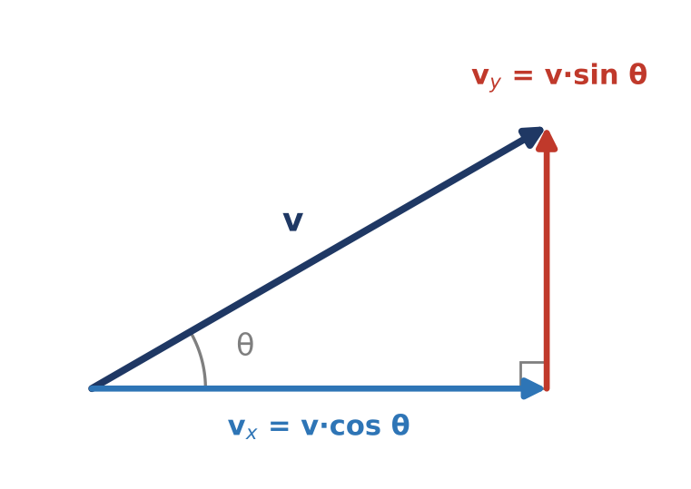
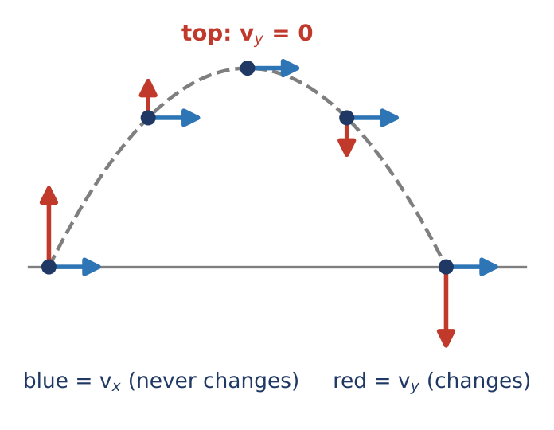
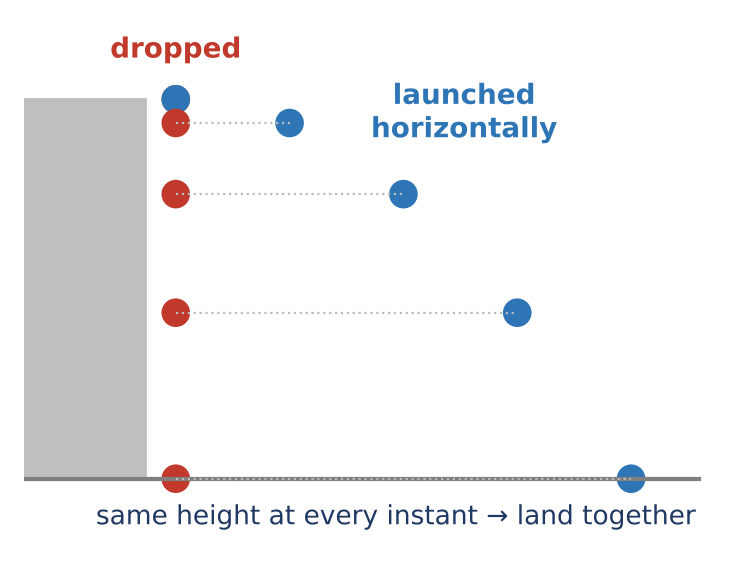
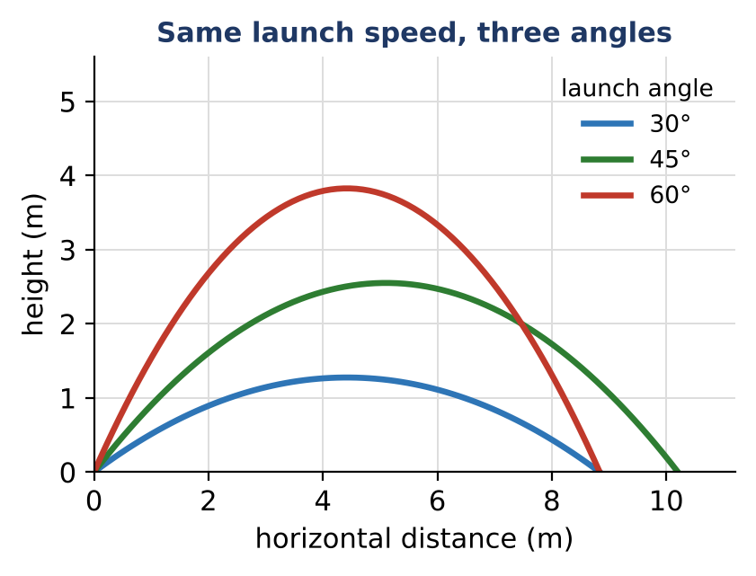

# Unit 2: Projectile Motion

**Suggested pacing:** Weeks 5–7 of semester 1  
**Essential question:** How can we predict where a thrown or launched object will land?

## Materials in this folder

| File | What it is |
|---|---|
| [cornell-notes.md](cornell-notes.md) | Cornell notes, readable here on GitHub |
| [cornell-notes-projectile.docx](cornell-notes-projectile.docx) | The same notes as a printable Word document with a cover page, visual memory aids, and an IXL practice plan |
| [Quiz](../../quizzes/index.html) | Interactive quiz on the most often missed questions (open `quizzes/index.html` in a browser and choose Projectile Motion) |

## Standards (NGSS for California, high school)

- **HS-PS2-1** Analyze data to support the claim that Newton's second law describes the relationship among net force, mass, and acceleration. A projectile is the case where gravity is the only force.
- **SEP 2 / SEP 5** Developing and using models; using mathematics and computational thinking (splitting motion into independent x and y parts).

## Learning objectives

Check each box when you can do it without notes.

- [ ] I can break a velocity vector into horizontal and vertical components.
- [ ] I can explain why the horizontal and vertical motions of a projectile are independent.
- [ ] I can solve horizontal-launch problems for time of flight and range.
- [ ] I can solve angled-launch problems for time, maximum height, and range.
- [ ] I can describe the velocity and acceleration of a projectile at any point on its path.

## Key concepts to master

| Concept | What you need to know |
|---|---|
| **Vector components** | Any vector can be split into a horizontal (x) part and a vertical (y) part: v_x = v·cos θ, v_y = v·sin θ. |
| **Projectile** | An object moving through the air with gravity as the only force acting on it. |
| **Independence of motion** | Horizontal and vertical motions do not affect each other. Time is the only quantity they share. |
| **Horizontal motion** | No horizontal force, so a_x = 0 and v_x stays constant. |
| **Vertical motion** | Free fall: a_y = 9.8 m/s² downward the whole flight. |
| **Trajectory** | The curved path of a projectile, a parabola. |
| **Range and maximum height** | Range is the horizontal distance covered. Maximum height is where v_y = 0. |

## Visual memory aids

A launch velocity split into its horizontal and vertical components. **Rule:** v_x = v·cos θ;  v_y = v·sin θ

Along the path the horizontal velocity arrow stays the same length while the vertical arrow shrinks, vanishes at the top, then grows downward. **Rule:** v_x constant;  v_y changes by 9.8 m/s each second

A dropped ball and a horizontally launched ball fall the same vertical distance in the same time and land together. **Rule:** t = √(2h ÷ g) for both

Same launch speed at 30°, 45°, and 60°: 45° goes farthest; 30° and 60° land at the same spot. **Rule:** maximum range at 45°

## Learning resources

| Resource | Use it for |
|---|---|
| [The Physics Classroom: Vectors and Projectiles](https://www.physicsclassroom.com/class/vectors) | Lessons on vector addition, components, and both kinds of projectile problem. |
| [PhET: Projectile Motion](https://phet.colorado.edu/en/simulations/projectile-motion) | Fire a cannon at different angles and speeds; turn the velocity and acceleration vectors on. |
| [Khan Academy: High school physics](https://www.khanacademy.org/science/highschool-physics) | Videos and practice on two-dimensional motion. |
| [OpenStax Physics (high school)](https://openstax.org/details/books/physics) | Free textbook; see the chapter on motion in two dimensions. |

### IXL practice plan

Goal: SmartScore 80+ on each skill before the unit test. Codes were checked against the live IXL skill lists on November 27, 2026; IXL renumbers skills from time to time, so search by skill name if a code has moved.

| Done | Skill | Skill name | Notes section |
|---|---|---|---|
| ☐ | Physics A.2 | Identify independent and dependent variables | 5 |
| ☐ | Physics A.3 | Identify the experimental question | 5 |
| ☐ | Physics B.4 | Calculations with significant figures | 5 |
| ☐ | Physics C.2 | Decompose and compose two-dimensional vectors | 1 |
| ☐ | Physics C.3 | Add and subtract two-dimensional vectors: component form | 1 |
| ☐ | Precalculus Y.1 | Find the magnitude of a vector | 1 |
| ☐ | Precalculus Y.3 | Find the direction angle of a vector | 1 |
| ☐ | Precalculus Y.4 | Find the component form of a vector from its magnitude and direction angle | 1 |
| ☐ | Precalculus Y.5 | Graph a resultant vector using the triangle method | 1 |
| ☐ | Precalculus Y.9 | Find the magnitude and direction of a vector sum | 1 |
| ☐ | Physics E.1 | Solve projectile motion problems given components of velocity | 3 |
| ☐ | Physics E.2 | Solve projectile motion problems given magnitude and direction of velocity | 4 |

No exact IXL match:

- **What Makes a Projectile:** No IXL skill covers these ideas on their own. Use the Concept Builders in the Vectors and Projectiles section of physicsclassroom.com.

## Practice problems

Use g = 9.8 m/s². Show givens, equation, substitution, and units. Answers are hidden under each problem.

1. **Foundation.** A ball is launched at 20 m/s at 30° above horizontal. Find v_x and v_y.

   

Answer
v_x = 20 cos 30° = 17.3 m/s. v_y = 20 sin 30° = 10.0 m/s.

2. **Foundation.** A marble rolls off a 1.2 m high table at 2.0 m/s. How long is it in the air and how far from the table does it land?

   

Answer
t = √(2 × 1.2 ÷ 9.8) = 0.49 s. x = 2.0 × 0.49 = 0.99 m.

3. **Proficient.** A stone is thrown horizontally at 15 m/s from a 44.1 m cliff. Find the time, the range, and the impact speed.

   

Answer
t = √(2 × 44.1 ÷ 9.8) = 3.0 s. x = 45 m. v_y = 29.4 m/s, so speed = √(15² + 29.4²) = 33.0 m/s.

4. **Proficient.** A plane flying level at 60 m/s at an altitude of 490 m drops a package. How far ahead of the drop point does it land?

   

Answer
t = √(2 × 490 ÷ 9.8) = 10 s. x = 60 × 10 = 600 m.

5. **Challenge.** A ball is launched at 25 m/s at 53° (use sin 53° = 0.80, cos 53° = 0.60). Find the total time, maximum height, and range.

   

Answer
v_x = 15 m/s, v_y = 20 m/s. t = 2 × 20 ÷ 9.8 = 4.08 s. h = 20² ÷ 19.6 = 20.4 m. Range = 15 × 4.08 = 61.2 m.

6. **Challenge.** Show that 30° and 60° give the same range for a launch speed of 20 m/s.

   

Answer
30°: v_x = 17.3, v_y = 10, t = 2.04 s, range = 35.3 m. 60°: v_x = 10, v_y = 17.3, t = 3.53 s, range = 35.3 m.

## Real-world applications

- Basketball free throws and soccer free kicks: launch angle and speed decide where the ball comes down.
- Long jump and shot put, where athletes trade launch speed against launch angle.
- Water from a fountain or hose, which traces a visible parabola.
- Airdrops of supplies, which must be released well before the plane is over the target.

## Assessment criteria

Scored on a 4-point scale. A 3 (Proficient) meets the standard. See [ASSESSMENT.md](../../ASSESSMENT.md) for how scores are collected.

| Skill | 1 Beginning | 2 Developing | 3 Proficient | 4 Advanced |
|---|---|---|---|---|
| **Resolve and add vectors** | Cannot split a vector into components | Finds components but swaps sine and cosine or drops direction | Finds components and resultants with correct trig and direction | Adds several vectors by components and explains the result |
| **Explain projectile motion** | Believes a forward force acts during flight | States that gravity acts but cannot say what is constant | Explains constant v_x, changing v_y, and constant downward acceleration | Predicts and justifies outcomes of unfamiliar scenarios (drop vs. launch, plane drop) |
| **Solve projectile problems** | Mixes horizontal and vertical quantities | Separates x and y but cannot link them by time | Solves horizontal and angled launches for time, height, and range | Solves launches that start and end at different heights |

## Unit checklist

- [ ] Read the Cornell notes and answer every cue aloud with the notes column covered
- [ ] Redraw each visual memory aid from memory
- [ ] Complete the practice problems (all Foundation and Proficient; at least one Challenge)
- [ ] Score 80% or higher on the unit quiz
- [ ] Reach SmartScore 80+ on the IXL skills above
- [ ] Complete the lab and its write-up
- [ ] Check off every learning objective above

[Back to the project outline](../../README.md)
