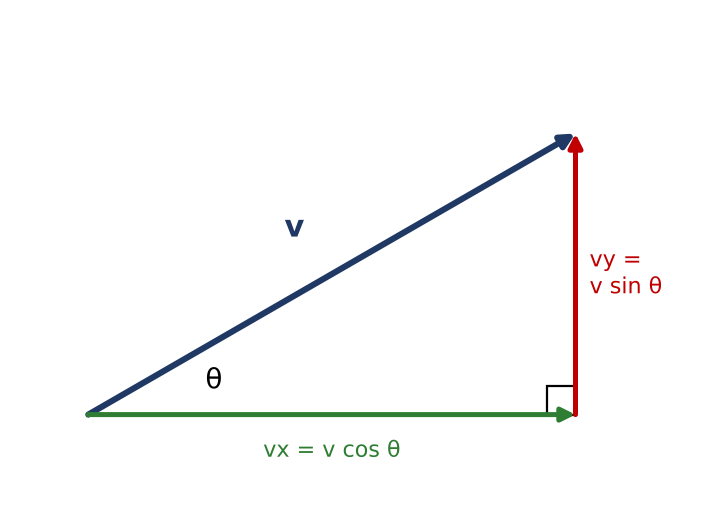
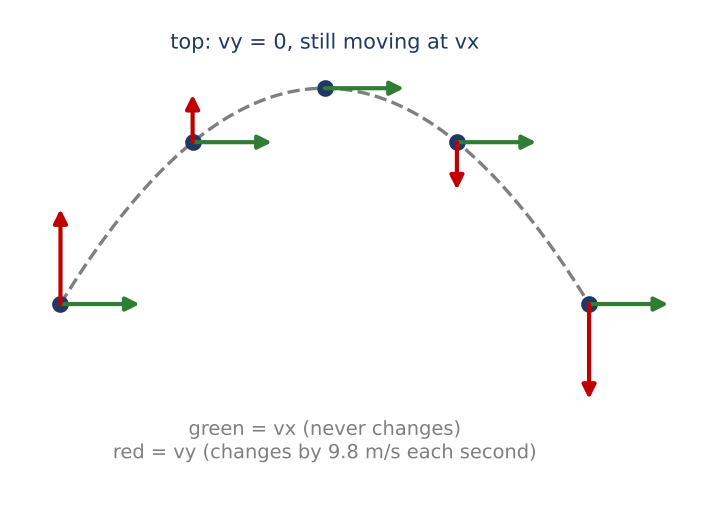
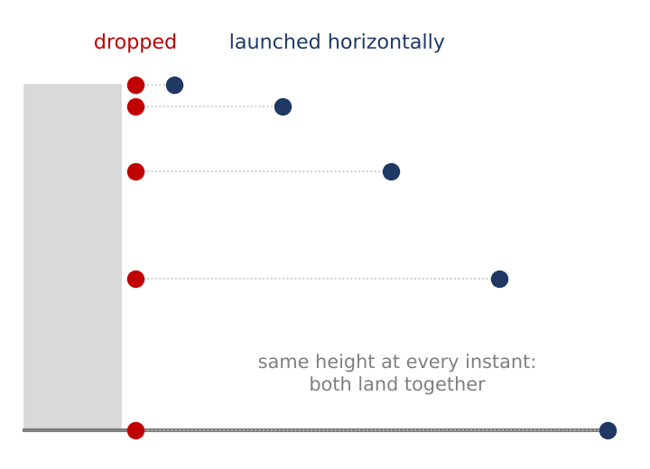
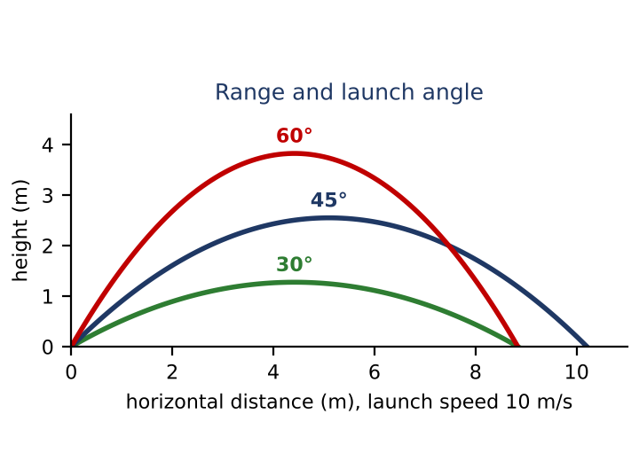

# Unit 2: Projectile Motion

[Project home](../../README.md) · [1. Kinematics](../01-kinematics/README.md) · **2. Projectile Motion** · [3. Newton's Laws](../03-newtons-laws/README.md) · [4. Momentum](../04-momentum/README.md) · [5. Work & Energy](../05-work-and-energy/README.md)

**Pacing:** Weeks 5–7 · **Essential question:** Why does a thrown ball follow a curved path, and how can we predict where it will land?

A projectile moves in two dimensions at once. Students learn to split motion into independent horizontal and vertical parts, solve each with the kinematics from Unit 1, and link them through time.

## Materials in this folder

| File | What it is |
|---|---|
| [cornell-notes-02-projectile-motion.docx](cornell-notes-02-projectile-motion.docx) | Printable Cornell notes: cue questions, notes with worked examples, visual memory aids, study method, IXL practice plan |
| [quiz.html](quiz.html) | Interactive quiz on the 10 most commonly missed ideas, with an explanation after every answer |

## Standards (CA NGSS)

- **HS-PS2-1** – Analyze data to support the claim that Newton's second law describes the relationship among net force, mass and acceleration. A projectile is the two-dimensional case: gravity is the only force, so the acceleration is vertical only.
- **SEP: Developing and Using Models** – Model a trajectory as two independent motions and predict a landing point before testing it.
- **SEP: Using Mathematics and Computational Thinking** – Resolve vectors into components and apply kinematic equations in each direction.

## Key concepts to master

- **Vector components** – vx = v cos θ and vy = v sin θ; recombining with the Pythagorean theorem and inverse tangent.
- **Projectile** – an object moving under gravity alone (air resistance ignored).
- **Independence of motion** – horizontal and vertical motions do not affect each other; time is the only thing they share.
- **Horizontal motion** – constant velocity, ax = 0.
- **Vertical motion** – free fall, ay = 9.8 m/s² downward for the whole flight.
- **Trajectory** – a parabola; at the top vy = 0 but the object is still moving horizontally.
- **Range and launch angle** – 45° gives maximum range on level ground; complementary angles give equal ranges.

## Learning objectives and how each is assessed

| # | Students can… | Evidence |
|---|---|---|
| 2.1 | Resolve a velocity into components and recombine components into a magnitude and angle. | Practice 1; IXL Physics C.2, Precalculus Y.1–4 |
| 2.2 | Explain the independence of horizontal and vertical motion. | Quiz Q1, Q4, Q6; cue self-test sections 2–3 |
| 2.3 | Describe velocity and acceleration at any point of the flight, including the top. | Quiz Q2, Q3, Q5, Q9 |
| 2.4 | Solve horizontal-launch problems. | Practice 2, 3, 6; IXL Physics E.1 |
| 2.5 | Solve angled-launch problems on level ground. | Practice 4, 5; IXL Physics E.2 |
| 2.6 | Predict a landing point and test it, reporting percent error (lab). | Marble-launch lab report |

Score each objective on the 4-point scale in [Assessment and progress tracking](../../docs/assessment-and-tracking.md). The unit is mastered when every objective is at 3 or above.

## Cue questions (self-test)

Cover the answers in the Cornell notes and answer these aloud.

**1. Vectors and Components**

- How do you break a velocity into horizontal and vertical parts?
- How do you put two components back together?
- How do you add two vectors that point in different directions?

**2. What Is a Projectile?**

- What is the only force acting on a projectile?
- Why are horizontal and vertical motion independent?
- Why is the path a parabola?

**3. Horizontal and Vertical Motion During the Flight**

- What happens to the horizontal velocity during the flight?
- What happens to the vertical velocity during the flight?
- What are the velocity and acceleration at the top of the path?

**4. Horizontally Launched Projectiles**

- What decides how long a horizontally launched object stays in the air?
- How far from the table does a ball land?

**5. Projectiles Launched at an Angle**

- What are the steps for an angled launch on level ground?
- How far does a ball kicked at 20 m/s and 30° travel?
- Which launch angle gives the greatest range?

**6. Labs and Measurement**

- What are the variables in the marble-launch lab?
- How do you predict the landing point and judge the result?

## Visual memory aids

| | |
|---|---|
|  A launch velocity is the hypotenuse of a right triangle whose sides are its components. **vx = v cos θ;  vy = v sin θ** |  Along the path the horizontal velocity arrow stays the same length while the vertical arrow shrinks, vanishes at the top, then grows downward. **ax = 0;  ay = 9.8 m/s² down** |
|  A ball launched horizontally falls exactly as fast as one dropped: at each time step they are at the same height. **t = √(2h/g), set by height only** |  At the same launch speed, 45° gives the longest range, and 30° and 60° land at the same spot. **maximum range at 45°** |

## Most commonly missed ideas

Each of these is a question in the [interactive quiz](quiz.html).

1. Thinking forward speed keeps an object up longer.
2. Saying the velocity is zero at the top of an arc.
3. Confusing zero vertical velocity with zero acceleration.
4. Linking horizontal speed to time of fall.
5. Believing a projectile "runs out of" forward motion.
6. Thinking the crate drops straight down or is left behind.
7. Choosing a steep angle because it keeps the ball in the air longest.
8. Assuming higher and longer in the air means farther.
9. Inventing a "force of motion" that travels with the ball.
10. Multiplying speed by height, or skipping the step of finding time from the vertical motion.

## Learning resources

- [The Physics Classroom: Vectors and Projectiles tutorial](https://www.physicsclassroom.com/class/vectors) – Reading and animations, including the classic monkey-and-zookeeper problem.
- [The Physics Classroom: Concept Builders](https://www.physicsclassroom.com/Concept-Builders) – Open the Vectors and Projectiles set.
- [PhET simulation: Projectile Motion](https://phet.colorado.edu/en/simulations/projectile-motion) – Change angle, speed and height; switch air resistance on and off.
- [OpenStax Physics (high school), Chapter 5](https://openstax.org/details/books/physics) – Free textbook: Motion in Two Dimensions.
- [Khan Academy Physics](https://www.khanacademy.org/science/physics) – Videos and practice; browse or search the library for two-dimensional and projectile motion. Unit names on the site change from time to time.
- [IXL Physics, sections C and E; Precalculus section Y](https://www.ixl.com/science/physics) – Skill practice; goal SmartScore 80+.

## IXL practice plan (goal: SmartScore 80+)

| Done | Skill | Skill name |
|---|---|---|
| ☐ | Physics A.2 | Identify independent and dependent variables |
| ☐ | Physics B.3 | Multiply and divide with significant figures |
| ☐ | Physics B.4 | Calculations with significant figures |
| ☐ | Precalculus Y.1 | Find the magnitude of a vector |
| ☐ | Precalculus Y.2 | Find the component form of a vector |
| ☐ | Precalculus Y.3 | Find the direction angle of a vector |
| ☐ | Precalculus Y.4 | Find the component form of a vector from its magnitude and direction angle |
| ☐ | Precalculus Y.5 | Graph a resultant vector using the triangle method |
| ☐ | Precalculus Y.6 | Graph a resultant vector using the parallelogram method |
| ☐ | Precalculus Y.7 | Add vectors |
| ☐ | Precalculus Y.8 | Subtract vectors |
| ☐ | Precalculus Y.9 | Find the magnitude and direction of a vector sum |
| ☐ | Physics C.2 | Decompose and compose two-dimensional vectors |
| ☐ | Physics C.3 | Add and subtract two-dimensional vectors: component form |
| ☐ | Physics E.1 | Solve projectile motion problems given components of velocity |
| ☐ | Physics E.2 | Solve projectile motion problems given magnitude and direction of velocity |

*No IXL match:* The concept questions (independence of horizontal and vertical motion, velocity and acceleration at the top, range versus angle) have no matching IXL skill. Use the physicsclassroom.com Concept Builders for Vectors and Projectiles.

## Practice problems

Use g = 9.8 m/s². Try each one before opening the answer.

1. Find the horizontal and vertical components of a 25 m/s velocity directed 40° above the horizontal.
   

Answer
vx = 25 cos 40° = <strong>19.2 m/s</strong>. vy = 25 sin 40° = <strong>16.1 m/s</strong>

2. A ball is thrown horizontally at 8.0 m/s from a 45 m cliff. How long is it in the air and how far from the base does it land?
   

Answer
t = √(2 × 45 ÷ 9.8) = <strong>3.03 s</strong>. x = 8.0 × 3.03 = <strong>24.2 m</strong>

3. A marble rolls off a 0.80 m table and lands 1.2 m from its base. How fast was it rolling?
   

Answer
t = √(2 × 0.80 ÷ 9.8) = 0.404 s. v = 1.2 ÷ 0.404 = <strong>3.0 m/s</strong>

4. A football is kicked at 18 m/s, 35° above level ground. Find the time of flight, range and maximum height.
   

Answer
vx = 14.7 m/s, vy = 10.3 m/s. t = 2 × 10.3 ÷ 9.8 = <strong>2.11 s</strong>. Range = 14.7 × 2.11 = <strong>31.1 m</strong>. Height = 10.3² ÷ 19.6 = <strong>5.4 m</strong>

5. Two water balloons leave a launcher at the same speed, one at 30° and one at 60°. Compare range, maximum height and time in the air.
   

Answer
Same <strong>range</strong>. The 60° balloon reaches a greater <strong>height</strong> and spends longer <strong>in the air</strong>.

6. A package is thrown horizontally at 15 m/s. What are its vertical velocity and its speed after 2.0 s?
   

Answer
vy = 9.8 × 2.0 = <strong>19.6 m/s down</strong>. Speed = √(15² + 19.6²) = <strong>24.7 m/s</strong>

## Labs and investigations

- **Marble launch**: measure launch speed and table height, predict the landing spot, place a target, then test and find percent error.
- **Range versus angle**: use a launcher or the PhET simulation to plot range against angle and find the maximum.
- **Video analysis**: film a tossed ball, mark its position frame by frame, and show that horizontal spacing is even while vertical spacing changes.

## Real-world applications

- **Sports**: basketball arcs, soccer free kicks, long jump take-off angle, golf launch monitors.
- **Emergency response**: aiming fire hoses and dropping water or supplies from aircraft.
- **Engineering**: fountain design, sprinkler coverage, stunt and ramp design.
- **Space**: an orbit is a projectile moving fast enough that the ground curves away beneath it.
- **Earth science link**: volcanic bombs follow projectile paths, and their landing distance reveals eruption speed.

## Unit checklist

**Student**

- [ ] Cornell notes read; every cue question answered aloud from memory
- [ ] All visual memory aids redrawn from memory
- [ ] Practice problems completed and checked
- [ ] IXL practice plan at SmartScore 80+
- [ ] Interactive quiz at 80% or higher
- [ ] Lab report submitted
- [ ] Unit test taken; missed objectives retested

**Instructor**

- [ ] Learning targets and essential question posted
- [ ] Quiz given as a pre-assessment to find misconceptions
- [ ] Lab(s) run and scored with the lab rubric
- [ ] Quiz repeated as a post-assessment; results recorded in the tracker
- [ ] Reteach plan made for any objective below 3
