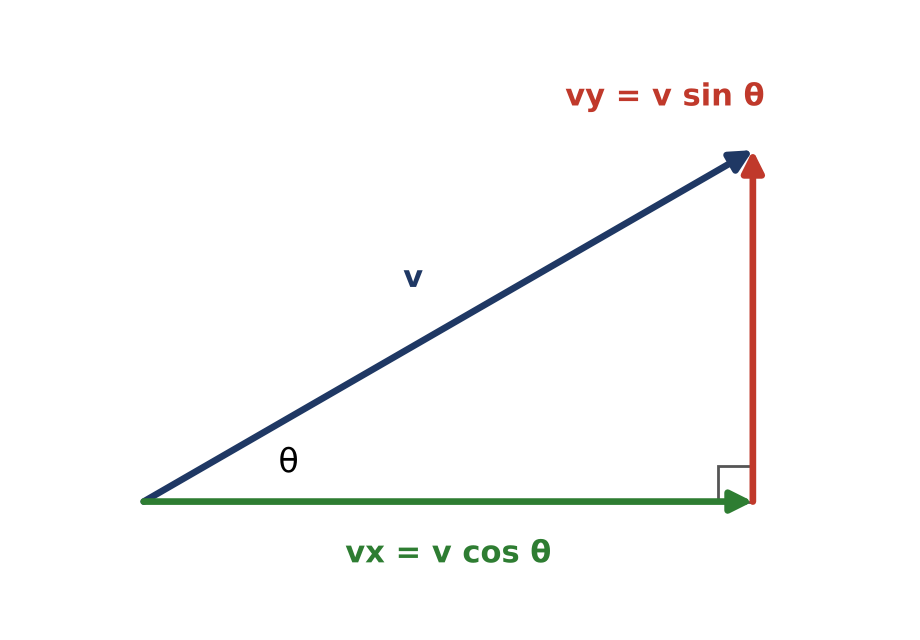
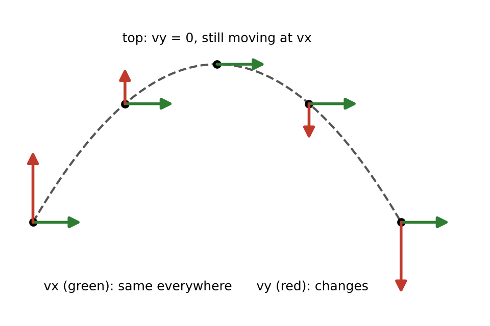
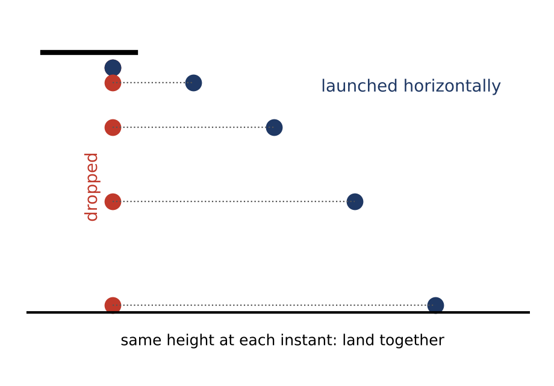
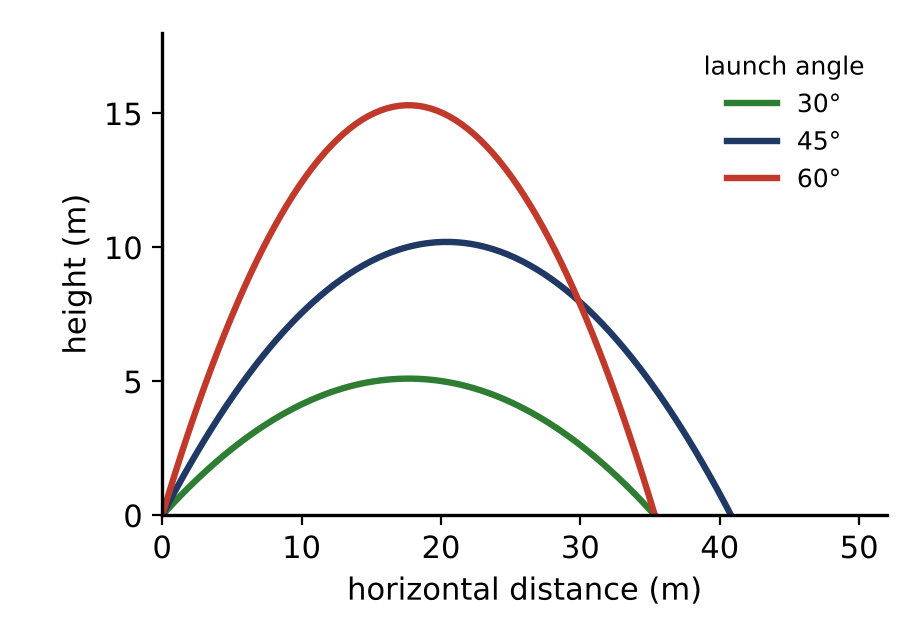

# Cornell Notes: Projectile Motion

*Physics (Grade 11) | Semester 1, Unit 2 | Vectors, components, horizontal and angled launches*

Name: ________________  Period: ______  Date: __________

A print-ready Word version with the same content is in [cornell-notes.docx](cornell-notes.docx).

**Learning targets**

- [ ] I can break a vector into horizontal and vertical components and put them back together.
- [ ] I can explain why horizontal and vertical motion are independent.
- [ ] I can solve problems for an object launched horizontally.
- [ ] I can find the time of flight, maximum height, and range of an object launched at an angle.
- [ ] I can predict a landing point and test the prediction in a lab.

**Essential question:** Why does a projectile follow a curved path, and how can we predict where it will land?

> **How to use these notes:** the left column is your self-test. Cover the right column, answer each cue question aloud, then check.

## 1. Vectors and Components

| Cues / Questions | Notes |
|---|---|
| **How do you split a velocity into components?** | • With the angle θ measured from the horizontal: **vx = v cos θ** and **vy = v sin θ**. • Worked example: 20 m/s at 30° above horizontal. vx = 20 cos 30° = **17.3 m/s**. vy = 20 sin 30° = **10.0 m/s**. • Sense check: √(17.3² + 10.0²) = 20 m/s. The components rebuild the original. |
| **How do you find a resultant from two perpendicular vectors?** | • Magnitude: **Pythagorean theorem**, R = √(x² + y²). Direction: **θ = tan⁻¹(y/x)**. • Worked example: 3.0 m/s east and 4.0 m/s north give R = **5.0 m/s** at tan⁻¹(4.0/3.0) = **53° north of east**. |
| **How do you add vectors that are not perpendicular?** | • Graphically: draw them **tip to tail**; the resultant goes from the first tail to the last tip. • By components: add all the x parts, add all the y parts, then use Pythagoras. |

**IXL practice (goal: SmartScore 80+):** **Physics C.2** Decompose and compose two-dimensional vectors · **Physics C.3** Add and subtract two-dimensional vectors: component form · **Precalculus Y.1** Find the magnitude of a vector · **Precalculus Y.2** Find the component form of a vector · **Precalculus Y.3** Find the direction angle of a vector · **Precalculus Y.4** Find the component form of a vector from its magnitude and direction angle · **Precalculus Y.5** Graph a resultant vector using the triangle method · **Precalculus Y.6** Graph a resultant vector using the parallelogram method · **Precalculus Y.7** Add vectors · **Precalculus Y.8** Subtract vectors · **Precalculus Y.9** Find the magnitude and direction of a vector sum

## 2. What Makes Something a Projectile

| Cues / Questions | Notes |
|---|---|
| **What is the only force on a projectile?** | • **Gravity.** Once the ball leaves the hand, foot, or launcher, the push is over. (We ignore air resistance.) |
| **Why does a projectile keep moving sideways with no sideways force?** | • **Inertia** (Newton's first law). No horizontal force means no horizontal acceleration, so vx stays constant. |
| **What does "independence of motion" mean?** | • The horizontal motion (constant velocity) and vertical motion (free fall) happen at the same time without affecting each other. • **Time** is the only variable shared by both directions. Solve for it in one direction, then use it in the other. |
| **Why is the path a curve?** | • Equal sideways steps each second combined with growing downward steps each second make a **parabola**. |

**IXL practice (goal: SmartScore 80+):** No IXL skill covers projectile concepts. Use the matching Concept Builders at physicsclassroom.com.

## 3. Horizontally Launched Projectiles

| Cues / Questions | Notes |
|---|---|
| **What are the starting velocities for a horizontal launch?** | • **vx = launch speed** (stays constant). **v₀y = 0** (it starts with no vertical motion). |
| **A ball rolls off a 1.25 m high table at 3.0 m/s. Where does it land?** | • Vertical (find time): Δy = ½gt², so t = √(2Δy/g) = √(2 × 1.25/9.8) = **0.505 s**. • Horizontal (find range): Δx = vx·t = (3.0)(0.505) = **1.52 m** from the table edge. • Sense check: about half a second to fall from table height is reasonable. |
| **A ball is dropped and another is launched horizontally from the same height. Which lands first?** | • **They land together.** Both start with zero vertical velocity and fall with the same 9.8 m/s². Horizontal speed does not change fall time. |
| **What changes if the launch speed doubles?** | • The time in the air is the **same** (same height). The range **doubles** because Δx = vx·t. |

**IXL practice (goal: SmartScore 80+):** **Physics E.1** Solve projectile motion problems given components of velocity

## 4. Projectiles Launched at an Angle

| Cues / Questions | Notes |
|---|---|
| **What are the velocity and acceleration at the top of the path?** | • Velocity is **horizontal and equal to vx** (only vy is zero). Acceleration is still **9.8 m/s² downward**. |
| **How do you find time of flight, maximum height, and range?** | • For launch and landing at the same height: • Time to top: **t_up = v₀y/g**. Total time: **t = 2v₀y/g**. • Maximum height: **H = v₀y²/(2g)**. Range: **R = vx·t**. |
| **A ball is launched at 20 m/s at 30°. Find the time, height, and range.** | • Components: vx = 17.3 m/s, v₀y = 10.0 m/s. • Time: t = 2(10.0)/9.8 = **2.04 s**. • Height: H = (10.0)²/(2 × 9.8) = **5.10 m**. • Range: R = (17.3)(2.04) = **35.3 m**. |
| **Which launch angle gives the greatest range?** | • **45°** on level ground with no air resistance. • Complementary angles (such as 30° and 60°) give the **same range**. The larger angle goes higher and stays up longer. |

**IXL practice (goal: SmartScore 80+):** **Physics E.2** Solve projectile motion problems given magnitude and direction of velocity

## 5. Labs and Measurement

| Cues / Questions | Notes |
|---|---|
| **How do you predict where a marble rolling off a table will land?** | • Measure the marble's speed on the table (distance ÷ time through a photogate or over a marked length) and the table height. • Compute t = √(2h/g), then Δx = vx·t. Place a cup or target there, then test. • Independent variable: launch speed (ramp release height). Dependent variable: horizontal range. Constant: table height. |
| **How do you test which angle gives the greatest range?** | • Use a launcher or the PhET Projectile Motion simulation at a fixed speed. Change only the **angle** and measure the **range**. Graph range vs angle; the peak is near 45°. |
| **Why might the real landing spot fall short of the prediction?** | • **Air resistance** and friction at launch reduce the speed. Timing and measuring errors also matter, so repeat trials and average. |

**IXL practice (goal: SmartScore 80+):** **Physics A.2** Identify independent and dependent variables · **Physics B.4** Calculations with significant figures

## Memory Tricks

- **SOH CAH TOA.** sin = opposite/hypotenuse, cos = adjacent/hypotenuse, tan = opposite/adjacent. Use to find components.
- **Two columns: x and y.** Write horizontal knowns in one column and vertical knowns in another. Only time crosses between them.
- **Horizontal: constant. Vertical: free fall..** ax = 0 and ay = 9.8 m/s² down. Use for every projectile problem.
- **Tip to tail.** Draw each vector starting where the last one ended to add them.
- **45° goes farthest.** On level ground the maximum range is at 45°, and angles that add to 90° land in the same place.

## Summary

A projectile is an object with gravity as the only force on it. The key idea is independence: horizontally there is no force, so the velocity stays constant, while vertically the object is in free fall at 9.8 m/s² downward. The two motions share only time. To solve any problem, split the launch velocity into components, use the vertical motion to find the time, and then use that time in the horizontal motion to find the range. At the top of the path only the vertical velocity is zero; the object is still moving sideways and still accelerating downward.

## Visual Memory Aids

A velocity vector split into its horizontal and vertical components. **vx = v cos θ; vy = v sin θ**

Angled launch: vx stays the same length the whole way, while vy shrinks, reaches zero at the top, then grows downward. **ax = 0; ay = 9.8 m/s² down**

A dropped ball and a horizontally launched ball are at the same height at every instant and land together. **Δy = ½gt² for both**

Same launch speed at 30°, 45°, and 60°: 45° has the greatest range; 30° and 60° land in the same spot. **R is greatest at 45°**

## Study Method

1. Cover the Notes column and answer each cue question aloud.
2. Uncover, check, and mark every cue you missed.
3. Redraw each Visual Memory Aid from memory, with labels and its equation.
4. Repeat the next day and again a few days later. Recall spread over days builds memory that rereading does not.
5. Finish the IXL Practice Plan to SmartScore 80+ before the test.

## IXL Practice Plan

Reach SmartScore 80+ on each skill before the test.

| Done | # | Skill | Skill name | Notes section |
|---|---|---|---|---|
| ☐ | 1 | Physics A.2 | Identify independent and dependent variables | 5 |
| ☐ | 2 | Physics B.4 | Calculations with significant figures | 5 |
| ☐ | 3 | Physics C.2 | Decompose and compose two-dimensional vectors | 1 |
| ☐ | 4 | Physics C.3 | Add and subtract two-dimensional vectors: component form | 1 |
| ☐ | 5 | Precalculus Y.1 | Find the magnitude of a vector | 1 |
| ☐ | 6 | Precalculus Y.2 | Find the component form of a vector | 1 |
| ☐ | 7 | Precalculus Y.3 | Find the direction angle of a vector | 1 |
| ☐ | 8 | Precalculus Y.4 | Find the component form of a vector from its magnitude and direction angle | 1 |
| ☐ | 9 | Precalculus Y.5 | Graph a resultant vector using the triangle method | 1 |
| ☐ | 10 | Precalculus Y.6 | Graph a resultant vector using the parallelogram method | 1 |
| ☐ | 11 | Precalculus Y.7 | Add vectors | 1 |
| ☐ | 12 | Precalculus Y.8 | Subtract vectors | 1 |
| ☐ | 13 | Precalculus Y.9 | Find the magnitude and direction of a vector sum | 1 |
| ☐ | 14 | Physics E.1 | Solve projectile motion problems given components of velocity | 3 |
| ☐ | 15 | Physics E.2 | Solve projectile motion problems given magnitude and direction of velocity | 4 |

No full IXL match (use physicsclassroom.com Concept Builders): What Makes Something a Projectile.

*Self-test tip: cover the Notes column, answer each cue aloud, then redo every worked example on blank paper without looking.*
