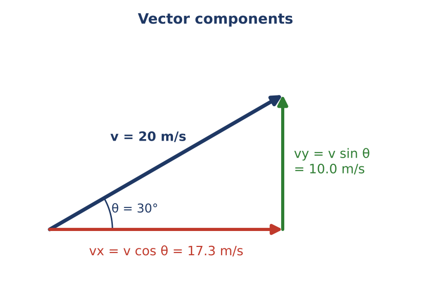
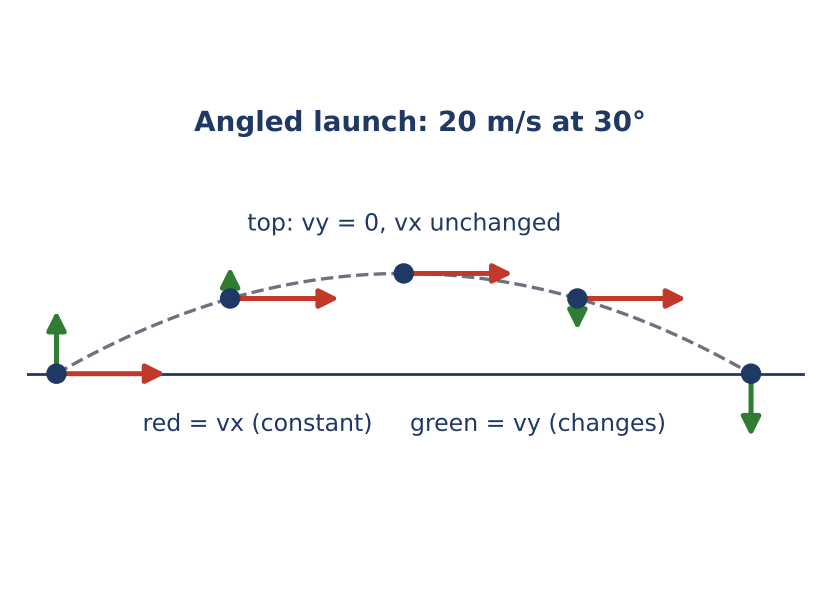
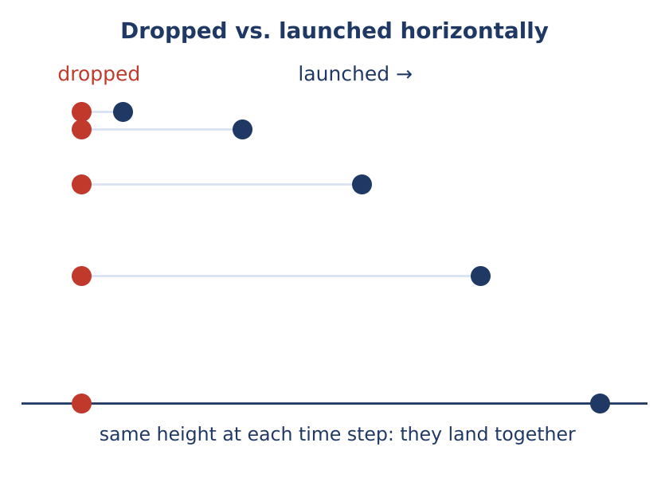
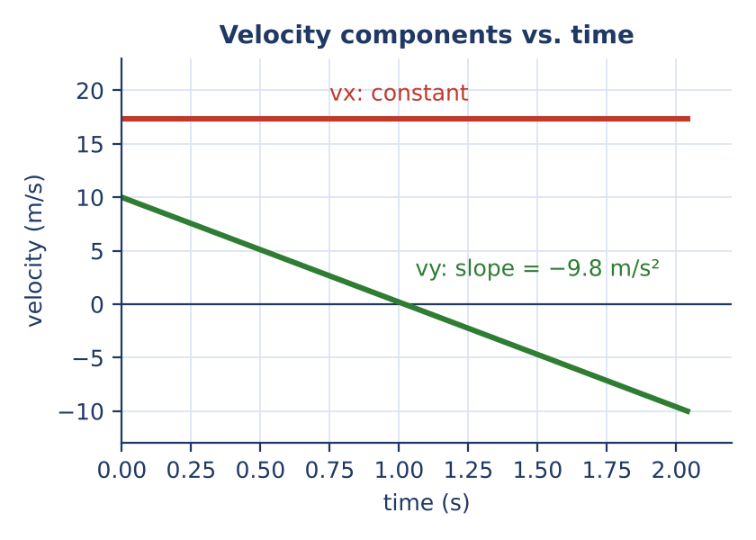

# Cornell Notes: Projectile Motion

*Physics | Unit 2 | Motion in two dimensions*

Name: ________________  Period: ______  Date: __________

> A print-ready Word version with the same content is in this folder. Cover the right-hand column and answer each cue aloud to self-test.

**Learning targets**

- I can break a vector into horizontal and vertical components and combine components into a resultant.
- I can explain why horizontal and vertical motion are independent and what each one does during flight.
- I can solve horizontally launched projectile problems for time, range, and impact speed.
- I can solve angled-launch problems for time of flight, maximum height, and range.
- I can predict how changing launch speed, height, or angle changes the path.
- I can predict a landing spot in a lab and compare it with my measurement.

**Essential question:** Why can we predict where a launched object will land by treating its horizontal and vertical motion separately?

## 1. Vectors and Components

| Cues / Questions | Notes |
|---|---|
| **How do you break a velocity vector into components?** | • With the angle θ measured from the horizontal: **vx = v cos θ** and **vy = v sin θ**. • Worked example: 20 m/s at 30° above horizontal. vx = 20 cos 30° = **17.3 m/s**. vy = 20 sin 30° = **10.0 m/s**. • Sense check: each component must be smaller than the original vector. Calculator in **degree mode**. |
| **How do you combine two perpendicular vectors into one resultant?** | • Magnitude from the Pythagorean theorem: **R = √(x² + y²)**. Direction from **θ = tan⁻¹(y ÷ x)**. • Worked example: 3 m/s east and 4 m/s north. R = √(9 + 16) = **5 m/s**. θ = tan⁻¹(4 ÷ 3) = **53.1° north of east**. • Always state a direction with the answer. |

**IXL practice (goal: SmartScore 80+):** **Physics C.2** Decompose and compose two-dimensional vectors; **Physics C.3** Add and subtract two-dimensional vectors: component form; **Precalculus Y.1** Find the magnitude of a vector; **Precalculus Y.2** Find the component form of a vector; **Precalculus Y.3** Find the direction angle of a vector; **Precalculus Y.4** Find the component form of a vector from its magnitude and direction angle; **Precalculus Y.5** Graph a resultant vector using the triangle method; **Precalculus Y.7** Add vectors; **Precalculus Y.9** Find the magnitude and direction of a vector sum

## 2. Independence of Horizontal and Vertical Motion

| Cues / Questions | Notes |
|---|---|
| **Why can horizontal and vertical motion be treated separately?** | • The only force on a projectile is **gravity, which acts straight down**. • **Horizontal: no force, so ax = 0 and vx stays constant.** • **Vertical: free fall, so ay = 9.8 m/s² downward.** • Solve each direction with its own list of givens. |
| **A ball is dropped and another is launched horizontally from the same height. Which lands first?** | • **They land at the same time.** Both start with zero vertical velocity and fall the same height with the same acceleration. • The launched ball also moves sideways, but that does not change how fast it falls. |
| **What one quantity is the same for the horizontal and vertical motion?** | • **Time.** The projectile moves sideways for exactly as long as it is in the air. • Usual plan: find time from the vertical motion, then use it in the horizontal motion. |

**IXL practice:** no IXL skill fits this section. Use the [Physics Classroom Concept Builders](https://www.physicsclassroom.com/Concept-Builders).

## 3. Horizontally Launched Projectiles

| Cues / Questions | Notes |
|---|---|
| **How do you find the time of flight for a horizontal launch?** | • Vertical givens: v₀y = 0, a = 9.8 m/s², Δy = height. Use **h = ½gt²**, so **t = √(2h ÷ g)**. • Time depends only on the **height**, not on the launch speed. |
| **A ball rolls off a 1.225 m table at 4.0 m/s. Where does it land, and how fast is it going?** | • Time (vertical): t = √(2 × 1.225 ÷ 9.8) = √0.25 = **0.50 s**. • Range (horizontal): x = vx × t = 4.0 × 0.50 = **2.0 m** from the table. • Impact: vx = 4.0 m/s (unchanged). vy = 9.8 × 0.50 = 4.9 m/s. Speed = √(4.0² + 4.9²) = **6.3 m/s**. • Sense check: launch twice as fast and it lands twice as far, in the same time. |

**IXL practice (goal: SmartScore 80+):** **Physics E.1** Solve projectile motion problems given components of velocity

## 4. Projectiles Launched at an Angle

| Cues / Questions | Notes |
|---|---|
| **What happens to each velocity component during the flight?** | • **vx stays constant** the whole flight. • **vy** shrinks on the way up, is **zero at the top**, then grows downward. • At the top the projectile is still moving: its velocity equals vx. Its acceleration is still 9.8 m/s² downward. • On level ground it lands with the same speed it was launched with. |
| **How do you find time of flight, maximum height, and range on level ground?** | • Split first: vx = v cos θ, vy = v sin θ. • **Time up = vy ÷ g. Total time = 2 × time up.** • **Maximum height = vy² ÷ (2g).** • **Range = vx × total time.** • Worked example: 20 m/s at 30°. vx = 17.3 m/s, vy = 10.0 m/s. Time up = 10.0 ÷ 9.8 = 1.02 s, total = **2.04 s**. Height = 10.0² ÷ 19.6 = **5.10 m**. Range = 17.3 × 2.04 = **35.3 m**. |
| **Which launch angle gives the greatest range on level ground?** | • **45°**, when air resistance is ignored. • **Complementary angles give the same range**: 30° and 60°, 20° and 70°. The steeper one goes higher and stays up longer. |

**IXL practice (goal: SmartScore 80+):** **Physics E.2** Solve projectile motion problems given magnitude and direction of velocity

## 5. Labs and Measurement

| Cues / Questions | Notes |
|---|---|
| **What question does the lab "Hit the target: marble off a table" answer, and what are its variables?** | • Question: Can we predict where a horizontally launched marble will land? • **Independent variable:** Launch speed (set by the release point on the ramp) • **Dependent variable:** Range (horizontal distance to the landing point) |
| **Which formula does the lab use, and what are the steps?** | • **Formula:** t = √(2h ÷ g), then range = vx × t. • Roll a marble down a ramp onto the table. Measure its speed across the table with a photogate, or time it over a marked 0.50 m. • Measure the table height. Calculate the time of flight, then the predicted range. • Place a paper target with carbon paper at the predicted spot, then release the marble. • Calculate the percent error between predicted and measured range. Name two sources of error. |

**IXL practice (goal: SmartScore 80+):** **Physics A.2** Identify independent and dependent variables; **Physics B.3** Multiply and divide with significant figures

## Memory tricks

| Trick or rule | When to use it |
|---|---|
| **SOH CAH TOA** | Finding components: cosine gives the side next to the angle, sine gives the side across from it. |
| **Horizontal is constant velocity, vertical is free fall** | Starting any projectile problem. Make two columns of givens. |
| **Time is the bridge between x and y** | When one direction has too few givens. Find time in the other direction first. |
| **45° for maximum range; complementary angles land together** | Comparing launches at the same speed on level ground. |
| **At the top: vy = 0, but vx and g are still there** | Any question about the highest point. |

## Summary

A projectile is two simple motions happening at once. Horizontally nothing pushes it, so it moves at constant velocity. Vertically it is in free fall at 9.8 m/s² downward. The two motions share only the time of flight, so we split the launch velocity into components, solve the vertical motion for time, and use that time to find the range. This explains why a dropped ball and a horizontally launched ball land together, and why 45° gives the longest range.

## Visual memory aids

A velocity vector split into horizontal and vertical components. **vx = v cos θ, vy = v sin θ, v = √(vx² + vy²).**

Velocity components at five points on an angled launch. **vx never changes. vy is zero at the top.**

Motion map of a dropped ball and a horizontally launched ball at equal time steps. **Same height at the same time: they land together.**

Velocity-time graphs for the horizontal and vertical components. **vx: flat line. vy: straight line with slope −9.8 m/s².**

## Study method

1. Cover the Notes column and answer each cue aloud.
2. Check, and mark the ones you missed.
3. Redraw each visual memory aid from memory.
4. Repeat the next day, and again a few days later. Recall spread over days builds memory that rereading does not.
5. Finish the IXL plan to SmartScore 80+ before the test.
