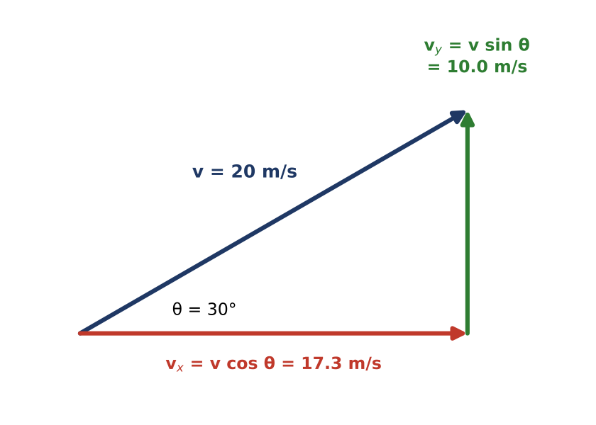
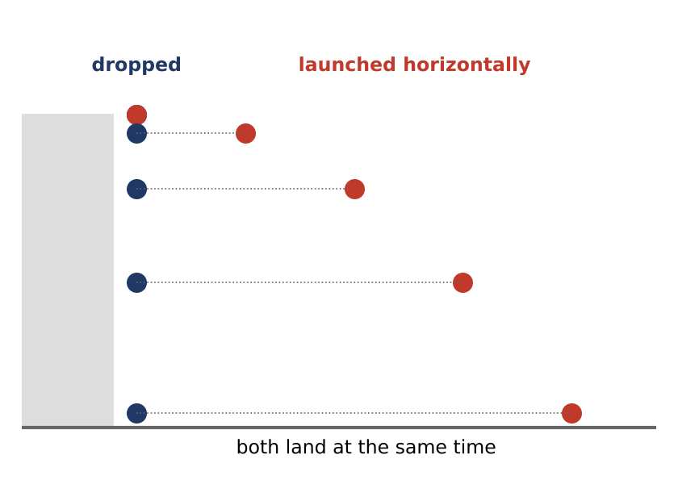
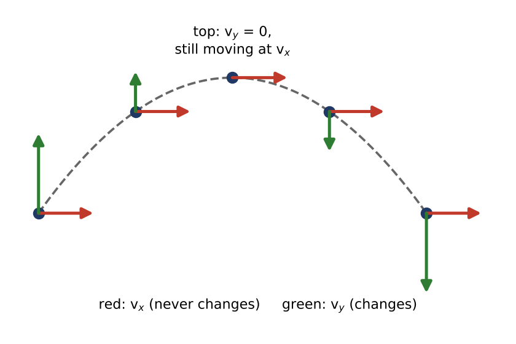
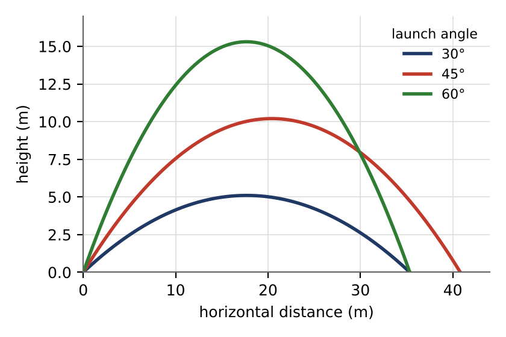

# Cornell Notes: Projectile Motion

*Physics | Semester 1, Unit 2 | Vector components, independent horizontal and vertical motion, horizontal and angled launches*

Printable version: [cornell-notes.docx](cornell-notes.docx)

**Essential question:** Why does a ball thrown sideways hit the ground at the same time as a ball that is dropped?

**Learning targets**

- I can break a vector into horizontal and vertical components and put components back together.
- I can explain why the horizontal and vertical motions of a projectile are independent.
- I can solve for time, range and landing speed of a horizontally launched projectile.
- I can solve for time of flight, maximum height and range of a projectile launched at an angle.

## 1. Vectors and Components

| Cues / Questions | Notes |
|---|---|
| **How do I find the horizontal and vertical components of a velocity?** | With the angle θ measured from the horizontal: **vx = v cos θ** and **vy = v sin θ**. Worked example: 20 m/s at 30° above horizontal. vx = 20 cos 30° = **17.3 m/s**. vy = 20 sin 30° = **10.0 m/s**. |
| **How do I combine two perpendicular components into one vector?** | Magnitude: v = √(vx² + vy²). Direction: θ = tan⁻¹(vy ÷ vx). Worked example: vx = 4.0 m/s and vy = 3.0 m/s. v = √(16 + 9) = **5.0 m/s** at tan⁻¹(3 ÷ 4) = **36.9°** above horizontal. |
| **How are vectors added on a diagram?** | Draw them **head to tail**. The **resultant** runs from the tail of the first to the head of the last. |

**IXL practice (goal: SmartScore 80+):** Physics C.2 Decompose and compose two-dimensional vectors; Physics C.3 Add and subtract two-dimensional vectors: component form; Precalculus Y.1 Find the magnitude of a vector; Precalculus Y.2 Find the component form of a vector; Precalculus Y.3 Find the direction angle of a vector; Precalculus Y.4 Find the component form of a vector from its magnitude and direction angle; Precalculus Y.5 Graph a resultant vector using the triangle method; Precalculus Y.7 Add vectors; Precalculus Y.9 Find the magnitude and direction of a vector sum.

## 2. Two Independent Motions

| Cues / Questions | Notes |
|---|---|
| **What is a projectile?** | Any object that, once launched, moves under the influence of **gravity alone** (air resistance ignored). |
| **What happens to the horizontal and vertical velocity during flight?** | **Horizontal:** no horizontal force, so vx stays **constant** (ax = 0). **Vertical:** free fall, so vy changes by 9.8 m/s every second (ay = 9.8 m/s² downward). The two motions do not affect each other. |
| **What is the one quantity the horizontal and vertical motions share?** | **Time.** Solve for time on one side and use it on the other. |
| **A ball is dropped and another is launched horizontally from the same height. Which lands first?** | They land **together**. Both start with zero vertical velocity and both fall with the same acceleration. |

**IXL practice (goal: SmartScore 80+):**  No IXL skill covers this idea on its own. Use the Projectile Motion Concept Builders at physicsclassroom.com.

## 3. Horizontally Launched Projectiles

| Cues / Questions | Notes |
|---|---|
| **What is the starting vertical velocity of a horizontal launch?** | **Zero.** All of the launch velocity is horizontal. |
| **How do I find the time in the air and the range?** | Vertical first: h = ½gt², so **t = √(2h ÷ g)**. Then horizontal: **range = vx × t**. Worked example: a ball rolls off a 1.25 m high table at 3.0 m/s. t = √(2 × 1.25 ÷ 9.8) = **0.505 s**. Range = 3.0 × 0.505 = **1.52 m**. |
| **How fast is it moving when it lands?** | Find vy = gt, then combine with vx. Same ball: vy = 9.8 × 0.505 = 4.95 m/s. Speed = √(3.0² + 4.95²) = **5.79 m/s**. |

**IXL practice (goal: SmartScore 80+):** Physics E.1 Solve projectile motion problems given components of velocity.

## 4. Projectiles Launched at an Angle

| Cues / Questions | Notes |
|---|---|
| **What are the steps for an angled launch that lands at launch height?** | 1. Find the components vx and viy. 2. Time to the top = viy ÷ g. Total time = 2 × time to the top. 3. Maximum height = viy² ÷ (2g). 4. Range = vx × total time. Worked example: 20 m/s at 30°. vx = 17.3 m/s, viy = 10.0 m/s. Time up = 10.0 ÷ 9.8 = 1.02 s; total time = **2.04 s**. Height = 10.0² ÷ 19.6 = **5.10 m**. Range = 17.3 × 2.04 = **35.3 m**. |
| **What are the velocity and acceleration at the top of the path?** | Vertical velocity is 0, but the object is still moving sideways at **vx**. Acceleration is still **9.8 m/s² downward**. |
| **Which launch angle gives the greatest range?** | **45°** (same launch speed, level ground, no air resistance). Angles that add to 90° give the same range: 30° and 60°, or 20° and 70°. |

**IXL practice (goal: SmartScore 80+):** Physics E.2 Solve projectile motion problems given magnitude and direction of velocity.

## 5. Labs and Measurement

| Cues / Questions | Notes |
|---|---|
| **In a marble-off-the-table lab, how do I predict where the marble lands?** | Measure the table height h and the marble's speed vx at the edge (distance ÷ time over a marked stretch). Calculate t = √(2h ÷ g), then range = vx × t. Place a target at that distance and test. |
| **What are the variables if we change the launch speed?** | Independent variable: **launch speed**. Dependent variable: **range**. Controlled: table height. |

**IXL practice (goal: SmartScore 80+):** Physics A.2 Identify independent and dependent variables.

## Memory tricks

- **SOH CAH TOA.** Use it: Breaking a launch velocity into components: cosine goes with the side next to the angle.
- **Horizontal: constant velocity. Vertical: free fall.** Use it: The first thing to write on any projectile problem.
- **Make an x \| y table.** Use it: List horizontal knowns in one column and vertical knowns in the other so they are never mixed.
- **Time is the bridge.** Use it: When stuck, solve for time on the side with enough information and carry it across.
- **45° goes farthest.** Use it: Quick check on range questions on level ground.

## Summary

A projectile has two motions at once. Sideways, nothing pushes on it, so it moves at constant velocity. Up and down, gravity makes it a free-fall problem. The two motions are independent and are tied together only by time. Break the launch velocity into components, solve the vertical side for time, and use that time on the horizontal side.

## Visual memory aids

A velocity vector and its components form a right triangle.  
**Rule:** vx = v cos θ, vy = v sin θ

A dropped ball and a horizontally launched ball are at the same height at every instant.  
**Rule:** Same vertical motion: t = √(2h ÷ g) for both

Along the path, vx never changes; vy shrinks to zero at the top and then grows downward.  
**Rule:** ax = 0; ay = 9.8 m/s² downward

Same launch speed at three angles: 45° goes farthest; 30° and 60° land at the same spot.  
**Rule:** Complementary angles give equal range

## Study method

1. Cover the Notes column and answer each cue question aloud.
2. Uncover, check, and mark every cue you missed.
3. Redraw each Visual Memory Aid from memory.
4. Repeat the next day and again a few days later.
5. Finish the IXL plan to SmartScore 80+ and take the unit quiz before the test.
