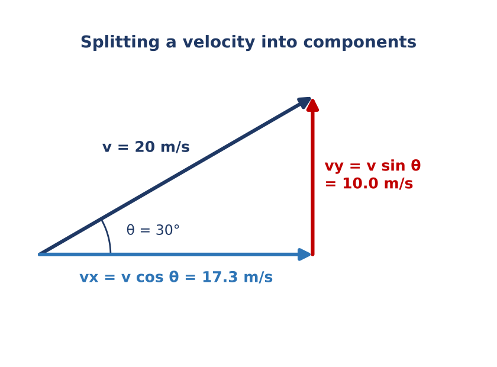
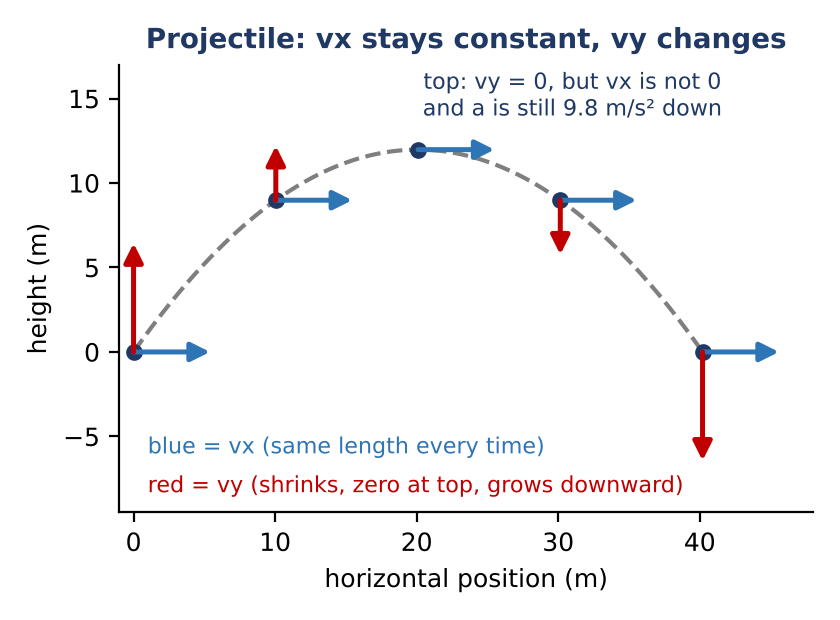
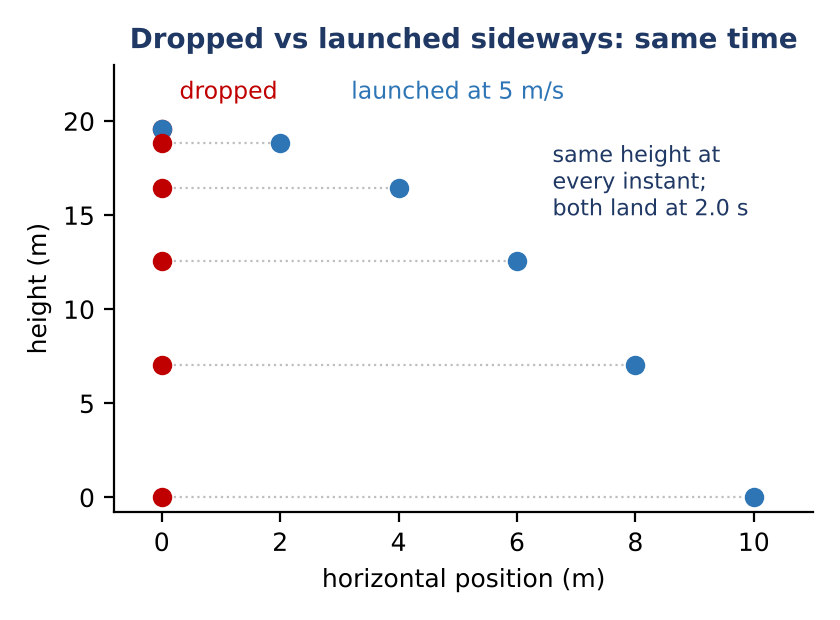
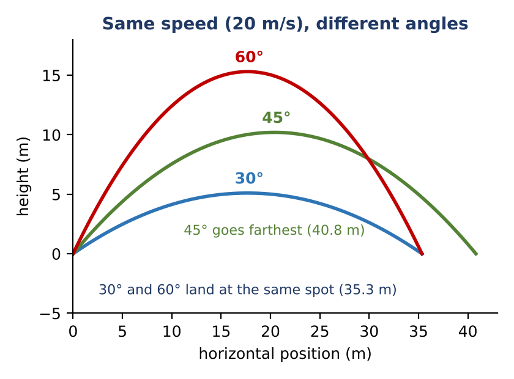

# Cornell Notes: Projectile Motion

*Physics | Unit 2 | Vectors, components, horizontal and angled launches*

> Printable version with the Visual Memory Aids laid out for class: [Cornell-Notes-Projectile-Motion.docx](Cornell-Notes-Projectile-Motion.docx)

**Essential question:** Why can we treat the horizontal and vertical parts of a projectile's motion separately, and how does that let us predict where it lands?

**Learning targets**

- I can split a vector into horizontal and vertical components and recombine them.
- I can explain why a projectile's horizontal velocity stays constant while its vertical velocity changes.
- I can solve horizontal-launch problems for time, range, and impact velocity.
- I can solve angled-launch problems on level ground for time, maximum height, and range.
- I can predict how launch angle and speed affect range and time in the air.

**How to use:** cover the Notes column, answer each cue aloud, then check.

## 1. Vectors and Components

| Cues / Questions | Notes |
|---|---|
| **How do you split a velocity into horizontal and vertical components?** | • Draw a right triangle with the velocity as the hypotenuse and θ measured from the horizontal. • **vₓ = v cos θ** (horizontal) and **v_y = v sin θ** (vertical). • Set your calculator to **degrees**. |
| **A ball leaves the ground at 20 m/s, 30° above horizontal. What are its components?** | • vₓ = 20 cos 30° = **17.3 m/s**. • v_y = 20 sin 30° = **10.0 m/s**. • Check: √(17.3² + 10.0²) = 20 m/s. |
| **How do you combine two perpendicular vectors into one resultant?** | • Magnitude: **Pythagorean theorem**, R = √(x² + y²). • Direction: **θ = tan⁻¹(y ÷ x)**. • Draw the vectors tip to tail; the resultant goes from the first tail to the last tip. |

**IXL practice (goal: SmartScore 80+):** **Physics C.2** Decompose and compose two-dimensional vectors; **Physics C.3** Add and subtract two-dimensional vectors: component form; **Precalculus Y.1** Find the magnitude of a vector; **Precalculus Y.2** Find the component form of a vector; **Precalculus Y.3** Find the direction angle of a vector; **Precalculus Y.4** Find the component form of a vector from its magnitude and direction angle; **Precalculus Y.5** Graph a resultant vector using the triangle method; **Precalculus Y.7** Add vectors; **Precalculus Y.9** Find the magnitude and direction of a vector sum

## 2. What Makes a Projectile

| Cues / Questions | Notes |
|---|---|
| **What is a projectile, and what forces act on it in flight?** | • A **projectile** is any object in the air with **gravity as the only force** (air resistance ignored). • After release there is **no “force of the throw.”** The object keeps moving forward because of inertia. |
| **What happens to a projectile's horizontal velocity during flight?** | • It **stays constant**. There is no horizontal force, so aₓ = 0. • Horizontal distance: **x = vₓt**. |
| **What happens to its vertical velocity?** | • It changes by **9.8 m/s every second**, exactly like an object in free fall. • Going up, v_y shrinks. At the top, v_y = 0. Coming down, v_y grows downward. |
| **What are the velocity and acceleration at the top of the path?** | • Velocity is **not zero**. It equals **vₓ**, pointing horizontally. • Acceleration is **9.8 m/s² downward**, the same as everywhere else on the path. |
| **What one quantity is shared by the horizontal and vertical motions?** | • **Time.** Solve for time on one side (usually vertical), then use it on the other. |

**IXL practice (goal: SmartScore 80+):** No IXL skill covers the concepts in this section on their own. Use the Vectors and Projectiles Concept Builders at physicsclassroom.com.

## 3. Horizontal Launch

| Cues / Questions | Notes |
|---|---|
| **One ball is dropped and another is launched horizontally from the same height at the same instant. Which lands first?** | • **They land at the same time.** Both start with zero vertical velocity and fall the same height with the same acceleration. • The launched ball simply lands farther away. |
| **What are the steps for a horizontal-launch problem?** | • Make an **x \| y table**. Horizontal: vₓ, aₓ = 0. Vertical: v_iy = 0, a_y = 9.8 m/s², height. • Vertical gives time: **h = ½gt²**, so t = √(2h ÷ g). • Horizontal gives range: **x = vₓt**. |
| **A ball rolls off a 19.6 m cliff at 5.0 m/s. How long is it in the air, how far from the base does it land, and how fast is it moving at impact?** | • Time: t = √(2 × 19.6 ÷ 9.8) = √4.0 = **2.0 s**. • Range: x = 5.0 × 2.0 = **10 m**. • At impact: vₓ = 5.0 m/s, v_y = 9.8 × 2.0 = 19.6 m/s. Speed = √(5.0² + 19.6²) = **20.2 m/s**. • Sense check: launching faster would not change the 2.0 s, only the range. |

**IXL practice (goal: SmartScore 80+):** **Physics E.1** Solve projectile motion problems given components of velocity

## 4. Launch at an Angle

| Cues / Questions | Notes |
|---|---|
| **What are the steps for an angled launch on level ground?** | • 1. Find the components: vₓ = v cos θ, v_y = v sin θ. • 2. Vertical: time to the top = v_y ÷ g. Total time = **2 × that**. • 3. Maximum height = **v_y² ÷ (2g)**. • 4. Horizontal: range = **vₓ × total time**. |
| **A ball is kicked at 20 m/s, 30° above level ground. Find the time in the air, maximum height, and range.** | • Components: vₓ = 17.3 m/s, v_y = 10.0 m/s. • Time up = 10.0 ÷ 9.8 = 1.02 s, so total time = **2.04 s**. • Maximum height = 10.0² ÷ (2 × 9.8) = **5.10 m**. • Range = 17.3 × 2.04 = **35.3 m**. |
| **Which launch angle gives the greatest range, and which pairs of angles give the same range?** | • On level ground with no air resistance, **45°** gives the greatest range. • **Complementary angles** (they add to 90°, such as 30° and 60°) give the **same range**. • The steeper angle goes higher and stays in the air longer. |

**IXL practice (goal: SmartScore 80+):** **Physics E.1** Solve projectile motion problems given components of velocity; **Physics E.2** Solve projectile motion problems given magnitude and direction of velocity

## 5. Labs and Measurement

| Cues / Questions | Notes |
|---|---|
| **In a “hit the target” launch lab, what do you measure and what do you predict?** | • Measure the **launch speed** (photogate, or distance ÷ time along the table) and the **table height**. • Predict the landing spot: t = √(2h ÷ g), then **x = vₓt**. Place the target before launching. |
| **What are the independent and dependent variables when you test launch angle?** | • **Independent:** launch angle. **Dependent:** range. • **Controlled:** launch speed, launch height, the same projectile. • Compare your predicted and measured range with **percent error = \|measured − predicted\| ÷ predicted × 100**. |

**IXL practice (goal: SmartScore 80+):** **Physics A.2** Identify independent and dependent variables; **Physics A.3** Identify the experimental question

## Memory tricks

- **SOH CAH TOA.** Use to find components: cosine goes with the side next to the angle, sine with the side opposite.
- **x | y table.** Use at the start of every projectile problem to keep horizontal and vertical values apart.
- **Horizontal: constant velocity. Vertical: free fall..** Use to decide which equation belongs on which side of the table.
- **Time is the bridge.** Use when stuck: find time from one direction and carry it to the other.
- **45° for maximum range; complementary angles match.** Use for quick predictions on level ground without air resistance.

## Summary

A projectile moves under gravity alone. Its motion splits into two independent parts: a horizontal part with constant velocity and a vertical part that is ordinary free fall at 9.8 m/s² downward. Because the parts share only the time, the method is always the same: break the launch velocity into components, use the vertical motion to find the time, then use the horizontal motion to find the range. This explains why a dropped ball and a horizontally launched ball land together, why velocity is never zero at the top of an angled launch, and why 45° gives the greatest range on level ground.

## Visual memory aids

| | |
|---|---|
|  A launch velocity is the hypotenuse of a right triangle whose sides are the two components. **Rule:** vₓ = v cos θ; v_y = v sin θ |  The horizontal arrow never changes; the vertical arrow shrinks, vanishes at the top, then grows downward. **Rule:** aₓ = 0; a_y = 9.8 m/s² down |
|  A dropped ball and a sideways-launched ball are at the same height at every instant. **Rule:** t = √(2h ÷ g) for both |  At the same launch speed, 45° travels farthest and 30° and 60° land at the same spot. **Rule:** range = vₓ × total time |
