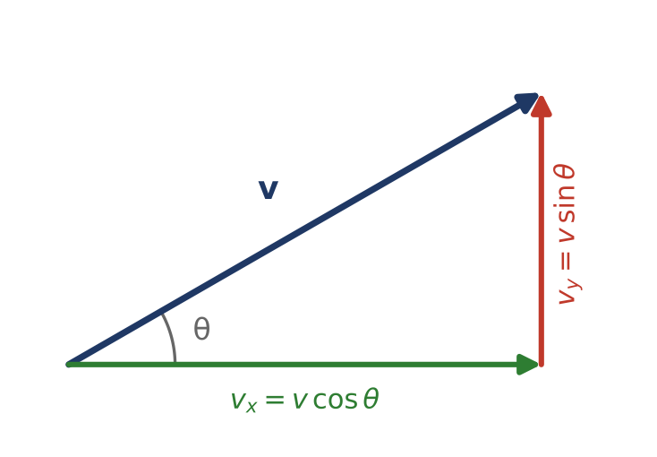
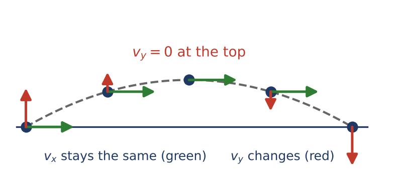
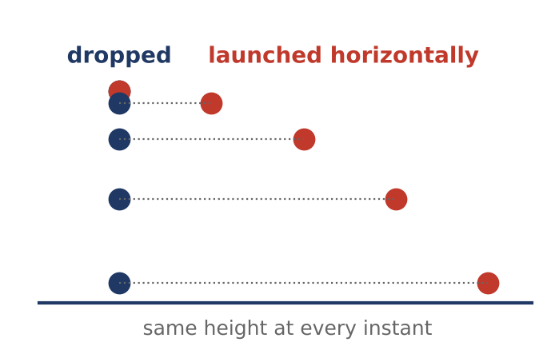
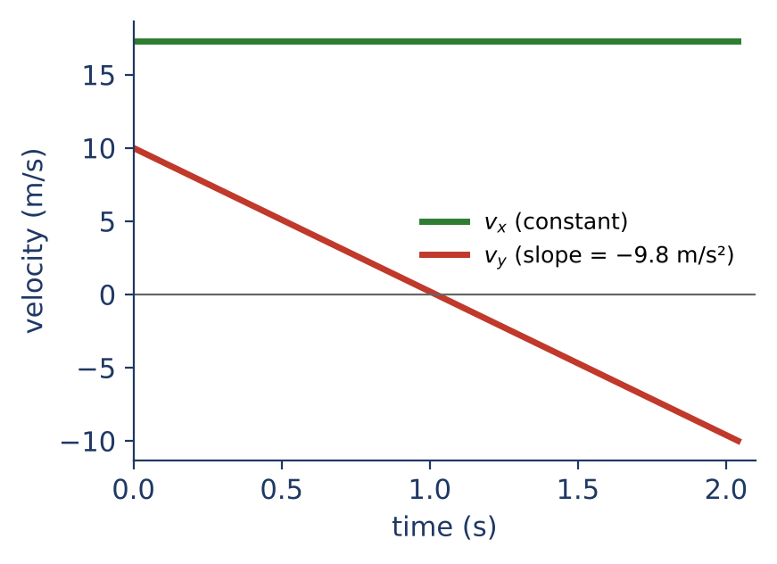

# Cornell Notes: Projectile Motion

*Physics | Semester 1, Unit 2 | Vectors, components, horizontal and angled launches*

Name: ____________________  Period: ______  Date: __________

**Learning targets**

- I can break a velocity vector into horizontal and vertical components and combine them again.
- I can explain why the horizontal and vertical motions of a projectile are independent.
- I can solve problems for a projectile launched horizontally.
- I can find the time of flight, maximum height, and range of a projectile launched at an angle.

**Essential question:** Why does a thrown object follow a curved path, and how can we predict where it lands?

How to use these notes: cover the Notes column, answer each cue question aloud, then check.

## 1. Vectors and Components

| Cues / Questions | Notes |
|---|---|
| **How do you find the horizontal and vertical components of a velocity?** | • With the angle θ measured from the horizontal: **vx = v cos θ** and **vy = v sin θ**. • Worked example: 20 m/s at 30° above horizontal. vx = 20 cos 30° = **17.3 m/s**. vy = 20 sin 30° = **10.0 m/s**. • Check: the components are the legs of a right triangle and v is the hypotenuse, so each leg must be smaller than v. |
| **How do you combine two components into one vector?** | • Magnitude: **v = √(vx² + vy²)** (Pythagorean theorem). • Direction: **θ = tan⁻¹(vy / vx)**. • Worked example: vx = 4 m/s and vy = 3 m/s. v = √(16 + 9) = **5 m/s** at tan⁻¹(3/4) = **36.9°** above horizontal. |
| **How do you add two vectors with a diagram?** | • Draw them **head-to-tail**. The **resultant** runs from the tail of the first to the head of the last. • Vectors at right angles: use the Pythagorean theorem. Vectors along one line: add or subtract. |

**IXL practice (goal: SmartScore 80+):** **Physics C.2** Decompose and compose two-dimensional vectors; **Physics C.3** Add and subtract two-dimensional vectors: component form; **Precalculus Y.1** Find the magnitude of a vector; **Precalculus Y.2** Find the component form of a vector; **Precalculus Y.3** Find the direction angle of a vector; **Precalculus Y.4** Find the component form of a vector from its magnitude and direction angle; **Precalculus Y.5** Graph a resultant vector using the triangle method; **Precalculus Y.7** Add vectors; **Precalculus Y.9** Find the magnitude and direction of a vector sum

## 2. What Makes a Projectile

| Cues / Questions | Notes |
|---|---|
| **Which forces act on a projectile after it is launched?** | • **Only gravity** (air resistance ignored). The push of the throw ends when the object leaves the hand. • A **projectile** is any object moving through the air with gravity as the only force on it. |
| **Why does a projectile's horizontal velocity stay constant?** | • No horizontal force means no horizontal acceleration: **ax = 0**, so vx never changes. • Vertically, gravity gives **ay = 9.8 m/s² downward**, so vy changes by 9.8 m/s every second. • The two motions together trace a **parabola**. |
| **What is the one thing the horizontal and vertical motions share?** | • **Time.** The two directions are independent, but both last the same time in the air. • A ball dropped and a ball launched horizontally from the same height **land at the same time**. |

**Practice:** No IXL skill covers the concept of independent horizontal and vertical motion. Use the Physics Classroom Vectors and Projectiles Concept Builders.

## 3. Projectiles Launched Horizontally

| Cues / Questions | Notes |
|---|---|
| **What are the starting velocity components for a horizontal launch?** | • **vix = launch speed** and **viy = 0**. Vertically it starts like a dropped object. |
| **What decides how long a horizontally launched object is in the air?** | • **Only the height.** From Δy = ½gt²: **t = √(2h / g)**. • Launch speed changes how far it lands, not how long it falls. |
| **How do you find where a ball lands after rolling off a table?** | • Worked example: a ball rolls off a 1.25 m high table at 3.0 m/s. • Vertical (find time): t = √(2 × 1.25 ÷ 9.8) = **0.505 s**. • Horizontal (find range): Δx = vx t = 3.0 × 0.505 = **1.52 m** from the table. • Landing speed: vy = 9.8 × 0.505 = 4.95 m/s, so v = √(3.0² + 4.95²) = **5.79 m/s**. |

**IXL practice (goal: SmartScore 80+):** **Physics E.1** Solve projectile motion problems given components of velocity

## 4. Projectiles Launched at an Angle

| Cues / Questions | Notes |
|---|---|
| **What are the velocity and acceleration at the top of the path?** | • **vy = 0** at the top, but the object is still moving sideways at **vx**. Its speed is not zero. • Acceleration is still **9.8 m/s² downward**, as everywhere on the path. |
| **How do you find time of flight, maximum height, and range on level ground?** | • Time to the top: **tup = viy / g**. Total time = 2 × tup. • Maximum height: **h = viy² / (2g)**. • Range: **R = vx × total time**. • Worked example: 20 m/s at 30°. vx = 17.3 m/s, viy = 10.0 m/s. tup = 10.0 ÷ 9.8 = 1.02 s, total = **2.04 s**. h = 10.0² ÷ 19.6 = **5.10 m**. R = 17.3 × 2.04 = **35.3 m**. |
| **Which launch angle gives the greatest range?** | • **45°** on level ground with no air resistance. • Angles that add to 90° (such as 30° and 60°) give the **same range**. The steeper one goes higher and stays up longer. |

**IXL practice (goal: SmartScore 80+):** **Physics E.2** Solve projectile motion problems given magnitude and direction of velocity

## 5. Labs and Measurement

| Cues / Questions | Notes |
|---|---|
| **How do you predict where a ball rolling off a table will land?** | • **Horizontal launch lab:** measure the launch speed v on the table (distance ÷ time, or a photogate) and the table height h. • Predict the range with **R = v √(2h / g)**, place a target, then test. • **Independent variable:** launch speed (or table height). **Dependent variable:** range. |
| **How do you test the effect of launch angle?** | • **Launcher lab or PhET Projectile Motion:** change the angle, keep launch speed the same, measure range. • **Independent variable:** angle. **Dependent variable:** range. **Controlled:** launch speed, launch height. |
| **Why might the ball miss the predicted spot?** | • Air resistance, a table that is not level, measuring height to the wrong point on the ball, and timing error in the launch speed. |

**IXL practice (goal: SmartScore 80+):** **Physics A.2** Identify independent and dependent variables; **Physics A.3** Identify the experimental question

## Memory tricks

- **SOH CAH TOA.** Finding components: the side next to the angle uses cosine, the side across from it uses sine.
- **Horizontal: constant velocity. Vertical: free fall.** Setting up any projectile problem. Make two columns, x and y.
- **Time is the link.** Solve for time in one direction, then use it in the other.
- **At the top, vy = 0 (not v, and not a).** Maximum-height questions.
- **45° for maximum range; angles that add to 90° land in the same place.** Comparing launch angles on level ground.

## Summary

A projectile moves in two directions at once, and the two motions do not affect each other. Horizontally nothing pushes on it, so it keeps a constant velocity. Vertically gravity makes it accelerate at 9.8 m/s² downward, exactly like a dropped object. Time is the only thing the two directions share. To solve a problem, split the launch velocity into components, use the vertical motion to find the time, and use that time in the horizontal motion to find the range.

## Visual memory aids

A velocity vector is the hypotenuse of a right triangle whose legs are its components. **vx = v cos θ,  vy = v sin θ**

Along the path the horizontal velocity arrow stays the same length while the vertical arrow shrinks, reaches zero at the top, then grows downward. **ax = 0,  ay = 9.8 m/s² down**

A dropped ball and a horizontally launched ball are at the same height at every instant, so they land together. **t = √(2h / g)**

Velocity-time graphs for a projectile: vx is a flat line, vy is a straight line sloping down at 9.8 m/s². **vy = viy − gt**

## Study method

1. Cover the Notes column and answer each cue aloud.
2. Check your answer and mark the ones you missed.
3. Redraw each visual memory aid from memory.
4. Repeat the next day and again a few days later. Recall spread over several days builds memory that rereading does not.
5. Finish the IXL plan to SmartScore 80+ before the test.
