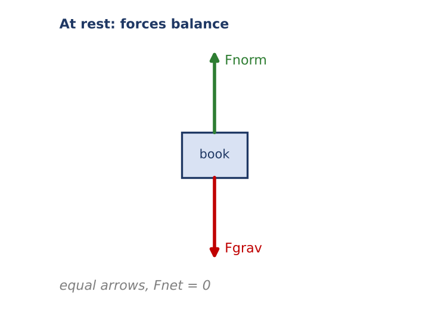
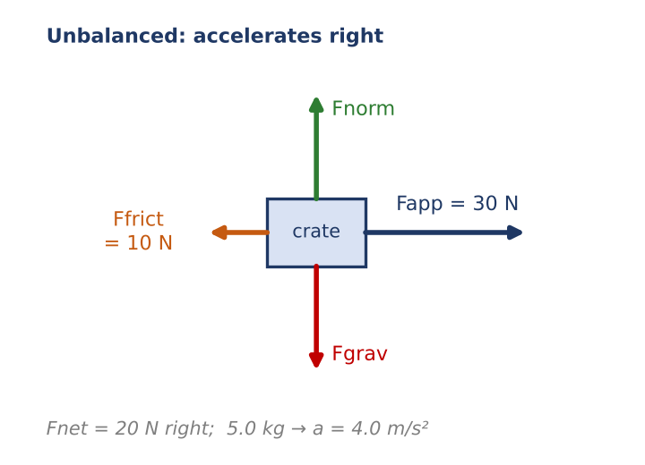
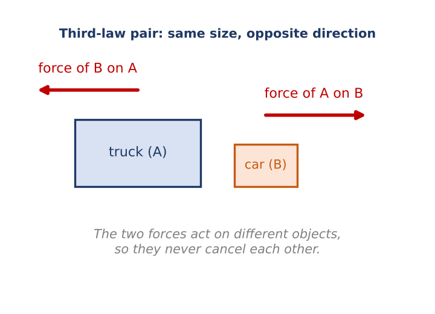
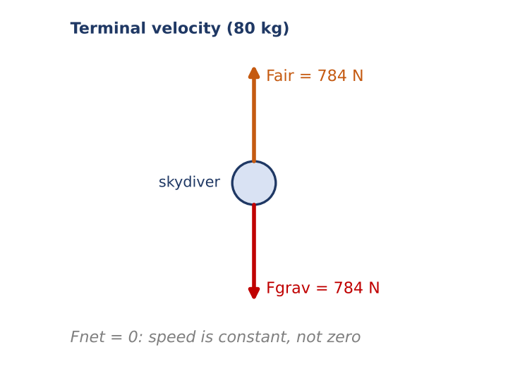

# Unit 3: Newton's Laws

[Project home](../../README.md) · [1. Kinematics](../01-kinematics/README.md) · [2. Projectile Motion](../02-projectile-motion/README.md) · **3. Newton's Laws** · [4. Momentum](../04-momentum/README.md) · [5. Work & Energy](../05-work-and-energy/README.md)

**Pacing:** Weeks 8–11 · **Essential question:** What causes an object's motion to change, and how can we predict the change?

Kinematics described motion; dynamics explains it. Students learn to identify forces, draw free-body diagrams, and use Newton's three laws to connect net force with acceleration.

## Materials in this folder

| File | What it is |
|---|---|
| [cornell-notes-03-newtons-laws.docx](cornell-notes-03-newtons-laws.docx) | Printable Cornell notes: cue questions, notes with worked examples, visual memory aids, study method, IXL practice plan |
| [quiz.html](quiz.html) | Interactive quiz on the 10 most commonly missed ideas, with an explanation after every answer |

## Standards (CA NGSS)

- **HS-PS2-1** – Analyze data to support the claim that Newton's second law of motion describes the mathematical relationship among the net force on a macroscopic object, its mass, and its acceleration. (Assessment is limited to one-dimensional motion.)
- **SEP: Analyzing and Interpreting Data** – Graph acceleration against net force and against mass from cart data and interpret the slope.
- **CCC: Cause and Effect** – Use evidence to separate cause (net force) from effect (acceleration).

## Key concepts to master

- **Force and net force** – a push or pull measured in newtons; the vector sum of all forces on one object.
- **Free-body diagram** – arrows for every force acting on a single object: Fgrav, Fnorm, Ffrict, Fapp, Ftens, Fair.
- **Newton's first law (inertia)** – balanced forces mean no change in velocity.
- **Newton's second law** – a = Fnet/m; acceleration points the same way as the net force.
- **Mass and weight** – mass is the amount of matter (kg); weight is the force of gravity (N), W = mg.
- **Normal force and friction** – the surface pushes perpendicular; friction opposes sliding, Ffrict = μFnorm.
- **Newton's third law** – forces come in equal, opposite pairs acting on two different objects.

## Learning objectives and how each is assessed

| # | Students can… | Evidence |
|---|---|---|
| 3.1 | Draw a correct free-body diagram for an object at rest, at constant velocity, or accelerating. | Free-body diagram check; Quiz Q5 |
| 3.2 | Apply the first law to balanced-force situations. | Quiz Q1, Q4, Q6, Q10; IXL Physics F.2 |
| 3.3 | Solve one-dimensional problems with a = Fnet/m. | Practice 1, 2, 4; IXL Physics F.3 |
| 3.4 | Calculate weight, normal force and friction. | Practice 3, 4, 5; Quiz Q8 |
| 3.5 | Identify action-reaction pairs and compare the forces in an interaction. | Quiz Q2, Q3, Q9; Practice 6 |
| 3.6 | Analyze cart data to support Newton's second law (lab, HS-PS2-1). | Second-law lab report with graph and CER |

Score each objective on the 4-point scale in [Assessment and progress tracking](../../docs/assessment-and-tracking.md). The unit is mastered when every objective is at 3 or above.

## Cue questions (self-test)

Cover the answers in the Cornell notes and answer these aloud.

**1. Forces and Free-Body Diagrams**

- What is a force, and what is net force?
- How do you draw a free-body diagram?
- Which object exerts the normal force?

**2. Newton's First Law: Inertia**

- What does Newton's first law say?
- Does a moving object need a force to keep it moving?
- What is inertia, and what does it depend on?

**3. Newton's Second Law: a = Fnet/m**

- What does Newton's second law say?
- How do you solve a second-law problem?
- What is the friction force when you push a crate at constant velocity?

**4. Mass, Weight, Normal Force and Friction**

- How is weight different from mass?
- How do you calculate friction?
- When is the normal force not equal to the weight?

**5. Newton's Third Law: Force Pairs**

- What does Newton's third law say?
- In a collision between a truck and a small car, which feels the larger force?
- Why don't action and reaction forces cancel?

**6. Labs and Measurement**

- What are the variables in the cart-and-hanging-mass lab?
- What should the graphs show if Newton's second law is correct?

## Visual memory aids

| | |
|---|---|
|  A book at rest on a table has two forces that balance: the table pushes up as hard as gravity pulls down. **Fnet = 0, so a = 0** |  A pushed crate with a longer Fapp arrow than Ffrict arrow has a net force to the right and accelerates right. **a = Fnet/m = (Fapp − Ffrict)/m** |
|  In a collision each vehicle pushes on the other with the same size force, in opposite directions. **F(A on B) = −F(B on A)** |  A skydiver at terminal velocity has air resistance equal to weight, so speed stops changing. **Fair = Fgrav, so Fnet = 0** |

## Most commonly missed ideas

Each of these is a question in the [interactive quiz](quiz.html).

1. Believing motion requires a force in the direction of motion.
2. Thinking the bigger or faster object pushes harder.
3. Calling the normal force the reaction to weight.
4. Thinking the push must beat friction for the crate to keep moving.
5. Drawing a "force of the throw" on an object no longer in contact with the hand.
6. Linking the scale reading to the direction of motion instead of the acceleration.
7. Tracking only one of the two changes.
8. Using mass and weight as the same thing.
9. Thinking only active or moving objects exert forces.
10. Assuming balanced forces mean the object must be at rest.

## Learning resources

- [The Physics Classroom: Newton's Laws tutorial](https://www.physicsclassroom.com/class/newtlaws) – Reading on all three laws, free-body diagrams and net force.
- [The Physics Classroom: Concept Builders](https://www.physicsclassroom.com/Concept-Builders) – Open the Newton's Laws set for free-body diagram practice.
- [PhET simulation: Forces and Motion: Basics](https://phet.colorado.edu/en/simulations/forces-and-motion-basics) – Tug-of-war net force, friction and acceleration with live force arrows.
- [OpenStax Physics (high school), Chapter 4](https://openstax.org/details/books/physics) – Free textbook: Forces and Newton's Laws of Motion.
- [Khan Academy Physics](https://www.khanacademy.org/science/physics) – Videos and practice; browse or search the library for forces and Newton's laws. Unit names on the site change from time to time.
- [IXL Physics, section F; Grade 8 science, section I](https://www.ixl.com/science/physics) – Skill practice; goal SmartScore 80+.

## IXL practice plan (goal: SmartScore 80+)

| Done | Skill | Skill name |
|---|---|---|
| ☐ | Physics A.2 | Identify independent and dependent variables |
| ☐ | Physics A.3 | Identify the experimental question |
| ☐ | Physics B.3 | Multiply and divide with significant figures |
| ☐ | Physics B.4 | Calculations with significant figures |
| ☐ | Grade 8 I.5 | Balanced and unbalanced forces |
| ☐ | Physics F.2 | Newton's first law of motion |
| ☐ | Grade 8 I.2 | How does mass affect force and acceleration? |
| ☐ | Grade 8 I.3 | Calculate acceleration using Newton's second law of motion |
| ☐ | Physics F.3 | Newton's second law of motion |
| ☐ | Physics F.1 | Newton's laws of motion |
| ☐ | Grade 8 I (new, not yet numbered) | How does mass affect gravitational force? |
| ☐ | Grade 8 KK.6 | Abbreviate force, energy, and electricity units |
| ☐ | Grade 8 I.4 | Predict forces using Newton's third law of motion |
| ☐ | Grade 8 I.6 | Newton's laws of motion |

*No IXL match:* Free-body diagrams, friction calculations (Ffrict = μFnorm) and elevator problems have no matching IXL skill. Use the physicsclassroom.com Concept Builders for Newton's Laws (Free-Body Diagrams, Recognizing Forces).

## Practice problems

Use g = 9.8 m/s². Try each one before opening the answer.

1. A net force of 12 N acts on a 2.0 kg cart. What is its acceleration?
   

Answer
a = 12 ÷ 2.0 = <strong>6.0 m/s²</strong>

2. A 1500 kg car speeds up from rest to 20 m/s in 8.0 s. What net force acts on it?
   

Answer
a = 20 ÷ 8.0 = 2.5 m/s². Fnet = 1500 × 2.5 = <strong>3750 N</strong>

3. What is the weight of a 75 kg person on Earth and on the Moon (g = 1.6 m/s²)?
   

Answer
Earth: 75 × 9.8 = <strong>735 N</strong>. Moon: 75 × 1.6 = <strong>120 N</strong>. Mass is 75 kg in both places.

4. A 20 kg sled is pulled horizontally with 80 N across snow with μ = 0.25. Find the acceleration.
   

Answer
Fnorm = 20 × 9.8 = 196 N. Ffrict = 0.25 × 196 = 49 N. Fnet = 80 − 49 = 31 N. a = 31 ÷ 20 = <strong>1.55 m/s²</strong>

5. A 70 kg rider is in an elevator accelerating downward at 1.5 m/s². What does a scale under the rider read?
   

Answer
mg − Fnorm = ma, so Fnorm = 70 × (9.8 − 1.5) = <strong>581 N</strong> (less than the 686 N weight)

6. Two skaters at rest push off each other with a force of 150 N. Their masses are 50 kg and 75 kg. Find each acceleration.
   

Answer
50 kg skater: 150 ÷ 50 = <strong>3.0 m/s²</strong>. 75 kg skater: 150 ÷ 75 = <strong>2.0 m/s²</strong>, in the opposite direction. Same force, different accelerations.

7. An 80 kg skydiver falls at terminal velocity. What is the force of air resistance?
   

Answer
Constant velocity means Fnet = 0, so Fair = mg = 80 × 9.8 = <strong>784 N</strong> upward

8. Use Newton's first law to explain why seat belts are needed.
   

Answer
In a sudden stop the car slows but the passenger's <strong>inertia</strong> keeps them moving forward at the original speed. The seat belt supplies the unbalanced force that slows the passenger with the car.

## Labs and investigations

- **Second-law lab (HS-PS2-1)**: cart pulled by a hanging mass; graph acceleration against net force and against mass.
- **Inertia demonstrations**: coin on a card over a cup; tablecloth pull.
- **Friction investigation**: pull a block with a spring scale across different surfaces to compare coefficients of friction.
- **Third-law pairs**: two spring scales hooked together always read the same.

## Real-world applications

- **Vehicle safety**: seat belts and headrests (first law), braking force and stopping distance (second law).
- **Rockets and jets**: exhaust is pushed backward and the engine is pushed forward (third law).
- **Sports**: sprinters push back on the blocks; a heavier bat or ball needs more force for the same acceleration.
- **Structures**: bridges and buildings are designed so that all forces balance.
- **Earth science link**: stress builds along a fault until the force exceeds static friction, and the plates slip in an earthquake.

## Unit checklist

**Student**

- [ ] Cornell notes read; every cue question answered aloud from memory
- [ ] All visual memory aids redrawn from memory
- [ ] Practice problems completed and checked
- [ ] IXL practice plan at SmartScore 80+
- [ ] Interactive quiz at 80% or higher
- [ ] Lab report submitted
- [ ] Unit test taken; missed objectives retested

**Instructor**

- [ ] Learning targets and essential question posted
- [ ] Quiz given as a pre-assessment to find misconceptions
- [ ] Lab(s) run and scored with the lab rubric
- [ ] Quiz repeated as a post-assessment; results recorded in the tracker
- [ ] Reteach plan made for any objective below 3
