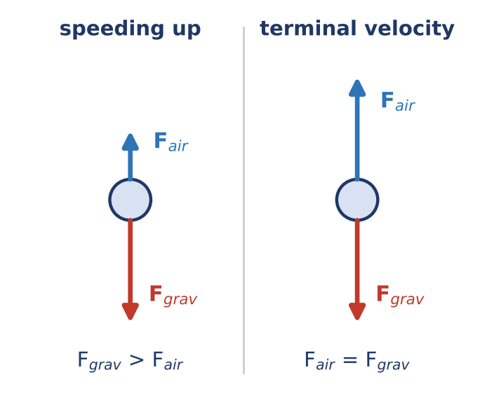

# Unit 3: Newton's Laws

**Suggested pacing:** Weeks 8–11 of semester 1  
**Essential question:** Why do objects speed up, slow down, change direction, or keep doing what they are doing?

## Materials in this folder

| File | What it is |
|---|---|
| [cornell-notes.md](cornell-notes.md) | Cornell notes, readable here on GitHub |
| [cornell-notes-newton.docx](cornell-notes-newton.docx) | The same notes as a printable Word document with a cover page, visual memory aids, and an IXL practice plan |
| [Quiz](../../quizzes/index.html) | Interactive quiz on the most often missed questions (open `quizzes/index.html` in a browser and choose Newton's Laws) |

## Standards (NGSS for California, high school)

- **HS-PS2-1** Analyze data to support the claim that Newton's second law of motion describes the mathematical relationship among the net force on a macroscopic object, its mass, and its acceleration.
- **HS-PS2-4** Use mathematical representations of Newton's Law of Gravitation to describe and predict the gravitational forces between objects (introduced here through weight, F_grav = m·g).

## Learning objectives

Check each box when you can do it without notes.

- [ ] I can state Newton's three laws and give an example of each.
- [ ] I can draw a free-body diagram with correctly named and sized force arrows.
- [ ] I can find the net force and use F_net = m·a to find acceleration, force, or mass.
- [ ] I can tell mass from weight and calculate weight with F_grav = m·g.
- [ ] I can identify action-reaction force pairs and explain why they do not cancel.
- [ ] I can calculate friction and explain what happens at constant velocity.

## Key concepts to master

| Concept | What you need to know |
|---|---|
| **Force** | A push or pull on an object from another object, measured in newtons (N). A vector. |
| **Net force** | The vector sum of all forces on one object. It, not any single force, decides the acceleration. |
| **Inertia (first law)** | Objects keep their velocity unless a net force acts. Mass measures inertia. |
| **Second law** | a = F_net ÷ m. Acceleration is in the direction of the net force. |
| **Mass vs. weight** | Mass is the amount of matter (kg) and is the same everywhere. Weight is the force of gravity (N): F_grav = m·g. |
| **Third law** | Forces come in pairs: equal size, opposite direction, acting on two different objects. |
| **Free-body diagram** | A sketch of one object with an arrow for each force on it: F_grav, F_norm, F_app, F_frict, F_tens, F_air. |
| **Friction** | A force that opposes sliding: F_frict = μ·F_norm. |

## Visual memory aids

Book at rest on a table: the normal force up and gravity down are the same size, so the net force is zero. **Rule:** balanced forces → a = 0

Crate pushed to the right: the applied force is larger than friction, so there is a net force to the right. **Rule:** F_net = F_app − F_frict = m·a

Truck and car in a collision: each pushes on the other with a force of the same size in opposite directions. **Rule:** F on car by truck = −F on truck by car

Skydiver speeding up (gravity larger than air resistance) and at terminal velocity (forces equal). **Rule:** F_air = F_grav → constant velocity

## Learning resources

| Resource | Use it for |
|---|---|
| [The Physics Classroom: Newton's Laws](https://www.physicsclassroom.com/class/newtlaws) | Lessons on all three laws, free-body diagrams, and net force, using the same force names as these notes. |
| [PhET: Forces and Motion: Basics](https://phet.colorado.edu/en/simulations/forces-and-motion-basics) | Tug-of-war, friction, and acceleration labs you can run in a browser. |
| [Khan Academy: High school physics](https://www.khanacademy.org/science/highschool-physics) | Videos and practice on forces and Newton's laws. |
| [OpenStax Physics (high school)](https://openstax.org/details/books/physics) | Free textbook; see the chapter on forces and Newton's laws of motion. |

### IXL practice plan

Goal: SmartScore 80+ on each skill before the unit test. Codes were checked against the live IXL skill lists on November 27, 2026; IXL renumbers skills from time to time, so search by skill name if a code has moved.

| Done | Skill | Skill name | Notes section |
|---|---|---|---|
| ☐ | Physics A.1 | The process of scientific inquiry | 7 |
| ☐ | Physics A.2 | Identify independent and dependent variables | 7 |
| ☐ | Grade 8 I.5 | Balanced and unbalanced forces | 1 |
| ☐ | Grade 8 KK.6 | Abbreviate force, energy, and electricity units | 1 |
| ☐ | Physics F.2 | Newton's first law of motion | 2 |
| ☐ | Physics F.3 | Newton's second law of motion | 3 |
| ☐ | Grade 8 I.2 | How does mass affect force and acceleration? | 3 |
| ☐ | Grade 8 I.3 | Calculate acceleration using Newton’s second law of motion | 3 |
| ☐ | Grade 8 I (New) | How does mass affect gravitational force? | 4 |
| ☐ | Physics I.4 | Newton's law of universal gravitation | 4 |
| ☐ | Grade 8 I.4 | Predict forces using Newton’s third law of motion | 5 |
| ☐ | Physics F.1 | Newton's laws of motion | 5 |
| ☐ | Grade 8 I.6 | Newton's laws of motion | 5 |

No exact IXL match:

- **Forces and Free-Body Diagrams:** IXL has no free-body-diagram skill. Use the physicsclassroom.com Concept Builders in the Newton's Laws section for drawing and reading free-body diagrams.
- **Friction and Air Resistance:** IXL has no friction-calculation skill. Use the friction and free-body Concept Builders at physicsclassroom.com.

## Practice problems

Use g = 9.8 m/s². Show givens, equation, substitution, and units. Answers are hidden under each problem.

1. **Foundation.** What net force gives a 4 kg object an acceleration of 3 m/s²?

   

Answer
F_net = 4 × 3 = 12 N

2. **Foundation.** Find the weight of a 60 kg person on Earth and on the Moon (g = 1.6 m/s²).

   

Answer
Earth: 588 N. Moon: 96 N. Mass is 60 kg in both places.

3. **Proficient.** A 20 kg crate is pushed with 100 N against 40 N of friction. Find the acceleration.

   

Answer
F_net = 60 N. a = 60 ÷ 20 = 3 m/s².

4. **Proficient.** A 1200 kg car brakes from 20 m/s to rest in 4 s. Find the braking force.

   

Answer
a = −5 m/s². F = 1200 × 5 = 6000 N, opposite the motion.

5. **Challenge.** A 70 kg person stands on a scale in an elevator accelerating upward at 2 m/s². What does the scale read?

   

Answer
F_norm = m(g + a) = 70 × 11.8 = 826 N (normal weight 686 N).

6. **Challenge.** A 10 kg box is pulled across a floor at constant velocity by a 30 N horizontal force. Find the coefficient of friction.

   

Answer
F_frict = 30 N, F_norm = 98 N, μ = 30 ÷ 98 = 0.31.

## Real-world applications

- Seat belts and headrests: your body keeps moving (inertia) when the car stops or is hit from behind.
- Rocket launches: the engine pushes exhaust gas down and the gas pushes the rocket up.
- Elevators: you feel heavier when it speeds up going up and lighter when it speeds up going down.
- Tires and shoe soles, which are designed around the friction needed to start, stop, and turn.

## Assessment criteria

Scored on a 4-point scale. A 3 (Proficient) meets the standard. See [ASSESSMENT.md](../../ASSESSMENT.md) for how scores are collected.

| Skill | 1 Beginning | 2 Developing | 3 Proficient | 4 Advanced |
|---|---|---|---|---|
| **Draw free-body diagrams** | Draws motion arrows or forces on the wrong object | Draws most forces but mislabels or missizes them | Draws every force on one object, labeled and sized correctly | Draws diagrams for connected objects or ramps and explains each force |
| **Apply the second law** | Uses a single force instead of the net force | Finds net force but makes unit or direction errors | Finds net force and solves F_net = m·a with units and a sense check | Combines F = ma with kinematics in a multi-step problem |
| **Use the first and third laws** | Says motion needs a force; says the bigger object pushes harder | States the laws but misapplies them to cases | Explains constant-velocity situations and identifies action-reaction pairs | Uses lab data to argue that a ∝ F_net and a ∝ 1/m (HS-PS2-1) |

## Unit checklist

- [ ] Read the Cornell notes and answer every cue aloud with the notes column covered
- [ ] Redraw each visual memory aid from memory
- [ ] Complete the practice problems (all Foundation and Proficient; at least one Challenge)
- [ ] Score 80% or higher on the unit quiz
- [ ] Reach SmartScore 80+ on the IXL skills above
- [ ] Complete the lab and its write-up
- [ ] Check off every learning objective above

[Back to the project outline](../../README.md)
