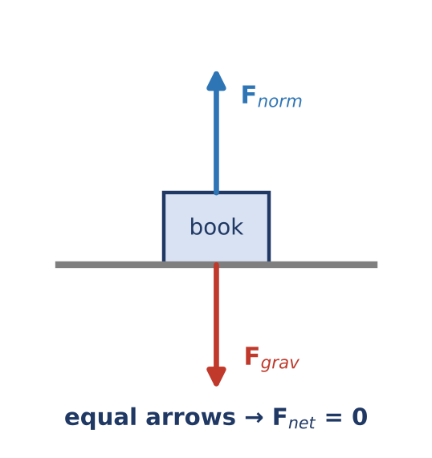
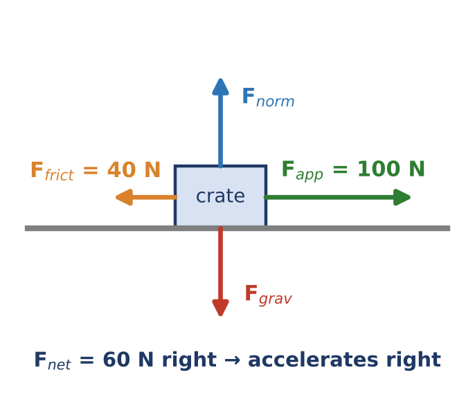
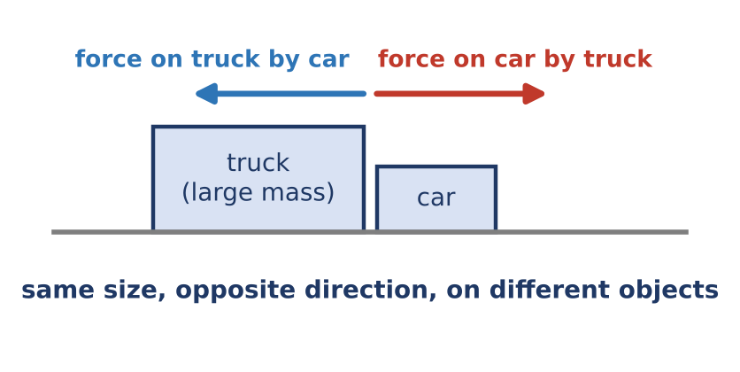

# Cornell Notes: Newton's Laws

*Physics | Forces and Motion | inertia, free-body diagrams, net force, F = ma, action-reaction*

Name: ________________  Period: ______  Date: __________

**Learning targets**

- I can state Newton's three laws and give an example of each.
- I can draw a free-body diagram with correctly named and sized force arrows.
- I can find the net force and use F_net = m·a to find acceleration, force, or mass.
- I can tell mass from weight and calculate weight with F_grav = m·g.
- I can identify action-reaction force pairs and explain why they do not cancel.
- I can calculate friction and explain what happens at constant velocity.

**Essential question:** Why do objects speed up, slow down, change direction, or keep doing what they are doing?

**How to use these notes:** cover the Notes column, answer each cue question aloud, then uncover and check. Mark the ones you miss and try them again tomorrow.

## 1. Forces and Free-Body Diagrams

| Cues / Questions | Notes |
|---|---|
| **What is a force, and what unit is it measured in?** | • A **force** is a push or pull that one object exerts on another. It is a vector. • Unit: the **newton (N)**. 1 N = 1 kg·m/s². • Common forces: gravity (**F_grav**), normal (**F_norm**), applied (**F_app**), friction (**F_frict**), tension (**F_tens**), air resistance (**F_air**). |
| **How do you draw a free-body diagram?** | • 1. Draw the object as a box or dot. Draw **one object only**. • 2. Draw an arrow for each force **on** that object, starting at the object and pointing the way the force acts. • 3. Label every arrow. Make longer arrows for larger forces. • Never draw velocity, acceleration, or a "force of motion" as a force. |
| **Which object exerts the normal force, and which way does it point?** | • The **surface** the object touches exerts the normal force. • It points **perpendicular** to the surface, away from it. • On a level floor with no other vertical forces, F_norm = F_grav. That is not always true (elevators, ramps, someone pushing down). |

> **IXL practice (goal: SmartScore 80+):** **Grade 8 I.5** Balanced and unbalanced forces · **Grade 8 KK.6** Abbreviate force, energy, and electricity units
> IXL has no free-body-diagram skill. Use the physicsclassroom.com Concept Builders in the Newton's Laws section for drawing and reading free-body diagrams.

## 2. Newton's First Law: Inertia

| Cues / Questions | Notes |
|---|---|
| **What does Newton's first law say?** | • An object at rest stays at rest, and an object in motion keeps moving at the same speed in the same direction, **unless a net force acts on it**. • **Inertia** is this tendency to resist changes in motion. More **mass** means more inertia. |
| **Does an object need a force to keep moving?** | • **No.** A force is needed to **change** velocity, not to keep it. • Things slow down on Earth because friction and air resistance act on them, not because motion "runs out". • A puck on frictionless ice would slide at constant velocity forever. |
| **What is the net force on an object moving at constant velocity?** | • **Zero.** Constant velocity (including rest) means the forces are **balanced**. • Worked example: you push a crate across the floor at constant velocity with 80 N. Net force = 0, so friction = **80 N** backward. |

> **IXL practice (goal: SmartScore 80+):** **Physics F.2** Newton's first law of motion

## 3. Newton's Second Law: F = ma

| Cues / Questions | Notes |
|---|---|
| **How are net force, mass, and acceleration related?** | • **a = F_net ÷ m**, usually written **F_net = m·a**. • More net force → more acceleration (direct). More mass → less acceleration (inverse). • The acceleration points in the direction of the **net** force. |
| **How do you find the net force?** | • Add forces in the same direction; subtract forces in opposite directions. • Handle vertical and horizontal forces separately. • Worked example: 100 N applied to the right, 40 N friction to the left → F_net = **60 N right**. |
| **What is the acceleration of a 20 kg crate pushed with 100 N against 40 N of friction?** | • Object: the crate. Forces: F_app = 100 N right, F_frict = 40 N left. F_grav and F_norm balance. • F_net = 100 − 40 = 60 N right. • a = F_net ÷ m = 60 ÷ 20 = **3 m/s² to the right**. • Sense check: without friction it would be 5 m/s², so 3 m/s² is reasonable. |
| **What force stops a 1200 kg car from 20 m/s in 4 s?** | • First the acceleration: a = (0 − 20) ÷ 4 = −5 m/s². • F_net = m·a = 1200 × (−5) = **−6000 N**. The minus sign means the force is opposite the motion. |

> **IXL practice (goal: SmartScore 80+):** **Physics F.3** Newton's second law of motion · **Grade 8 I.2** How does mass affect force and acceleration? · **Grade 8 I.3** Calculate acceleration using Newton’s second law of motion

## 4. Mass, Weight, and Gravity

| Cues / Questions | Notes |
|---|---|
| **What is the difference between mass and weight?** | • **Mass** is the amount of matter, in **kilograms**. It is the same on Earth, on the Moon, and in orbit. • **Weight** is the force of gravity on the object, in **newtons**: **F_grav = m·g**. • On Earth g = 9.8 m/s² (also written 9.8 N/kg). |
| **What does a 60 kg person weigh on Earth and on the Moon?** | • Earth: F_grav = 60 × 9.8 = **588 N**. • Moon (g = 1.6 m/s²): F_grav = 60 × 1.6 = **96 N**. • The mass is 60 kg in both places. |
| **What does a scale read in an elevator accelerating upward at 2 m/s² for a 70 kg person?** | • Object: the person. Forces: F_norm up (the scale reading), F_grav = 70 × 9.8 = 686 N down. • F_net = m·a → F_norm − 686 = 70 × 2 → F_norm = **826 N**. • At constant velocity (up or down) a = 0, so the scale reads the normal 686 N. |

> **IXL practice (goal: SmartScore 80+):** **Grade 8 I (New)** How does mass affect gravitational force? · **Physics I.4** Newton's law of universal gravitation

## 5. Newton's Third Law: Action-Reaction

| Cues / Questions | Notes |
|---|---|
| **What does Newton's third law say?** | • When object A pushes on object B, B pushes back on A with a force that is **equal in size and opposite in direction**. • The two forces act on **different objects** and are the same type of force. |
| **In a collision between a truck and a small car, which exerts the larger force?** | • **Neither.** The forces are equal in size. • The car is affected more because it has less mass: the same force gives it a larger acceleration (a = F ÷ m). |
| **Why don't action and reaction forces cancel?** | • They act on **different objects**. Only forces on the **same** object can cancel. • To name the pair, swap the two objects: "Earth pulls book down" pairs with "book pulls Earth up". • A book's weight and the normal force from the table are **not** a third-law pair. Both act on the book. |

> **IXL practice (goal: SmartScore 80+):** **Grade 8 I.4** Predict forces using Newton’s third law of motion · **Physics F.1** Newton's laws of motion · **Grade 8 I.6** Newton's laws of motion

## 6. Friction and Air Resistance

| Cues / Questions | Notes |
|---|---|
| **How do you calculate the force of friction?** | • **F_frict = μ·F_norm**, where μ (mu) is the coefficient of friction for the two surfaces. • **Static friction** holds an object still and matches the push, up to a maximum. **Kinetic friction** acts while it slides. • Worked example: a 10 kg box is pulled at constant velocity by 30 N. F_frict = 30 N. F_norm = 10 × 9.8 = 98 N. μ = 30 ÷ 98 = **0.31**. |
| **How much static friction acts on a crate you push with 100 N if it does not move?** | • Exactly **100 N**. The crate is at rest, so the net force is zero. • Static friction is only as large as it needs to be. |
| **What is terminal velocity?** | • Air resistance grows as a falling object speeds up. • When F_air equals F_grav, the net force is zero and the object stops accelerating. • It then falls at a constant speed called **terminal velocity**. |

> **IXL practice (goal: SmartScore 80+):** **Grade 8 I.5** Balanced and unbalanced forces
> IXL has no friction-calculation skill. Use the friction and free-body Concept Builders at physicsclassroom.com.

## 7. Labs and Measurement

| Cues / Questions | Notes |
|---|---|
| **In a cart-and-hanging-mass lab, what do you change and what do you measure?** | • Part 1: change the **net force** (hanging mass), keep total mass constant, measure **acceleration**. • Part 2: change the **mass** of the cart, keep the force constant, measure **acceleration**. • Independent variable: force (or mass). Dependent variable: acceleration. |
| **What should the graphs from that lab look like?** | • Acceleration vs. net force: a **straight line through the origin**. Its slope is 1 ÷ mass. • Acceleration vs. mass: a **curve that falls** as mass rises (inverse relationship). • This data is the evidence for NGSS HS-PS2-1. |

> **IXL practice (goal: SmartScore 80+):** **Physics A.1** The process of scientific inquiry · **Physics A.2** Identify independent and dependent variables

## Memory tricks

- **Net force, not force.** Always ask for the net force before using F = ma. *Use it for:* Any second-law problem.
- **Constant velocity means balanced.** At rest or at constant velocity, F_net = 0. *Use it for:* Finding an unknown force such as friction.
- **Swap the objects.** "A pushes B" pairs with "B pushes A". *Use it for:* Naming a third-law pair.
- **Mass in kilograms, weight in newtons.** Multiply mass by 9.8 to get weight on Earth. *Use it for:* Any problem that gives mass and needs a force.
- **One object, forces on it.** A free-body diagram shows only the forces acting on the chosen object. *Use it for:* Starting every force problem.

## Summary

Newton's laws explain why motion changes. The first law says an object keeps its velocity unless a net force acts, so constant velocity means balanced forces. The second law gives the size of the change: acceleration equals net force divided by mass, in the direction of the net force. The third law says forces always come in equal and opposite pairs acting on two different objects, which is why they never cancel. A free-body diagram is the tool for every problem: choose one object, draw each force on it, find the net force, then apply F_net = m·a. Weight is the force of gravity, m·g, and is different from mass.

## Visual memory aids

Book at rest on a table: the normal force up and gravity down are the same size, so the net force is zero. **Rule:** balanced forces → a = 0

Crate pushed to the right: the applied force is larger than friction, so there is a net force to the right. **Rule:** F_net = F_app − F_frict = m·a

Truck and car in a collision: each pushes on the other with a force of the same size in opposite directions. **Rule:** F on car by truck = −F on truck by car

Skydiver speeding up (gravity larger than air resistance) and at terminal velocity (forces equal). **Rule:** F_air = F_grav → constant velocity

## Study method

1. Cover the Notes column and answer each cue aloud.
2. Check, and mark the ones you missed.
3. Redraw each visual memory aid from memory.
4. Repeat the next day and again a few days later. Recall spread over days builds memory that rereading does not.
5. Finish the IXL plan to SmartScore 80+ before the test.

Printable version: [cornell-notes-newton.docx](cornell-notes-newton.docx) · [Unit guide](README.md)
