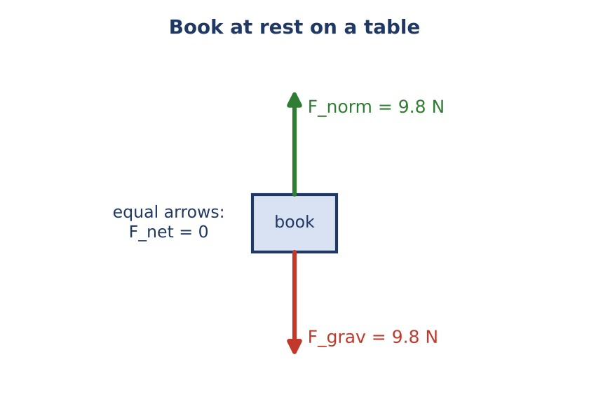
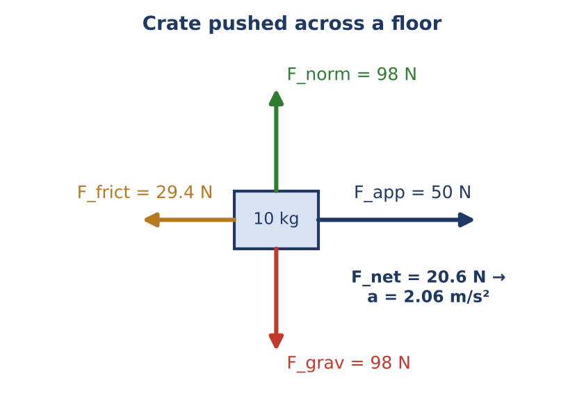
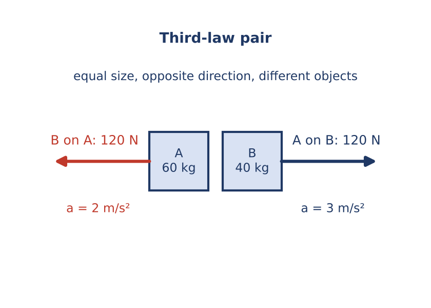
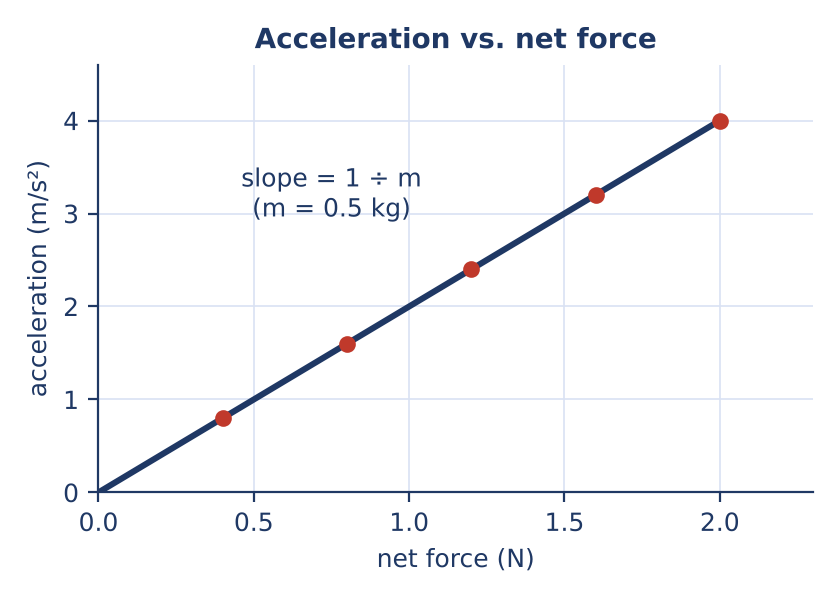

# Cornell Notes: Newton's Laws

*Physics | Unit 3 | Forces and motion*

Name: ________________  Period: ______  Date: __________

> A print-ready Word version with the same content is in this folder. Cover the right-hand column and answer each cue aloud to self-test.

**Learning targets**

- I can draw a free-body diagram that shows only the forces acting on one object.
- I can use Newton's first law to explain motion when forces are balanced.
- I can use F_net = ma to find acceleration, net force, or mass.
- I can tell mass from weight and calculate weight, normal force, and friction.
- I can identify Newton's third-law force pairs and explain why they do not cancel.
- I can analyze lab data to show how acceleration depends on net force and mass.

**Essential question:** How do the forces acting on an object determine how its motion changes?

## 1. Forces and Free-Body Diagrams

| Cues / Questions | Notes |
|---|---|
| **What is a net force?** | • A **force** is a push or pull, measured in **newtons (N)**. It is a vector. • The **net force** is the vector sum of all the forces on one object. Forces in the same direction add, opposite directions subtract. • Example: 30 N right and 10 N left gives a net force of **20 N right**. • **Balanced forces** (net force = 0) give no acceleration. **Unbalanced forces** give acceleration. |
| **Which forces belong on a free-body diagram?** | • Only forces acting **on** the object you chose, drawn as arrows from a dot or box. • **F_grav** (weight): Earth pulls down. **F_norm**: a surface pushes perpendicular to itself. **F_frict**: a surface opposes sliding. **F_tens**: a rope pulls. **F_app**: a person pushes or pulls. **F_air**: air resistance. • Longer arrow = larger force. Do not draw velocity, and do not draw a "force of motion". |

**IXL practice (goal: SmartScore 80+):** **Grade 8 I.5** Balanced and unbalanced forces; **Grade 8 KK.6** Abbreviate force, energy, and electricity units

## 2. Newton's First Law (Inertia)

| Cues / Questions | Notes |
|---|---|
| **What does Newton's first law say?** | • An object at rest stays at rest, and an object in motion stays in motion at **constant velocity**, unless a **net force** acts on it. • **Inertia** is the resistance to a change in motion. More mass = more inertia. Inertia does not depend on speed. |
| **Does a moving object need a force to keep it moving?** | • **No.** Force is needed to **change** motion, not to maintain it. • A puck sliding on frictionless ice keeps the same speed and direction forever. • On Earth things slow down because friction is an unbalanced force, not because motion "runs out". • **Constant velocity means net force = 0.** Pushing a box at constant velocity with 50 N means friction is exactly 50 N. |

**IXL practice (goal: SmartScore 80+):** **Physics F.2** Newton's first law of motion

## 3. Newton's Second Law

| Cues / Questions | Notes |
|---|---|
| **How are net force, mass, and acceleration related?** | • **a = F_net ÷ m**, or **F_net = ma**. Units: 1 N = 1 kg·m/s². • Acceleration is **directly proportional to net force**: double the force, double the acceleration. • Acceleration is **inversely proportional to mass**: double the mass, half the acceleration. • The acceleration points in the direction of the net force. |
| **A 1200 kg car has a 4000 N engine force and 1000 N of friction. What is its acceleration?** | • Object: the car. Horizontal forces: 4000 N forward, 1000 N backward. • F_net = 4000 − 1000 = **3000 N forward**. • a = F_net ÷ m = 3000 ÷ 1200 = **2.5 m/s² forward**. • Sense check: use the net force, never just the engine force. |

**IXL practice (goal: SmartScore 80+):** **Physics F.3** Newton's second law of motion; **Grade 8 I.2** How does mass affect force and acceleration?; **Grade 8 I.3** Calculate acceleration using Newton’s second law of motion

## 4. Weight, Normal Force, and Friction

| Cues / Questions | Notes |
|---|---|
| **What is the difference between mass and weight?** | • **Mass** (kg) is the amount of matter. It is the same everywhere. • **Weight** (N) is the force of gravity: **F_grav = mg**, with g = 9.8 m/s² on Earth. • Worked example: a 60 kg student weighs 60 × 9.8 = **588 N** on Earth. On the Moon (g = 1.6 m/s²) the mass is still 60 kg, but the weight is **96 N**. |
| **Which object exerts the normal force, and when does it equal the weight?** | • The **surface** exerts the normal force, perpendicular to the surface. • **F_norm = mg only** on a level surface with no other vertical forces and no vertical acceleration. • In an elevator accelerating upward, F_norm is greater than the weight: F_norm = m(g + a). |
| **How do you calculate friction?** | • **F_frict = μ × F_norm.** μ (mu) is the coefficient of friction and has no units. • **Kinetic friction** acts on sliding objects. **Static friction** matches the push, up to a maximum, on objects that are not sliding. • Worked example: a 10 kg crate is pulled with 50 N along a level floor, μ = 0.30. F_norm = 10 × 9.8 = 98 N. F_frict = 0.30 × 98 = 29.4 N. F_net = 50 − 29.4 = 20.6 N. a = 20.6 ÷ 10 = **2.06 m/s²**. |

**IXL practice (goal: SmartScore 80+):** **Grade 8 I.5** Balanced and unbalanced forces

## 5. Newton's Third Law

| Cues / Questions | Notes |
|---|---|
| **What does Newton's third law say about a pair of forces?** | • If object A pushes on object B, then B pushes on A with a force **equal in size and opposite in direction**. • The two forces act on **different objects** and are the same type of force. • Pattern: "A on B" pairs with "B on A". Earth pulls the book down; the book pulls Earth up. |
| **If the forces are equal and opposite, why don't they cancel?** | • Forces cancel only when they act on the **same object**. Third-law forces act on different objects. • A truck and a small car collide: the forces on each are **equal**. The car's acceleration is larger because its mass is smaller (a = F ÷ m). • Worked example: a 60 kg skater pushes a 40 kg skater with 120 N. Each feels 120 N. a = 120 ÷ 60 = **2 m/s²** one way and 120 ÷ 40 = **3 m/s²** the other way. |

**IXL practice (goal: SmartScore 80+):** **Physics F.1** Newton's laws of motion; **Grade 8 I.4** Predict forces using Newton’s third law of motion; **Grade 8 I.6** Newton's laws of motion

## 6. Labs and Measurement

| Cues / Questions | Notes |
|---|---|
| **What question does the lab "Cart and hanging mass (Newton's second law)" answer, and what are its variables?** | • Question: How does the acceleration of a cart depend on the net force on it and on its mass? • **Independent variable:** Part A: net force (weight of the hanging mass). Part B: total mass of the system. • **Dependent variable:** Acceleration of the cart |
| **Which formula does the lab use, and what are the steps?** | • **Formula:** a = F_net ÷ m_total. On a graph of acceleration against net force, slope = 1 ÷ mass. • Connect a cart to a hanging mass with a string over a pulley. Measure acceleration with a motion sensor or photogates. • Part A: move masses from the cart to the hanger so the total mass stays constant while the force changes. Record acceleration for five forces. • Part B: keep the hanging mass constant and add mass to the cart. Record acceleration for five masses. • Graph acceleration against net force, and acceleration against 1 ÷ mass. State the claim the data supports (HS-PS2-1). |

**IXL practice (goal: SmartScore 80+):** **Physics A.2** Identify independent and dependent variables; **Physics A.3** Identify the experimental question

## Memory tricks

| Trick or rule | When to use it |
|---|---|
| **F_net = ma** | Any time you know two of net force, mass, and acceleration. Add the forces first. |
| **Constant velocity means balanced forces** | Whenever a problem says constant speed in a straight line or at rest: net force is zero. |
| **A on B, B on A** | Finding the third-law partner of a force. Swap the two objects. |
| **Mass is matter (kg), weight is a force (N): F_grav = mg** | Any problem that mixes kilograms and newtons, or mentions the Moon. |
| **Draw the free-body diagram first** | Before any force calculation. One object, only the forces acting on it. |

## Summary

Newton's laws explain why motion changes. With balanced forces an object keeps its velocity (first law). An unbalanced net force causes acceleration, in proportion to the force and in inverse proportion to the mass (second law, F_net = ma). Forces always come in equal and opposite pairs acting on two different objects (third law). A free-body diagram of one object, with weight, normal force, friction, and any applied forces, is the starting point for every force problem.

## Visual memory aids

Free-body diagram of a book at rest on a table. **Balanced: F_norm = F_grav, so a = 0.**

Free-body diagram of a crate pushed across a floor with friction. **F_net = F_app − F_frict, and a = F_net ÷ m.**

Two skaters pushing apart: equal and opposite forces on different objects. **F(A on B) = −F(B on A). Smaller mass, larger acceleration.**

Graph of acceleration against net force for a constant mass. **Straight line through the origin. Slope = 1 ÷ m.**

## Study method

1. Cover the Notes column and answer each cue aloud.
2. Check, and mark the ones you missed.
3. Redraw each visual memory aid from memory.
4. Repeat the next day, and again a few days later. Recall spread over days builds memory that rereading does not.
5. Finish the IXL plan to SmartScore 80+ before the test.
