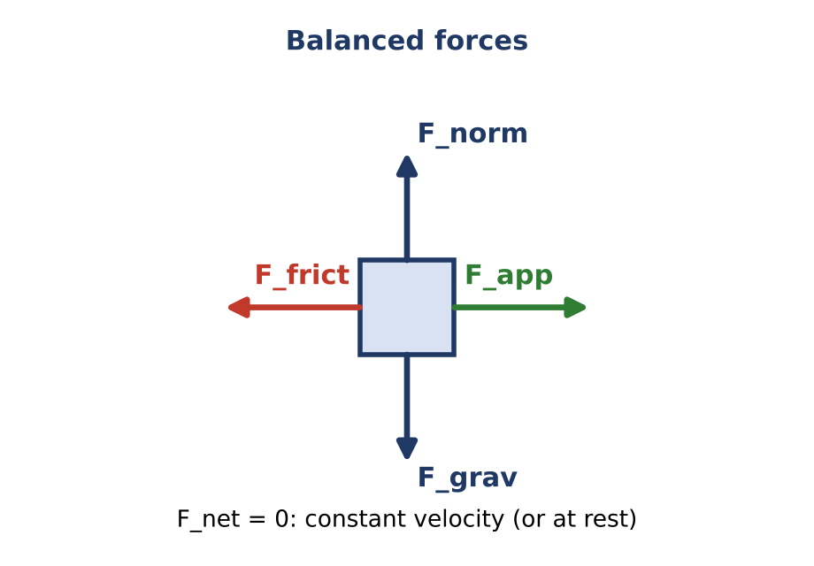
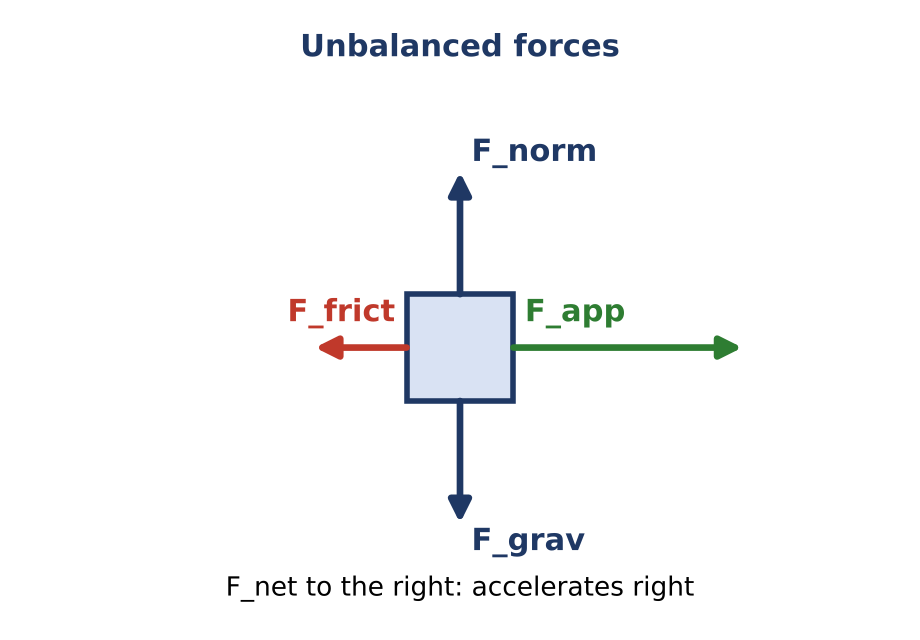
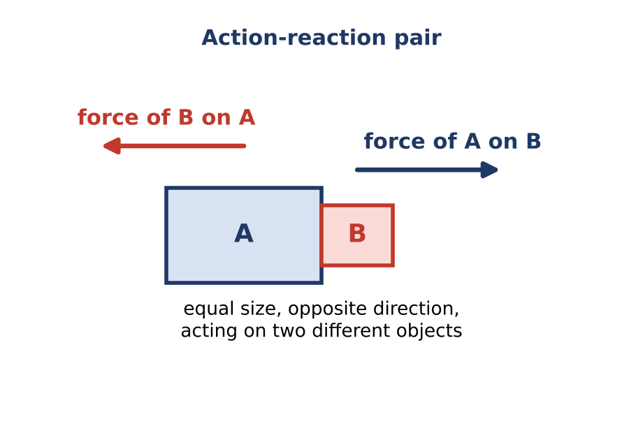
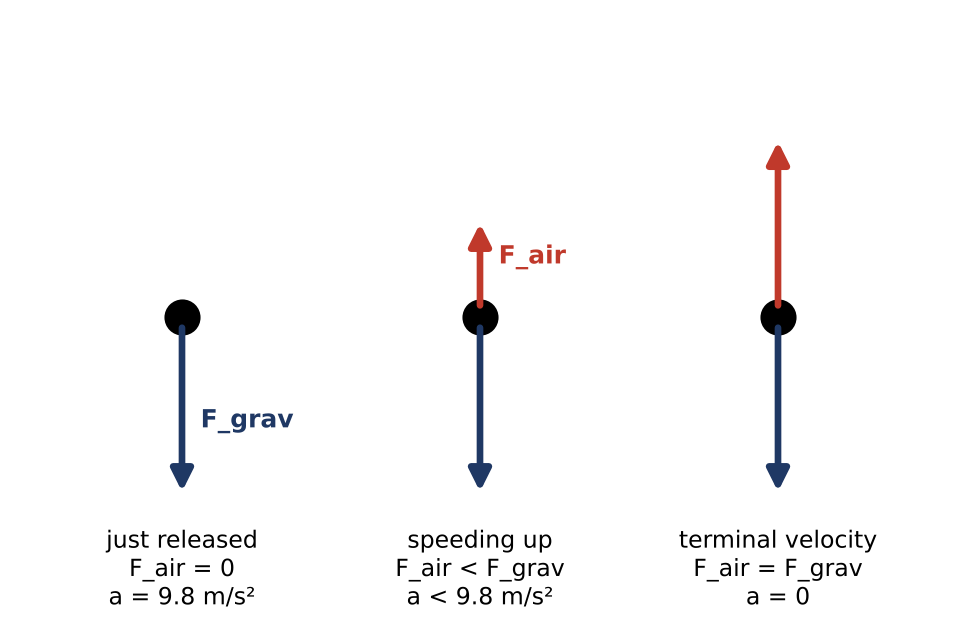

# Cornell Notes: Newton's Laws

*Physics (Grade 11) | Semester 1, Unit 3 | Forces, free-body diagrams, inertia, F = ma, action-reaction*

Name: ________________  Period: ______  Date: __________

A print-ready Word version with the same content is in [cornell-notes.docx](cornell-notes.docx).

**Learning targets**

- [ ] I can name the forces on an object and draw its free-body diagram.
- [ ] I can use Newton's first law to explain motion when forces are balanced.
- [ ] I can use F_net = ma to find acceleration, net force, or mass.
- [ ] I can identify action-reaction force pairs and explain why they do not cancel.
- [ ] I can calculate weight, normal force, and friction.
- [ ] I can analyze lab data to support Newton's second law.

**Essential question:** How do the forces on an object determine how its motion changes?

> **How to use these notes:** the left column is your self-test. Cover the right column, answer each cue question aloud, then check.

## 1. Forces and Free-Body Diagrams

| Cues / Questions | Notes |
|---|---|
| **What is a force, and what is net force?** | • A **force** is a push or pull that one object exerts on another. Unit: **newton**, 1 N = 1 kg·m/s². • **Net force** (F_net) is the vector sum of all forces on one object. Forces in opposite directions subtract. |
| **What are the common forces and their symbols?** | • **F_grav** (gravity/weight, down), **F_norm** (normal, perpendicular to the surface), **F_frict** (friction, opposes sliding), **F_tens** (tension, along a rope), **F_app** (applied push or pull), **F_air** (air resistance, opposes motion). |
| **How do you draw a free-body diagram?** | • (1) Draw the object as a box or dot. (2) Draw one arrow for each force **on that object**, starting at the object and pointing the way the force acts. (3) Label each arrow. (4) Make longer arrows for larger forces. • Do not draw forces the object exerts on other things, and do not draw velocity or "force of motion." |
| **What is the difference between mass and weight?** | • **Mass** (kg) is the amount of matter and is the same everywhere. **Weight** (N) is the force of gravity: **F_grav = mg**. • Worked example: a 60 kg person on Earth weighs (60)(9.8) = **588 N**. On the Moon the mass is still 60 kg, but the weight is smaller. |

**IXL practice (goal: SmartScore 80+):** **Grade 8 I.5** Balanced and unbalanced forces · For free-body diagram practice, use the matching Concept Builders at physicsclassroom.com.

## 2. Newton's First Law (Inertia)

| Cues / Questions | Notes |
|---|---|
| **What does Newton's first law say?** | • An object at rest stays at rest, and an object in motion stays in motion at **constant velocity**, unless acted on by a **net (unbalanced) force**. |
| **What is inertia, and what measures it?** | • **Inertia** is an object's resistance to a change in its motion. **Mass** measures inertia: more mass, harder to speed up, slow down, or turn. |
| **Is a force needed to keep an object moving?** | • **No.** A net force is needed only to **change** velocity. A puck sliding on frictionless ice keeps going with no force at all. • Things on Earth usually slow down because friction is a net force, not because motion "runs out." |
| **What can you say about the forces on an object moving at constant velocity?** | • They are **balanced**: F_net = 0. This is true for an object at rest and for one moving in a straight line at steady speed. |

**IXL practice (goal: SmartScore 80+):** **Physics F.1** Newton's laws of motion · **Physics F.2** Newton's first law of motion

## 3. Newton's Second Law (F_net = ma)

| Cues / Questions | Notes |
|---|---|
| **What does Newton's second law say?** | • **a = F_net/m**, or F_net = ma. Acceleration is in the direction of the net force. • Double the net force, double the acceleration. Double the mass, half the acceleration. |
| **A 10 kg box is pushed right with 50 N against 20 N of friction. What is its acceleration?** | • Object: the box. Horizontal forces: F_app = 50 N right, F_frict = 20 N left. • F_net = 50 − 20 = **30 N right**. • a = F_net/m = 30/10 = **3.0 m/s² right**. • Sense check: vertical forces (gravity and normal) balance, so they do not affect the answer. |
| **What does a scale read for a 60 kg person in an elevator accelerating upward at 2.0 m/s²?** | • Object: the person. Forces: F_norm up (the scale reading), F_grav = 588 N down. • F_net = ma: F_norm − 588 = (60)(2.0) = 120, so F_norm = **708 N**. • Sense check: the reading is more than 588 N, and you do feel heavier when an elevator starts upward. |
| **What are the steps for any second-law problem?** | • (1) Choose the object. (2) Draw the free-body diagram. (3) Find F_net in the direction of acceleration. (4) Use F_net = ma. (5) Check units and direction. |

**IXL practice (goal: SmartScore 80+):** **Physics F.3** Newton's second law of motion · **Grade 8 I.2** How does mass affect force and acceleration? · **Grade 8 I.3** Calculate acceleration using Newton's second law of motion

## 4. Newton's Third Law (Force Pairs)

| Cues / Questions | Notes |
|---|---|
| **What does Newton's third law say?** | • When object A pushes on object B, object B pushes back on A with a force that is **equal in size and opposite in direction**. |
| **How do you identify an action-reaction pair?** | • Swap the two objects in the sentence: "foot pushes ball forward" pairs with "ball pushes foot backward." • The two forces are the **same type** and act on **two different objects**. |
| **Why do action-reaction forces not cancel?** | • Forces cancel only when they act on the **same object**. Each force of a pair acts on a different object, so each can cause its own acceleration. |
| **A truck hits a bug. Which feels the larger force?** | • **Neither. The forces are equal.** The bug has a much smaller mass, so the same force gives it a far larger acceleration (a = F/m). |

**IXL practice (goal: SmartScore 80+):** **Grade 8 I.4** Predict forces using Newton's third law of motion · **Grade 8 I.6** Newton's laws of motion

## 5. Normal Force, Friction, and Air Resistance

| Cues / Questions | Notes |
|---|---|
| **Which object exerts the normal force, and in what direction?** | • The **surface** exerts it, **perpendicular** to the surface. On a level floor with no other vertical forces, F_norm = F_grav. • It is not always equal to weight (elevators, ramps, someone pressing down). |
| **How do you calculate friction?** | • **F_frict = μ·F_norm**, where μ is the coefficient of friction (no units). **Static** friction holds an object still; **kinetic** friction acts when it slides. • Static friction matches the push, up to a maximum. If you push with 30 N and the crate stays put, static friction is 30 N. |
| **A 20 kg crate (μ = 0.30) is pulled across a level floor with 100 N. What is its acceleration?** | • F_grav = (20)(9.8) = 196 N, so F_norm = 196 N. • F_frict = (0.30)(196) = **58.8 N**. • F_net = 100 − 58.8 = 41.2 N. a = 41.2/20 = **2.06 m/s²**. |
| **What is terminal velocity?** | • As a falling object speeds up, F_air grows. When **F_air = F_grav**, the net force is zero and the object falls at a constant speed called **terminal velocity**. |

**IXL practice (goal: SmartScore 80+):** No IXL Physics skill covers friction or normal force. Use the matching Concept Builders at physicsclassroom.com.

## 6. Labs and Measurement

| Cues / Questions | Notes |
|---|---|
| **How does the cart-and-hanging-mass lab test the second law?** | • A hanging mass pulls a cart along a track. Measure the cart's **acceleration** with a motion sensor or photogates. • Part 1: change the **net force** (move masses from the cart to the hanger so total mass stays constant). Dependent variable: acceleration. • Part 2: keep the force constant and change the **total mass**. Dependent variable: acceleration. |
| **What should the graphs look like?** | • Acceleration vs net force: a **straight line through the origin** with slope = 1/mass. • Acceleration vs mass: a **curve that falls** (inverse relationship). Acceleration vs 1/mass is a straight line. |
| **How do you measure a coefficient of friction?** | • Pull a block at **constant velocity** with a spring scale. Then F_app = F_frict, and μ = F_frict/F_norm, where F_norm = mg on a level surface. |

**IXL practice (goal: SmartScore 80+):** **Physics A.2** Identify independent and dependent variables · **Physics A.3** Identify the experimental question

## Memory Tricks

- **Inertia is laziness.** Objects keep doing what they are already doing. Use for first-law explanations.
- **A on B, B on A.** Swap the two objects to name the third-law partner force.
- **Same object cancels, different objects cannot.** Use to tell balanced forces (same object) from action-reaction pairs (two objects).
- **Net force first.** Always find F_net before using F = ma. The m multiplies only the net force.
- **Mass is matter, weight is a force.** Mass in kg never changes with location. Weight in N is mg.

## Summary

Forces are interactions between two objects, and the net force on an object decides how its velocity changes. With zero net force, velocity stays constant (first law); this covers both rest and steady motion. With a net force, the object accelerates in the direction of that force by a = F_net/m (second law). Forces always come in equal and opposite pairs acting on two different objects (third law), which is why they never cancel each other. Free-body diagrams are the tool that connects all three: choose one object, draw every force on it, find the net force, and apply F_net = ma.

## Visual Memory Aids

Balanced forces: a box moving at constant velocity. Arrows in each direction are the same length. **F_net = 0, so a = 0**

Unbalanced forces: the applied force is larger than friction, so the box accelerates to the right. **a = F_net/m**

Action-reaction pair: each force acts on a different object, with equal size and opposite direction. **F(A on B) = −F(B on A)**

A falling object: air resistance grows with speed until it equals gravity at terminal velocity. **F_air = F_grav, so F_net = 0**

## Study Method

1. Cover the Notes column and answer each cue question aloud.
2. Uncover, check, and mark every cue you missed.
3. Redraw each Visual Memory Aid from memory, with labels and its equation.
4. Repeat the next day and again a few days later. Recall spread over days builds memory that rereading does not.
5. Finish the IXL Practice Plan to SmartScore 80+ before the test.

## IXL Practice Plan

Reach SmartScore 80+ on each skill before the test.

| Done | # | Skill | Skill name | Notes section |
|---|---|---|---|---|
| ☐ | 1 | Physics A.2 | Identify independent and dependent variables | 6 |
| ☐ | 2 | Physics A.3 | Identify the experimental question | 6 |
| ☐ | 3 | Grade 8 I.2 | How does mass affect force and acceleration? | 3 |
| ☐ | 4 | Grade 8 I.3 | Calculate acceleration using Newton's second law of motion | 3 |
| ☐ | 5 | Grade 8 I.4 | Predict forces using Newton's third law of motion | 4 |
| ☐ | 6 | Grade 8 I.5 | Balanced and unbalanced forces | 1 |
| ☐ | 7 | Grade 8 I.6 | Newton's laws of motion | 4 |
| ☐ | 8 | Physics F.1 | Newton's laws of motion | 2 |
| ☐ | 9 | Physics F.2 | Newton's first law of motion | 2 |
| ☐ | 10 | Physics F.3 | Newton's second law of motion | 3 |

No full IXL match (use physicsclassroom.com Concept Builders): Forces and Free-Body Diagrams; Normal Force, Friction, and Air Resistance.

*Self-test tip: cover the Notes column, answer each cue aloud, then redo every worked example on blank paper without looking.*
