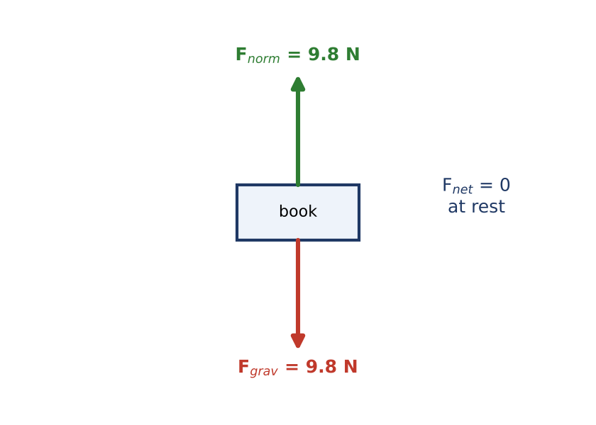
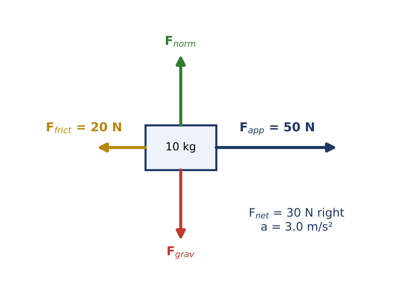
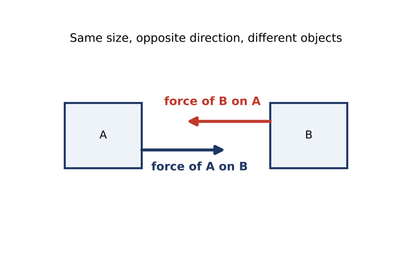
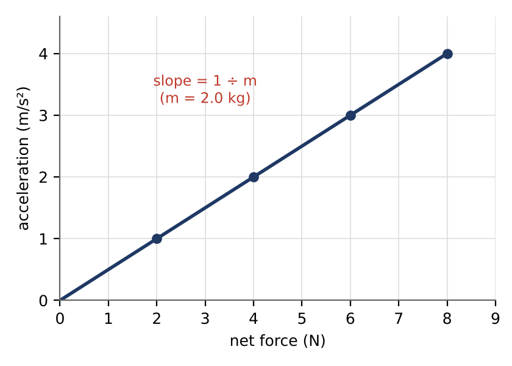

# Cornell Notes: Newton's Laws

*Physics | Semester 1, Unit 3 | Forces, free-body diagrams, inertia, F = ma, action-reaction pairs*

Printable version: [cornell-notes.docx](cornell-notes.docx)

**Essential question:** What causes the motion of an object to change?

**Learning targets**

- I can draw a free-body diagram and find the net force on an object.
- I can use Newton's first law and inertia to explain what objects do when forces are balanced.
- I can use Newton's second law to relate net force, mass and acceleration.
- I can identify action-reaction force pairs and explain why they do not cancel.
- I can tell mass from weight and calculate weight and friction.

## 1. Forces and Free-Body Diagrams

| Cues / Questions | Notes |
|---|---|
| **What is a force and what is its unit?** | A **force** is a push or pull on an object from its interaction with another object. It is a vector. Unit: the **newton**. 1 N = 1 kg·m/s². |
| **Which forces can appear on a free-body diagram?** | **Fgrav** (weight): straight down, always present. **Fnorm**: from a surface, perpendicular to that surface. **Ffrict**: along the surface, opposite to the sliding. **Fapp** (a push or pull), **Ftens** (rope or string), **Fair** (air resistance). Draw only forces acting **on** the object, each as an arrow from the center with length showing its size. |
| **How do I find the net force?** | Add the forces as vectors. Forces in opposite directions subtract. Worked example: 20 N applied to the right, 8 N of friction to the left. Fnet = 20 − 8 = **12 N to the right**. |

**IXL practice (goal: SmartScore 80+):** Grade 8 I.5 Balanced and unbalanced forces; Grade 8 KK.6 Abbreviate force, energy, and electricity units.

## 2. Newton's First Law (Inertia)

| Cues / Questions | Notes |
|---|---|
| **What does Newton's first law say?** | An object at rest stays at rest, and an object in motion stays in motion with the same speed and direction, **unless acted on by an unbalanced force**. |
| **What is inertia and what does it depend on?** | **Inertia** is an object's resistance to a change in its motion. It depends only on **mass**: more mass, more inertia. |
| **Does a moving object need a force to keep it moving?** | No. A force is needed to **change** motion, not to keep it going. Balanced forces (Fnet = 0) mean constant velocity. That could be at rest or moving steadily in a straight line. |

**IXL practice (goal: SmartScore 80+):** Physics F.2 Newton's first law of motion.

## 3. Newton's Second Law (F = ma)

| Cues / Questions | Notes |
|---|---|
| **How are net force, mass and acceleration related?** | **a = Fnet ÷ m**, or Fnet = ma. Acceleration points in the direction of the net force. More net force gives more acceleration. More mass gives less acceleration. Worked example: a 12 N net force on a 4.0 kg cart. a = 12 ÷ 4.0 = **3.0 m/s²**. |
| **How do I solve a problem with friction?** | Draw the free-body diagram, find the net force, then divide by the mass. Worked example: a 50 N push on a 10 kg crate with 20 N of friction. Fnet = 50 − 20 = 30 N. a = 30 ÷ 10 = **3.0 m/s²**. |
| **What is the difference between mass and weight?** | **Mass** is the amount of matter (kg) and is the same everywhere. **Weight** is the force of gravity on the object (N): **Fgrav = mg**. Worked example: a 60 kg student on Earth weighs 60 × 9.8 = **588 N**. On the Moon the mass is still 60 kg, but the weight is smaller. |
| **How do I calculate friction?** | **Ffrict = μ × Fnorm**, where μ is the coefficient of friction. Worked example: a 10 kg box on a level floor with μ = 0.30. Fnorm = Fgrav = 10 × 9.8 = 98 N. Ffrict = 0.30 × 98 = **29.4 N**. |

**IXL practice (goal: SmartScore 80+):** Physics F.3 Newton's second law of motion; Grade 8 I.2 How does mass affect force and acceleration?; Grade 8 I.3 Calculate acceleration using Newton’s second law of motion.

## 4. Newton's Third Law (Action-Reaction)

| Cues / Questions | Notes |
|---|---|
| **What does Newton's third law say?** | When object A pushes on object B, object B pushes back on A with a force **equal in size and opposite in direction**. |
| **Why do action-reaction forces not cancel?** | They act on **two different objects**. Only forces on the same object can cancel. |
| **A truck hits a bug. Which one feels the larger force?** | Neither. The forces are **equal**. The bug has a far smaller mass, so the same force gives it a far larger acceleration (a = F ÷ m). |
| **How do I name the partner of a force?** | Swap the two objects in the sentence. "Earth pulls the book down" pairs with "the book pulls Earth up". A book's weight and the normal force from the table are **not** a third-law pair: both act on the book. |

**IXL practice (goal: SmartScore 80+):** Grade 8 I.4 Predict forces using Newton’s third law of motion; Physics F.1 Newton's laws of motion; Grade 8 I.6 Newton's laws of motion.

## 5. Labs and Measurement

| Cues / Questions | Notes |
|---|---|
| **In a cart-and-hanging-mass lab, how do we test the second law?** | Change the net force (the hanging weight) while keeping the total mass the same, and measure the acceleration. Independent variable: **net force**. Dependent variable: **acceleration**. Controlled: total mass. |
| **What should the graph of acceleration versus net force look like?** | A **straight line through the origin**. Its slope equals 1 ÷ mass. Acceleration versus mass (constant force) is a curve that falls: doubling the mass halves the acceleration. |

**IXL practice (goal: SmartScore 80+):** Physics A.2 Identify independent and dependent variables.

## Memory tricks

- **No net force, no acceleration.** Use it: Any time an object is at rest or moving at constant velocity: the forces must balance.
- **F = ma always means F-net.** Use it: Before dividing by mass, subtract friction and any other opposing forces.
- **A on B, B on A.** Use it: Naming third-law pairs: swap the two objects in the sentence.
- **Mass is in kilograms; weight is a force in newtons.** Use it: Any question that mentions the Moon, another planet, or a scale.
- **Draw the free-body diagram first.** Use it: Every force problem, before writing any equation.

## Summary

Forces change motion; they do not keep it going. If the forces on an object balance, its velocity stays the same (first law). If they do not balance, the object accelerates in the direction of the net force, by an amount set by its mass (second law). Every force is one half of an interaction between two objects, and the two halves are always equal and opposite (third law). A free-body diagram is the tool that connects all three.

## Visual memory aids

A book at rest on a table: the two forces on the book are equal and opposite, so the net force is zero.  
**Rule:** Fnet = 0, so a = 0

A pushed crate with friction: the applied force arrow is longer than the friction arrow, so there is a net force to the right.  
**Rule:** Fnet = 50 − 20 = 30 N; a = 30 ÷ 10 = 3.0 m/s²

An action-reaction pair: equal arrows, opposite directions, drawn on two different objects.  
**Rule:** F(A on B) = −F(B on A)

Acceleration versus net force for a constant mass is a straight line through the origin.  
**Rule:** a = Fnet ÷ m; slope = 1 ÷ m

## Study method

1. Cover the Notes column and answer each cue question aloud.
2. Uncover, check, and mark every cue you missed.
3. Redraw each Visual Memory Aid from memory.
4. Repeat the next day and again a few days later.
5. Finish the IXL plan to SmartScore 80+ and take the unit quiz before the test.
