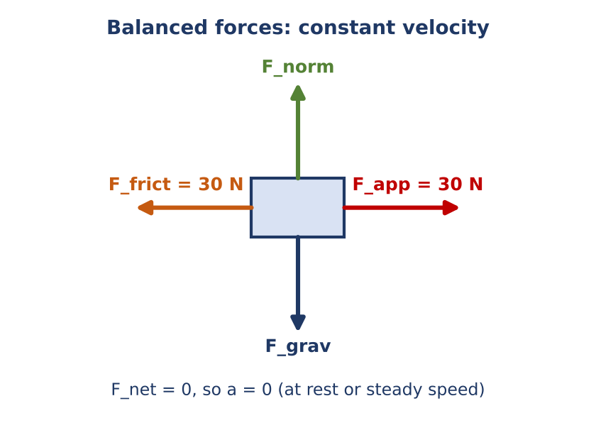
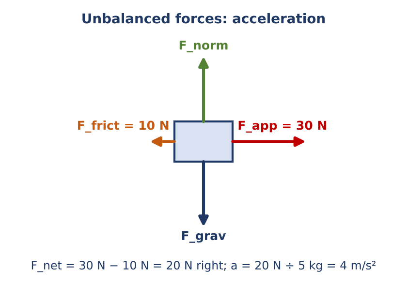
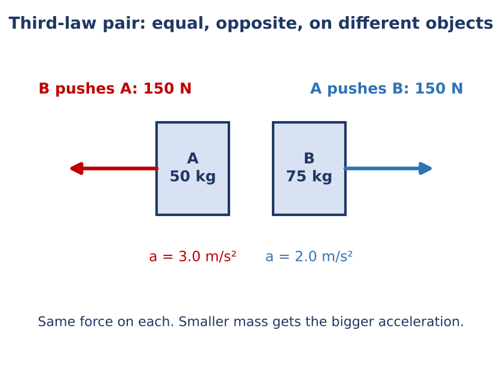
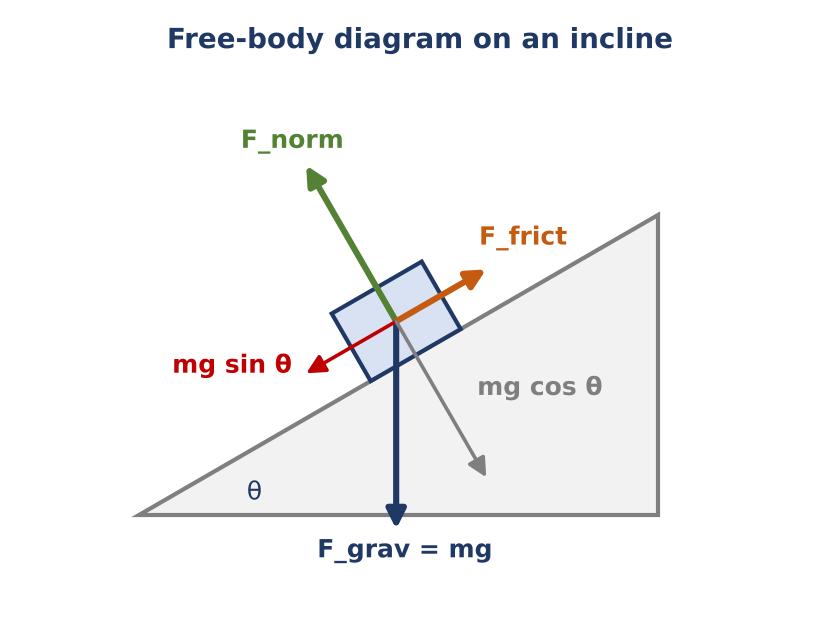

# Cornell Notes: Newton's Laws

*Physics | Unit 3 | Forces, free-body diagrams, Newton's three laws, friction*

> Printable version with the Visual Memory Aids laid out for class: [Cornell-Notes-Newtons-Laws.docx](Cornell-Notes-Newtons-Laws.docx)

**Essential question:** How do the forces on an object determine what its motion does next?

**Learning targets**

- I can draw a free-body diagram and find the net force on an object.
- I can use Newton's first law to explain why an object keeps its velocity when forces are balanced.
- I can apply F_net = ma to find acceleration, force, or mass, and support it with lab data.
- I can identify Newton's third-law force pairs and explain why they do not cancel.
- I can tell mass from weight and calculate weight, normal force, and friction.

**How to use:** cover the Notes column, answer each cue aloud, then check.

## 1. Forces and Free-Body Diagrams

| Cues / Questions | Notes |
|---|---|
| **What is a force, and what are the common forces in this unit?** | • A **force** is a push or pull that one object exerts on another. It is a vector, measured in **newtons (N)**. • **F_grav** (weight, down), **F_norm** (surface pushes perpendicular to itself), **F_frict** (opposes sliding), **F_tens** (rope pulls), **F_app** (a push or pull by a person), **F_air** (air resistance). |
| **What is net force?** | • **Net force** is the vector sum of all forces on **one** object. • Forces in the same direction add; forces in opposite directions subtract. • **Balanced** forces: F_net = 0. **Unbalanced** forces: F_net ≠ 0, and the object accelerates. |
| **How do you draw a free-body diagram?** | • 1. Choose **one object** and draw it as a box or dot. • 2. Draw an arrow for **every force on that object**, starting at the object and pointing the way the force acts. • 3. Label each arrow and make longer arrows for bigger forces. Never draw forces the object exerts on other things. |
| **What is the difference between mass and weight? What does a 60 kg person weigh on Earth?** | • **Mass** is the amount of matter, in kg. It is the same everywhere. • **Weight** is the force of gravity on the object: **F_grav = mg**, in newtons. It changes with location. • Weight = 60 kg × 9.8 m/s² = **588 N**. |

**IXL practice (goal: SmartScore 80+):** **Grade 8 I.5** Balanced and unbalanced forces; **Grade 8 KK.6** Abbreviate force, energy, and electricity units

## 2. Newton's First Law: Inertia

| Cues / Questions | Notes |
|---|---|
| **What does Newton's first law say?** | • An object at rest stays at rest, and an object in motion keeps moving at **constant velocity**, unless a **net force** acts on it. |
| **Does a moving object need a force to keep it moving?** | • **No.** A force is needed to **change** motion, not to maintain it. • Objects on Earth slow down because **friction and air resistance** act on them, not because motion “runs out.” |
| **What is inertia, and what does it depend on?** | • **Inertia** is an object's resistance to changes in its motion. • It depends only on **mass**. More mass means more inertia. It does not depend on speed. |
| **If an object moves at constant velocity, what must be true about the forces on it?** | • The forces are **balanced**: F_net = 0. • Example: a crate pushed at steady speed with 50 N has exactly 50 N of friction acting backward. |

**IXL practice (goal: SmartScore 80+):** **Physics F.2** Newton's first law of motion

## 3. Newton's Second Law: F_net = ma

| Cues / Questions | Notes |
|---|---|
| **What does Newton's second law say?** | • **a = F_net ÷ m**, usually written **F_net = ma**. • Acceleration is **directly proportional** to net force and **inversely proportional** to mass. • The acceleration points in the **same direction as the net force**. 1 N = 1 kg·m/s². |
| **A 5 kg box is pushed with 30 N while friction pulls back with 10 N. What is its acceleration?** | • Object: the box. Horizontal forces: 30 N forward, 10 N backward. • F_net = 30 N − 10 N = **20 N forward**. • a = F_net ÷ m = 20 N ÷ 5 kg = **4 m/s² forward**. • Sense check: use the net force, never just the push. |
| **A 60 kg person stands on a scale in an elevator accelerating upward at 2 m/s². What does the scale read?** | • Forces on the person: F_norm up (the scale reading) and F_grav = 588 N down. • F_net = ma → F_norm − mg = ma → F_norm = m(g + a) = 60 × (9.8 + 2) = **708 N**. • Sense check: the reading is more than the 588 N weight, which matches feeling heavier. |
| **If you double the net force on an object and also double its mass, what happens to the acceleration?** | • a = F_net ÷ m, so (2F) ÷ (2m) = F ÷ m. The acceleration is **unchanged**. |

**IXL practice (goal: SmartScore 80+):** **Physics F.3** Newton's second law of motion; **Grade 8 I.2** How does mass affect force and acceleration?; **Grade 8 I.3** Calculate acceleration using Newton’s second law of motion

## 4. Newton's Third Law: Force Pairs

| Cues / Questions | Notes |
|---|---|
| **What does Newton's third law say?** | • When object A pushes on object B, B pushes back on A with a force that is **equal in size and opposite in direction**. • The two forces are the **same type**, happen at the **same time**, and act on **different objects**. |
| **Why don't third-law force pairs cancel out?** | • Forces only cancel when they act on the **same object**. • A third-law pair acts on two different objects, so each object feels only one of the two forces. |
| **A truck hits a small car. Which vehicle feels the bigger force?** | • **Neither.** The forces are equal in size. • The car is damaged more because it has less mass, so the same force gives it a much **bigger acceleration**. |
| **A book rests on a table. What is the third-law partner of the book's weight?** | • Weight is **Earth pulling down on the book**, so its partner is **the book pulling up on Earth**. • The normal force is **not** the partner. It acts on the same object (the book) and is a different type of force. |

**IXL practice (goal: SmartScore 80+):** **Physics F.1** Newton's laws of motion; **Grade 8 I.4** Predict forces using Newton’s third law of motion; **Grade 8 I.6** Newton's laws of motion

## 5. Friction, Normal Force, and Inclines

| Cues / Questions | Notes |
|---|---|
| **How do you calculate friction?** | • **F_frict = μ F_norm**, where μ (mu) is the coefficient of friction for the two surfaces. • **Static** friction keeps an object from starting to slide; **kinetic** friction acts while it slides. Static is usually larger. • Friction depends on the surfaces and the normal force, not on contact area or speed. |
| **A 10 kg crate slides across a level floor with μ = 0.30. What is the friction force?** | • On a level floor with no other vertical forces, F_norm = mg = 10 × 9.8 = 98 N. • F_frict = 0.30 × 98 N = **29.4 N**, opposite to the motion. |
| **How is the weight of an object on an incline split into components?** | • **Parallel to the slope: mg sin θ** (pulls the object down the slope). • **Perpendicular to the slope: mg cos θ** (balanced by the normal force, so F_norm = mg cos θ). • On a frictionless incline, a = g sin θ. At 30°: a = 9.8 × 0.5 = **4.9 m/s²**. |

**IXL practice (goal: SmartScore 80+):** No IXL Physics skill covers friction or inclines. Use the Newton's Laws Concept Builders at physicsclassroom.com.

## 6. Labs and Measurement

| Cues / Questions | Notes |
|---|---|
| **In the cart-and-hanging-mass lab, what are the variables when you test force against acceleration?** | • **Independent:** net force (the hanging weight). **Dependent:** acceleration of the cart. • **Controlled:** total mass of the system. Move masses from the cart to the hanger so the total stays the same. |
| **What should the graphs look like if Newton's second law is correct?** | • **Acceleration vs net force** (mass constant): a straight line through the origin with slope = **1 ÷ mass**. • **Acceleration vs mass** (force constant): a curve that falls as mass rises (inverse relationship). • These graphs are the data evidence HS-PS2-1 asks for. |

**IXL practice (goal: SmartScore 80+):** **Physics A.2** Identify independent and dependent variables; **Physics A.1** The process of scientific inquiry

## Memory tricks

- **An object in motion stays in motion; an object at rest stays at rest.** Use for any question about what happens when forces are balanced.
- **F_net = ma.** Use whenever acceleration, mass, and force appear together. Always find the net force first.
- **“A on B, B on A”.** Use to find a third-law partner: swap the two objects in the sentence.
- **Constant velocity means F_net = 0.** Use the moment a problem says “steady speed” or “constant velocity.”
- **Weight = mg; mass stays the same everywhere.** Use to convert kg to N and to answer Moon or elevator questions.

## Summary

Forces are interactions between objects, and the net force on an object decides how its motion changes. With zero net force, velocity stays constant (first law). With a nonzero net force, the object accelerates in the direction of that force at a = F_net ÷ m (second law). Every force is one half of an equal and opposite pair acting on two different objects (third law). A free-body diagram is the tool that makes all three laws usable: choose one object, draw every force on it, find the net force, then apply F_net = ma.

## Visual memory aids

| | |
|---|---|
|  Equal arrows in opposite directions cancel, so the box keeps whatever velocity it has. **Rule:** F_net = 0 → a = 0 |  A longer arrow one way leaves a net force, and the box accelerates in that direction. **Rule:** a = F_net ÷ m |
|  Each skater feels the same 150 N, but on different objects and in opposite directions. **Rule:** F(A on B) = −F(B on A) |  On an incline, weight splits into a part along the slope and a part into the slope. **Rule:** mg sin θ along; mg cos θ = F_norm |
