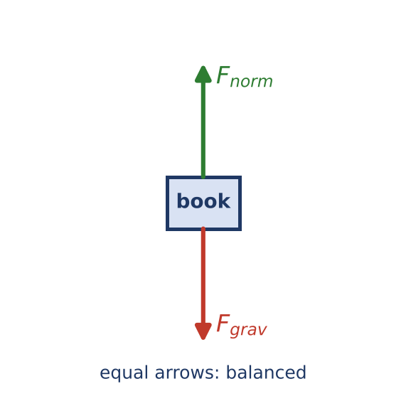
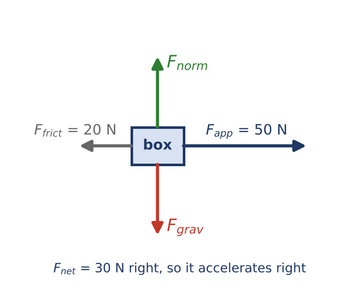
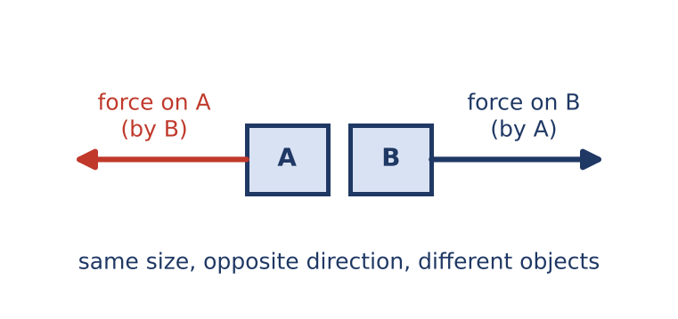
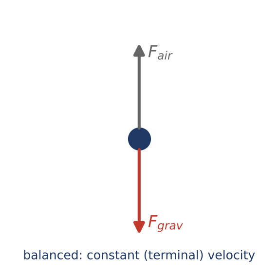

# Cornell Notes: Newton's Laws

*Physics | Semester 1, Unit 3 | Forces, free-body diagrams, inertia, F = ma, action-reaction*

Name: ____________________  Period: ______  Date: __________

**Learning targets**

- I can draw a free-body diagram and find the net force on an object.
- I can use Newton's first law to explain what happens when forces are balanced.
- I can use Fnet = ma to solve problems and to analyze lab data.
- I can identify the action-reaction pair in any interaction.
- I can tell mass from weight and calculate weight and friction.

**Essential question:** How do forces change the motion of an object?

How to use these notes: cover the Notes column, answer each cue question aloud, then check.

## 1. Forces and Free-Body Diagrams

| Cues / Questions | Notes |
|---|---|
| **What is a force, and what unit measures it?** | • A **force** is a push or pull on an object from another object. It is a vector. • Unit: the **newton (N)**. 1 N = 1 kg·m/s². |
| **Which forces can appear on a free-body diagram?** | • **Fgrav** (weight): Earth pulls down. **Fnorm**: a surface pushes perpendicular to itself. • **Fapp**: a person or object pushes or pulls. **Ffrict**: a surface resists sliding, along the surface. • **Ftens**: a rope pulls. **Fair**: air resists motion. • Draw only forces acting **on** the object, each as an arrow from the object, sized to its strength. |
| **How do you find the net force?** | • **Net force** is the vector sum of all forces. Same direction: add. Opposite directions: subtract. • Worked example: a box is pushed right with 50 N while friction pulls left with 20 N. Fnet = 50 − 20 = **30 N right**. • Vertical forces on a level floor cancel: Fnorm = Fgrav. |
| **What is the difference between mass and weight?** | • **Mass** is the amount of matter (kg). It is the same everywhere. • **Weight** is the force of gravity: **Fgrav = mg** (N). It changes with location. • Worked example: a 60 kg student on Earth weighs 60 × 9.8 = **588 N**. |

**IXL practice (goal: SmartScore 80+):** **Grade 8 I.5** Balanced and unbalanced forces; **Precalculus Y.7** Add vectors

## 2. Newton's First Law: Inertia

| Cues / Questions | Notes |
|---|---|
| **What does Newton's first law say?** | • An object at rest stays at rest, and an object in motion keeps moving at **constant velocity**, unless a **net force** acts on it. |
| **Does an object need a force to keep it moving?** | • **No.** Forces change motion. They are not needed to maintain it. • Objects on Earth slow down because **friction and air resistance** act on them, not because they run out of force. |
| **What is inertia, and what measures it?** | • **Inertia** is an object's resistance to a change in its motion. • **Mass** measures inertia. More mass means harder to start, stop, or turn. |
| **What is true about the forces on an object moving at constant velocity?** | • They are **balanced**: Fnet = 0. This is **equilibrium**, the same as for an object at rest. • Example: a car cruising at a steady 25 m/s. The forward force from the road equals friction plus air resistance. |

**IXL practice (goal: SmartScore 80+):** **Physics F.1** Newton's laws of motion; **Physics F.2** Newton's first law of motion

## 3. Newton's Second Law: F = ma

| Cues / Questions | Notes |
|---|---|
| **What does Newton's second law say?** | • **a = Fnet / m**, or Fnet = ma. Acceleration points in the direction of the net force. • Double the net force: double the acceleration. Double the mass: half the acceleration. |
| **How do you solve a second-law problem?** | • Steps: choose the object, draw the free-body diagram, find Fnet, then use a = Fnet / m. • Worked example: a 10 kg box is pushed right with 50 N against 20 N of friction. Fnet = 30 N. a = 30 ÷ 10 = **3 m/s² right**. • Worked example: what net force gives a 1200 kg car an acceleration of 2.5 m/s²? Fnet = 1200 × 2.5 = **3000 N**. |
| **How do you calculate friction?** | • **Ffrict = μ Fnorm**, where μ is the coefficient of friction (no units). • Worked example: a 10 kg box on a level floor with μ = 0.20. Fnorm = 10 × 9.8 = 98 N. Ffrict = 0.20 × 98 = **19.6 N**. • Static friction matches the push, up to a maximum. A box pushed with 30 N that does not move has 30 N of friction on it. |
| **Why do heavy and light objects fall with the same acceleration?** | • A heavier object has more weight but also more inertia: a = Fgrav / m = mg / m = **g**. The mass cancels. |

**IXL practice (goal: SmartScore 80+):** **Physics F.3** Newton's second law of motion; **Grade 8 I.2** How does mass affect force and acceleration?; **Grade 8 I.3** Calculate acceleration using Newton’s second law of motion

## 4. Newton's Third Law: Action and Reaction

| Cues / Questions | Notes |
|---|---|
| **What does Newton's third law say?** | • When object A pushes on object B, B pushes back on A with a force that is **equal in size and opposite in direction**. • Forces always come in pairs. Name a pair by swapping the nouns: 'foot pushes ground back' and 'ground pushes foot forward'. |
| **Why don't action and reaction forces cancel each other?** | • They act on **two different objects**. Only forces on the same object can cancel. • The weight of a book and the normal force on it are **not** a third-law pair. Both act on the book. • The pair for the book's weight (Earth pulls book down) is **book pulls Earth up**. |
| **In a truck and car collision, which vehicle feels the larger force?** | • **Neither.** The forces are equal. • The car is damaged more because it has less mass, so the same force gives it a larger acceleration (a = F / m). |

**IXL practice (goal: SmartScore 80+):** **Grade 8 I.4** Predict forces using Newton’s third law of motion; **Grade 8 I.6** Newton's laws of motion

## 5. Labs and Measurement

| Cues / Questions | Notes |
|---|---|
| **How do you test Newton's second law in the lab?** | • **Cart and hanging mass lab:** a falling mass pulls a cart along a track. Measure acceleration with a motion sensor or photogates. • Part 1: change the net force, keep total mass the same. **Independent variable:** net force. **Dependent variable:** acceleration. The graph is a straight line through the origin with **slope = 1 / mass**. • Part 2: change the mass, keep the force the same. Acceleration falls as mass rises (inverse relationship). • This lab is the data analysis asked for in HS-PS2-1. |
| **How do you measure the coefficient of friction?** | • Pull a block with a spring scale at **constant velocity**. Then Fapp = Ffrict (balanced forces). • **μ = Ffrict / Fnorm**, with Fnorm = mg on a level surface. • **Independent variable:** surface type or block mass. **Dependent variable:** friction force. |

**IXL practice (goal: SmartScore 80+):** **Physics A.2** Identify independent and dependent variables; **Physics A.3** Identify the experimental question; **Grade 8 KK.6** Abbreviate force, energy, and electricity units

## Memory tricks

- **First law: inertia. Second law: F = ma. Third law: action-reaction.** Naming which law explains a situation.
- **Net force causes acceleration, not motion.** Any question about an object moving at constant velocity.
- **Draw the free-body diagram first.** Every force problem, before any equation.
- **A on B, B on A.** Finding a third-law pair. Swap the two objects in the sentence.
- **Weight = mg.** Changing a mass in kilograms into a force in newtons.

## Summary

Forces are pushes and pulls between objects, and the net force decides what an object's motion does next. With zero net force, an object keeps doing what it was doing: staying at rest or moving at constant velocity. With a net force, it accelerates in the direction of that force, by an amount a = Fnet / m. Forces always come in equal and opposite pairs acting on two different objects. A free-body diagram is the tool that turns a situation into a net force, and from there the kinematics of Unit 1 predicts the motion.

## Visual memory aids

A book at rest on a table. The two forces are equal and opposite, so the net force is zero. **Fnet = 0, so a = 0**

A pushed box. The applied force is larger than friction, so the box accelerates to the right. **a = Fnet / m**

Two skaters push off. Each feels the same size force in opposite directions, on different bodies. **FA on B = −FB on A**

A skydiver at terminal velocity. Air resistance has grown to equal weight, so speed stops changing. **Fair = Fgrav, so a = 0**

## Study method

1. Cover the Notes column and answer each cue aloud.
2. Check your answer and mark the ones you missed.
3. Redraw each visual memory aid from memory.
4. Repeat the next day and again a few days later. Recall spread over several days builds memory that rereading does not.
5. Finish the IXL plan to SmartScore 80+ before the test.
