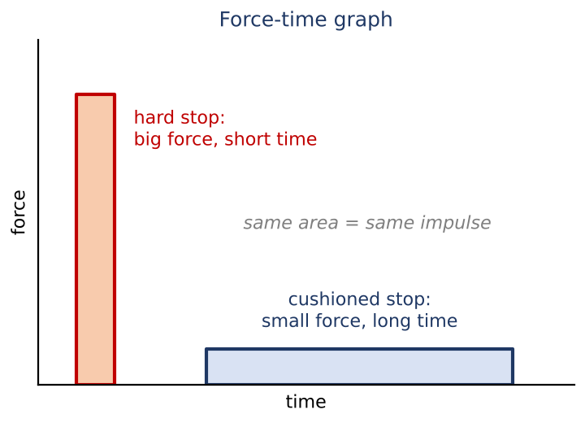
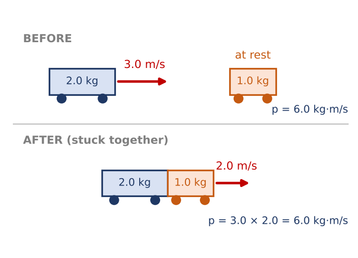
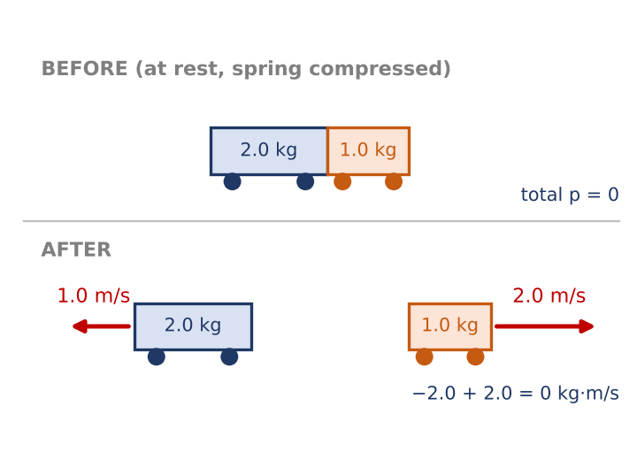
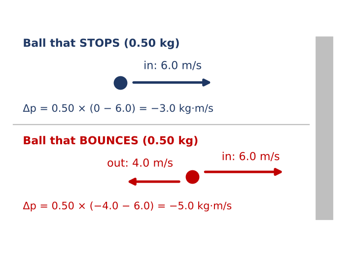

# Unit 4: Momentum

[Project home](../../README.md) · [1. Kinematics](../01-kinematics/README.md) · [2. Projectile Motion](../02-projectile-motion/README.md) · [3. Newton's Laws](../03-newtons-laws/README.md) · **4. Momentum** · [5. Work & Energy](../05-work-and-energy/README.md)

**Pacing:** Weeks 12–14 · **Essential question:** Why are some collisions more damaging than others, and what stays the same in every collision?

Momentum connects force with time. Students use impulse to explain why longer collisions are gentler, apply conservation of momentum to collisions and explosions, and design a device that reduces collision force.

## Materials in this folder

| File | What it is |
|---|---|
| [cornell-notes-04-momentum.docx](cornell-notes-04-momentum.docx) | Printable Cornell notes: cue questions, notes with worked examples, visual memory aids, study method, IXL practice plan |
| [quiz.html](quiz.html) | Interactive quiz on the 10 most commonly missed ideas, with an explanation after every answer |

## Standards (CA NGSS)

- **HS-PS2-2** – Use mathematical representations to support the claim that the total momentum of a system of objects is conserved when there is no net force on the system. (Assessment is limited to systems of two macroscopic bodies moving in one dimension.)
- **HS-PS2-3** – Apply scientific and engineering ideas to design, evaluate, and refine a device that minimizes the force on a macroscopic object during a collision.
- **CCC: Systems and System Models** – Define the system and its boundaries before deciding whether momentum is conserved.

## Key concepts to master

- **Momentum** – p = mv, a vector measured in kg·m/s.
- **Impulse** – force multiplied by time, equal to the change in momentum: FΔt = Δp.
- **Force-time trade-off** – for the same change in momentum, a longer time means a smaller force.
- **System** – the objects chosen for analysis; internal forces are between them, external forces come from outside.
- **Conservation of momentum** – total momentum of a system stays constant when no net external force acts.
- **Collision types** – elastic (kinetic energy conserved), inelastic (not conserved), perfectly inelastic (objects stick).
- **Engineering design** – criteria, constraints, testing and refining a collision-safety device.

## Learning objectives and how each is assessed

| # | Students can… | Evidence |
|---|---|---|
| 4.1 | Calculate momentum and change in momentum, including sign. | Practice 1, 3; Quiz Q7 |
| 4.2 | Apply the impulse-momentum relationship to explain and calculate collision forces. | Quiz Q2, Q3, Q8, Q9; Practice 2, 3, 6 |
| 4.3 | State the condition for conservation of momentum and identify the system. | Quiz Q1, Q5, Q10 |
| 4.4 | Solve one-dimensional collision and explosion problems (HS-PS2-2). | Practice 4, 5, 7; IXL Physics G.1 |
| 4.5 | Classify collisions and account for kinetic energy. | Quiz Q4; Practice 4 |
| 4.6 | Design, test and refine a force-reducing device (HS-PS2-3). | Egg-drop design project rubric |

Score each objective on the 4-point scale in [Assessment and progress tracking](../../docs/assessment-and-tracking.md). The unit is mastered when every objective is at 3 or above.

## Cue questions (self-test)

Cover the answers in the Cornell notes and answer these aloud.

**1. Momentum**

- What is momentum, and what are its units?
- Can a light object have more momentum than a heavy one?
- Why does the sign of momentum matter?

**2. Impulse**

- What is impulse?
- Why do airbags, helmets and bent knees reduce injury?
- Why does a ball that bounces deliver more impulse than one that sticks?

**3. Conservation of Momentum**

- When is the momentum of a system conserved?
- Why is momentum conserved in a collision?
- How fast does a skater recoil after throwing a ball?

**4. Collisions**

- What are the types of collision?
- What is the speed after a hit-and-stick collision?
- How do you handle a head-on collision?

**5. Designing for Collisions**

- How do crumple zones, airbags and helmets protect people?
- What are criteria and constraints in an engineering design?

**6. Labs and Measurement**

- What do you measure in the cart-collision lab?
- How do you judge whether momentum was conserved?

## Visual memory aids

| | |
|---|---|
|  Two force-time graphs with the same area deliver the same impulse: a hard stop is tall and brief, a cushioned stop is low and long. **area = FΔt = Δp** |  In a hit-and-stick collision the total momentum before equals the total momentum of the joined carts after. **m₁v₁ + m₂v₂ = (m₁ + m₂)v** |
|  When two carts at rest push apart, they leave with equal and opposite momenta, so the total stays zero. **0 = m₁v₁ + m₂v₂** |  A ball that bounces back has a larger change in momentum than one that stops, because its velocity reverses. **Δp = m(v − v₀)** |

## Most commonly missed ideas

Each of these is a question in the [interactive quiz](quiz.html).

1. Confusing change in momentum with change in velocity.
2. Thinking that sticking transfers more than bouncing.
3. Believing safety devices reduce the change in momentum itself.
4. Assuming that if kinetic energy is lost, momentum must be lost too.
5. Adding momenta as if they were speeds, ignoring direction.
6. Halving the speed without accounting for the masses.
7. Treating momentum as a scalar.
8. Mixing up force-time graphs with force-distance graphs.
9. Saying the impulse or momentum change is smaller.
10. Applying conservation to a single object that has an outside force on it.

## Learning resources

- [The Physics Classroom: Momentum and Its Conservation tutorial](https://www.physicsclassroom.com/class/momentum) – Reading on impulse, collisions and conservation, with worked momentum tables.
- [The Physics Classroom: Concept Builders](https://www.physicsclassroom.com/Concept-Builders) – Open the Momentum and Collisions set.
- [PhET simulation: Collision Lab](https://phet.colorado.edu/en/simulations/collision-lab) – Set masses, speeds and elasticity; watch momentum vectors before and after.
- [OpenStax Physics (high school), Chapter 8](https://openstax.org/details/books/physics) – Free textbook: Momentum.
- [Khan Academy Physics](https://www.khanacademy.org/science/physics) – Videos and practice; browse or search the library for momentum and impulse. Unit names on the site change from time to time.
- [IXL Physics, section G; Grade 8 science, skill I.7](https://www.ixl.com/science/physics) – Skill practice; goal SmartScore 80+.

## IXL practice plan (goal: SmartScore 80+)

| Done | Skill | Skill name |
|---|---|---|
| ☐ | Physics A.2 | Identify independent and dependent variables |
| ☐ | Physics B.3 | Multiply and divide with significant figures |
| ☐ | Physics B.4 | Calculations with significant figures |
| ☐ | Physics G (new, not yet numbered) | Calculate linear momentum and impulse |
| ☐ | Physics G.1 | Conservation of momentum |
| ☐ | Grade 8 I.7 | Collisions and car safety features |

*No IXL match:* Elastic versus inelastic collisions and the engineering-design work have no matching IXL Physics skill. Use the physicsclassroom.com Concept Builders for Momentum and Collisions.

## Practice problems

Use g = 9.8 m/s². Try each one before opening the answer.

1. What is the momentum of a 1200 kg car travelling at 25 m/s?
   

Answer
p = 1200 × 25 = <strong>30 000 kg·m/s</strong>

2. A 50 N force acts on a 0.60 kg ball, initially at rest, for 0.30 s. Find the impulse and the ball's final speed.
   

Answer
Impulse = 50 × 0.30 = <strong>15 N·s</strong>. v = 15 ÷ 0.60 = <strong>25 m/s</strong>

3. A 0.145 kg baseball arrives at 40 m/s and is hit straight back at 50 m/s. Contact lasts 0.0015 s. Find the change in momentum and the average force.
   

Answer
Δp = 0.145 × (50 − (−40)) = <strong>13.1 kg·m/s</strong>. F = 13.05 ÷ 0.0015 = <strong>8700 N</strong>

4. A 4.0 kg cart at 5.0 m/s hits a 6.0 kg cart at rest and they stick. Find the final speed and the kinetic energy lost.
   

Answer
v = (4.0 × 5.0) ÷ 10 = <strong>2.0 m/s</strong>. KE before = 50 J, after = 20 J; <strong>30 J</strong> lost to thermal energy, sound and deformation.

5. A 4.0 kg rifle fires a 0.010 kg bullet at 400 m/s. What is the recoil velocity of the rifle?
   

Answer
0 = (0.010)(400) + (4.0)v, so v = <strong>−1.0 m/s</strong> (backward)

6. A 70 kg driver moving at 20 m/s is brought to rest. Compare the force for a 0.25 s stop (airbag) with a 0.010 s stop (dashboard).
   

Answer
Δp = 1400 kg·m/s. Airbag: 1400 ÷ 0.25 = <strong>5600 N</strong>. Dashboard: 1400 ÷ 0.010 = <strong>140 000 N</strong>, 25 times larger.

7. A 0.20 kg cart at +3.0 m/s collides head-on with a 0.30 kg cart at −2.0 m/s and they stick. What is their velocity afterward?
   

Answer
Total p = 0.60 − 0.60 = 0, so v = <strong>0 m/s</strong>. Both stop.

8. Explain why a car with a crumple zone is safer than a perfectly rigid car.
   

Answer
The crumple zone lengthens the <strong>time</strong> of the collision. The change in momentum is the same, so by F = Δp/Δt the force on the passengers is smaller.

## Labs and investigations

- **Cart collisions (HS-PS2-2)**: measure velocities before and after bouncing and sticking collisions; compare total momentum.
- **Egg drop (HS-PS2-3)**: design, test and refine a device that protects an egg, explaining each change with FΔt = Δp.
- **Impulse with a force sensor**: compare force-time graphs for a cart hitting a hard bumper and a soft bumper.

## Real-world applications

- **Car safety**: crumple zones, airbags, seat belts and padded dashboards all extend stopping time.
- **Sports**: following through on a swing increases contact time and impulse; helmets and mats reduce force.
- **Rockets**: exhaust gas gains backward momentum and the rocket gains equal forward momentum.
- **Crash reconstruction**: investigators use skid marks and conservation of momentum to find pre-crash speeds.
- **Earth science link**: asteroid impacts and the momentum transferred to a planet or moon.

## Unit checklist

**Student**

- [ ] Cornell notes read; every cue question answered aloud from memory
- [ ] All visual memory aids redrawn from memory
- [ ] Practice problems completed and checked
- [ ] IXL practice plan at SmartScore 80+
- [ ] Interactive quiz at 80% or higher
- [ ] Lab report submitted
- [ ] Unit test taken; missed objectives retested

**Instructor**

- [ ] Learning targets and essential question posted
- [ ] Quiz given as a pre-assessment to find misconceptions
- [ ] Lab(s) run and scored with the lab rubric
- [ ] Quiz repeated as a post-assessment; results recorded in the tracker
- [ ] Reteach plan made for any objective below 3
