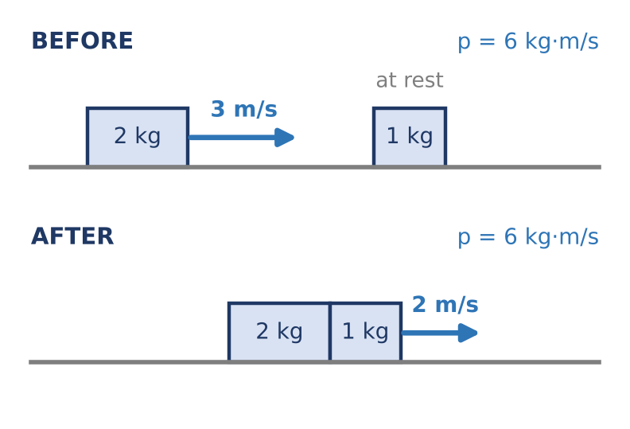
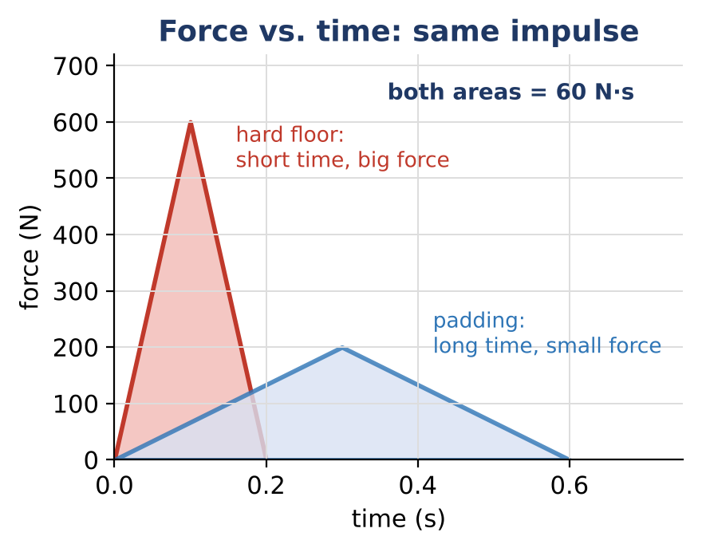
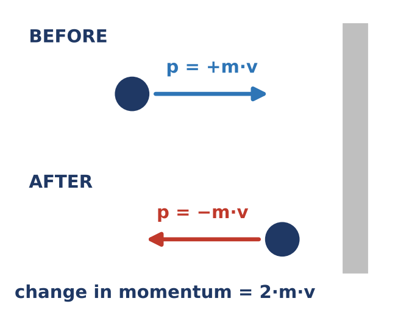
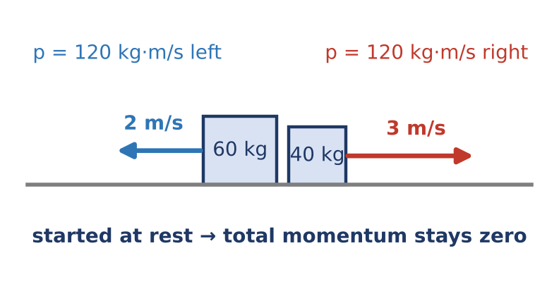

# Unit 4: Momentum

**Suggested pacing:** Weeks 12–14 of semester 1  
**Essential question:** What decides how hard it is to stop a moving object, and what happens when objects collide?

## Materials in this folder

| File | What it is |
|---|---|
| [cornell-notes.md](cornell-notes.md) | Cornell notes, readable here on GitHub |
| [cornell-notes-momentum.docx](cornell-notes-momentum.docx) | The same notes as a printable Word document with a cover page, visual memory aids, and an IXL practice plan |
| [Quiz](../../quizzes/index.html) | Interactive quiz on the most often missed questions (open `quizzes/index.html` in a browser and choose Momentum) |

## Standards (NGSS for California, high school)

- **HS-PS2-2** Use mathematical representations to support the claim that the total momentum of a system of objects is conserved when there is no net force on the system.
- **HS-PS2-3** Apply scientific and engineering ideas to design, evaluate, and refine a device that minimizes the force on a macroscopic object during a collision.
- **HS-ETS1-2 / HS-ETS1-3** Break a design problem into smaller parts and evaluate solutions against criteria and constraints (egg-drop or crash-cushion project).

## Learning objectives

Check each box when you can do it without notes.

- [ ] I can calculate momentum and explain why it is a vector.
- [ ] I can use the impulse-momentum theorem, F·Δt = m·Δv.
- [ ] I can explain how increasing collision time reduces force.
- [ ] I can use conservation of momentum to solve collision and explosion problems.
- [ ] I can tell elastic from inelastic collisions and say what is conserved in each.

## Key concepts to master

| Concept | What you need to know |
|---|---|
| **Momentum** | p = m·v, in kg·m/s. A vector in the direction of the velocity. |
| **Impulse** | Force multiplied by the time it acts, F·Δt, in N·s. The area under a force-time graph. |
| **Impulse-momentum theorem** | Impulse equals change in momentum: F·Δt = m·Δv. |
| **System** | The set of objects you choose to track together. |
| **Conservation of momentum** | With no net outside force, total momentum before equals total momentum after. |
| **Elastic collision** | Objects bounce apart; momentum and kinetic energy are both conserved. |
| **Inelastic collision** | Momentum is conserved but kinetic energy is not. Perfectly inelastic: the objects stick together. |

## Visual memory aids

Before and after a perfectly inelastic collision: the carts stick and share the original momentum. **Rule:** m₁·v₁ + m₂·v₂ = (m₁ + m₂)·v

Two force-time graphs with the same area: a short hard hit and a long gentle one deliver the same impulse. **Rule:** impulse = area = F·Δt = Δp

A ball that bounces back from a wall reverses its momentum, so its change in momentum is larger than if it stopped. **Rule:** Δp = m·(v_f − v_i)

Two skaters push apart from rest: their momenta are equal in size and opposite in direction. **Rule:** total p = 0 before and after

## Learning resources

| Resource | Use it for |
|---|---|
| [The Physics Classroom: Momentum and Its Conservation](https://www.physicsclassroom.com/class/momentum) | Lessons on impulse, the momentum-change theorem, and collision analysis. |
| [PhET: Collision Lab](https://phet.colorado.edu/en/simulations/collision-lab) | Set masses and speeds, choose elastic or inelastic, and read momentum before and after. |
| [Khan Academy: High school physics](https://www.khanacademy.org/science/highschool-physics) | Videos and practice on momentum and collisions. |
| [OpenStax Physics (high school)](https://openstax.org/details/books/physics) | Free textbook; see the chapter on momentum. |

### IXL practice plan

Goal: SmartScore 80+ on each skill before the unit test. Codes were checked against the live IXL skill lists on November 27, 2026; IXL renumbers skills from time to time, so search by skill name if a code has moved.

| Done | Skill | Skill name | Notes section |
|---|---|---|---|
| ☐ | Physics A.2 | Identify independent and dependent variables | 5 |
| ☐ | Physics A.4 | Identify questions that can be investigated with a set of materials | 5 |
| ☐ | Physics G (New) | Calculate linear momentum and impulse | 1 |
| ☐ | Grade 8 I.7 | Collisions and car safety features | 2 |
| ☐ | Physics G.1 | Conservation of momentum | 3 |

## Practice problems

Use g = 9.8 m/s². Show givens, equation, substitution, and units. Answers are hidden under each problem.

1. **Foundation.** Find the momentum of a 0.15 kg baseball moving at 40 m/s.

   

Answer
p = 0.15 × 40 = 6.0 kg·m/s

2. **Foundation.** A 200 N force acts on a 0.5 kg ball at rest for 0.05 s. Find the impulse and the final speed.

   

Answer
Impulse = 10 N·s. v = 10 ÷ 0.5 = 20 m/s.

3. **Proficient.** A 1000 kg car at 20 m/s hits a parked 1500 kg truck and they lock together. Find their speed.

   

Answer
20,000 = 2500·v → v = 8 m/s.

4. **Proficient.** A 60 kg skater at rest throws a 2 kg ball forward at 15 m/s. Find the skater's recoil velocity.

   

Answer
0 = 2 × 15 + 60·v → v = −0.5 m/s (backward).

5. **Challenge.** A 0.06 kg tennis ball hits a wall at 30 m/s and rebounds at 20 m/s. Contact lasts 0.01 s. Find the change in momentum and the average force.

   

Answer
Δp = 0.06 × (−20 − 30) = −3.0 kg·m/s. F = 3.0 ÷ 0.01 = 300 N.

6. **Challenge.** For the car and truck above, how much kinetic energy is lost, and where does it go?

   

Answer
200,000 J − 80,000 J = 120,000 J (60%) becomes heat, sound, and deformation.

## Real-world applications

- Airbags, seat belts, and crumple zones, which lengthen the stopping time in a crash.
- Helmets and padded gym floors, which do the same for a head or a falling athlete.
- Following through on a golf, tennis, or baseball swing to keep the force on the ball longer.
- Rocket and jet propulsion: gas goes one way and the vehicle gains equal momentum the other way.

## Assessment criteria

Scored on a 4-point scale. A 3 (Proficient) meets the standard. See [ASSESSMENT.md](../../ASSESSMENT.md) for how scores are collected.

| Skill | 1 Beginning | 2 Developing | 3 Proficient | 4 Advanced |
|---|---|---|---|---|
| **Calculate momentum and impulse** | Confuses momentum with mass or force | Calculates p = mv but ignores direction | Calculates momentum, impulse, and Δp with signs and units | Uses force-time graphs and rebounds to find force or time |
| **Apply conservation of momentum** | Does not treat the two objects as one system | Sets up before = after but makes sign errors | Solves sticking, bouncing, and push-apart problems correctly | Uses lab data to support the claim that momentum is conserved (HS-PS2-2) |
| **Design to reduce collision force** | Cannot connect time and force | States that padding helps without explaining why | Explains force reduction using F·Δt = Δp | Designs, tests, and refines a device against criteria and constraints (HS-PS2-3) |

## Unit checklist

- [ ] Read the Cornell notes and answer every cue aloud with the notes column covered
- [ ] Redraw each visual memory aid from memory
- [ ] Complete the practice problems (all Foundation and Proficient; at least one Challenge)
- [ ] Score 80% or higher on the unit quiz
- [ ] Reach SmartScore 80+ on the IXL skills above
- [ ] Complete the lab and its write-up
- [ ] Check off every learning objective above

[Back to the project outline](../../README.md)
