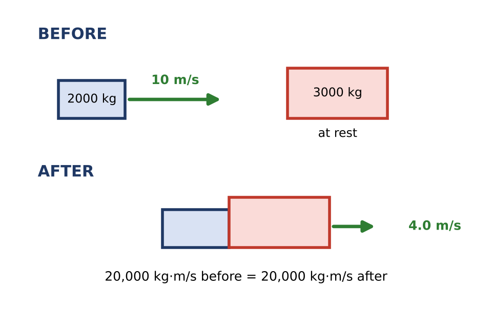
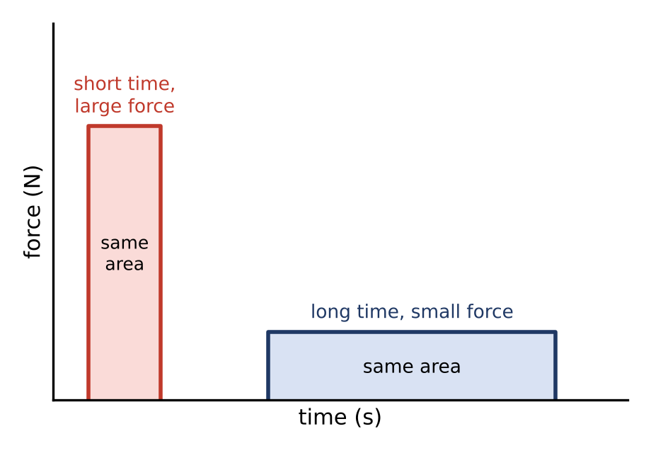
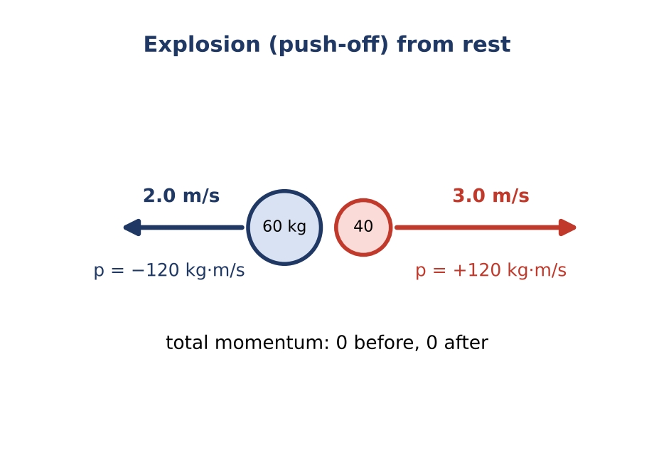
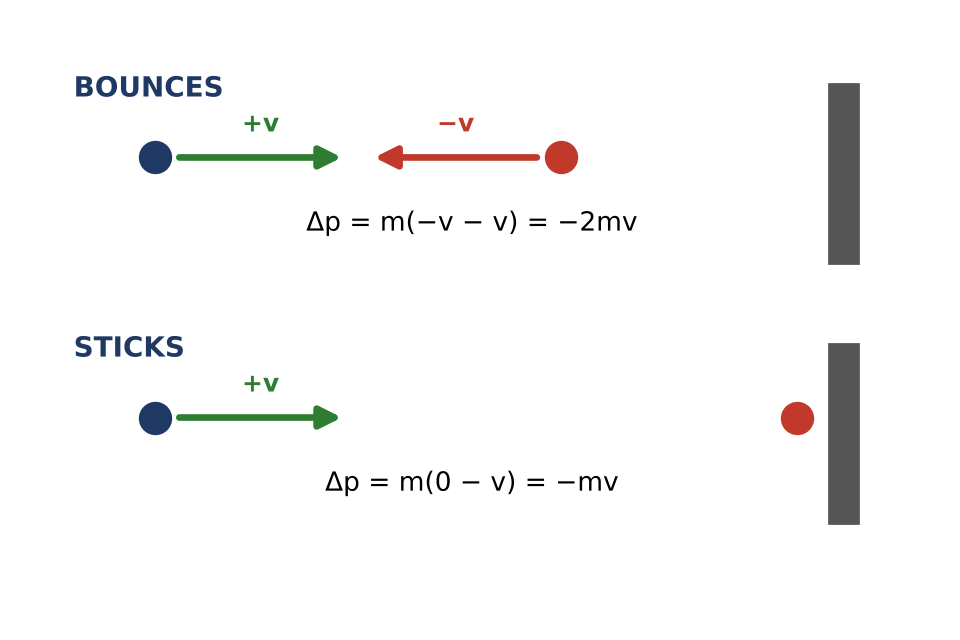

# Cornell Notes: Momentum

*Physics (Grade 11) | Semester 1, Unit 4 | Momentum, impulse, conservation, collisions*

Name: ________________  Period: ______  Date: __________

A print-ready Word version with the same content is in [cornell-notes.docx](cornell-notes.docx).

**Learning targets**

- [ ] I can calculate momentum and state its direction.
- [ ] I can use impulse (FΔt = mΔv) to relate force, time, and change in momentum.
- [ ] I can explain how increasing collision time reduces force.
- [ ] I can use conservation of momentum to solve collision and explosion problems.
- [ ] I can tell elastic from inelastic collisions.
- [ ] I can design and test a device that reduces the force in a collision.

**Essential question:** Why is momentum conserved in collisions, and how can we use that to make collisions safer?

> **How to use these notes:** the left column is your self-test. Cover the right column, answer each cue question aloud, then check.

## 1. Momentum

| Cues / Questions | Notes |
|---|---|
| **What is momentum and how is it calculated?** | • **Momentum** is "mass in motion": **p = mv**. Units: **kg·m/s**. It is a vector in the same direction as the velocity. • Worked example: a 1200 kg car at 25 m/s has p = (1200)(25) = **30,000 kg·m/s**. |
| **Can a small object have more momentum than a large one?** | • **Yes**, if it is moving fast enough. A 0.050 kg bullet at 400 m/s has 20 kg·m/s; a 60 kg skater drifting at 0.20 m/s has only 12 kg·m/s. |
| **Why does the sign of momentum matter?** | • Momentum is a vector. Two 2 kg carts moving at 3 m/s in opposite directions have +6 and −6 kg·m/s, so the **total is zero**. |

**IXL practice (goal: SmartScore 80+):** **Physics G (New!)** Calculate linear momentum and impulse

## 2. Impulse and Change in Momentum

| Cues / Questions | Notes |
|---|---|
| **What is impulse, and how is it related to momentum?** | • **Impulse** = force × time: J = FΔt. The **impulse-momentum theorem** says **FΔt = Δp = mΔv**. • On a force-time graph, impulse is the **area under the curve**. |
| **A 0.15 kg baseball arrives at 40 m/s and leaves the bat at 50 m/s the other way. Contact lasts 0.0015 s. What is the average force?** | • Take the direction away from the bat as positive: v₀ = −40 m/s, v = +50 m/s. • Δp = m(v − v₀) = (0.15)(50 − (−40)) = **13.5 kg·m/s**. • F = Δp/Δt = 13.5/0.0015 = **9000 N**. • Sense check: the change in velocity is 90 m/s, not 10 m/s, because the direction reversed. |
| **How do airbags, helmets, and crumple zones reduce injury?** | • The change in momentum to stop you is fixed. These devices **increase the time** of the collision, so the **force is smaller** (F = Δp/Δt). |
| **Which delivers more impulse: a ball that bounces back or one that sticks?** | • The one that **bounces**. Its velocity reverses, so its change in momentum is larger than simply stopping. |

**IXL practice (goal: SmartScore 80+):** **Physics G (New!)** Calculate linear momentum and impulse · **Grade 8 I.7** Collisions and car safety features

## 3. Conservation of Momentum

| Cues / Questions | Notes |
|---|---|
| **What does the law of conservation of momentum say?** | • If no net external force acts on a system, its **total momentum stays the same**: p_total before = p_total after. • m₁v₁ + m₂v₂ = m₁v₁′ + m₂v₂′ |
| **How does Newton's third law explain it?** | • In a collision the two objects push on each other with equal and opposite forces for the same time. So their impulses, and their changes in momentum, are **equal and opposite**. What one loses, the other gains. |
| **What is an isolated system?** | • A system with **no net external force**. Friction from the floor or a push from outside breaks the isolation, and the system's momentum can then change. |

**IXL practice (goal: SmartScore 80+):** **Physics G.1** Conservation of momentum

## 4. Collisions and Explosions

| Cues / Questions | Notes |
|---|---|
| **What is the difference between elastic and inelastic collisions?** | • **Elastic:** objects bounce apart and total kinetic energy is conserved. **Inelastic:** some kinetic energy becomes heat, sound, and deformation. **Perfectly inelastic:** the objects stick together. • **Momentum is conserved in every type.** |
| **A 2000 kg car at 10 m/s hits a parked 3000 kg truck and they stick. What is their speed afterward?** | • Before: (2000)(10) + (3000)(0) = 20,000 kg·m/s. • After: (2000 + 3000)v = 20,000, so v = **4.0 m/s**. • Kinetic energy: before ½(2000)(10)² = 100,000 J; after ½(5000)(4.0)² = 40,000 J. **60,000 J** went to heat, sound, and bending metal. |
| **A 60 kg skater pushes a 40 kg skater from rest. The 40 kg skater moves at 3.0 m/s. How fast does the other move?** | • Total momentum before = 0, so it must be 0 after. • 0 = (40)(3.0) + (60)v, so v = **−2.0 m/s** (2.0 m/s in the opposite direction). |
| **What are the steps for any collision problem?** | • (1) Choose a positive direction. (2) Write total momentum before. (3) Write total momentum after. (4) Set them equal and solve. (5) Check the sign of the answer. |

**IXL practice (goal: SmartScore 80+):** **Physics G.1** Conservation of momentum

## 5. Labs and Engineering Design

| Cues / Questions | Notes |
|---|---|
| **How do you test conservation of momentum with carts?** | • Measure each cart's mass and its velocity before and after a collision (photogates or motion sensors). Calculate total momentum before and after and compare. • Independent variable: cart masses or starting speeds. Dependent variable: velocities after the collision. |
| **Why might the totals differ slightly?** | • **Friction** on the track is an external force, and velocity measurements have uncertainty. A difference of a few percent still supports conservation. |
| **What makes a good egg-drop (collision safety) design?** | • It **lengthens the stopping time** (padding, crumpling, suspension) so the force on the egg is small. Define criteria and constraints, build, test, and **refine** based on results. |

**IXL practice (goal: SmartScore 80+):** **Physics A.2** Identify independent and dependent variables

## Memory Tricks

- **p = mv.** Momentum is mass times velocity. The letter p is the standard symbol.
- **Impulse changes momentum.** FΔt = mΔv. Use when a problem gives force and time, or asks how long or how hard.
- **More time, less force.** For the same change in momentum, a longer collision means a smaller force. Use for every safety-device question.
- **Before = after.** Total momentum before a collision equals total momentum after. Write both sides, then solve.
- **Hit and stick: one combined mass.** In a perfectly inelastic collision, treat the stuck objects as one object of mass m₁ + m₂.

## Summary

Momentum (p = mv) measures how hard it is to stop a moving object, and it has direction. A force acting for a time delivers an impulse, which changes momentum: FΔt = mΔv. That one relationship explains why safety devices work, since stretching out the time of a collision lowers the force. Because the forces between two colliding objects are equal and opposite, the momentum one loses is gained by the other, so the total momentum of an isolated system is conserved. This holds for elastic collisions, inelastic collisions, and explosions; only kinetic energy behaves differently among them.

## Visual Memory Aids

Perfectly inelastic collision: the car and truck stick and move together. Total momentum is the same before and after. **m₁v₁ + m₂v₂ = (m₁ + m₂)v′**

Force-time graphs for the same impulse: a short, hard collision and a long, gentle one have equal areas. **Impulse = FΔt = area = Δp**

Explosion from rest: the two skaters move apart with equal and opposite momenta. **0 = m₁v₁′ + m₂v₂′**

A ball that bounces has a larger change in momentum than one that sticks. **Δp = m(v − v₀)**

## Study Method

1. Cover the Notes column and answer each cue question aloud.
2. Uncover, check, and mark every cue you missed.
3. Redraw each Visual Memory Aid from memory, with labels and its equation.
4. Repeat the next day and again a few days later. Recall spread over days builds memory that rereading does not.
5. Finish the IXL Practice Plan to SmartScore 80+ before the test.

## IXL Practice Plan

Reach SmartScore 80+ on each skill before the test.

| Done | # | Skill | Skill name | Notes section |
|---|---|---|---|---|
| ☐ | 1 | Physics A.2 | Identify independent and dependent variables | 5 |
| ☐ | 2 | Grade 8 I.7 | Collisions and car safety features | 2 |
| ☐ | 3 | Physics G.1 | Conservation of momentum | 3, 4 |
| ☐ | 4 | Physics G (New!) | Calculate linear momentum and impulse | 1, 2 |

*Self-test tip: cover the Notes column, answer each cue aloud, then redo every worked example on blank paper without looking.*
