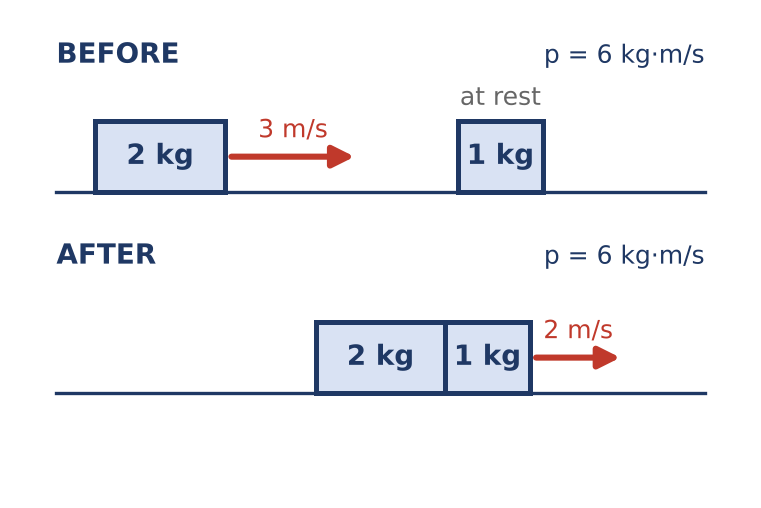
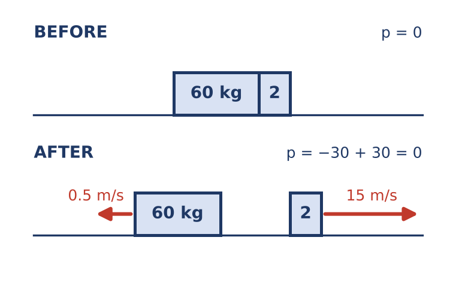
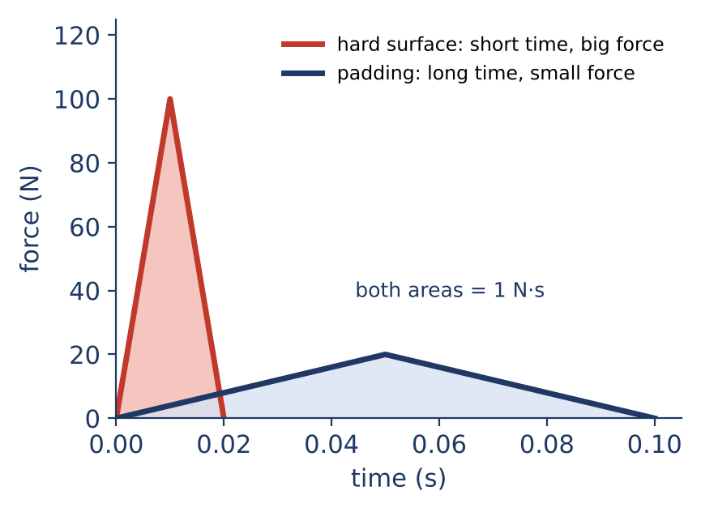

# Cornell Notes: Momentum

*Physics | Semester 1, Unit 4 | Momentum, impulse, conservation of momentum, collisions*

Name: ____________________  Period: ______  Date: __________

**Learning targets**

- I can calculate the momentum of an object and give its direction.
- I can use impulse to explain why a longer collision time means a smaller force.
- I can use conservation of momentum to predict velocities after a collision or explosion.
- I can tell elastic from inelastic collisions.
- I can design and test a device that reduces the force in a collision.

**Essential question:** What stays the same when objects collide, and why does it matter how long a collision lasts?

How to use these notes: cover the Notes column, answer each cue question aloud, then check.

## 1. Momentum

| Cues / Questions | Notes |
|---|---|
| **What is momentum, and what are its units?** | • **Momentum** is mass times velocity: **p = mv**. Units: **kg·m/s**. • Worked example: a 1000 kg car moving at 20 m/s has p = 1000 × 20 = **20,000 kg·m/s**. |
| **Why does the direction of momentum matter?** | • Momentum is a **vector** with the same direction as the velocity. • In one dimension use signs: right is +, left is −. Two carts moving toward each other have momenta with opposite signs. |
| **Can a small object have more momentum than a large one?** | • **Yes**, if it is moving fast enough. • Example: a 0.05 kg bullet at 400 m/s has p = **20 kg·m/s**. A 7 kg bowling ball at 2 m/s has p = **14 kg·m/s**. |

**IXL practice (goal: SmartScore 80+):** **Physics G (new, no number yet)** Calculate linear momentum and impulse

## 2. Impulse and Changing Momentum

| Cues / Questions | Notes |
|---|---|
| **What is impulse, and how is it related to momentum?** | • **Impulse** is force times the time it acts: FΔt. Units: N·s (the same as kg·m/s). • **Impulse = change in momentum:** FΔt = Δp = m(vf − vi). • On a force-time graph, the **area under the curve is the impulse**. |
| **Why do airbags and padding reduce injury?** | • The change in momentum is fixed by the crash. A **longer stopping time** means a **smaller force**. • Worked example: a 70 kg passenger moving at 15 m/s is brought to rest. Δp = 70 × 15 = 1050 kg·m/s. • Stopped by a dashboard in 0.01 s: F = 1050 ÷ 0.01 = **105,000 N**. Stopped by an airbag in 0.15 s: F = 1050 ÷ 0.15 = **7,000 N**. |
| **Which has the larger change in momentum: an object that bounces or one that stops?** | • **The one that bounces.** Its velocity reverses, so the change is larger. • Worked example: a 0.5 kg ball hits a wall at +4 m/s and rebounds at −4 m/s. Δp = 0.5 × (−4 − 4) = **−4 kg·m/s**. If it had stopped, Δp would be −2 kg·m/s. |

**IXL practice (goal: SmartScore 80+):** **Physics G (new, no number yet)** Calculate linear momentum and impulse; **Grade 8 I.7** Collisions and car safety features

## 3. Conservation of Momentum

| Cues / Questions | Notes |
|---|---|
| **What does the law of conservation of momentum say?** | • If no net outside force acts on a system, its **total momentum stays the same**. • **Total momentum before = total momentum after.** |
| **Why is momentum conserved in a collision?** | • By Newton's third law, the two objects push on each other with **equal and opposite forces** for the **same time**. • So they receive equal and opposite impulses. What one object loses, the other gains. |
| **How do you find the speed after two objects collide and stick?** | • Worked example: a 2 kg cart moving at 3 m/s hits a 1 kg cart at rest, and they stick. • Before: (2)(3) + (1)(0) = 6 kg·m/s. After: (2 + 1)v = 6, so v = **2 m/s**. |
| **How do you handle an explosion or recoil?** | • Total momentum starts at zero, so the pieces must have **equal and opposite momenta**. • Worked example: a 60 kg skater at rest throws a 2 kg ball forward at 15 m/s. 0 = (2)(15) + (60)v, so v = **−0.5 m/s** (backward). |

**IXL practice (goal: SmartScore 80+):** **Physics G.1** Conservation of momentum

## 4. Types of Collisions

| Cues / Questions | Notes |
|---|---|
| **What is the difference between elastic and inelastic collisions?** | • **Elastic:** objects bounce apart and total kinetic energy is conserved. • **Inelastic:** some kinetic energy becomes heat, sound, and deformation. • **Perfectly inelastic:** the objects stick together. |
| **Is momentum conserved in an inelastic collision?** | • **Yes.** Momentum is conserved in every collision in a closed system. Kinetic energy is the quantity that may not be. • Check with the carts above: KE before = ½(2)(3²) = 9 J. KE after = ½(3)(2²) = 6 J. **3 J** became heat, sound, and deformation. |
| **What happens when two objects with equal and opposite momenta collide and stick?** | • Worked example: a 1000 kg car moving at +20 m/s hits a 2000 kg truck moving at −10 m/s. • Total momentum = 20,000 − 20,000 = 0, so the wreck is **at rest**. Momentum was not lost. The total was zero from the start. |

**Practice:** No IXL skill classifies elastic and inelastic collisions. Use the Physics Classroom Momentum and Collisions Concept Builders and the PhET Collision Lab.

## 5. Labs and Engineering Design

| Cues / Questions | Notes |
|---|---|
| **How do you test conservation of momentum in the lab?** | • **Collision carts lab:** measure each cart's mass and its velocity before and after the collision (motion sensors, photogates, or video). • Compare total momentum before and after. **p = mv** for each cart, with signs. • **Independent variable:** cart masses or collision type (stick or bounce). **Dependent variable:** velocities after the collision. |
| **How do you design a device that reduces collision force?** | • **Egg-drop or crash-cushion challenge** (HS-PS2-3): the goal is to make the stopping time longer. • State the criteria (egg survives) and constraints (size, mass, materials). Build, test, record results, and improve one feature at a time. • Explain the design with **FΔt = Δp**: same change in momentum, more time, less force. |

**IXL practice (goal: SmartScore 80+):** **Physics A.2** Identify independent and dependent variables; **Grade 8 C.1** Identify parts of the engineering-design process; **Grade 8 C.2** Evaluate tests of engineering-design solutions; **Grade 8 C.3** Use data from tests to compare engineering-design solutions

## Memory tricks

- **p = mv.** Momentum of any moving object. The letter p is the standard symbol for momentum.
- **Impulse = FΔt = Δp.** Any question about a force acting for a time.
- **More time, less force.** Explaining airbags, crumple zones, helmets, and bending your knees when you land.
- **Total before = total after.** Every collision and explosion problem. Add momenta with signs.
- **Stick together: one shared final velocity.** Perfectly inelastic collisions. Use (m1 + m2)v on the after side.

## Summary

Momentum is mass in motion, p = mv, and it has direction. A force acting for a time changes momentum by an amount equal to the impulse, FΔt. That one idea explains safety equipment: stretching out the stopping time shrinks the force. When objects interact with no outside net force, they exchange equal and opposite impulses, so the total momentum before equals the total momentum after. That holds for every collision and explosion, whether the objects bounce or stick. Kinetic energy is conserved only in elastic collisions.

## Visual memory aids

Before and after a collision in which two carts stick together. The total momentum is the same in both pictures. **m1 v1 + m2 v2 = (m1 + m2) v**

An explosion from rest. The two pieces move apart with equal and opposite momenta, so the total stays zero. **0 = m1 v1 + m2 v2**

Two force-time graphs with the same area (same impulse). The longer collision has a much smaller peak force. **area = FΔt = Δp**

## Study method

1. Cover the Notes column and answer each cue aloud.
2. Check your answer and mark the ones you missed.
3. Redraw each visual memory aid from memory.
4. Repeat the next day and again a few days later. Recall spread over several days builds memory that rereading does not.
5. Finish the IXL plan to SmartScore 80+ before the test.
