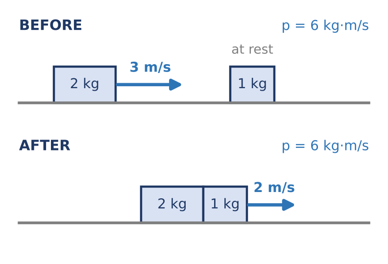
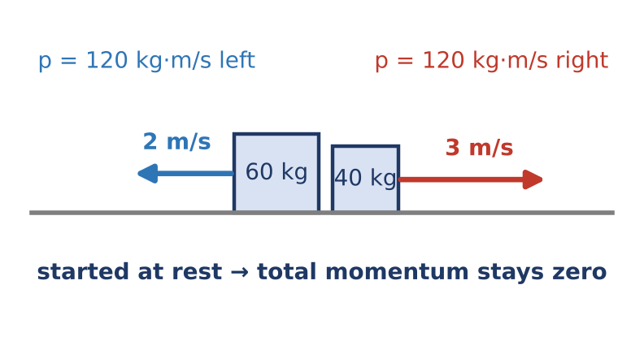

# Cornell Notes: Momentum

*Physics | Momentum and Collisions | momentum, impulse, conservation, elastic and inelastic collisions*

Name: ________________  Period: ______  Date: __________

**Learning targets**

- I can calculate momentum and explain why it is a vector.
- I can use the impulse-momentum theorem, F·Δt = m·Δv.
- I can explain how increasing collision time reduces force.
- I can use conservation of momentum to solve collision and explosion problems.
- I can tell elastic from inelastic collisions and say what is conserved in each.

**Essential question:** What decides how hard it is to stop a moving object, and what happens when objects collide?

**How to use these notes:** cover the Notes column, answer each cue question aloud, then uncover and check. Mark the ones you miss and try them again tomorrow.

## 1. Momentum

| Cues / Questions | Notes |
|---|---|
| **What is momentum and how do you calculate it?** | • **Momentum** is mass in motion: **p = m·v**. Units: **kg·m/s**. • It is a **vector**, pointing the same way as the velocity. • Worked example: a 0.15 kg baseball at 40 m/s has p = 0.15 × 40 = **6.0 kg·m/s**. |
| **Can a small object have more momentum than a large one?** | • **Yes.** Momentum depends on both mass and velocity. • A parked truck has zero momentum. A rolling skateboard has more. • A 0.01 kg bullet at 600 m/s (6 kg·m/s) has the same momentum as the 0.15 kg baseball at 40 m/s. |
| **Why does direction matter when adding momentum?** | • Momentum in opposite directions has opposite signs. • Two identical carts moving toward each other at the same speed have a **total momentum of zero**. |

> **IXL practice (goal: SmartScore 80+):** **Physics G (New)** Calculate linear momentum and impulse

## 2. Impulse and Change in Momentum

| Cues / Questions | Notes |
|---|---|
| **What is impulse, and how is it related to momentum?** | • **Impulse** = force × time = **F·Δt**. Units: N·s (the same as kg·m/s). • **Impulse-momentum theorem**: F·Δt = Δp = m·(v_f − v_i). • Worked example: a 200 N force acts on a 0.5 kg ball at rest for 0.05 s. Impulse = 200 × 0.05 = 10 N·s. Δv = 10 ÷ 0.5 = **20 m/s**. |
| **Why does an airbag or a padded floor reduce injury?** | • The change in momentum is the same with or without padding (the object still stops). • Padding makes the stop take **more time**. Since F·Δt is fixed, more time means **less force**. • Same idea: bending your knees when landing, catching an egg with moving hands, crumple zones. |
| **Which has the larger change in momentum: a ball that bounces back or a ball that sticks?** | • The ball that **bounces** back. • Sticking: momentum goes from m·v to 0, a change of m·v. • Bouncing: momentum goes from +m·v to −m·v, a change of up to **2·m·v**. • Worked example: a 0.06 kg ball hits a wall at 30 m/s and rebounds at 20 m/s. Δp = 0.06 × (−20 − 30) = **−3.0 kg·m/s**. If contact lasts 0.01 s, the force is 3.0 ÷ 0.01 = **300 N**. |
| **What does the area under a force-time graph represent?** | • The area is the **impulse**, which equals the change in momentum. • A tall, narrow graph and a short, wide graph can have the same area: same impulse, different peak force. |

> **IXL practice (goal: SmartScore 80+):** **Physics G (New)** Calculate linear momentum and impulse · **Grade 8 I.7** Collisions and car safety features

## 3. Conservation of Momentum

| Cues / Questions | Notes |
|---|---|
| **What does conservation of momentum say, and when does it apply?** | • If no net **outside** force acts on a system, the **total momentum stays the same**. • m₁·v₁ + m₂·v₂ (before) = m₁·v₁′ + m₂·v₂′ (after). • It follows from Newton's third law: the objects push on each other with equal and opposite forces for the same time, so their momentum changes are equal and opposite. |
| **How do you set up a conservation of momentum problem?** | • 1. Choose the system (both objects) and a positive direction. • 2. Write total momentum **before**. Watch the signs. • 3. Write total momentum **after**. • 4. Set them equal and solve for the unknown. |
| **A 2 kg cart moving at 3 m/s hits a 1 kg cart at rest and they stick. How fast do they move together?** | • Before: (2)(3) + (1)(0) = 6 kg·m/s. • After: (2 + 1)·v = 3v. • 6 = 3v → v = **2 m/s** in the original direction. • Sense check: more mass is moving, so the speed must be lower than 3 m/s. |

> **IXL practice (goal: SmartScore 80+):** **Physics G.1** Conservation of momentum

## 4. Collisions and Explosions

| Cues / Questions | Notes |
|---|---|
| **What is the difference between an elastic and an inelastic collision?** | • **Elastic**: objects bounce apart with no lasting deformation. Momentum **and** kinetic energy are conserved. • **Inelastic**: momentum is conserved, but some kinetic energy becomes heat, sound, and deformation. • **Perfectly inelastic**: the objects stick together. This loses the most kinetic energy. • Momentum is conserved in **every** type of collision. |
| **How much kinetic energy is lost when a 1000 kg car at 20 m/s locks onto a parked 1500 kg truck?** | • Momentum: 1000 × 20 = (2500)·v → v = **8 m/s**. • KE before = ½ × 1000 × 20² = 200,000 J. KE after = ½ × 2500 × 8² = 80,000 J. • Lost: **120,000 J** (60%), which went into heat, sound, and bending metal. |
| **What happens to momentum in an explosion or a push-off from rest?** | • Total momentum before is zero, so total momentum after is also **zero**. • The pieces move in opposite directions with equal-size momenta. • Worked example: a 60 kg skater and a 40 kg skater push apart from rest. The 60 kg skater moves at 2 m/s. 60 × 2 = 40 × v → v = **3 m/s** the other way. |
| **When a bug hits a windshield, which has the greater force, momentum change, and acceleration?** | • **Force**: equal on both (third law). • **Change in momentum**: equal in size on both (same force, same time). • **Acceleration**: far greater for the bug, because its mass is tiny. |

> **IXL practice (goal: SmartScore 80+):** **Physics G.1** Conservation of momentum · **Grade 8 I.7** Collisions and car safety features

## 5. Labs and Measurement

| Cues / Questions | Notes |
|---|---|
| **In a cart collision lab, how do you test conservation of momentum?** | • Measure each cart's mass and its velocity before and after the collision (motion sensor, photogates, or video). • Calculate total momentum before and after. Remember negative signs for carts moving the other way. • They should agree within experimental error. Percent difference = \|before − after\| ÷ before × 100%. |
| **What are the criteria and constraints in an egg-drop design challenge?** | • **Criterion**: the egg survives the drop (the force on the egg stays below what cracks it). • **Constraints**: limits on materials, mass, size, and cost. • The design works by increasing the **stopping time**, which lowers the force (HS-PS2-3). • Test, record what failed, change one feature at a time, and test again. |

> **IXL practice (goal: SmartScore 80+):** **Physics A.2** Identify independent and dependent variables · **Physics A.4** Identify questions that can be investigated with a set of materials

## Memory tricks

- **p = mv.** Momentum is mass times velocity. *Use it for:* Every momentum calculation.
- **Before = after.** Total momentum before a collision equals total momentum after. *Use it for:* Any collision or explosion with no outside net force.
- **More time, less force.** For the same change in momentum, a longer stop means a smaller force. *Use it for:* Safety and design questions.
- **Bounce means bigger change.** A rebound reverses the momentum, so the change is larger than for a stop. *Use it for:* Comparing bouncing and sticking.
- **Momentum always; kinetic energy only if elastic.** Momentum is conserved in every collision. Kinetic energy is conserved only in elastic ones. *Use it for:* Deciding what you may set equal.

## Summary

Momentum, p = m·v, measures how hard it is to stop a moving object, and it has a direction. A force acting over time delivers an impulse, F·Δt, that equals the object's change in momentum; stretching out the time of a collision lowers the force, which is how airbags, helmets, and crumple zones work. When no net outside force acts on a system, its total momentum is conserved, so the momentum before a collision or explosion equals the momentum after. Elastic collisions also conserve kinetic energy. Inelastic collisions do not, and when objects stick together the most kinetic energy is lost.

## Visual memory aids

Before and after a perfectly inelastic collision: the carts stick and share the original momentum. **Rule:** m₁·v₁ + m₂·v₂ = (m₁ + m₂)·v

Two force-time graphs with the same area: a short hard hit and a long gentle one deliver the same impulse. **Rule:** impulse = area = F·Δt = Δp

A ball that bounces back from a wall reverses its momentum, so its change in momentum is larger than if it stopped. **Rule:** Δp = m·(v_f − v_i)

Two skaters push apart from rest: their momenta are equal in size and opposite in direction. **Rule:** total p = 0 before and after

## Study method

1. Cover the Notes column and answer each cue aloud.
2. Check, and mark the ones you missed.
3. Redraw each visual memory aid from memory.
4. Repeat the next day and again a few days later. Recall spread over days builds memory that rereading does not.
5. Finish the IXL plan to SmartScore 80+ before the test.

Printable version: [cornell-notes-momentum.docx](cornell-notes-momentum.docx) · [Unit guide](README.md)
