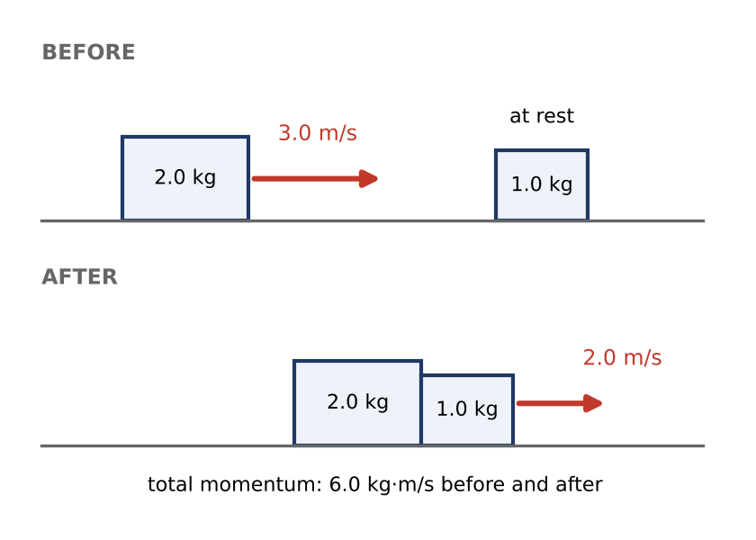
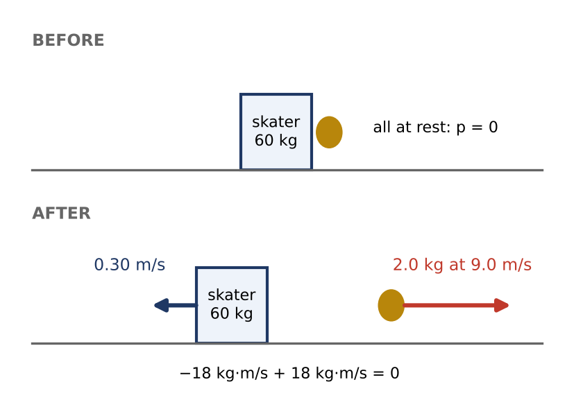
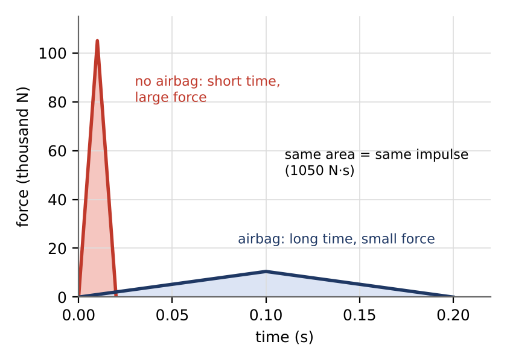
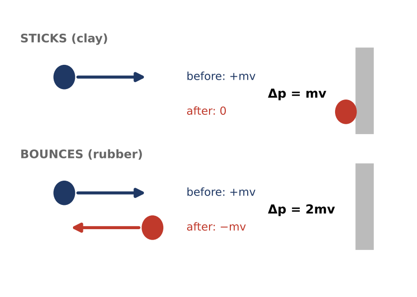

# Cornell Notes: Momentum

*Physics | Semester 1, Unit 4 | Momentum, impulse, conservation of momentum, collisions*

Printable version: [cornell-notes.docx](cornell-notes.docx)

**Essential question:** Why do airbags, helmets and crumple zones save lives?

**Learning targets**

- I can calculate the momentum of an object and the total momentum of a system.
- I can use the impulse-momentum theorem to relate force, time and change in momentum.
- I can explain how increasing collision time reduces force.
- I can use conservation of momentum to solve collision and explosion problems.
- I can tell elastic collisions from inelastic collisions.

## 1. Momentum

| Cues / Questions | Notes |
|---|---|
| **What is momentum and how is it calculated?** | **Momentum** is mass in motion: **p = mv**. Unit: kg·m/s. It is a vector in the direction of the velocity. Worked example: a 1200 kg car moving at 20 m/s. p = 1200 × 20 = **24,000 kg·m/s**. |
| **Can a light object have more momentum than a heavy one?** | Yes, if it is moving fast enough. Worked example: a 0.010 kg bullet at 800 m/s has p = **8.0 kg·m/s**. A 60 kg person strolling at 0.10 m/s has p = **6.0 kg·m/s**. |
| **Why does the sign of momentum matter?** | Momentum to the right is +, to the left is −. An object that bounces back reverses the sign of its momentum, so its change is large. |

**IXL practice (goal: SmartScore 80+):** Physics G (New) Calculate linear momentum and impulse.

## 2. Impulse and Changing Momentum

| Cues / Questions | Notes |
|---|---|
| **What is impulse and how is it related to momentum?** | **Impulse = FΔt**. It equals the **change in momentum**: FΔt = mΔv = m(vf − vi). Units: N·s, which is the same as kg·m/s. On a force-time graph, impulse is the **area** under the line. |
| **How do I find the force on a ball hit by a bat?** | Worked example: a 0.15 kg baseball arrives at 40 m/s and leaves at 50 m/s the other way. Take the incoming direction as +. Δp = 0.15 × (−50 − 40) = **−13.5 kg·m/s**. With a contact time of 0.0030 s, F = 13.5 ÷ 0.0030 = **4500 N**. |
| **Why does an airbag reduce the force on a passenger?** | The change in momentum is the same with or without the bag. The airbag makes the stop take **longer**, so the force is **smaller**. Worked example: a 70 kg passenger stops from 15 m/s. Δp = 70 × 15 = 1050 kg·m/s. Stopping in 0.010 s: F = **105,000 N**. Stopping in 0.10 s: F = **10,500 N**. |
| **Which has the larger impulse: a ball that bounces or one that sticks?** | The one that **bounces**. It must be stopped and then sent back, so its change in momentum is larger. |

**IXL practice (goal: SmartScore 80+):** Grade 8 I.7 Collisions and car safety features. Impulse calculations are in Physics G (New), listed in Section 1.

## 3. Conservation of Momentum

| Cues / Questions | Notes |
|---|---|
| **What does the law of conservation of momentum say?** | If no net external force acts on a system, its **total momentum stays the same**: pbefore = pafter. |
| **Why is momentum conserved in a collision?** | Third law: the two objects push on each other with equal and opposite forces for the same time. Their impulses are equal and opposite, so what one gains the other loses. |
| **How do I solve a collision where the objects stick together?** | Worked example: a 2.0 kg cart at 3.0 m/s hits a 1.0 kg cart at rest and they stick. Before: (2.0)(3.0) + (1.0)(0) = 6.0 kg·m/s. After: (2.0 + 1.0)v = 6.0, so v = **2.0 m/s**. |
| **How do I solve a recoil (explosion) problem?** | Total momentum starts at zero and stays at zero. Worked example: a 60 kg skater at rest throws a 2.0 kg ball forward at 9.0 m/s. 0 = (2.0)(9.0) + (60)v, so v = **−0.30 m/s** (backward). |

**IXL practice (goal: SmartScore 80+):** Physics G.1 Conservation of momentum.

## 4. Types of Collisions

| Cues / Questions | Notes |
|---|---|
| **What is the difference between elastic and inelastic collisions?** | **Elastic:** objects bounce apart; momentum **and** kinetic energy are conserved. **Inelastic:** some kinetic energy becomes heat, sound or deformation. **Perfectly inelastic:** the objects stick together. |
| **Is momentum conserved in an inelastic collision?** | **Yes.** Momentum is conserved in every collision in an isolated system. Only kinetic energy is not. Worked check (carts above): kinetic energy before = ½(2.0)(3.0)² = 9.0 J. After = ½(3.0)(2.0)² = 6.0 J. **3.0 J** became heat, sound and deformation. |

**IXL practice (goal: SmartScore 80+):**  No IXL skill on elastic versus inelastic collisions. Use the Momentum and Collisions Concept Builders at physicsclassroom.com.

## 5. Labs and Engineering

| Cues / Questions | Notes |
|---|---|
| **In a collision-cart lab, how do we test conservation of momentum?** | Measure each cart's mass and its velocity before and after. Add up mv for both carts before and after and compare the totals. |
| **In an egg-drop or crash-cushion design challenge, what are we trying to change?** | The **stopping time**. A design that makes the stop last longer lowers the force (FΔt = Δp). Independent variable: the design or padding. Dependent variable: the force on the egg, or whether it survives. Controlled: drop height and mass. |

**IXL practice (goal: SmartScore 80+):** Grade 8 C.1 Identify parts of the engineering-design process; Grade 8 C.2 Evaluate tests of engineering-design solutions; Grade 8 C.3 Use data from tests to compare engineering-design solutions.

## Memory tricks

- **p = mv.** Use it: Any time the question asks "how hard is it to stop?"
- **Ft = mΔv.** Use it: Whenever force, time and a change in speed appear in the same problem.
- **More time, less force.** Use it: Explaining airbags, helmets, bent knees on landing, catching with "soft hands".
- **Momentum is conserved in every collision; kinetic energy only in elastic ones.** Use it: Deciding what you are allowed to set equal before and after.
- **Pick a positive direction and keep it.** Use it: Head-on collisions, rebounds and recoil problems.

## Summary

Momentum measures how much motion an object has. A force acting for a time, an impulse, changes it. Stretching out the time of a collision lowers the force, which is the idea behind most safety equipment. When two objects interact, the third law makes their momentum changes equal and opposite, so the total momentum of the system is the same before and after. Kinetic energy may or may not survive the collision, but momentum always does.

## Visual memory aids

Perfectly inelastic collision: the carts stick and share the original momentum.  
**Rule:** (2.0)(3.0) + 0 = (3.0)v, so v = 2.0 m/s

Recoil: the system starts at rest, so the two momenta afterward are equal and opposite.  
**Rule:** 0 = (2.0)(9.0) + (60)(−0.30)

Force-time graph: both stops have the same area (same impulse); the longer stop has the smaller peak force.  
**Rule:** Impulse = area = FΔt = Δp

A ball that bounces has a larger change in momentum than one that sticks.  
**Rule:** Stick: Δp = mv. Bounce: Δp up to 2mv

## Study method

1. Cover the Notes column and answer each cue question aloud.
2. Uncover, check, and mark every cue you missed.
3. Redraw each Visual Memory Aid from memory.
4. Repeat the next day and again a few days later.
5. Finish the IXL plan to SmartScore 80+ and take the unit quiz before the test.
