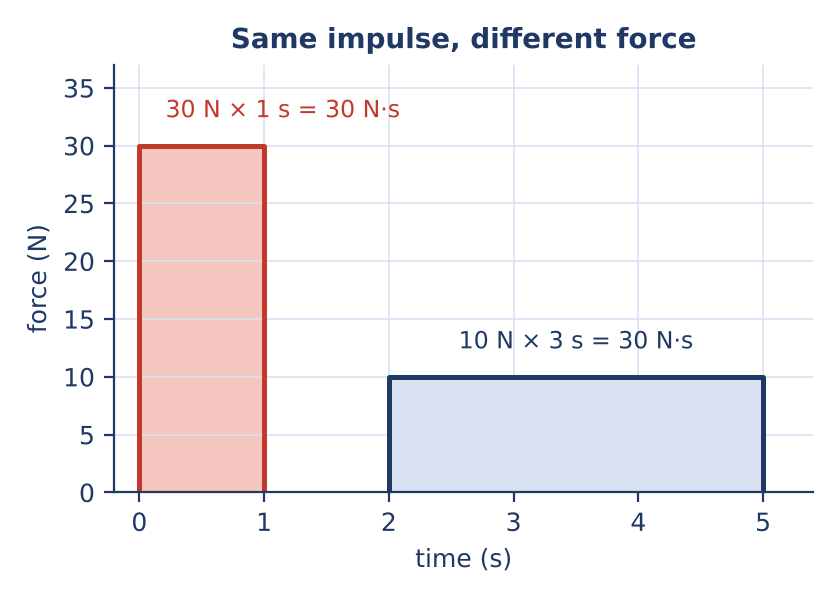
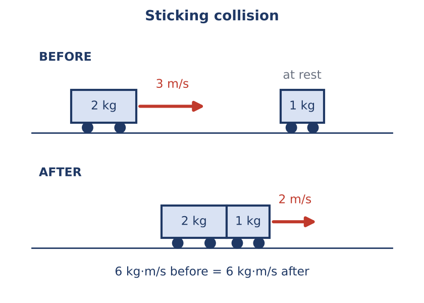
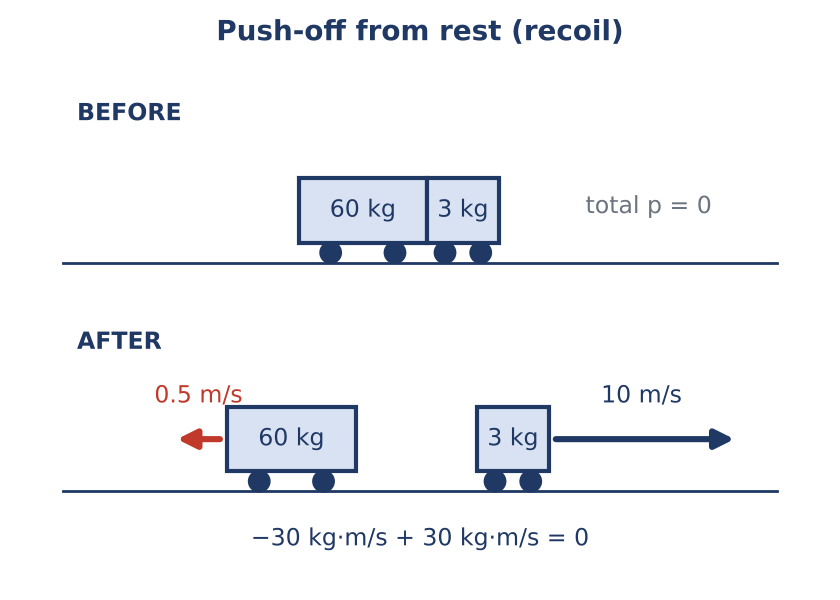
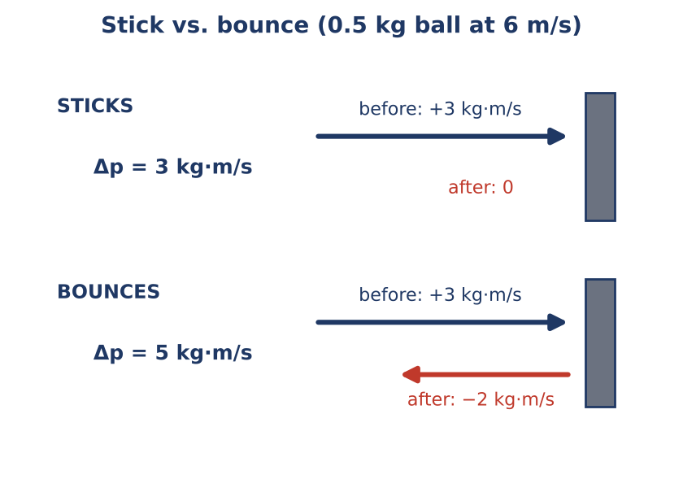

# Cornell Notes: Momentum

*Physics | Unit 4 | Impulse and collisions*

Name: ________________  Period: ______  Date: __________

> A print-ready Word version with the same content is in this folder. Cover the right-hand column and answer each cue aloud to self-test.

**Learning targets**

- I can calculate momentum and treat it as a vector with a sign.
- I can use impulse = FΔt = Δp to find force, time, or change in velocity.
- I can explain how increasing collision time reduces force.
- I can use conservation of momentum to solve collision and recoil problems.
- I can classify collisions as elastic or inelastic by checking kinetic energy.
- I can design and test a device that reduces the force in a collision.

**Essential question:** Why is the total momentum the same before and after a collision, and how can we use that to make collisions safer?

## 1. Momentum

| Cues / Questions | Notes |
|---|---|
| **What is momentum, and what are its units?** | • **Momentum = mass × velocity: p = mv.** Units: **kg·m/s**. • It is a **vector**. Choose a positive direction. Motion the other way has negative momentum. • Worked example: a 0.145 kg baseball at 40 m/s has p = 0.145 × 40 = **5.8 kg·m/s**. • A slow truck can have more momentum than a fast car: 5000 kg × 2 m/s = 10 000 kg·m/s, and 1000 kg × 8 m/s = 8000 kg·m/s. |
| **How do you find the total momentum of two objects moving in opposite directions?** | • Add the momenta **with their signs**. • Example: 2 kg at +3 m/s and 2 kg at −3 m/s. Total = (+6) + (−6) = **0 kg·m/s**. |

**IXL practice (goal: SmartScore 80+):** **Physics G (new)** Calculate linear momentum and impulse

## 2. Impulse and the Impulse-Momentum Theorem

| Cues / Questions | Notes |
|---|---|
| **What is impulse, and how is it related to momentum?** | • **Impulse = force × time: J = FΔt.** Units: N·s (the same as kg·m/s). • **Impulse-momentum theorem: FΔt = Δp = m(v − v₀).** • On a force-time graph, **impulse = area under the graph**. • Worked example: a 50 N force acts for 4 s on a 10 kg cart at rest. Impulse = 200 N·s, so Δv = 200 ÷ 10 = **20 m/s**. |
| **Why does an airbag reduce the force on a passenger?** | • The passenger's change in momentum is **the same** with or without the airbag (same mass, same speed to zero). • The airbag **increases the stopping time**, so the force is smaller: F = Δp ÷ Δt. • Worked example: a 1000 kg car stops from 20 m/s, so Δp = 20 000 kg·m/s. In 0.1 s: F = **200 000 N**. In 2 s: F = **10 000 N**. • Same idea: bending your knees when landing, crumple zones, helmets, padded gym floors. |
| **Which has the greater change in momentum, a ball that bounces or one that sticks?** | • **The ball that bounces.** Its velocity reverses, so Δv is larger. • Worked example: a 0.5 kg ball hits a wall at 6 m/s and rebounds at 4 m/s. Δp = 0.5 × (−4 − 6) = −5, so the size is **5 kg·m/s**. If it stuck: 0.5 × (0 − 6) gives only **3 kg·m/s**. |

**IXL practice (goal: SmartScore 80+):** **Physics G (new)** Calculate linear momentum and impulse; **Grade 8 I.7** Collisions and car safety features

## 3. Conservation of Momentum

| Cues / Questions | Notes |
|---|---|
| **When is the total momentum of a system conserved?** | • When the system is **isolated**: no net external force acts on it. • **Total momentum before = total momentum after.** m₁v₁ + m₂v₂ = m₁v₁′ + m₂v₂′. • This comes from Newton's third law: during the collision the objects exert equal and opposite forces for the same time, so their momentum changes are equal and opposite. |
| **A 2 kg cart at 3 m/s hits a 1 kg cart at rest and they stick. What is their speed afterward?** | • System: both carts. Before: (2)(3) + (1)(0) = 6 kg·m/s. • After they stick they move as one object: (2 + 1)v = 6. • v = 6 ÷ 3 = **2 m/s**, in the original direction. • Sense check: the combined mass is larger, so the speed must be smaller than 3 m/s. |

**IXL practice (goal: SmartScore 80+):** **Physics G.1** Conservation of momentum

## 4. Collisions and Explosions

| Cues / Questions | Notes |
|---|---|
| **What is the difference between elastic and inelastic collisions?** | • **Elastic**: objects bounce apart, and kinetic energy is conserved. • **Inelastic**: some kinetic energy becomes heat, sound, and deformation. **Perfectly inelastic**: the objects stick together. • **Momentum is conserved in every type.** • Check with the sticking carts above: KE before = ½(2)(3²) = 9 J. KE after = ½(3)(2²) = 6 J. **3 J** went to heat, sound, and deformation. |
| **How does conservation of momentum explain recoil?** | • Before an "explosion" (a push-off, a throw, a shot) total momentum is **zero**. Afterward it must still be zero. • The two pieces get **equal and opposite momentum**. The lighter piece moves faster. • Worked example: a 60 kg skater at rest throws a 3 kg ball at 10 m/s. 0 = (3)(10) + (60)v, so v = **−0.5 m/s** (backward). |

**IXL practice (goal: SmartScore 80+):** **Physics G.1** Conservation of momentum

## 5. Labs and Measurement

| Cues / Questions | Notes |
|---|---|
| **What question does the lab "Colliding carts, plus the egg-drop design challenge" answer, and what are its variables?** | • Question: Is total momentum the same before and after a collision? How can a design reduce the force of an impact? • **Independent variable:** Cart masses and type of collision (bounce or stick) • **Dependent variable:** Velocity of each cart before and after the collision |
| **Which formula does the lab use, and what are the steps?** | • **Formula:** p = mv for each cart. Compare Σp before with Σp after: percent difference = \|before − after\| ÷ before × 100. • On a low-friction track, measure each cart's velocity before and after a collision with motion sensors or photogates. • Run a sticking (Velcro) collision and a bouncing (magnet or spring) collision, with equal and unequal masses. • Calculate total momentum and total kinetic energy before and after. Decide which collisions are elastic. • Design challenge (HS-PS2-3): build a device that protects an egg in a drop. Explain the design using FΔt = Δp, test, and refine. |

**IXL practice (goal: SmartScore 80+):** **Physics A.2** Identify independent and dependent variables; **Grade 8 C.2** Evaluate tests of engineering-design solutions

## Memory tricks

| Trick or rule | When to use it |
|---|---|
| **p = mv** | Finding momentum. Remember the sign for direction. |
| **FΔt = mΔv** | Any problem with a force acting for a time, or a question about stopping. |
| **More time, less force** | Explaining airbags, helmets, crumple zones, and bent knees. |
| **Stick together: (m₁ + m₂)v** | Perfectly inelastic collisions. One combined mass, one final velocity. |
| **Momentum is always conserved in collisions; kinetic energy only in elastic ones** | Deciding which conservation law to use. |

## Summary

Momentum (p = mv) measures how hard it is to stop a moving object. A force acting for a time delivers an impulse that changes momentum: FΔt = Δp. For the same change in momentum, a longer time means a smaller force, which is the idea behind every piece of crash safety equipment. When no net external force acts on a system, its total momentum stays the same through any collision or explosion. Kinetic energy is conserved only when the collision is elastic.

## Visual memory aids

Two force-time graphs with the same area: a short hard hit and a long gentle one. **Impulse = area = FΔt = Δp. More time, less force.**

Before and after diagram of a sticking collision. **m₁v₁ + m₂v₂ = (m₁ + m₂)v′.**

Before and after diagram of a push-off from rest. **Total momentum stays zero: m₁v₁′ = −m₂v₂′.**

Momentum arrows for a ball that sticks and a ball that bounces. **Bouncing reverses the velocity, so Δp is larger.**

## Study method

1. Cover the Notes column and answer each cue aloud.
2. Check, and mark the ones you missed.
3. Redraw each visual memory aid from memory.
4. Repeat the next day, and again a few days later. Recall spread over days builds memory that rereading does not.
5. Finish the IXL plan to SmartScore 80+ before the test.
