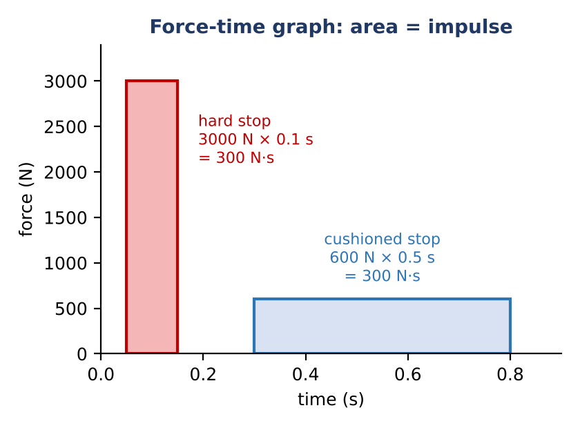
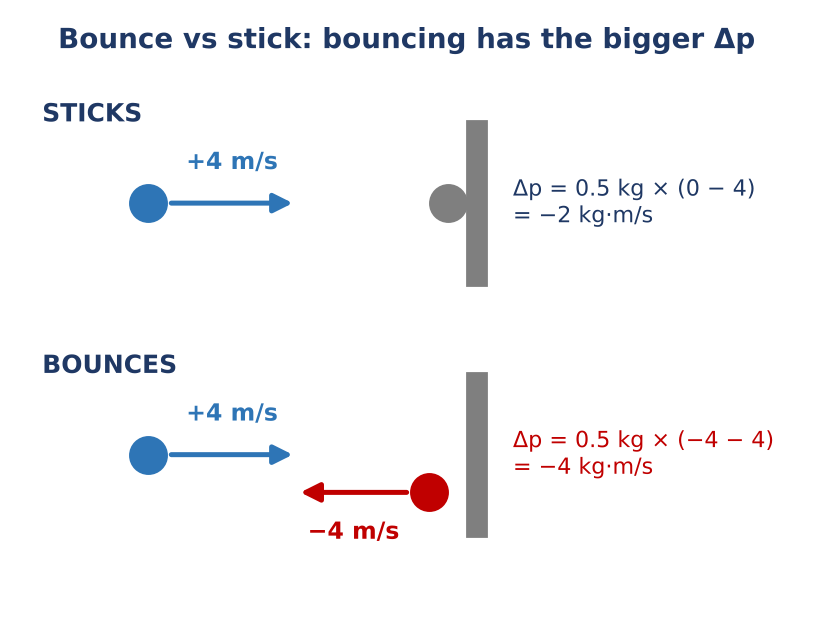
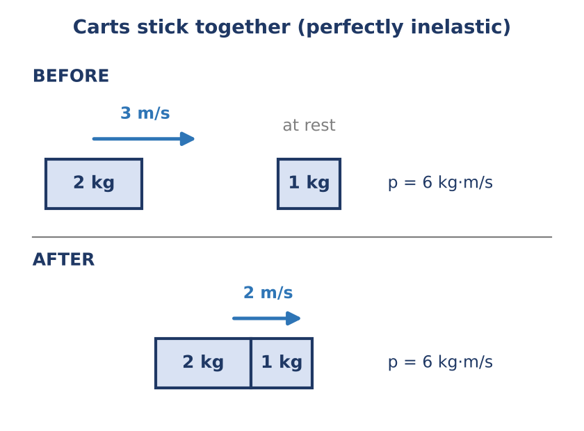
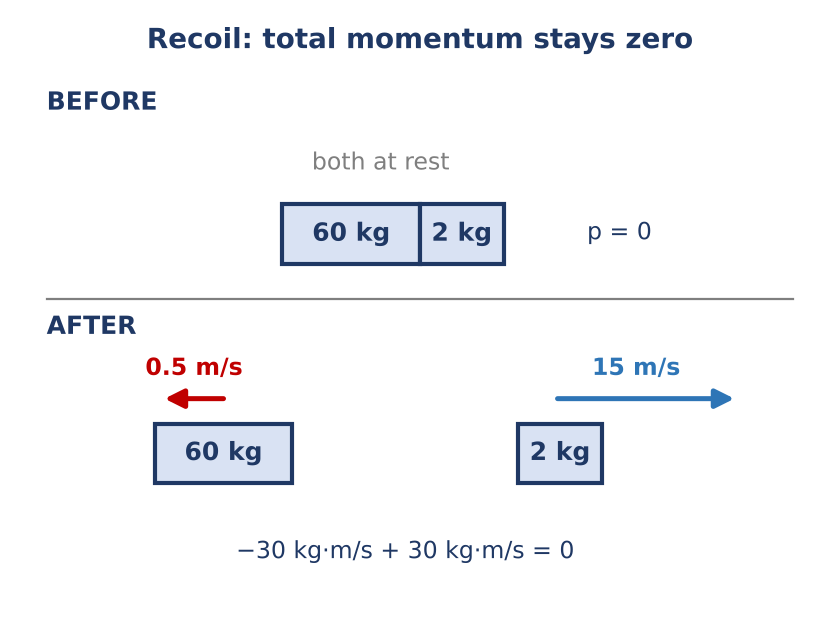

# Cornell Notes: Momentum

*Physics | Unit 4 | Momentum, impulse, conservation, collisions*

> Printable version with the Visual Memory Aids laid out for class: [Cornell-Notes-Momentum.docx](Cornell-Notes-Momentum.docx)

**Essential question:** Why is momentum conserved in every collision, and how can engineers use that to make collisions safer?

**Learning targets**

- I can calculate momentum and explain that it is a vector.
- I can use impulse = change in momentum to connect force, time, and change in velocity.
- I can explain how increasing collision time reduces force, and apply it to a safety design.
- I can use conservation of momentum to solve collision and recoil problems for two objects in one dimension.
- I can classify collisions as elastic or inelastic by checking kinetic energy.

**How to use:** cover the Notes column, answer each cue aloud, then check.

## 1. Momentum

| Cues / Questions | Notes |
|---|---|
| **What is momentum, and what are its units?** | • **Momentum** is mass times velocity: **p = mv**. • It is a **vector** pointing the same way as the velocity. Units: **kg·m/s**. • Choose a + direction. Objects moving the other way have **negative** momentum. |
| **What is the momentum of a 1000 kg car moving at 20 m/s?** | • p = mv = 1000 kg × 20 m/s = **20,000 kg·m/s** in the direction the car is moving. |
| **Can a small object have more momentum than a large one?** | • **Yes**, if it is moving fast enough. Momentum depends on both mass and velocity. • An object at rest has **zero** momentum, whatever its mass. |

**IXL practice (goal: SmartScore 80+):** **Physics G (New)** Calculate linear momentum and impulse

## 2. Impulse

| Cues / Questions | Notes |
|---|---|
| **What is impulse, and how is it related to momentum?** | • **Impulse** is force times the time the force acts: **J = FΔt**, in N·s. • **Impulse-momentum theorem: FΔt = Δp = m(v_f − vᵢ).** • 1 N·s is the same as 1 kg·m/s. |
| **Why do airbags, crumple zones, and bending your knees reduce injury?** | • The change in momentum is **the same** either way: you go from moving to stopped. • These devices make the stop take **longer**. Since FΔt is fixed, a bigger Δt means a **smaller force**. • They do not reduce the impulse or the change in momentum. |
| **A 0.15 kg baseball arrives at 40 m/s and is hit straight back at 50 m/s. The bat touches it for 0.005 s. What force acts on the ball?** | • Call the hit direction +. vᵢ = −40 m/s, v_f = +50 m/s. • Δp = m(v_f − vᵢ) = 0.15 × (50 − (−40)) = 0.15 × 90 = **13.5 kg·m/s**. • F = Δp ÷ Δt = 13.5 ÷ 0.005 = **2700 N**. • Sense check: the velocity change is 90 m/s, not 10 m/s, because the direction reversed. |
| **Which delivers a bigger impulse to a wall: a ball that sticks or an identical ball that bounces back?** | • **The ball that bounces.** Its velocity goes from +v to −v, a change of 2v. • The ball that sticks only goes from +v to 0, a change of v. |
| **What does the area under a force-time graph represent?** | • **Impulse**, which equals the change in momentum. |

**IXL practice (goal: SmartScore 80+):** **Physics G (New)** Calculate linear momentum and impulse; **Grade 8 I.7** Collisions and car safety features

## 3. Conservation of Momentum

| Cues / Questions | Notes |
|---|---|
| **What does the law of conservation of momentum say?** | • If **no net outside force** acts on a system, its **total momentum stays the same**. • **p_total before = p_total after**: m₁v₁ + m₂v₂ = m₁v₁′ + m₂v₂′. |
| **Why is momentum conserved in a collision?** | • By Newton's third law, the objects push on each other with **equal and opposite forces for the same time**. • So they receive **equal and opposite impulses**. What one object loses in momentum, the other gains. |
| **A 2 kg cart moving at 3 m/s hits a 1 kg cart at rest and they stick together. What is their velocity afterward?** | • Before: (2)(3) + (1)(0) = 6 kg·m/s. • After: the combined mass is 3 kg, so 3v = 6 → v = **2 m/s** in the original direction. • Sense check: slower than 3 m/s because the same momentum is shared by more mass. |
| **A 60 kg skater at rest throws a 2 kg ball forward at 15 m/s. What happens to the skater?** | • Before: total momentum = 0. • After: (60)v + (2)(15) = 0 → v = −30 ÷ 60 = **−0.5 m/s** (the skater moves backward). • This is **recoil**. The total momentum is still zero. |

**IXL practice (goal: SmartScore 80+):** **Physics G.1** Conservation of momentum

## 4. Types of Collisions

| Cues / Questions | Notes |
|---|---|
| **What is the difference between elastic and inelastic collisions?** | • **Elastic:** objects bounce apart and total **kinetic energy is conserved**. • **Inelastic:** some kinetic energy is changed into thermal energy, sound, and deformation. • **Perfectly inelastic:** the objects **stick together**. This loses the most kinetic energy. |
| **Is momentum conserved in an inelastic collision?** | • **Yes.** Momentum is conserved in **every** collision in an isolated system. • Only kinetic energy is not conserved. The “missing” energy becomes thermal energy, sound, and bent metal. |
| **How much kinetic energy is lost when the 2 kg and 1 kg carts stick together?** | • Before: KE = ½(2)(3²) = 9 J. • After: KE = ½(3)(2²) = 6 J. • **3 J** is changed into thermal energy and sound. Momentum stayed at 6 kg·m/s. |

**IXL practice (goal: SmartScore 80+):** **Physics G.1** Conservation of momentum

## 5. Labs and Engineering Design

| Cues / Questions | Notes |
|---|---|
| **In a cart-collision lab, what do you measure and what do you compare?** | • Measure each cart's **mass** and its **velocity before and after** the collision (motion sensors, photogates, or video). • Compare **total momentum before** with **total momentum after**. They should agree within measurement error. • **Independent:** cart masses or starting velocity. **Dependent:** velocities after the collision. |
| **In the egg-drop (collision safety) challenge, what are you trying to change, and how do you judge a design?** | • You cannot change the egg's change in momentum. You **increase the stopping time** so the force is smaller. • Judge the design against criteria and constraints: does the egg survive, mass, cost, size. • Then **refine**: change one feature, retest, and explain the result using FΔt = Δp. This is HS-PS2-3. |

**IXL practice (goal: SmartScore 80+):** **Physics A.2** Identify independent and dependent variables; **Grade 8 I.7** Collisions and car safety features

## Memory tricks

- **p = mv.** Use for any single object's momentum. Keep the sign for direction.
- **FΔt = mΔv.** Use when a problem links force, contact time, and a change in speed.
- **More time, less force.** Use to explain airbags, helmets, crumple zones, and landing with bent knees.
- **Before = after.** Use for every collision or recoil: total momentum before equals total momentum after.
- **Sticky is inelastic; bouncy is closer to elastic.** Use to classify a collision quickly, then check kinetic energy to be sure.

## Summary

Momentum, p = mv, measures how hard it is to stop a moving object, and it has direction. A force acting for a time delivers an impulse that changes momentum: FΔt = Δp. That is why spreading a stop over a longer time lowers the force, the idea behind every collision safety device. Because colliding objects push on each other with equal and opposite forces for the same time, the total momentum of an isolated system never changes. This holds for elastic collisions, inelastic collisions, and explosions; only kinetic energy can be lost.

## Visual memory aids

| | |
|---|---|
|  A hard stop and a cushioned stop have the same area (impulse), but the cushioned stop has a much smaller force. **Rule:** impulse = FΔt = Δp |  A ball that bounces reverses its velocity, so its momentum changes twice as much as a ball that sticks. **Rule:** Δp = m(v_f − vᵢ) |
|  When carts stick together, the same total momentum is shared by more mass, so they move slower. **Rule:** m₁v₁ + m₂v₂ = (m₁ + m₂)v′ |  Starting from rest, the two objects move apart with equal and opposite momentum. **Rule:** 0 = m₁v₁′ + m₂v₂′ |
