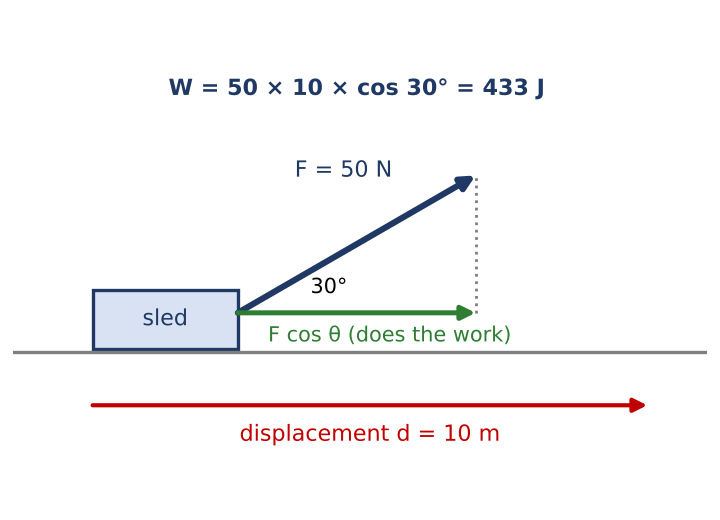
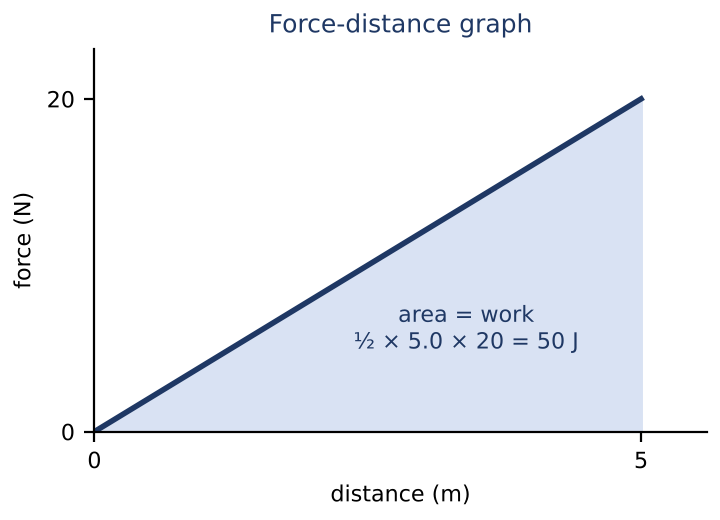
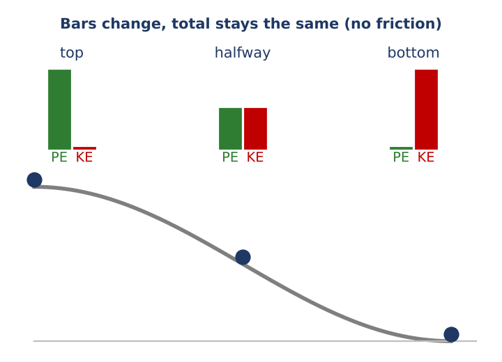
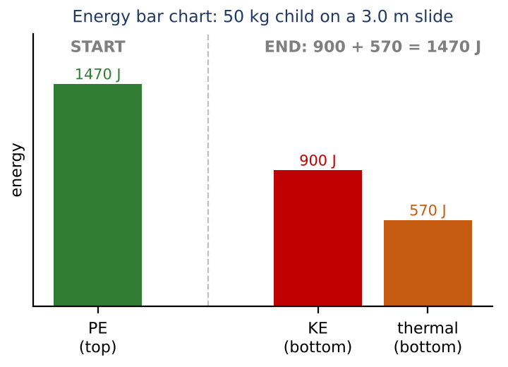

# Unit 5: Work & Energy

[Project home](../../README.md) · [1. Kinematics](../01-kinematics/README.md) · [2. Projectile Motion](../02-projectile-motion/README.md) · [3. Newton's Laws](../03-newtons-laws/README.md) · [4. Momentum](../04-momentum/README.md) · **5. Work & Energy**

**Pacing:** Weeks 15–18 · **Essential question:** Where does energy come from, where does it go, and how can tracking it predict motion?

Energy gives a second way to solve motion problems, often a shorter one. Students calculate work, kinetic and potential energy, track energy through a system with bar charts, and design a device that converts energy from one form to another.

## Materials in this folder

| File | What it is |
|---|---|
| [cornell-notes-05-work-and-energy.docx](cornell-notes-05-work-and-energy.docx) | Printable Cornell notes: cue questions, notes with worked examples, visual memory aids, study method, IXL practice plan |
| [quiz.html](quiz.html) | Interactive quiz on the 10 most commonly missed ideas, with an explanation after every answer |

## Standards (CA NGSS)

- **HS-PS3-1** – Create a computational model to calculate the change in the energy of one component in a system when the change in energy of the other component(s) and energy flows in and out of the system are known.
- **HS-PS3-2** – Develop and use models to illustrate that energy at the macroscopic scale can be accounted for as a combination of energy associated with the motions of particles (objects) and energy associated with the relative positions of particles (objects).
- **HS-PS3-3** – Design, build, and refine a device that works within given constraints to convert one form of energy into another form of energy.

## Key concepts to master

- **Work** – energy transferred by a force acting through a distance: W = Fd cos θ, in joules.
- **Kinetic energy** – energy of motion: KE = ½mv².
- **Work-energy theorem** – net work equals the change in kinetic energy.
- **Potential energy** – stored energy of position: gravitational (mgh) and elastic (½kx²).
- **Conservation of energy** – energy is never created or destroyed, only transferred or transformed.
- **Mechanical energy and friction** – friction turns mechanical energy into thermal energy.
- **Power and efficiency** – rate of doing work (P = W/t); useful output divided by total input.

## Learning objectives and how each is assessed

| # | Students can… | Evidence |
|---|---|---|
| 5.1 | Calculate work, including zero and negative work. | Quiz Q1, Q7; Practice 1; IXL Physics H.1 |
| 5.2 | Calculate kinetic energy and apply the work-energy theorem. | Quiz Q2, Q10; Practice 2, 7 |
| 5.3 | Calculate gravitational and elastic potential energy. | Practice 3, 5 |
| 5.4 | Apply conservation of energy with and without friction (HS-PS3-1, HS-PS3-2). | Quiz Q3–Q6, Q9; Practice 3–5, 7; IXL Physics H.2 |
| 5.5 | Calculate power and efficiency. | Quiz Q8; Practice 6, 8 |
| 5.6 | Design, build and refine an energy-conversion device (HS-PS3-3). | Design project rubric |

Score each objective on the 4-point scale in [Assessment and progress tracking](../../docs/assessment-and-tracking.md). The unit is mastered when every objective is at 3 or above.

## Cue questions (self-test)

Cover the answers in the Cornell notes and answer these aloud.

**1. Work**

- When does a force do work?
- When is the work zero or negative?
- How do you find work from a force-distance graph?

**2. Kinetic Energy and the Work-Energy Theorem**

- What is kinetic energy, and how does it depend on speed?
- What does the work-energy theorem say?

**3. Potential Energy**

- What is gravitational potential energy?
- What is elastic potential energy?

**4. Conservation of Energy**

- When is mechanical energy conserved?
- How fast is a roller coaster at the bottom of a hill?
- Where does the energy go when there is friction?
- How does an energy bar chart show conservation?

**5. Power and Efficiency**

- What is power?
- What is efficiency?

**6. Labs and Measurement**

- What are the variables in the cart-on-a-ramp energy lab?
- How do you measure your own power?

## Visual memory aids

| | |
|---|---|
|  Only the part of the pull that points along the motion does work on the sled. **W = Fd cos θ** |  On a force-distance graph the shaded area is the work done. **W = area under F–d graph** |
|  On a frictionless hill, potential energy changes into kinetic energy while the total stays the same. **mgh + ½mv² = constant** |  With friction, the starting potential energy ends up as kinetic energy plus thermal energy. **PE(top) = KE(bottom) + thermal** |

## Most commonly missed ideas

Each of these is a question in the [interactive quiz](quiz.html).

1. Equating effort or tiredness with work.
2. Assuming kinetic energy is directly proportional to speed.
3. Thinking mass or ramp steepness changes the final speed.
4. Reversing where the bob is fastest.
5. Thinking energy disappears when the object stops moving.
6. Saying energy is "lost" or "used up".
7. Counting force alone, without displacement, as work.
8. Mixing up power and work.
9. Forgetting the square root, or stopping at mgh = 98 J.
10. Doubling the distance because the speed doubled.

## Learning resources

- [The Physics Classroom: Work, Energy and Power tutorial](https://www.physicsclassroom.com/class/energy) – Reading on work, energy forms and energy bar charts.
- [The Physics Classroom: Concept Builders](https://www.physicsclassroom.com/Concept-Builders) – Open the Work and Energy set.
- [PhET simulation: Energy Skate Park: Basics](https://phet.colorado.edu/en/simulations/energy-skate-park-basics) – Live energy bar charts for a skater on a track, with and without friction.
- [OpenStax Physics (high school), Chapter 9](https://openstax.org/details/books/physics) – Free textbook: Work, Energy, and Simple Machines.
- [Khan Academy Physics](https://www.khanacademy.org/science/physics) – Videos and practice; browse or search the library for work and energy. Unit names on the site change from time to time.
- [IXL Physics, section H; Grade 8 science, section J](https://www.ixl.com/science/physics) – Skill practice; goal SmartScore 80+.

## IXL practice plan (goal: SmartScore 80+)

| Done | Skill | Skill name |
|---|---|---|
| ☐ | Physics A.2 | Identify independent and dependent variables |
| ☐ | Physics B.3 | Multiply and divide with significant figures |
| ☐ | Physics B.4 | Calculations with significant figures |
| ☐ | Grade 8 KK.6 | Abbreviate force, energy, and electricity units |
| ☐ | Physics H.1 | Calculate work |
| ☐ | Physics H (new, not yet numbered) | Calculate work from force-displacement graphs |
| ☐ | Grade 8 J.2 | Use tables and graphs to identify patterns about kinetic energy |
| ☐ | Grade 8 J.1 | Identify changes in gravitational potential energy |
| ☐ | Grade 8 J.3 | Explore energy transformations: roller coaster ride |
| ☐ | Grade 8 J.4 | Explore energy transformations: bike ride |
| ☐ | Physics H.2 | Conservation of mechanical energy |

*No IXL match:* Power, efficiency, elastic potential energy and energy bar charts have no matching IXL skill in the sections used here. Use the physicsclassroom.com Concept Builders for Work and Energy.

## Practice problems

Use g = 9.8 m/s². Try each one before opening the answer.

1. A 40 N force pushes a box 6.0 m in the direction of the force. How much work is done?
   

Answer
W = 40 × 6.0 = <strong>240 J</strong>

2. What is the kinetic energy of a 0.145 kg baseball moving at 40 m/s?
   

Answer
KE = ½(0.145)(40)² = <strong>116 J</strong>

3. A 55 kg diver stands on a 10 m platform. Find the potential energy relative to the water and the speed on entering the water.
   

Answer
PE = 55 × 9.8 × 10 = <strong>5390 J</strong>. v = √(2 × 9.8 × 10) = <strong>14 m/s</strong>

4. A pendulum bob is released from 0.45 m above its lowest point. How fast is it moving at the bottom?
   

Answer
v = √(2 × 9.8 × 0.45) = <strong>2.97 m/s</strong>

5. A spring (k = 400 N/m) is compressed 0.050 m and launches a 0.020 kg ball. Find the stored energy and the launch speed.
   

Answer
PE = ½(400)(0.050)² = <strong>0.50 J</strong>. v = √(2 × 0.50 ÷ 0.020) = <strong>7.1 m/s</strong>

6. A motor lifts a 200 kg load 15 m in 10 s. Find the work done and the power.
   

Answer
W = 200 × 9.8 × 15 = <strong>29 400 J</strong>. P = 29 400 ÷ 10 = <strong>2940 W</strong>

7. A 1200 kg car moving at 15 m/s skids to a stop in 22.5 m. Find the kinetic energy removed and the friction force.
   

Answer
KE = ½(1200)(15)² = <strong>135 000 J</strong>. F = 135 000 ÷ 22.5 = <strong>6000 N</strong>

8. A machine takes in 500 J and delivers 350 J of useful work. What is its efficiency, and where did the rest go?
   

Answer
Efficiency = 350 ÷ 500 = <strong>70%</strong>. The other 150 J became thermal energy (and sound).

## Labs and investigations

- **Energy on a ramp**: compare mgh at release with ½mv² at the bottom and account for the difference.
- **Stair-climb power**: measure your own power output.
- **Energy Skate Park (HS-PS3-1)**: build a spreadsheet model that calculates KE, PE and thermal energy at several points on a track.
- **Energy-conversion device (HS-PS3-3)**: design, build and refine a device such as a rubber-band car or small wind turbine within given constraints; measure its efficiency.

## Real-world applications

- **Roller coasters**: the first hill is the tallest because no energy is added afterward and friction removes some.
- **Hydroelectric dams**: gravitational potential energy of water becomes kinetic, then electrical energy.
- **Regenerative braking**: electric cars recover kinetic energy instead of turning it all into thermal energy.
- **Pole vault and trampolines**: kinetic energy to elastic potential to gravitational potential.
- **Earth science link**: elastic energy stored in strained rock is released as seismic waves in an earthquake; a preview of Semester 2.

## Unit checklist

**Student**

- [ ] Cornell notes read; every cue question answered aloud from memory
- [ ] All visual memory aids redrawn from memory
- [ ] Practice problems completed and checked
- [ ] IXL practice plan at SmartScore 80+
- [ ] Interactive quiz at 80% or higher
- [ ] Lab report submitted
- [ ] Unit test taken; missed objectives retested

**Instructor**

- [ ] Learning targets and essential question posted
- [ ] Quiz given as a pre-assessment to find misconceptions
- [ ] Lab(s) run and scored with the lab rubric
- [ ] Quiz repeated as a post-assessment; results recorded in the tracker
- [ ] Reteach plan made for any objective below 3
