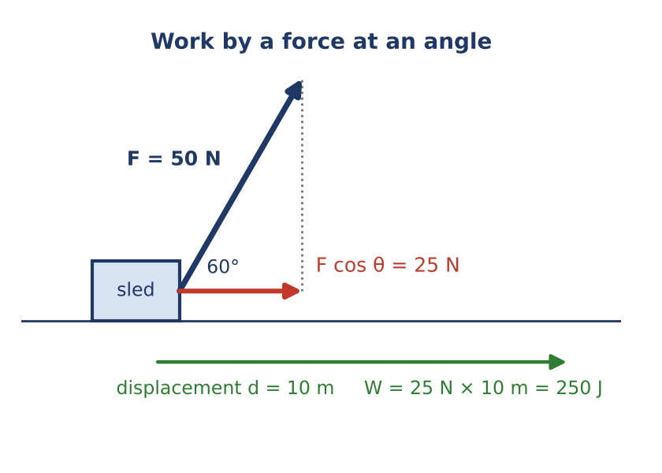
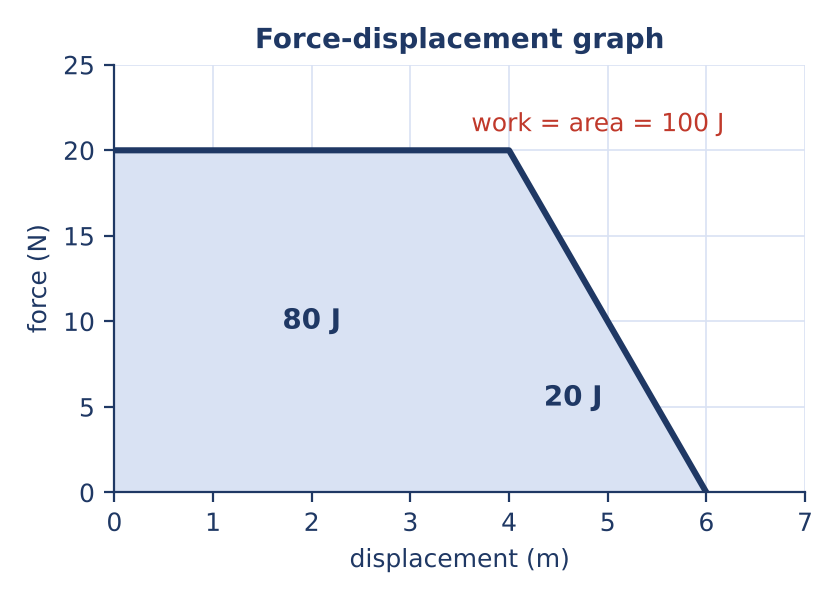
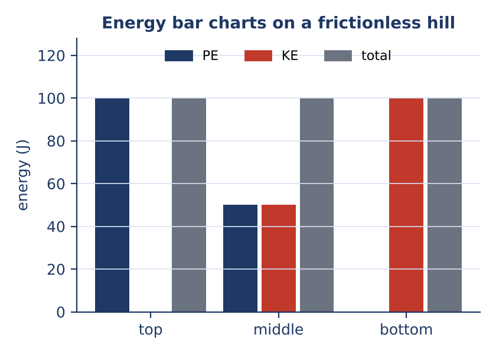
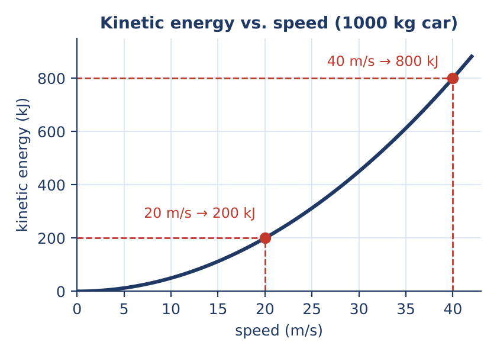

# Cornell Notes: Work & Energy

*Physics | Unit 5 | Work, energy, and power*

Name: ________________  Period: ______  Date: __________

> A print-ready Word version with the same content is in this folder. Cover the right-hand column and answer each cue aloud to self-test.

**Learning targets**

- I can calculate the work done by a force, including at an angle, and say when work is zero or negative.
- I can calculate kinetic energy and use the work-energy theorem.
- I can calculate gravitational and elastic potential energy.
- I can use conservation of mechanical energy to find a speed or height.
- I can account for energy transformed to thermal energy by friction.
- I can calculate power and compare how quickly work is done.

**Essential question:** How can tracking energy let us predict motion without knowing every force along the way?

## 1. Work

| Cues / Questions | Notes |
|---|---|
| **How do you calculate the work done by a force?** | • **W = Fd cos θ**, where θ is the angle between the force and the displacement. Units: **joule (J) = N·m**. • Only the part of the force **along the direction of motion** does work. • Worked example: you pull a sled with 50 N at 60° above horizontal for 10 m. W = 50 × 10 × cos 60° = **250 J**. • On a force-displacement graph, **work = area under the graph**. |
| **When is the work done by a force zero or negative?** | • **Zero** when there is no displacement (holding a heavy bag still, pushing a wall). • **Zero** when the force is perpendicular to the motion (carrying a box across a level floor: the upward force does no work). • **Negative** when the force opposes the motion. Friction does negative work and removes kinetic energy. |

**IXL practice (goal: SmartScore 80+):** **Physics H.1** Calculate work; **Physics H (new)** Calculate work from force-displacement graphs

## 2. Kinetic Energy and the Work-Energy Theorem

| Cues / Questions | Notes |
|---|---|
| **What is kinetic energy, and how does it depend on speed?** | • **KE = ½mv².** Units: joules. • KE depends on **speed squared**. Double the speed, **four times** the kinetic energy. • Worked example: a 1000 kg car at 20 m/s has KE = ½(1000)(20²) = **200 000 J**. At 40 m/s it has **800 000 J**. |
| **What does the work-energy theorem say?** | • **Net work = change in kinetic energy: W_net = ΔKE.** • Worked example: a 200 N net force pushes a 10 kg cart from rest for 5 m. W = 200 × 5 = 1000 J = ½(10)v², so v = √200 = **14.1 m/s**. • This is why stopping distance is four times longer at double the speed: the brakes must remove four times the kinetic energy with the same force. |

**IXL practice (goal: SmartScore 80+):** **Grade 8 J.2** Use tables and graphs to identify patterns about kinetic energy

## 3. Potential Energy

| Cues / Questions | Notes |
|---|---|
| **How do you calculate gravitational potential energy?** | • **PE = mgh.** h is the height above a reference level that you choose. • Worked example: a 2 kg book on a 1.5 m shelf has PE = 2 × 9.8 × 1.5 = **29.4 J** relative to the floor. • Only **changes** in height matter. The path taken to get there does not. |
| **How do you calculate the energy stored in a spring?** | • **Elastic PE = ½kx².** k is the spring constant (N/m) and x is the stretch or compression (m). • Worked example: a spring with k = 200 N/m compressed 0.10 m stores ½(200)(0.10²) = **1.0 J**. • Hooke's law gives the spring force: F = kx. |

**IXL practice (goal: SmartScore 80+):** **Grade 8 J.1** Identify changes in gravitational potential energy; **Physics K.1** Hooke's law

## 4. Conservation of Mechanical Energy

| Cues / Questions | Notes |
|---|---|
| **When is mechanical energy conserved?** | • When only gravity and springs do work (no friction or air resistance): **KE + PE at the start = KE + PE at the end**. • Energy changes form, PE to KE and back, but the total stays the same. • Energy bar charts (LOL charts) show this: the bars change, the total height does not. |
| **How fast is a roller coaster going at the bottom of a 20 m hill if it starts from rest?** | • Top: all PE = mgh. Bottom: all KE = ½mv². • mgh = ½mv². **The mass cancels**: v = √(2gh). • v = √(2 × 9.8 × 20) = √392 = **19.8 m/s**. • Sense check: the answer is the same for any mass and any shape of track, as long as there is no friction. |
| **Where does the energy go when there is friction?** | • Friction transforms mechanical energy into **thermal energy**. It is not destroyed. • **Thermal energy = mechanical energy at the start − mechanical energy at the end.** • Worked example: a 2 kg block starts at rest 5 m up a ramp and arrives at the bottom at 8 m/s. Start: 2 × 9.8 × 5 = 98 J. End: ½(2)(8²) = 64 J. **34 J** became thermal energy. |

**IXL practice (goal: SmartScore 80+):** **Physics H.2** Conservation of mechanical energy; **Grade 8 J.3** Explore energy transformations: roller coaster ride; **Grade 8 J.4** Explore energy transformations: bike ride

## 5. Power

| Cues / Questions | Notes |
|---|---|
| **What is power, and what are its units?** | • **Power = work ÷ time: P = W ÷ t.** Units: **watt (W) = J/s**. 1 horsepower = 746 W. • The same work done in less time means more power. For a constant force along the motion, P = Fv. • Worked example: a 600 N student climbs 3 m of stairs in 4 s. W = 600 × 3 = 1800 J. P = 1800 ÷ 4 = **450 W**. |

**IXL practice:** no IXL skill fits this section. Use the [Physics Classroom Concept Builders](https://www.physicsclassroom.com/Concept-Builders).

## 6. Labs and Measurement

| Cues / Questions | Notes |
|---|---|
| **What question does the lab "Energy on a ramp (or pendulum)" answer, and what are its variables?** | • Question: Does the potential energy lost by a cart equal the kinetic energy it gains? • **Independent variable:** Release height • **Dependent variable:** Speed at the bottom |
| **Which formula does the lab use, and what are the steps?** | • **Formula:** Compare mgh at the release point with ½mv² at the bottom. Efficiency = KE gained ÷ PE lost × 100. • Release a cart from rest at five measured heights on a ramp. Measure its speed at the bottom with a photogate. • Calculate PE at the top and KE at the bottom for each height. • Graph KE against PE. A slope near 1 supports conservation of energy. Explain where any missing energy went. • Extension (HS-PS3-1): build a spreadsheet model that predicts speed for any height and compare it with your data. |

**IXL practice (goal: SmartScore 80+):** **Physics A.2** Identify independent and dependent variables; **Grade 8 KK.6** Abbreviate force, energy, and electricity units

## Memory tricks

| Trick or rule | When to use it |
|---|---|
| **Work = force × distance in the direction of the force** | Before calculating work, check the angle. Perpendicular force means zero work. |
| **KE = ½mv²: double the speed, four times the energy** | Any comparison of speeds, including stopping distance. |
| **PE top = KE bottom, and the mass cancels** | Frictionless drops, ramps, pendulums, and roller coasters. |
| **Energy is never created or destroyed, only transferred or transformed** | Whenever energy seems to be "lost". Look for thermal energy. |
| **Power is how fast work is done: P = W ÷ t** | When a question compares doing the same job quickly and slowly. |

## Summary

Work is energy transferred by a force acting through a distance. Net work changes an object's kinetic energy. Lifting or compressing stores potential energy that can become kinetic energy again. When there is no friction, kinetic plus potential energy stays constant, which lets us find speeds and heights from the start and end points alone. Friction does not destroy energy. It transforms mechanical energy into thermal energy. Power tells how quickly the work is done.

## Visual memory aids

A force applied at an angle to the direction of motion. **W = Fd cos θ. Only the component along the motion does work.**

Force-displacement graph with the area shaded. **Work = area under the graph.**

Energy bar charts at the top, middle, and bottom of a frictionless hill. **KE + PE = constant. Bars change, total stays the same.**

Graph of kinetic energy against speed. **KE = ½mv². Twice the speed, four times the energy.**

## Study method

1. Cover the Notes column and answer each cue aloud.
2. Check, and mark the ones you missed.
3. Redraw each visual memory aid from memory.
4. Repeat the next day, and again a few days later. Recall spread over days builds memory that rereading does not.
5. Finish the IXL plan to SmartScore 80+ before the test.
