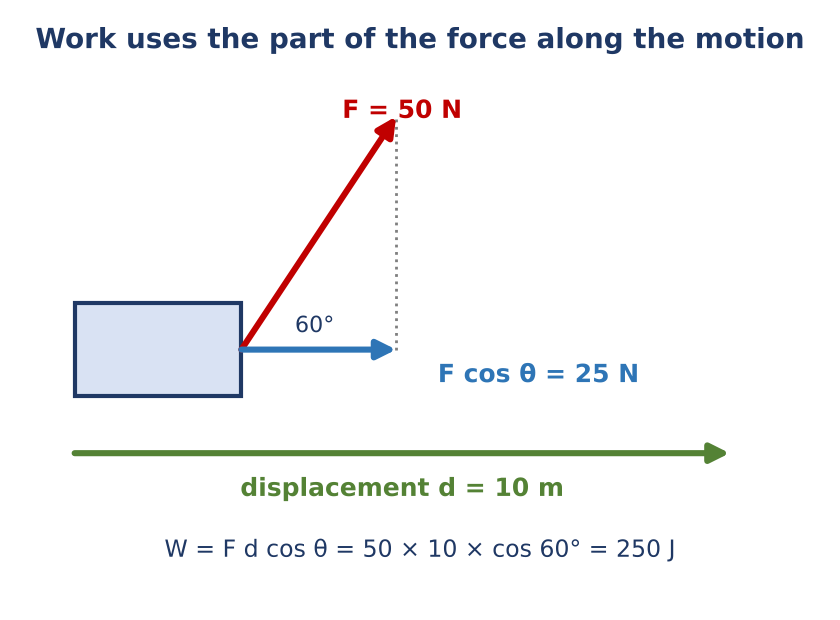
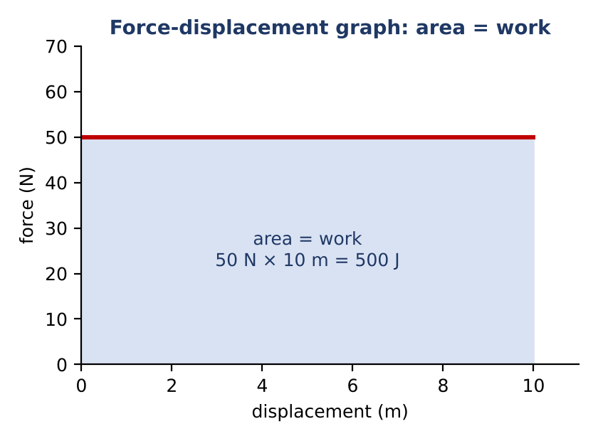
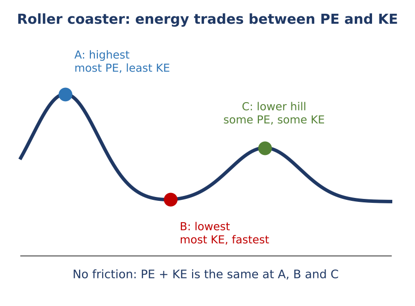
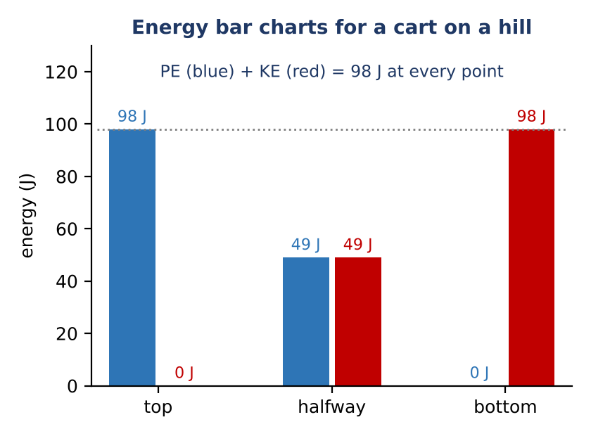

# Cornell Notes: Work and Energy

*Physics | Unit 5 | Work, kinetic and potential energy, conservation of energy, power*

> Printable version with the Visual Memory Aids laid out for class: [Cornell-Notes-Work-and-Energy.docx](Cornell-Notes-Work-and-Energy.docx)

**Essential question:** If energy is never created or destroyed, where does it go when things speed up, slow down, rise, or fall?

**Learning targets**

- I can calculate the work done by a force, including when the force is at an angle or does zero or negative work.
- I can calculate kinetic energy and gravitational potential energy and describe how each depends on speed and height.
- I can use conservation of energy to find speeds and heights, with and without friction.
- I can model energy changes with bar charts and a simple spreadsheet (computational) model.
- I can calculate power and tell it apart from work and energy.

**How to use:** cover the Notes column, answer each cue aloud, then check.

## 1. Work

| Cues / Questions | Notes |
|---|---|
| **What is work in physics, and how is it calculated?** | • **Work** is energy transferred when a force moves an object through a distance. • **W = Fd cos θ**, where θ is the angle between the force and the displacement. Units: **joules (J)**; 1 J = 1 N·m. • Only the part of the force **along the direction of motion** does work. |
| **When does a force do zero work?** | • When there is **no displacement** (pushing on a wall that does not move). • When the force is **perpendicular** to the motion (carrying a box at steady speed across a level floor: the upward force does no work). • Feeling tired is not the same as doing work on the object. |
| **When is work negative?** | • When the force points **opposite** to the motion. **Friction** does negative work and removes kinetic energy. |
| **A sled is pulled 10 m by a 50 N rope angled 60° above horizontal. How much work does the rope do?** | • Force along the motion: 50 × cos 60° = 25 N. • W = Fd cos θ = 50 × 10 × cos 60° = **250 J**. • Sense check: less than 50 × 10 = 500 J because only part of the pull is forward. |
| **What does the area under a force-displacement graph represent?** | • The **work done** by that force. |

**IXL practice (goal: SmartScore 80+):** **Physics H.1** Calculate work; **Physics H (New)** Calculate work from force-displacement graphs; **Grade 8 KK.6** Abbreviate force, energy, and electricity units

## 2. Kinetic and Potential Energy

| Cues / Questions | Notes |
|---|---|
| **What is kinetic energy, and how does it depend on speed?** | • **Kinetic energy** is energy of motion: **KE = ½mv²**. • It depends on speed **squared**. Double the speed gives **four times** the kinetic energy. • Example: a 2 kg cart at 3 m/s has KE = ½ × 2 × 3² = **9 J**. |
| **What is gravitational potential energy?** | • Energy stored because of height: **PE = mgh**, where h is measured from a zero level you choose. • Example: a 2 kg book 5 m above the floor has PE = 2 × 9.8 × 5 = **98 J**. |
| **What does the work-energy theorem say?** | • **W_net = ΔKE = ½mv_f² − ½mvᵢ²**. Net work done on an object changes its kinetic energy. • Positive net work speeds it up; negative net work slows it down. |
| **Why does doubling a car's speed make its braking distance four times longer?** | • The brakes must remove all the kinetic energy: F_frict × d = ½mv². • Double the speed means four times the kinetic energy. With the same braking force, the distance must be **four times** longer. |

**IXL practice (goal: SmartScore 80+):** **Grade 8 J.1** Identify changes in gravitational potential energy; **Grade 8 J.2** Use tables and graphs to identify patterns about kinetic energy

## 3. Conservation of Energy

| Cues / Questions | Notes |
|---|---|
| **What does the law of conservation of energy say?** | • Energy is **never created or destroyed**. It only changes form or moves from one object to another. • Without friction, **mechanical energy** stays constant: **KEᵢ + PEᵢ = KE_f + PE_f**. |
| **A roller coaster starts from rest at the top of a 20 m hill. Ignoring friction, how fast is it going at the bottom?** | • All the starting PE becomes KE: mgh = ½mv². • The mass cancels: v = √(2gh) = √(2 × 9.8 × 20) = √392 = **19.8 m/s**. • Sense check: the answer does not depend on the mass or on the shape of the track. |
| **Where does the “lost” energy go when there is friction?** | • Friction changes mechanical energy into **thermal energy** (the surfaces warm up), plus some sound. • **KEᵢ + PEᵢ = KE_f + PE_f + thermal energy.** The total is still conserved. • Example: a 2 kg block starts at rest 3 m up a ramp (PE = 58.8 J) and reaches the bottom at 6 m/s (KE = 36 J). Thermal energy = 58.8 − 36 = **22.8 J**. |
| **How do energy bar charts show conservation of energy?** | • Draw a bar for each kind of energy at the start and at the end. • The bars change height, but the **total height stays the same** (including a thermal bar when there is friction). |

**IXL practice (goal: SmartScore 80+):** **Physics H.2** Conservation of mechanical energy; **Grade 8 J.3** Explore energy transformations: roller coaster ride; **Grade 8 J.4** Explore energy transformations: bike ride

## 4. Power

| Cues / Questions | Notes |
|---|---|
| **What is power, and what are its units?** | • **Power** is the rate of doing work or transferring energy: **P = W ÷ t**. • Units: **watts (W)**; 1 W = 1 J/s. For steady motion, P = Fv also works. |
| **A 60 kg student climbs a 3 m staircase in 4 s. What is the student's power?** | • Work against gravity = mgh = 60 × 9.8 × 3 = 1764 J. • P = W ÷ t = 1764 ÷ 4 = **441 W**. |
| **Two students of equal mass climb the same stairs, one twice as fast. How do their work and power compare?** | • **Same work** (same mass, same height). • The faster student has **twice the power** because the work is done in half the time. |

**IXL practice (goal: SmartScore 80+):** No IXL Physics skill covers power. Use the Work and Energy Concept Builders at physicsclassroom.com.

## 5. Labs, Modeling, and Engineering Design

| Cues / Questions | Notes |
|---|---|
| **In a ramp or pendulum energy lab, what do you measure and what do you compare?** | • Measure the **release height** and the **speed at the bottom** (photogate or motion sensor). • Compare **PE at the top (mgh)** with **KE at the bottom (½mv²)**. The difference is the thermal energy from friction. • **Independent:** release height. **Dependent:** speed at the bottom. |
| **What is a computational model of energy, and how do you build a simple one?** | • A spreadsheet that calculates energy at each step. Columns: height, PE = mgh, KE = total − PE, speed = √(2KE ÷ m). • Change one input (mass, start height, or energy lost to friction) and the model updates the rest. This is HS-PS3-1. |
| **How do you judge an energy-conversion device such as a marble coaster or a Rube Goldberg machine?** | • Name each energy conversion in order (for example PE → KE → elastic PE → KE). • Estimate **efficiency = useful energy out ÷ energy in × 100**, then change one feature to reduce losses and retest. This is HS-PS3-3. |

**IXL practice (goal: SmartScore 80+):** **Physics A.2** Identify independent and dependent variables; **Physics A.4** Identify questions that can be investigated with a set of materials

## Memory tricks

- **Work = force × distance in the direction of the force.** Use to decide quickly whether work is positive, negative, or zero.
- **Speed is squared in KE.** Use for “what if the speed doubles” questions: the kinetic energy and braking distance go up four times.
- **Energy before = energy after.** Use for every hill, ramp, pendulum, and drop. Add a thermal term if there is friction.
- **LOL diagrams (energy bar charts).** Use to plan a conservation of energy problem before writing the equation.
- **A watt is a joule per second.** Use to keep power separate from energy: power is how fast, energy is how much.

## Summary

Work is how forces transfer energy: a force acting along a displacement changes an object's energy by W = Fd cos θ. Moving objects have kinetic energy, ½mv², and raised objects have gravitational potential energy, mgh. Energy is never created or destroyed, so the total at the start of any process equals the total at the end. Without friction, kinetic plus potential energy stays constant, which lets us find speeds and heights without knowing the path. With friction, the “missing” mechanical energy shows up as thermal energy. Power tells how quickly energy is transferred.

## Visual memory aids

| | |
|---|---|
|  Only the part of the pull that points along the motion does work on the sled. **Rule:** W = Fd cos θ |  For a force-displacement graph, the shaded area is the work done. **Rule:** area = F × d = work |
|  A coaster has the most potential energy at the highest point and the most kinetic energy at the lowest. **Rule:** PE = mgh; KE = ½mv² |  As the cart rolls down, the PE bar shrinks and the KE bar grows, but the total stays 98 J. **Rule:** KEᵢ + PEᵢ = KE_f + PE_f |
