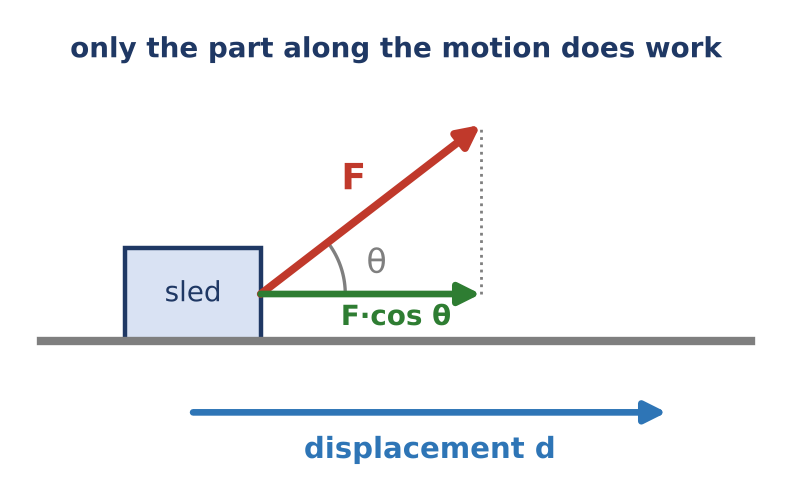
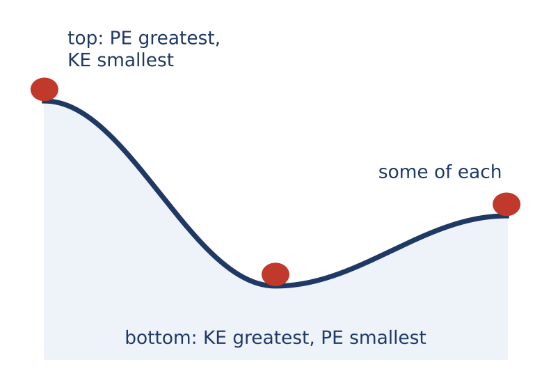
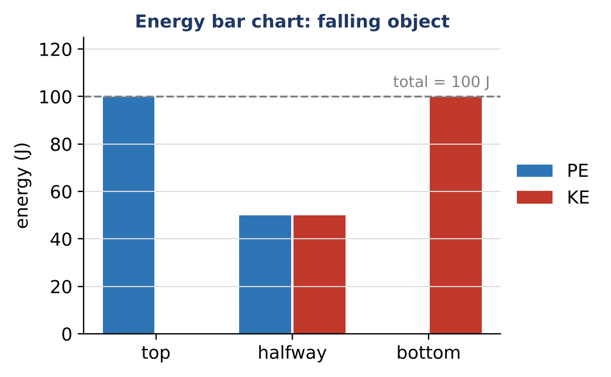
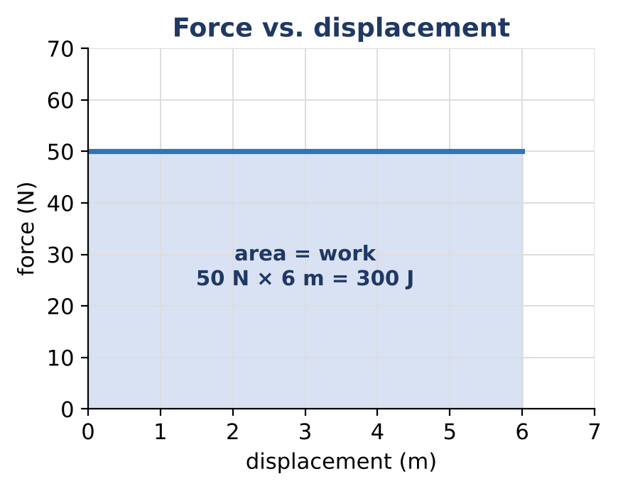

# Unit 5: Work & Energy

**Suggested pacing:** Weeks 15–17 of semester 1  
**Essential question:** Where does energy come from, where does it go, and how can we keep track of it?

## Materials in this folder

| File | What it is |
|---|---|
| [cornell-notes.md](cornell-notes.md) | Cornell notes, readable here on GitHub |
| [cornell-notes-energy.docx](cornell-notes-energy.docx) | The same notes as a printable Word document with a cover page, visual memory aids, and an IXL practice plan |
| [Quiz](../../quizzes/index.html) | Interactive quiz on the most often missed questions (open `quizzes/index.html` in a browser and choose Work & Energy) |

## Standards (NGSS for California, high school)

- **HS-PS3-1** Create a computational model to calculate the change in the energy of one component in a system when the change in energy of the other component(s) and energy flows in and out of the system are known.
- **HS-PS3-2** Develop and use models to illustrate that energy at the macroscopic scale can be accounted for as a combination of energy associated with the motions of particles (objects) and energy associated with the relative positions of particles (objects).
- **HS-PS3-3** Design, build, and refine a device that works within given constraints to convert one form of energy into another form of energy.

## Learning objectives

Check each box when you can do it without notes.

- [ ] I can calculate work and decide when a force does zero or negative work.
- [ ] I can calculate kinetic energy and gravitational potential energy.
- [ ] I can use the work-energy theorem to connect net work and change in kinetic energy.
- [ ] I can use conservation of energy to find speed or height, with and without friction.
- [ ] I can calculate power and tell it apart from work.

## Key concepts to master

| Concept | What you need to know |
|---|---|
| **Work** | W = F·d·cos θ, in joules (J). Only the part of the force along the displacement does work. |
| **Kinetic energy** | Energy of motion: KE = ½·m·v². |
| **Gravitational potential energy** | Energy of position: PE = m·g·h, measured from a chosen zero height. |
| **Work-energy theorem** | Net work on an object equals its change in kinetic energy. |
| **Mechanical energy** | The sum of kinetic and potential energy. |
| **Conservation of energy** | Energy is never created or destroyed. It moves between objects or changes form. |
| **Power** | The rate of doing work: P = W ÷ t, in watts (W). |

## Visual memory aids

A force at an angle to the displacement: only the component along the motion does work. **Rule:** W = F·d·cos θ

A cart on a frictionless track: potential energy is greatest at the top and kinetic energy is greatest at the bottom. **Rule:** m·g·h + ½·m·v² = constant

Energy bar charts at the top, halfway, and bottom of a fall: the bars change but the total stays the same. **Rule:** KE + PE = total energy

Force-displacement graph: the shaded area under the line is the work done. **Rule:** work = area under F vs. d

## Learning resources

| Resource | Use it for |
|---|---|
| [The Physics Classroom: Work, Energy, and Power](https://www.physicsclassroom.com/class/energy) | Lessons on work, the work-energy relationship, bar charts, and power. |
| [PhET: Energy Skate Park](https://phet.colorado.edu/en/simulations/energy-skate-park) | Watch live energy bar charts as a skater moves on a track, with and without friction. |
| [Khan Academy: High school physics](https://www.khanacademy.org/science/highschool-physics) | Videos and practice on work and energy. |
| [OpenStax Physics (high school)](https://openstax.org/details/books/physics) | Free textbook; see the chapter on work, energy, and simple machines. |

### IXL practice plan

Goal: SmartScore 80+ on each skill before the unit test. Codes were checked against the live IXL skill lists on November 27, 2026; IXL renumbers skills from time to time, so search by skill name if a code has moved.

| Done | Skill | Skill name | Notes section |
|---|---|---|---|
| ☐ | Physics A.2 | Identify independent and dependent variables | 5 |
| ☐ | Physics B.4 | Calculations with significant figures | 5 |
| ☐ | Grade 8 KK.6 | Abbreviate force, energy, and electricity units | 5 |
| ☐ | Physics H.1 | Calculate work | 1 |
| ☐ | Physics H (New) | Calculate work from force-displacement graphs | 1 |
| ☐ | Grade 8 J.1 | Identify changes in gravitational potential energy | 2 |
| ☐ | Grade 8 J.2 | Use tables and graphs to identify patterns about kinetic energy | 2 |
| ☐ | Physics H.2 | Conservation of mechanical energy | 3 |
| ☐ | Grade 8 J.3 | Explore energy transformations: roller coaster ride | 3 |
| ☐ | Grade 8 J.4 | Explore energy transformations: bike ride | 3 |

No exact IXL match:

- **Power:** The live IXL Physics list has no power skill. Use the physicsclassroom.com lesson on power in the Work, Energy, and Power section.

## Practice problems

Use g = 9.8 m/s². Show givens, equation, substitution, and units. Answers are hidden under each problem.

1. **Foundation.** A 50 N force pushes a box 6 m in the direction of the force. How much work is done?

   

Answer
W = 50 × 6 = 300 J

2. **Foundation.** Find the kinetic energy of a 2 kg object moving at 3 m/s and its potential energy 5 m above the floor.

   

Answer
KE = 9 J. PE = 2 × 9.8 × 5 = 98 J.

3. **Proficient.** A 500 kg roller coaster car starts from rest at the top of a 20 m hill. Ignoring friction, find its speed at the bottom.

   

Answer
v = √(2 × 9.8 × 20) = 19.8 m/s.

4. **Proficient.** A 60 kg student climbs a 3 m staircase in 4 s. Find the work done and the power.

   

Answer
W = 1764 J. P = 441 W.

5. **Challenge.** A 1000 kg car moving at 20 m/s brakes with a friction force of 8000 N. Find the stopping distance. What is it at 40 m/s?

   

Answer
d = 200,000 ÷ 8000 = 25 m. At 40 m/s: 100 m.

6. **Challenge.** A 2 kg block starts from rest 5 m above the ground and slides down a rough ramp, arriving at 8 m/s. How much energy became thermal?

   

Answer
PE = 98 J, KE = 64 J, thermal = 34 J.

## Real-world applications

- Roller coasters: the first hill is the tallest because no energy is added after the lift.
- Hydroelectric dams: falling water's potential energy becomes kinetic, then electrical energy.
- Regenerative braking in electric cars, which recovers kinetic energy instead of turning it all into heat.
- Highway speed and crash severity: a crash at 60 mph involves four times the energy of one at 30 mph.

## Assessment criteria

Scored on a 4-point scale. A 3 (Proficient) meets the standard. See [ASSESSMENT.md](../../ASSESSMENT.md) for how scores are collected.

| Skill | 1 Beginning | 2 Developing | 3 Proficient | 4 Advanced |
|---|---|---|---|---|
| **Calculate work and power** | Treats any effort as work | Calculates W = F·d but ignores the angle or sign | Calculates work (including zero and negative work) and power with units | Finds work from a force-displacement graph and links it to energy change |
| **Use kinetic and potential energy** | Cannot tell KE from PE | Calculates each but forgets to square the speed or choose a zero height | Calculates KE and PE and applies the work-energy theorem | Predicts how energy and stopping distance scale when speed or height changes |
| **Apply conservation of energy** | Says energy is used up | Writes energy before = energy after but omits a term | Solves for speed or height, including thermal energy from friction | Builds a bar-chart or spreadsheet model of a system (HS-PS3-1, HS-PS3-2) |

## Unit checklist

- [ ] Read the Cornell notes and answer every cue aloud with the notes column covered
- [ ] Redraw each visual memory aid from memory
- [ ] Complete the practice problems (all Foundation and Proficient; at least one Challenge)
- [ ] Score 80% or higher on the unit quiz
- [ ] Reach SmartScore 80+ on the IXL skills above
- [ ] Complete the lab and its write-up
- [ ] Check off every learning objective above

[Back to the project outline](../../README.md)
