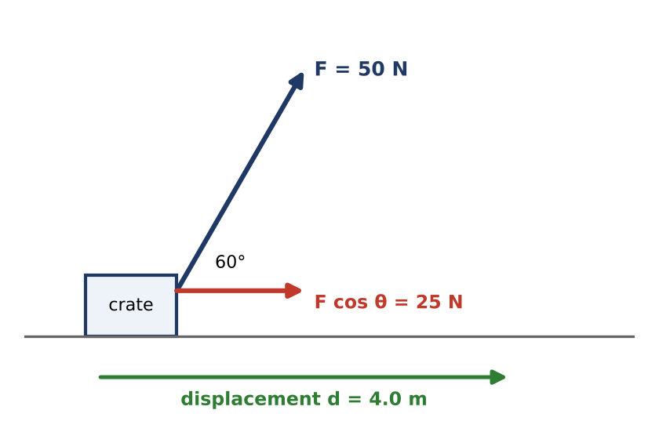
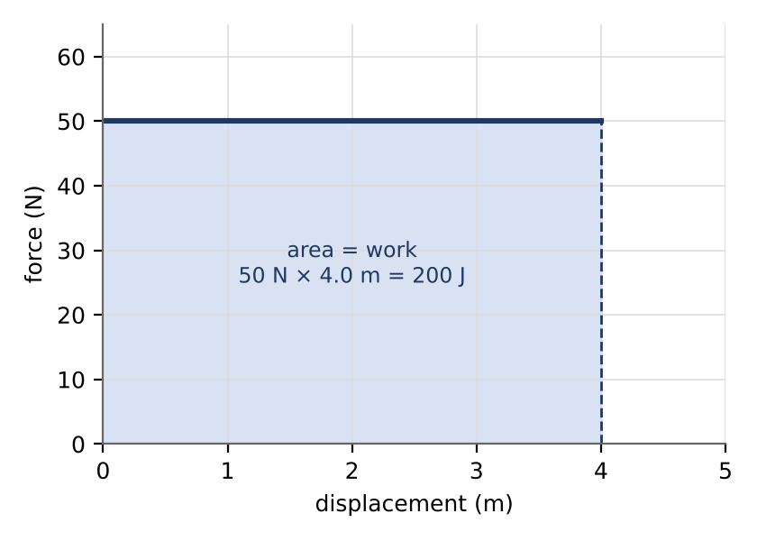
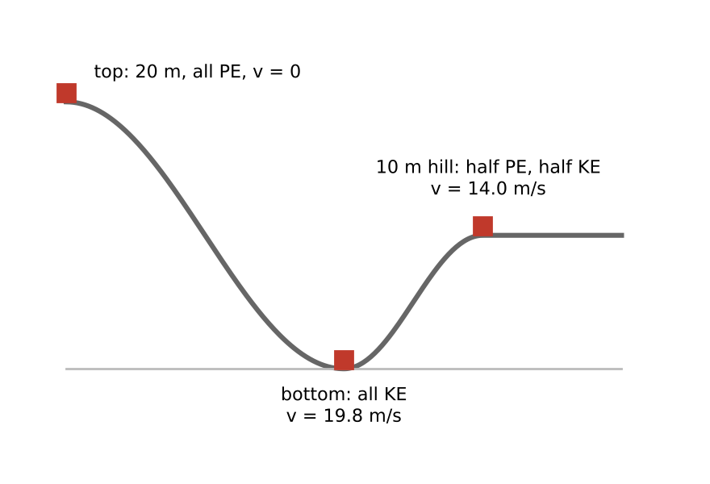
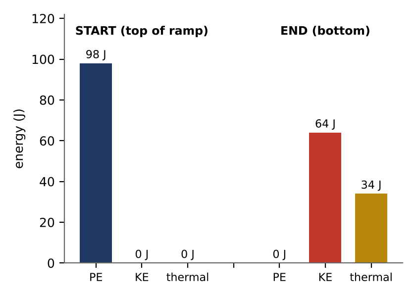

# Cornell Notes: Work and Energy

*Physics | Semester 1, Unit 5 | Work, kinetic and potential energy, conservation of energy, power*

Printable version: [cornell-notes.docx](cornell-notes.docx)

**Essential question:** Where does the energy go when a roller coaster slows down?

**Learning targets**

- I can calculate the work done by a force and say when the work is zero.
- I can calculate kinetic energy and gravitational potential energy.
- I can use the work-energy theorem to connect work and a change in speed.
- I can use conservation of energy to find speeds and heights, with and without friction.
- I can calculate power.

## 1. Work

| Cues / Questions | Notes |
|---|---|
| **What is work and how is it calculated?** | **Work** is energy transferred by a force acting through a distance: **W = Fd cos θ**, where θ is the angle between the force and the displacement. Unit: the **joule**. 1 J = 1 N·m. Worked example: a 50 N push moves a crate 4.0 m in the direction of the push. W = 50 × 4.0 = **200 J**. Worked example: a 50 N pull at 60° above horizontal over 4.0 m. W = 50 × 4.0 × cos 60° = **100 J**. |
| **When is the work done by a force zero?** | When there is **no displacement** (holding a heavy box still). When the force is **perpendicular** to the motion (carrying a box across a level floor: the upward lift does no work). |
| **Can work be negative?** | Yes. A force opposite to the motion, such as friction, does **negative work** and removes energy from the object. On a force-displacement graph, work is the **area** under the line. |

**IXL practice (goal: SmartScore 80+):** Physics H.1 Calculate work; Physics H (New) Calculate work from force-displacement graphs; Grade 8 KK.6 Abbreviate force, energy, and electricity units.

## 2. Kinetic and Potential Energy

| Cues / Questions | Notes |
|---|---|
| **How do I calculate kinetic energy?** | **KE = ½mv²**. It is the energy of motion. Because speed is squared, doubling the speed gives **four times** the kinetic energy. Worked example: a 1000 kg car at 20 m/s. KE = ½(1000)(20)² = **200,000 J**. |
| **How do I calculate gravitational potential energy?** | **PE = mgh**, where h is the height above a chosen zero level. Worked example: a 2.0 kg ball 5.0 m above the floor. PE = 2.0 × 9.8 × 5.0 = **98 J**. |
| **How much energy is stored in a spring?** | **Elastic PE = ½kx²**, where k is the spring constant and x is the stretch or compression. Worked example: k = 200 N/m, compressed 0.10 m. PE = ½(200)(0.10)² = **1.0 J**. |
| **What does the work-energy theorem say?** | **Wnet = ΔKE.** Net work done on an object equals its change in kinetic energy. Worked example: 200 J of net work on a 4.0 kg crate starting at rest. ½(4.0)v² = 200, so v = √100 = **10 m/s**. |

**IXL practice (goal: SmartScore 80+):** Grade 8 J.1 Identify changes in gravitational potential energy; Grade 8 J.2 Use tables and graphs to identify patterns about kinetic energy.

## 3. Conservation of Energy

| Cues / Questions | Notes |
|---|---|
| **What does the law of conservation of energy say?** | Energy is never created or destroyed. It is only **transferred or transformed**. **Mechanical energy** (KE + PE) stays constant when friction and air resistance can be ignored: KEi + PEi = KEf + PEf. |
| **How fast is a dropped object moving after falling a height h?** | mgh = ½mv², so **v = √(2gh)**. The mass cancels. Worked example: a ball dropped from 5.0 m. v = √(2 × 9.8 × 5.0) = √98 = **9.9 m/s**. |
| **How do I find a roller coaster's speed at different heights?** | Worked example: a car starts from rest at the top of a 20 m hill (no friction). At the bottom: v = √(2 × 9.8 × 20) = **19.8 m/s**. On top of a 10 m hill it has dropped 10 m: v = √(2 × 9.8 × 10) = **14.0 m/s**. |
| **Where does the energy go when there is friction?** | It becomes **thermal energy** (the surfaces warm up). Total energy is still conserved. Worked example: a 2.0 kg block starts at rest 5.0 m up a rough ramp (PE = 98 J) and reaches the bottom at 8.0 m/s (KE = ½(2.0)(8.0)² = 64 J). Thermal energy = 98 − 64 = **34 J**. |

**IXL practice (goal: SmartScore 80+):** Physics H.2 Conservation of mechanical energy; Grade 8 J.3 Explore energy transformations: roller coaster ride; Grade 8 J.4 Explore energy transformations: bike ride.

## 4. Power

| Cues / Questions | Notes |
|---|---|
| **What is power and how is it calculated?** | **Power** is how fast work is done: **P = W ÷ t**. Unit: the **watt**. 1 W = 1 J/s. Also P = Fv for a steady force and speed. Worked example: a 60 kg student climbs stairs 3.0 m high in 4.0 s. W = mgh = 60 × 9.8 × 3.0 = 1764 J. P = 1764 ÷ 4.0 = **441 W**. |
| **If two people do the same job at different speeds, what is different?** | The **work is the same**. The faster person has the greater **power**. |
| **Is a kilowatt-hour a unit of power or energy?** | **Energy.** 1 kWh = 1000 W × 3600 s = 3.6 million joules. |

**IXL practice (goal: SmartScore 80+):**  No IXL Physics skill on power. Use the Work and Energy Concept Builders at physicsclassroom.com.

## 5. Labs and Engineering

| Cues / Questions | Notes |
|---|---|
| **In a stair-climb power lab, what do I measure?** | Your mass (or weight), the vertical height of the stairs, and your time. Then P = mgh ÷ t. Only the **vertical** height counts, because gravity acts vertically. |
| **In a ramp or pendulum energy lab, what are we comparing?** | The potential energy lost (mgh) with the kinetic energy gained (½mv²). Independent variable: **release height**. Dependent variable: **speed at the bottom**. Any shortfall is energy transferred to thermal energy by friction. |

**IXL practice (goal: SmartScore 80+):** Physics A.2 Identify independent and dependent variables.

## Memory tricks

- **Work needs a force and a distance in the same direction.** Use it: Any "is work done?" question: check for motion, then check the angle.
- **Double the speed, four times the kinetic energy.** Use it: Comparing stopping distances or crash energy at different speeds.
- **Energy at the start = energy at the end.** Use it: Every conservation problem: list KE and PE at both points before solving.
- **Energy bar charts.** Use it: Draw bars for KE, PE and thermal energy at the start and end; the totals must match.
- **Power is work per second.** Use it: Whenever the question includes a time.

## Summary

Work is how forces move energy into or out of an object. Energy of motion is kinetic; energy of position is potential. In a system without friction the two trade back and forth while their total stays fixed, which lets us find speeds from heights without knowing the path. With friction, some mechanical energy becomes thermal energy, but the total is still conserved. Power is the rate at which the work is done.

## Visual memory aids

Only the component of the force along the displacement does work.  
**Rule:** W = Fd cos θ = 50 × 4.0 × cos 60° = 100 J

Force-displacement graph: the shaded area is the work done.  
**Rule:** W = area = 50 N × 4.0 m = 200 J

A frictionless roller coaster: potential energy becomes kinetic energy on the way down and back again on the way up.  
**Rule:** KE + PE = constant; v = √(2g × drop)

Energy bar chart for a block sliding down a rough ramp: the totals at the start and end are equal.  
**Rule:** 98 J = 64 J + 34 J (thermal)

## Study method

1. Cover the Notes column and answer each cue question aloud.
2. Uncover, check, and mark every cue you missed.
3. Redraw each Visual Memory Aid from memory.
4. Repeat the next day and again a few days later.
5. Finish the IXL plan to SmartScore 80+ and take the unit quiz before the test.
