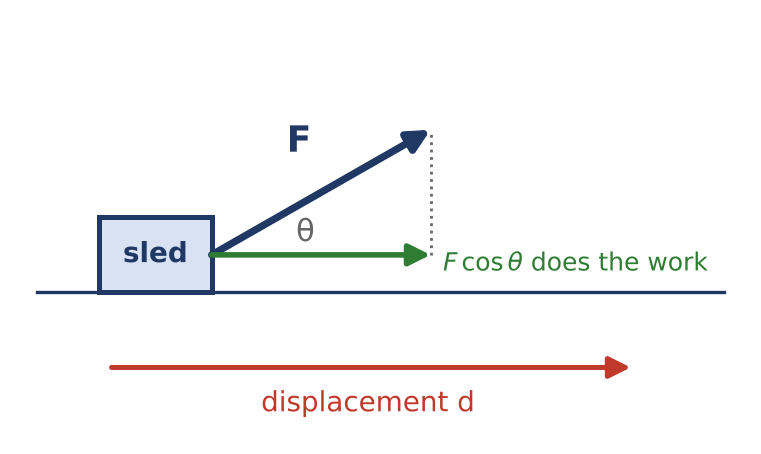
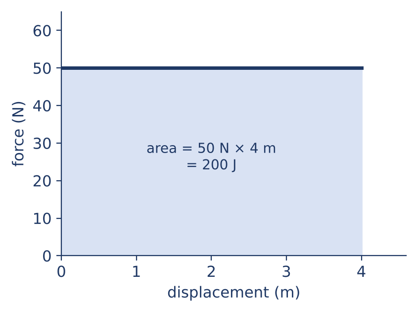
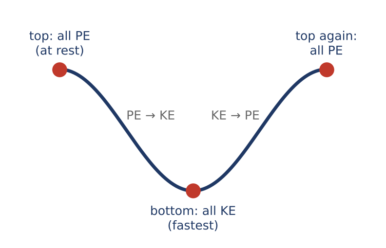
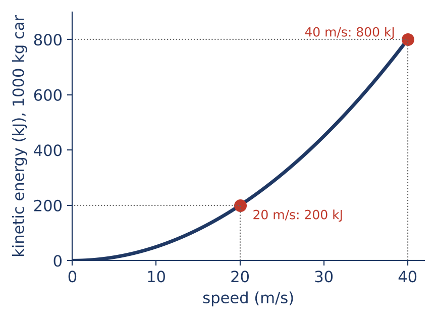

# Cornell Notes: Work and Energy

*Physics | Semester 1, Unit 5 | Work, kinetic and potential energy, conservation of energy, power*

Name: ____________________  Period: ______  Date: __________

**Learning targets**

- I can calculate work and tell when a force does no work.
- I can calculate kinetic energy and gravitational potential energy.
- I can use conservation of energy to predict speeds and heights.
- I can account for the energy that friction turns into thermal energy.
- I can calculate power.
- I can design a device that converts energy from one form to another.

**Essential question:** Where does energy go when an object speeds up, slows down, rises, or falls?

How to use these notes: cover the Notes column, answer each cue question aloud, then check.

## 1. Work

| Cues / Questions | Notes |
|---|---|
| **What is work, and what are its units?** | • **Work** is done when a force moves an object: **W = Fd cos θ**, where θ is the angle between the force and the displacement. • Units: **joule (J)**. 1 J = 1 N·m. • Worked example: a 50 N push moves a box 4 m in the direction of the push. W = 50 × 4 = **200 J**. |
| **When does a force do no work?** | • When there is **no displacement** (pushing on a wall that does not move). • When the force is **perpendicular** to the motion (the upward force on a book you carry across a room at constant velocity). • Feeling tired is not the same as doing work on the object. |
| **What does negative work mean?** | • The force acts **opposite** to the motion and takes energy away from the object. Friction and braking do negative work. • On a force-displacement graph, the **area under the line is the work**. |

**IXL practice (goal: SmartScore 80+):** **Physics H.1** Calculate work; **Physics H (new, no number yet)** Calculate work from force-displacement graphs

## 2. Kinetic and Potential Energy

| Cues / Questions | Notes |
|---|---|
| **How do you calculate kinetic energy?** | • **Kinetic energy** is energy of motion: **KE = ½mv²**. • Worked example: a 1000 kg car moving at 20 m/s has KE = ½(1000)(20²) = **200,000 J**. • Speed is squared: **double the speed, four times the kinetic energy**. |
| **How do you calculate gravitational potential energy?** | • **Gravitational potential energy** is stored energy of position: **PE = mgh**. • Worked example: a 2 kg book on a shelf 1.5 m above the floor has PE = 2 × 9.8 × 1.5 = **29.4 J**. • Height is measured from a **reference level** you choose (usually the lowest point). • A stretched or squeezed spring stores elastic potential energy: PE = ½kx². |
| **How is work related to kinetic energy?** | • **Work-energy theorem:** the net work on an object equals its change in kinetic energy: **Wnet = ΔKE**. • Worked example: the 1000 kg car at 20 m/s brakes with a friction force of 8000 N. F × d = 200,000 J, so d = 200,000 ÷ 8000 = **25 m**. • At 40 m/s the kinetic energy is 800,000 J and the stopping distance is **100 m**: double the speed, four times the distance. |

**IXL practice (goal: SmartScore 80+):** **Grade 8 J.1** Identify changes in gravitational potential energy; **Grade 8 J.2** Use tables and graphs to identify patterns about kinetic energy

## 3. Conservation of Energy

| Cues / Questions | Notes |
|---|---|
| **What does the law of conservation of energy say?** | • Energy cannot be created or destroyed. It can only be **transformed** from one form to another or **transferred** between objects. • The total energy of a closed system stays the same. |
| **When is mechanical energy conserved?** | • **Mechanical energy** = KE + PE. It stays constant when there is **no friction or air resistance**. • Then: **KEi + PEi = KEf + PEf**. • Worked example: a roller coaster car starts from rest 20 m above the bottom. mgh = ½mv², so v = √(2gh) = √(2 × 9.8 × 20) = **19.8 m/s**. The mass cancels. • A pendulum has maximum PE at the ends of its swing and maximum KE at the bottom. |
| **Where does the energy go when friction acts?** | • Friction transforms mechanical energy into **thermal energy**. Total energy is still conserved. • Worked example: a 50 kg sledder starts from rest on a 10 m high hill and reaches the bottom at 12 m/s. PE at top = 50 × 9.8 × 10 = 4900 J. KE at bottom = ½(50)(12²) = 3600 J. **1300 J** became thermal energy. |

**IXL practice (goal: SmartScore 80+):** **Physics H.2** Conservation of mechanical energy; **Grade 8 J.3** Explore energy transformations: roller coaster ride; **Grade 8 J.4** Explore energy transformations: bike ride

## 4. Power

| Cues / Questions | Notes |
|---|---|
| **What is power, and what are its units?** | • **Power** is the rate of doing work: **P = W / t**. Units: **watt (W)**. 1 W = 1 J/s. • Worked example: a 60 kg student climbs stairs 3 m high in 4 s. W = 60 × 9.8 × 3 = 1764 J. P = 1764 ÷ 4 = **441 W**. |
| **If two people do the same work, who is more powerful?** | • The one who does it in **less time**. Same work, half the time, twice the power. • A kilowatt-hour on an electric bill is a unit of **energy** (power × time), not power. |

**Practice:** No IXL Physics skill covers power. Use the Physics Classroom Work and Energy Concept Builders.

## 5. Labs and Engineering Design

| Cues / Questions | Notes |
|---|---|
| **How do you test conservation of energy in the lab?** | • **Cart on a ramp or pendulum lab:** measure the release height h and the speed at the bottom (photogate or motion sensor). • Compare **mgh** at the top with **½mv²** at the bottom. The difference is the energy friction turned into thermal energy. • **Independent variable:** release height. **Dependent variable:** speed at the bottom. |
| **How do you measure your own power?** | • **Stair-climb lab:** measure your mass, the vertical height of the stairs, and your climb time. • **P = mgh / t.** Use the vertical height, not the length of the staircase. |
| **How do you design a device that converts energy?** | • **Energy conversion challenge** (HS-PS3-3): for example a rubber-band or mousetrap car (elastic PE to KE) or a small wind turbine (KE to electrical energy). • State criteria and constraints, build, measure the output, and refine. Track where energy is wasted as thermal energy. |

**IXL practice (goal: SmartScore 80+):** **Physics A.2** Identify independent and dependent variables; **Grade 8 KK.6** Abbreviate force, energy, and electricity units

## Memory tricks

- **Work = force × distance (in the same direction).** Any work calculation. Use only the part of the force along the motion.
- **No distance, no work.** Holding, pushing a wall, or carrying at constant height.
- **KE = ½mv². Speed counts twice.** Comparing energies or stopping distances at different speeds.
- **Energy is never lost, only transformed.** Any 'where did the energy go' question. Look for thermal energy.
- **Power is how fast work is done.** Comparing two machines or people doing the same job.

## Summary

Work is the transfer of energy by a force acting through a distance. Doing work on an object changes its kinetic energy, the energy of motion, or its potential energy, the energy of position. Energy is never created or destroyed. Without friction, kinetic plus potential energy stays constant, which lets us predict the speed of a roller coaster from its height alone. With friction, some mechanical energy becomes thermal energy, but the total is still conserved. Power measures how quickly work is done.

## Visual memory aids

Only the part of a force that points along the displacement does work. **W = Fd cos θ**

On a force-displacement graph, the shaded area is the work done. **area = W**

On a frictionless track, potential energy changes to kinetic energy and back. The total stays the same at every point. **KE + PE = constant**

Kinetic energy grows with the square of speed. Doubling the speed gives four times the energy. **KE = ½mv²**

## Study method

1. Cover the Notes column and answer each cue aloud.
2. Check your answer and mark the ones you missed.
3. Redraw each visual memory aid from memory.
4. Repeat the next day and again a few days later. Recall spread over several days builds memory that rereading does not.
5. Finish the IXL plan to SmartScore 80+ before the test.
