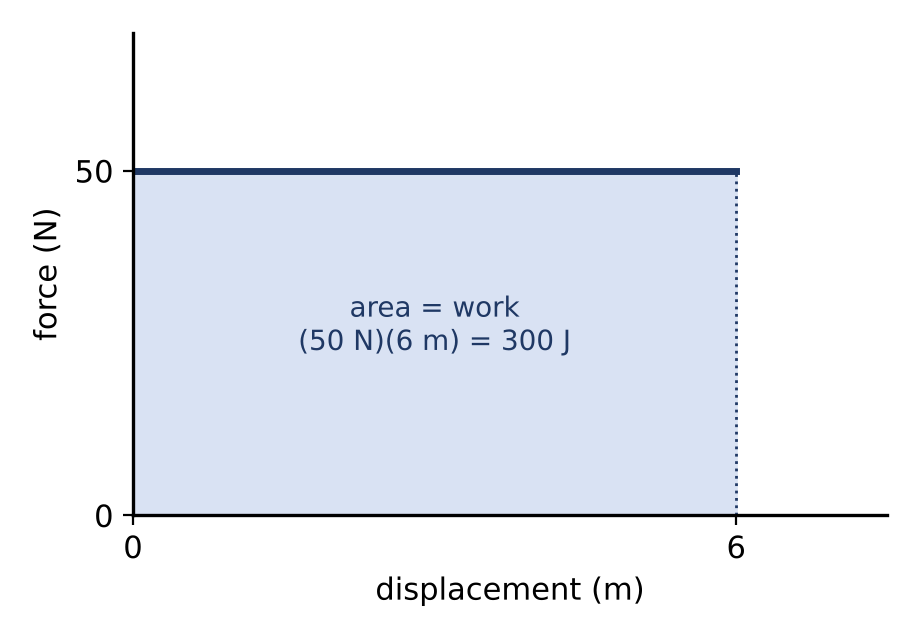
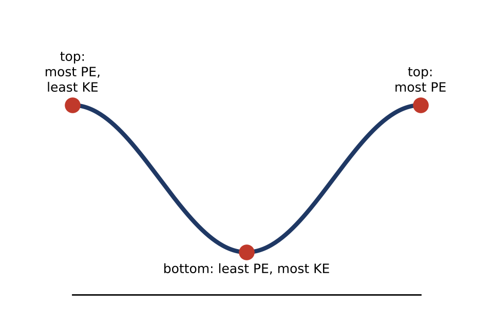
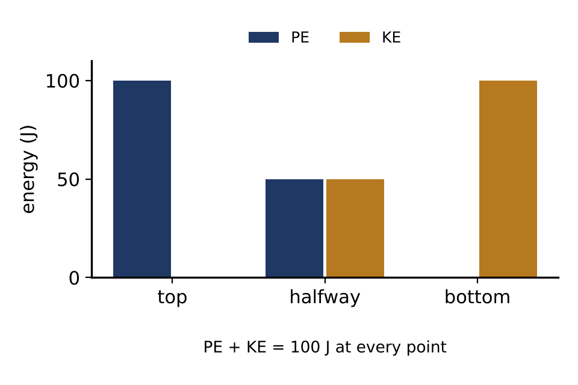
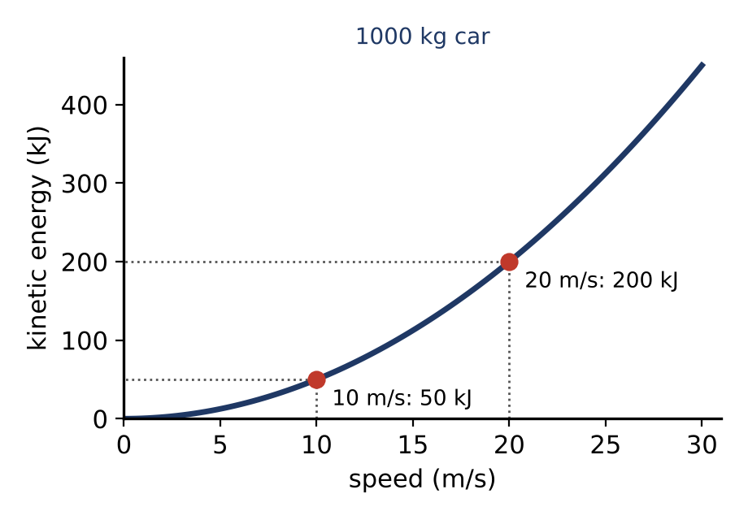

# Cornell Notes: Work & Energy

*Physics (Grade 11) | Semester 1, Unit 5 | Work, kinetic and potential energy, conservation, power*

Name: ________________  Period: ______  Date: __________

A print-ready Word version with the same content is in [cornell-notes.docx](cornell-notes.docx).

**Learning targets**

- [ ] I can calculate the work done by a force, including when it is zero or negative.
- [ ] I can calculate kinetic energy and use the work-energy theorem.
- [ ] I can calculate gravitational and elastic potential energy.
- [ ] I can use conservation of energy to solve problems with and without friction.
- [ ] I can calculate power.
- [ ] I can model energy changes with bar charts and a spreadsheet.

**Essential question:** How is energy transferred and transformed, and what does it mean to say energy is conserved?

> **How to use these notes:** the left column is your self-test. Cover the right column, answer each cue question aloud, then check.

## 1. Work

| Cues / Questions | Notes |
|---|---|
| **What is work, and how is it calculated?** | • **Work** is energy transferred when a force moves an object: **W = Fd cos θ**, where θ is the angle between the force and the displacement. Units: **joule**, 1 J = 1 N·m. • Worked example: a 50 N pull at 60° above horizontal moves a sled 10 m. W = (50)(10) cos 60° = **250 J**. • Only the part of the force **along the motion** does work. |
| **When is the work done by a force zero?** | • When the object **does not move** (holding a box still), or when the force is **perpendicular** to the motion (carrying a box horizontally at constant velocity; the normal force on a sliding box). |
| **When is work negative?** | • When the force points **opposite** to the motion. Friction and braking forces do negative work and take kinetic energy away. |
| **How do you find work from a force-displacement graph?** | • Work = the **area under the graph**. |

**IXL practice (goal: SmartScore 80+):** **Physics H.1** Calculate work · **Physics H (New!)** Calculate work from force-displacement graphs

## 2. Kinetic Energy and the Work-Energy Theorem

| Cues / Questions | Notes |
|---|---|
| **What is kinetic energy and how is it calculated?** | • **Kinetic energy** is energy of motion: **KE = ½mv²**. Units: joules. • Worked example: a 1000 kg car at 20 m/s has KE = ½(1000)(20)² = **200,000 J**. |
| **What happens to kinetic energy when speed doubles?** | • It becomes **four times** as large, because KE depends on v². Doubling the mass only doubles it. |
| **What does the work-energy theorem say?** | • **W_net = ΔKE.** The net work done on an object equals its change in kinetic energy. • Worked example: a 1200 kg car at 25 m/s brakes with a 7500 N friction force. KE = ½(1200)(25)² = 375,000 J. Friction must do −375,000 J of work, so d = 375,000/7500 = **50 m**. • At twice the speed the car has four times the KE, so it needs **200 m**. |

**IXL practice (goal: SmartScore 80+):** **Grade 8 J.2** Use tables and graphs to identify patterns about kinetic energy

## 3. Potential Energy

| Cues / Questions | Notes |
|---|---|
| **What is gravitational potential energy and how is it calculated?** | • Energy stored because of height: **PE = mgh**, where h is measured from a **reference level** you choose. • Worked example: a 2.0 kg book on a 1.5 m shelf has PE = (2.0)(9.8)(1.5) = **29.4 J** relative to the floor. |
| **Does the path taken to a height change the potential energy?** | • **No.** Only the vertical height matters. Stairs, a ramp, or a straight lift to the same height give the same PE. |
| **What is elastic potential energy?** | • Energy stored in a stretched or compressed spring: **PE = ½kx²**, where k is the spring constant (N/m) and x is the stretch or compression. • Worked example: a spring with k = 200 N/m compressed 0.10 m stores ½(200)(0.10)² = **1.0 J**. |

**IXL practice (goal: SmartScore 80+):** **Grade 8 J.1** Identify changes in gravitational potential energy

## 4. Conservation of Energy

| Cues / Questions | Notes |
|---|---|
| **What does the law of conservation of energy say?** | • Energy cannot be created or destroyed, only **transferred** between objects or **transformed** between forms. The total stays the same. • **Mechanical energy** = KE + PE. With no friction or air resistance: **KE₁ + PE₁ = KE₂ + PE₂**. |
| **How fast is a roller coaster going at the bottom of a 20 m frictionless hill, starting from rest?** | • Top: all PE = mgh. Bottom: all KE = ½mv². • mgh = ½mv², so v = √(2gh) = √(2 × 9.8 × 20) = **19.8 m/s**. • The **mass cancels**: any car reaches the same speed. |
| **Where does the energy go when there is friction?** | • Friction turns mechanical energy into **thermal energy** (heat). Mechanical energy drops, but total energy is still conserved. • Worked example: a 500 kg coaster car starts from rest at 20 m and reaches the bottom at 18 m/s. Start: (500)(9.8)(20) = 98,000 J. End: ½(500)(18)² = 81,000 J. **17,000 J** became thermal energy. |
| **Where in a pendulum swing are KE and PE greatest?** | • **PE is greatest at the highest points** (where the bob stops for an instant). **KE is greatest at the lowest point** (where it moves fastest). |

**IXL practice (goal: SmartScore 80+):** **Physics H.2** Conservation of mechanical energy · **Grade 8 J.3** Explore energy transformations: roller coaster ride · **Grade 8 J.4** Explore energy transformations: bike ride

## 5. Power

| Cues / Questions | Notes |
|---|---|
| **What is power and how is it calculated?** | • **Power** is the rate of doing work or transferring energy: **P = W/t**. Units: **watt**, 1 W = 1 J/s. For a constant force and speed, P = Fv. |
| **A 60 kg student climbs 3.0 m of stairs in 4.0 s. What is the student's power?** | • Work against gravity: W = mgh = (60)(9.8)(3.0) = 1764 J. • P = W/t = 1764/4.0 = **441 W**. |
| **If you lift the same box the same height faster, what changes?** | • The **work is the same**. The **power is greater**, because the same work is done in less time. |

**IXL practice (goal: SmartScore 80+):** No IXL Physics skill covers power. Use the matching Concept Builders at physicsclassroom.com.

## 6. Labs, Models, and Engineering Design

| Cues / Questions | Notes |
|---|---|
| **How do you test conservation of energy with a cart on a ramp?** | • Release a cart from a measured height h and measure its speed at the bottom. Compare **mgh** at the top with **½mv²** at the bottom. • Independent variable: release height. Dependent variable: speed at the bottom. The small difference is energy transferred by friction. |
| **What is an energy bar chart?** | • A bar graph of each kind of energy (KE, gravitational PE, elastic PE, thermal) at two moments. The **total height of the bars is the same** before and after if the system is closed. |
| **How can a spreadsheet model energy?** | • Make columns for height, PE = mgh, KE = total − PE, and speed = √(2KE/m). Changing the starting height updates every row. This is a simple **computational model** (HS-PS3-1). |
| **What is the goal of the energy conversion device project?** | • Design, build, and refine a device (for example a rubber-band or mousetrap car) that converts one form of energy into another within given constraints, then measure how much of the stored energy became useful motion. |

**IXL practice (goal: SmartScore 80+):** **Physics A.2** Identify independent and dependent variables

## Memory Tricks

- **Work = force × distance in the same direction.** A force perpendicular to the motion does no work. Use to spot zero-work situations.
- **KE is motion, PE is position.** Kinetic energy needs speed; potential energy needs height or stretch.
- **Speed is squared.** Double the speed, four times the kinetic energy and four times the braking distance.
- **Energy bar charts (LOL diagrams).** Bars before, system circle in the middle, bars after. Total bar height stays the same in a closed system.
- **Power is how fast.** Same work in less time means more power: P = W/t.

## Summary

Work is how forces transfer energy: a force acting along a displacement does work W = Fd cos θ, and the net work on an object equals its change in kinetic energy. Energy can be stored as gravitational potential energy (mgh) or elastic potential energy (½kx²) and released as kinetic energy (½mv²). The total energy of a closed system never changes. Without friction, kinetic plus potential energy stays constant, which lets us find speeds from heights without knowing the path. With friction, some mechanical energy becomes thermal energy, but the total is still conserved. Power measures how quickly the energy is transferred.

## Visual Memory Aids

Force-displacement graph: the shaded area under the line is the work done. **W = Fd = area**

Roller coaster: potential energy is greatest at the top, kinetic energy is greatest at the bottom, and the total stays the same. **KE + PE = constant (no friction)**

Energy bar charts for an object falling without friction: PE shrinks as KE grows, and the total bar height is unchanged. **KE₁ + PE₁ = KE₂ + PE₂**

Kinetic energy vs speed is a curve, not a line: doubling the speed gives four times the kinetic energy. **KE = ½mv²**

## Study Method

1. Cover the Notes column and answer each cue question aloud.
2. Uncover, check, and mark every cue you missed.
3. Redraw each Visual Memory Aid from memory, with labels and its equation.
4. Repeat the next day and again a few days later. Recall spread over days builds memory that rereading does not.
5. Finish the IXL Practice Plan to SmartScore 80+ before the test.

## IXL Practice Plan

Reach SmartScore 80+ on each skill before the test.

| Done | # | Skill | Skill name | Notes section |
|---|---|---|---|---|
| ☐ | 1 | Physics A.2 | Identify independent and dependent variables | 6 |
| ☐ | 2 | Grade 8 J.1 | Identify changes in gravitational potential energy | 3 |
| ☐ | 3 | Grade 8 J.2 | Use tables and graphs to identify patterns about kinetic energy | 2 |
| ☐ | 4 | Grade 8 J.3 | Explore energy transformations: roller coaster ride | 4 |
| ☐ | 5 | Grade 8 J.4 | Explore energy transformations: bike ride | 4 |
| ☐ | 6 | Physics H.1 | Calculate work | 1 |
| ☐ | 7 | Physics H.2 | Conservation of mechanical energy | 4 |
| ☐ | 8 | Physics H (New!) | Calculate work from force-displacement graphs | 1 |

No full IXL match (use physicsclassroom.com Concept Builders): Power.

*Self-test tip: cover the Notes column, answer each cue aloud, then redo every worked example on blank paper without looking.*
