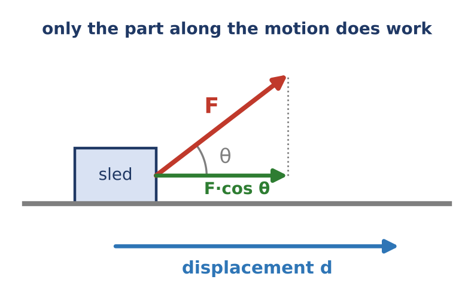
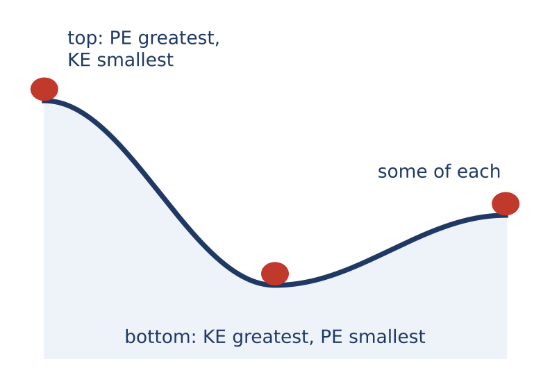
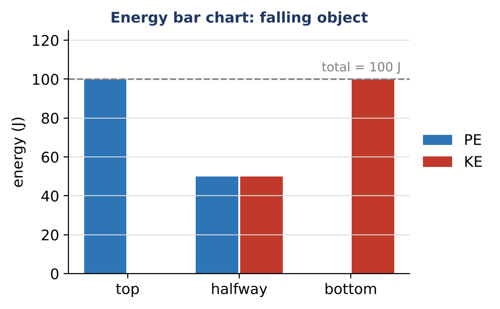

# Cornell Notes: Work & Energy

*Physics | Work, Energy, and Power | work, kinetic and potential energy, conservation of energy, power*

Name: ________________  Period: ______  Date: __________

**Learning targets**

- I can calculate work and decide when a force does zero or negative work.
- I can calculate kinetic energy and gravitational potential energy.
- I can use the work-energy theorem to connect net work and change in kinetic energy.
- I can use conservation of energy to find speed or height, with and without friction.
- I can calculate power and tell it apart from work.

**Essential question:** Where does energy come from, where does it go, and how can we keep track of it?

**How to use these notes:** cover the Notes column, answer each cue question aloud, then uncover and check. Mark the ones you miss and try them again tomorrow.

## 1. Work

| Cues / Questions | Notes |
|---|---|
| **What is work in physics, and how do you calculate it?** | • **Work** is done when a force moves an object through a displacement. • **W = F·d·cos θ**, where θ is the angle between the force and the displacement. Units: **joules** (1 J = 1 N·m). • Worked example: a 50 N push moves a box 6 m in the direction of the push. W = 50 × 6 = **300 J**. |
| **When does a force do zero work?** | • When there is **no displacement**: pushing on a wall that does not move. • When the force is **perpendicular** to the motion: carrying a box horizontally (your upward force does no work), or the normal force on a sliding object. • Feeling tired is not the test. Work in physics needs force along a displacement. |
| **What does negative work mean?** | • The force acts **opposite** to the displacement and **removes** energy from the object. • Friction and braking forces do negative work. |
| **How much work does a 100 N pull at 60° do over 10 m?** | • Only the part of the force along the motion counts: F·cos θ = 100 × cos 60° = 50 N. • W = 50 × 10 = **500 J**. • On a force-displacement graph, work is the **area** under the line. |

> **IXL practice (goal: SmartScore 80+):** **Physics H.1** Calculate work · **Physics H (New)** Calculate work from force-displacement graphs

## 2. Kinetic and Potential Energy

| Cues / Questions | Notes |
|---|---|
| **What is kinetic energy, and what happens to it when speed doubles?** | • **Kinetic energy** is energy of motion: **KE = ½·m·v²**. • Because speed is squared, doubling the speed gives **four times** the kinetic energy. • Worked example: a 2 kg object at 3 m/s has KE = ½ × 2 × 3² = **9 J**. At 6 m/s it has 36 J. |
| **What is gravitational potential energy?** | • Energy stored because of height: **PE = m·g·h**. • h is measured from a zero level that you choose (usually the lowest point in the problem). • Worked example: a 2 kg object 5 m above the floor has PE = 2 × 9.8 × 5 = **98 J**. |
| **What does the work-energy theorem say?** | • **W_net = ΔKE.** The net work done on an object equals its change in kinetic energy. • Worked example: a 1000 kg car at 20 m/s has KE = ½ × 1000 × 20² = 200,000 J. A friction force of 8000 N stops it in d = 200,000 ÷ 8000 = **25 m**. • At 40 m/s the kinetic energy is four times as large, so the stopping distance is **100 m**. |

> **IXL practice (goal: SmartScore 80+):** **Grade 8 J.1** Identify changes in gravitational potential energy · **Grade 8 J.2** Use tables and graphs to identify patterns about kinetic energy

## 3. Conservation of Energy

| Cues / Questions | Notes |
|---|---|
| **What does the law of conservation of energy say?** | • Energy cannot be created or destroyed. It can only be **transferred** between objects or **transformed** from one form to another. • With no friction or air resistance, **mechanical energy** is conserved: KE_i + PE_i = KE_f + PE_f. |
| **How fast is a roller coaster moving at the bottom of a 20 m hill if it starts from rest?** | • Top: all potential energy. Bottom: all kinetic energy. • m·g·h = ½·m·v². The mass cancels: **v = √(2·g·h)**. • v = √(2 × 9.8 × 20) = √392 = **19.8 m/s**. • The answer does not depend on the mass or on the shape of the track. |
| **Do two frictionless ramps of the same height but different steepness give the same final speed?** | • **Yes.** The same height means the same potential energy lost, so the same kinetic energy gained. • The steeper ramp gets there in less time, but the speed at the bottom is the same. |
| **Where does the energy go when there is friction?** | • Friction turns mechanical energy into **thermal energy** (the surfaces warm up). Total energy is still conserved. • Worked example: a 2 kg block starts at rest 5 m up a ramp and reaches the bottom at 8 m/s. PE at top = 98 J. KE at bottom = ½ × 2 × 8² = 64 J. Thermal energy = 98 − 64 = **34 J**. |

> **IXL practice (goal: SmartScore 80+):** **Physics H.2** Conservation of mechanical energy · **Grade 8 J.3** Explore energy transformations: roller coaster ride · **Grade 8 J.4** Explore energy transformations: bike ride

## 4. Power

| Cues / Questions | Notes |
|---|---|
| **What is power, and how is it different from work?** | • **Power** is how fast work is done: **P = W ÷ t**. Units: **watts** (1 W = 1 J/s). • Work is the amount of energy transferred. Power is the rate of transfer. • At constant speed, P = F·v. |
| **Two students of equal mass climb the same stairs, one in half the time. Who does more work, and who has more power?** | • They do the **same work** (same weight lifted through the same height). • The faster student has **twice the power**. • Worked example: a 60 kg student climbs 3 m in 4 s. W = 60 × 9.8 × 3 = 1764 J. P = 1764 ÷ 4 = **441 W**. |

> **IXL practice:** The live IXL Physics list has no power skill. Use the physicsclassroom.com lesson on power in the Work, Energy, and Power section.

## 5. Labs and Measurement

| Cues / Questions | Notes |
|---|---|
| **In a pendulum or ramp energy lab, what do you compare?** | • Measure the release height h and the speed v at the lowest point (photogate or video). • Compare PE at the top, m·g·h, with KE at the bottom, ½·m·v². • They should be close. The difference is energy transferred to thermal energy by friction and air resistance. |
| **How do you measure your own power on a staircase?** | • Measure the vertical height of the stairs (not the slanted length), your mass, and your time. • P = m·g·h ÷ t. • Independent variable: climbing time. Dependent variable: power. Controlled: height and mass. |
| **How can an energy bar chart model a system?** | • Draw bars for KE, PE, and thermal energy at each moment (top, middle, bottom). • The total height of the bars stays the same at every moment. This is the model asked for in HS-PS3-2. • A spreadsheet that calculates KE and PE at each height is the computational model asked for in HS-PS3-1. |

> **IXL practice (goal: SmartScore 80+):** **Physics A.2** Identify independent and dependent variables · **Physics B.4** Calculations with significant figures · **Grade 8 KK.6** Abbreviate force, energy, and electricity units

## Memory tricks

- **Work needs force along a displacement.** No motion, or force at 90° to the motion, means zero work. *Use it for:* Deciding whether work is done.
- **Speed is squared.** Double the speed, four times the kinetic energy and four times the stopping distance. *Use it for:* Any "what if the speed doubles" question.
- **Energy before = energy after.** Write the total energy at the start and at the end and set them equal; add a thermal term if there is friction. *Use it for:* Every conservation problem.
- **Height sets speed.** With no friction, final speed depends only on the height dropped: v = √(2gh). *Use it for:* Ramps, pendulums, roller coasters.
- **Work is how much, power is how fast.** Same work in less time is more power. *Use it for:* Telling work and power apart.

## Summary

Work is the transfer of energy by a force acting along a displacement, W = F·d·cos θ. Doing net work on an object changes its kinetic energy, ½·m·v². Lifting an object stores gravitational potential energy, m·g·h. Energy is never created or destroyed, so the total before equals the total after: without friction, kinetic and potential energy trade back and forth while their sum stays constant, and with friction the missing mechanical energy shows up as thermal energy. Because energy depends on height and on speed squared, it often answers questions about speed without needing time or forces. Power is the rate at which work is done.

## Visual memory aids

A force at an angle to the displacement: only the component along the motion does work. **Rule:** W = F·d·cos θ

A cart on a frictionless track: potential energy is greatest at the top and kinetic energy is greatest at the bottom. **Rule:** m·g·h + ½·m·v² = constant

Energy bar charts at the top, halfway, and bottom of a fall: the bars change but the total stays the same. **Rule:** KE + PE = total energy

Force-displacement graph: the shaded area under the line is the work done. **Rule:** work = area under F vs. d

## Study method

1. Cover the Notes column and answer each cue aloud.
2. Check, and mark the ones you missed.
3. Redraw each visual memory aid from memory.
4. Repeat the next day and again a few days later. Recall spread over days builds memory that rereading does not.
5. Finish the IXL plan to SmartScore 80+ before the test.

Printable version: [cornell-notes-energy.docx](cornell-notes-energy.docx) · [Unit guide](README.md)
